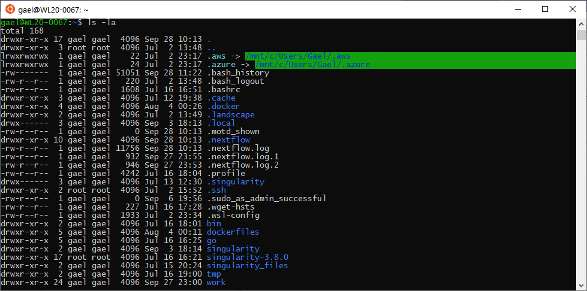
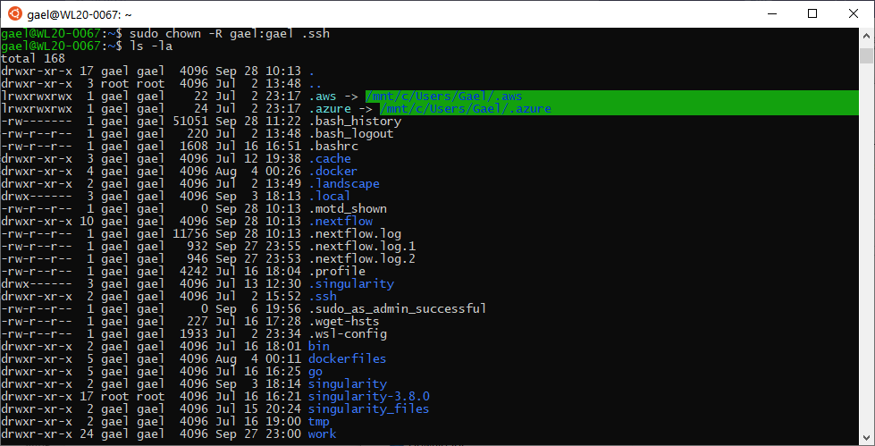
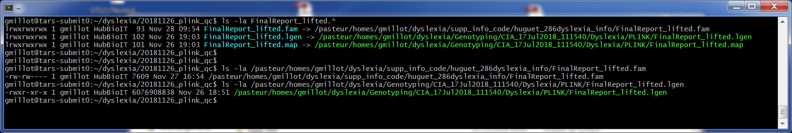
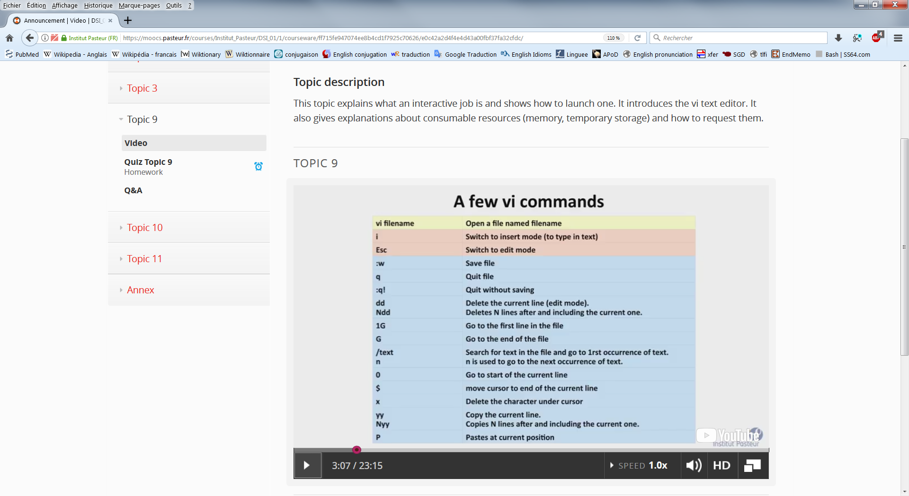
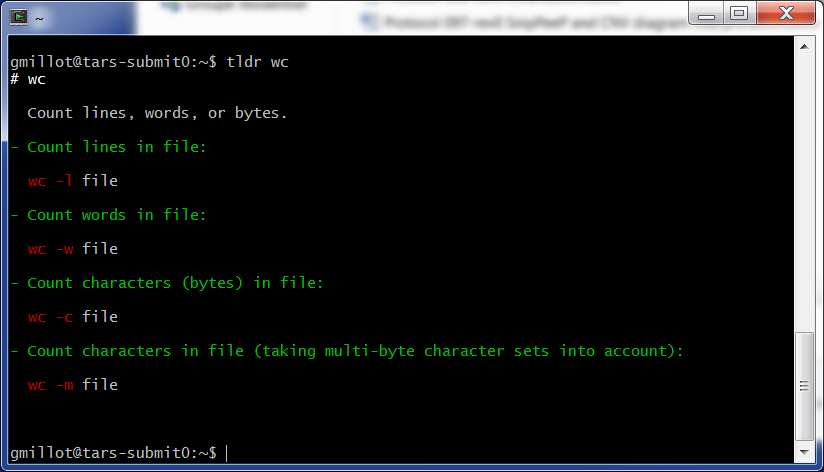
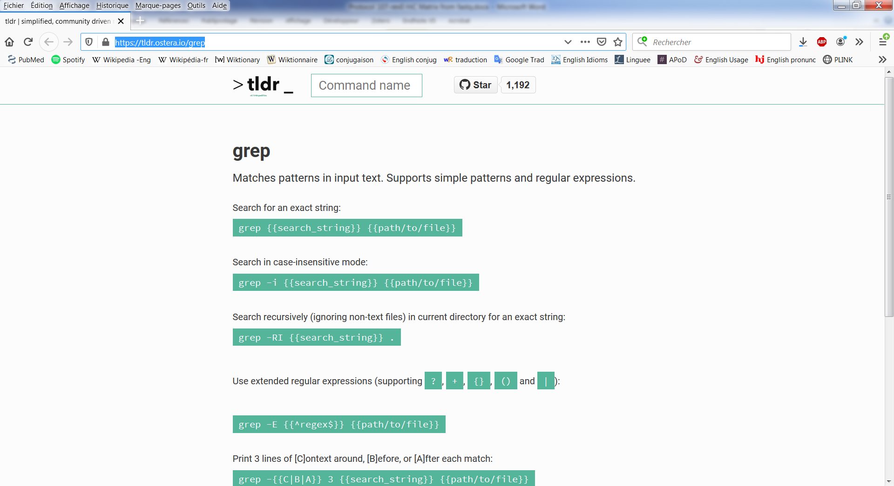

**h**

# Definition

Bash (Bourne Again SHell) is the free and enhanced version of the Bourne shell distributed with Linux and GNU operating systems. Bash is similar to the original, but has added features such as command-line editing. Created to improve on the earlier Bourne shell (named sh)

extended file match globbing operator from Bash 4

# To know the main bash shell commands

## Cheat sheet

<https://devhints.io/bash>

C:\\Users\\gael\\Documents\\Manip\\Protocoles bioinfo\\Supp info\\protocol 044 bash\\2022-11-21_Dreo\_\_UNIX-Shell_Cheatsheet\_\_poster.pdf

## Others

<http://ss64.com/bash/>

<http://www.linfo.org/index.html>

<http://www.linfo.org/command_index.html>

<http://tldp.org/LDP/abs/html/basic.html>

# ssh key

## .ssh verification

If the .ssh folder does not exist, create .ssh:

```
mkdir ~/.ssh # tild means home directory
```

Then, check that the .ssh folder is not root but controled by the owner (i.e., gael).

```
cd # to be in the home
ls -la
```

Here the .ssh is root (written root instead of gael):

{width="94%"}

To change this:

```
cd
sudo chown -R gael:gael .ssh # change the owner of the folder, -R to change also the owner inside the folder
ls -la
```



If the owner is root, the ssh key will not be generated into /`home/Gael/` but into `/root/`. Which cannot be used then after.

## Key already exists

Check if a id_rsa key already exists in .ssh in the home:

```
cd .ssh
ls -la
```

If the id_rsa.pub key exists, copy the key into the remote server

```
scp -r /home/Gael/.ssh/id_rsa.pub gmillot@maestro.pasteur.fr:~/id_rsa.pub
```

From maestro, type:

```
cat ~/id_rsa.pub >> ~/.ssh/authorized_keys # move the public key into a required path "~/.ssh/authorized_keys"
```

Remove `id_rsa.pub` from the maestro home

Then, when using `scp` or `ssh` from a local interface, no more password is required.

## New key

If the key does not exists:

```
ssh-keygen -t rsa # or sudo ...
```

Leave every question blank (just clic ENTER).

A public key has been generated and is available here:

```
/home/Gael/.ssh/id_rsa.pub # C:\cygwin64\home\Gael\.ssh in windows
```

Then do the procedure in section [Key already exists](#key-already-exists). Or see protocol 88 for Gitlab

# Basic notions in bash

To know which version of bash is used:

```
echo "$BASH_VERSION"
```

<http://explainshell.com/>

<https://openclassrooms.com/courses/reprenez-le-controle-a-l-aide-de-linux/afficher-et-manipuler-des-variables>

unix_tutorial.pdf from tutorialspoints.com

<http://www.commentcamarche.net/faq/3585-bash-la-variable-d-environnement-path>

<http://abs.traduc.org/abs-fr/index.html>

# To know permissions in bash shell

<https://en.wikipedia.org/wiki/File_system_permissions>

<http://stackoverflow.com/questions/2933843/why-0-is-true-but-false-is-1-in-the-shell>

# To change permission

Warning: on Windows, the behavior of `chmod` depends on the console used. For instance, using MINGW64, changing the mode of a file will depend on the shebang: no shebang -\> `chmod` does not work; `#!` -\> `chmod` works. With WSL2, no problem detected for `chmod`.

`chmod` change the rights for a file or a directory

Examples:

|  |  |
|----|----|
| `chmod +x file1` | autorize execution only for me |
| `chmod +x dir1/` | autorize execution only for me for all the files inside the directory dir1 |
| `chmod -R +x dir1/` | autorize execution only for me for all the files and subdirectories inside the directory dir1 |
| `chmod u=rwx,g=rx,o=r file1` | The letters u, g, and o stand for "user", "group", and "other". The equals sign ("=") means "set the permissions exactly like this," and the letters "r", "w", and "x" stand for "read", "write", and "execute", respectively. The commas separate the different classes of permissions, and there are no spaces in between them. |
| `chmod -R 700 dir1/` | recover read write exe of dir1 and subdir only for me. |

In case of right loss, try:

`chmod u+rwX dir1/` autorize execution only for me for all the files and subdirectories inside the directory dir1

Numbers can be used for "user", "group", and "other", like this:

0 = no permissions whatsoever; this person cannot read, write, or execute the file

1 = execute only

2 = write only

3 = write and execute (1+2)

4 = read only

5 = read and execute (4+1)

6 = read and write (4+2)

7 = read and write and execute (4+2+1)

Example: 777 means read and write and execute for "user", "group", and "other".

Of note: to move a file using `mv` requires write permission.

See <https://en.wikipedia.org/wiki/Chmod>

# Symbolic link

<https://www.cyberciti.biz/faq/creating-soft-link-or-symbolic-link/>

A symbolic link is a file that point toward another "real" file.

This avoids the duplication of files on a computer.

Two kinds: soft and hard.

> Soft: files that point to the "real" file are abstractions. If the "real" file is removed, the connection is lost.
>
> Hard: the "real" file has two entries in the inode table. Hard links are problematic. If one want to remove a big file that has several entries in the inode table, it will not be erased and it is not easy to find the different entries of a file. Thus avoid hard links.

To create a soft symbolic link:

```
ln -s file1 link1 # -s for soft (beware ln by default is hard), file1 is the source file to point
```

The color of the pointing path depends on the rights of the pointed file. Example:



|        |                                                                              |
|--------|------------------------------------------------------------------------------|
| Red:   | the pointed file does not exists (check the path) or has no execution rigths |
| Green: | pointed file with execution right                                            |
| Grey:  | pointed file with no execution right                                         |
| Cyan:  | point toward a directory                                                     |

T

To remove a symbolic link:

```
unlink file1 # it seems that unlink link1 also works
```

Warning:

1\) Always use symbolic links for files, not for directories. With files, there is no possible way to accidentally delete the target of a symbolic link using rm.

2\) Never use rm -r on large directories if it is or if it contains directory symbolic link because can delete the content of the pointed directory (target). Use `ls -lR <PATH> | grep ^l` to know if there are symbolic links in a folder

Example from <https://stackoverflow.com/questions/62637046/how-to-make-rm-not-delete-symbolic-links>

```
$ mkdir test1
$ touch test1/foo.txt
$ ln -s test1 test2
$ ls -lR
.:
total 4
drwxrwxr-x 2 soren soren 4096 Jun 29 17:02 test1
lrwxrwxrwx 1 soren soren    5 Jun 29 17:02 test2 -> test1

./test1:
total 0
-rw-rw-r-- 1 soren soren 0 Jun 29 17:02 foo.txt
```

These are all safe:

- `rm test2` (deletes the symlink only)

- `rm -r test2` (deletes the symlink only)

- `rm -rf test2` (deletes the symlink only)

- `rm test2/` (`rm: cannot remove 'test2/': Is a directory` -- no action taken)

- `rm -rf *2` (or any other glob matching the symlink -- deletes the symlink only)

These are *not* safe:

- `rm -r test2/` (`rm: cannot remove 'test2/': Not a directory` -- but deletes the contents of the `test1` directory)

- `rm -rf test2/` (deletes the contents of the directory, leaves the symlink, no error)

- `rm -rf test2/*` (deletes the contents of the directory, leaves the symlink, no error)

To copy the target of a symbolic link, and not the link file:

```
cp -L link1
```

<https://stackoverflow.com/questions/27870965/linux-cp-how-to-have-it-follow-links-but-not-stop-if-a-link-target-doesnt-exis>

To replace a symlink file by the hard file:

```
shopt -s globstar
sed -i '' **/* # **/* is a bash globstar pattern meaning "all files and all folders, at all depth, from here"
```

To detect all the symlinks in a folder:

```
find . -xtype l | while read -r symlink ; do
     echo $symlink
done
```

To change all the broken paths of sym files in a folder (gpt5):

```
#!/usr/bin/env bash

# Set the paths
old="/pasteur/appa/scratch/gmillot"
new="/pasteur/helix/projects/project_b/results"


# Find broken symlinks
find . -xtype l | while read -r link ; do
    target=$(readlink "$link")

    # Only adjust if target starts with the old path
    if [[ $target == $old* ]]; then
        newtarget="${target/$old/$new}"

        echo "Updating: $link"
        echo "   from: $target"
        echo "     to: $newtarget"

        # Remove the old symlink and create the updated one
        rm "$link"
        ln -s "$newtarget" "$link"
    fi
done
```

Of, note:

readlink reports what a symlink points to.

ln -sfn safely forces the link to point to the new target.

find ... -type l lists only symlinks; -maxdepth 1 keeps it to the given folder (remove if you want recursion).

The if \[\[ "\$target" == \$old_prefix\* \]\] ensures only links with the old path are updated.

• `find . -xtype l` finds broken symlinks in current dir and subdirs.

• `readlink "$link"` gets the symlink’s target.

# Internal variables in bash

<http://tldp.org/LDP/abs/html/internalvariables.html>

# About the \$ in bash shell

Call the content of a variable, or call an argument of a .sh script inside the code of this script (\$1 for the first argument, etc., \$0 for the name of the .sh script executable, \$@ for all the arguments after \$0)

<http://stackoverflow.com/questions/5163144/what-are-the-special-dollar-sign-shell-variables>

<https://www.gnu.org/software/bash/manual/html_node/Variable-Index.html>

# Standard input and standard output

[Standard input (stdin)]{.underline}

According to Yohan Dufresne, when you write in a shell CLI:

```
python3 main.py < data.txt
```

It means that we want to run the `main.py` python script. Using `< data.txt` indicates that the data.txt file is put in the standard entry of the main.py program. This means that it is not necessary to use an import command in the main.py script. It is directly imported. But we have to use "import sys" to import the standard input of the shell:

````
```{python3}
import sys
for line in sys.stdin:
print(line) #print all the lines of data.txt
```
````

Beware: some commands, like `echo` do not read the stdin. Example:

```
echo "prout" > caca.txt
echo < caca.txt
```

It is equivalent to `echo "test" | echo` and it does not work. Others can:

```
echo "prout" > caca.txt
cat < caca.txt
```

[Standard output (stdout)]{.underline}

See the Bash tricks section

[Symbols of assignations]{.underline}

|  |  |
|----|----|
| `|` | take the standard output of a command and put it in the standard input of another command. |
| `>` | assign the standard output on the left to something on the right. Example: `echo "caca" > file.txt` |
| `<` | assing something on the right to the standard input on the left. Example `print < file.txt` |

# About pattern matching and regular expression

## Global pattern

<http://wiki.bash-hackers.org/syntax/pattern>

<http://mywiki.wooledge.org/BashGuide/Patterns>

regular expression:

<https://www.regular-expressions.info/refcharclass.html>

<https://www.gnu.org/software/sed/manual/html_node/Regular-Expressions.html>

<https://www.tutorialspoint.com/unix/unix-regular-expressions.htm>

[<http://mywiki.wooledge.org/glob>]{.red}

[Beware: grep, awk is using not Pearl POSIX extended regular expressions (ERE)]{.red}

[<https://pubs.opengroup.org/onlinepubs/9699919799.2018edition/basedefs/V1_chap09.html#tag_09_04>]{.red}

See grep and awk below (seek "!")

See lookahead and lookbehind section also.

## Glob pattern in file names or path

Glob pattern in file names or path is not regex, it is called "extended globbing" or "wildcard".

# extended globbing (wildcard)

<https://www.linuxjournal.com/content/bash-extended-globbing>

<https://www.gnu.org/software/make/manual/html_node/Wildcard-Function.html>

<https://docs.oracle.com/javase/tutorial/essential/io/fileOps.html#glob>

An asterisk, \*, matches any number of characters (including none).

Two asterisks, \*\*, works like \* but crosses directory boundaries. This syntax is generally used for matching complete paths.

A question mark, ?, matches exactly one character.

Braces specify a collection of subpatterns. For example:

{sun,moon,smaestro} matches "sun", "moon", or "smaestro".

{temp\*,tmp\*} matches all strings beginning with "temp" or "tmp".

Square brackets convey a set of single characters or, when the hyphen character (-) is used, a range of characters. For example:

\[aeiou\] matches any lowercase vowel.

\[0-9\] matches any digit.

\[A-Z\] matches any uppercase letter.

\[a-z,A-Z\] matches any uppercase or lowercase letter.

Within the square brackets, \*, ?, and \\ match themselves.

All other characters match themselves.

To match \*, ?, or the other special characters, you can escape them by using the backslash character, \\. For example: \\\\ matches a single backslash, and \\? matches the question mark.

Here are some examples of glob syntax:

\*.html – Matches all strings that end in .html

??? – Matches all strings with exactly three letters or digits

\*\[0-9\]\* – Matches all strings containing a numeric value

\*.{htm,html,pdf} – Matches any string ending with .htm, .html or .pdf

a?\*.java – Matches any string beginning with a, followed by at least one letter or digit, and ending with .java

{foo\*,\*\[0-9\]\*} – Matches any string beginning with foo or any string containing a numeric value

Note: If you are typing the glob pattern at the keyboard and it contains one of the special characters, you must put the pattern in quotes ("\*"), use the backslash (\\\*), or use whatever escape mechanism is supported at the command line.

# lookahead and lookbehind (including ?!)

<https://www.regular-expressions.info/lookaround.html>

# Simple and double brackets \[\] and \[\[\]\], brace, parentheses, etc

The differences between \[\] and \[\[\]\] :

<https://www.baeldung.com/linux/bash-single-vs-double-brackets>

The management of wildcard (\*):

<https://unix.stackexchange.com/questions/597850/why-does-using-double-brackets-to-check-if-wildcard-matched-files-exists-fa>

Other:

<http://stackoverflow.com/questions/2188199/how-to-use-double-or-single-bracket-parentheses-curly-braces>

<http://stackoverflow.com/questions/13617843/unary-operator-expected>

<http://stackoverflow.com/questions/17843889/how-to-remove-the-extension-of-a-file>

# Comparison

Comparison of elements:

<http://tldp.org/LDP/abs/html/comparison-ops.html>

For files and attributes:

<http://tldp.org/LDP/Bash-Beginners-Guide/html/sect_07_01.html>

To display the result of a comparison:

```
[[ "a" == "a" ]] && echo true || echo false
[[ ! "ATCG" =~ [-NATGC.]* ]] && echo true || echo false
```

# Internal field separator (IFS)

<http://unix.stackexchange.com/questions/26784/understanding-ifs>

# Date

<http://stackoverflow.com/questions/1401482/yyyy-mm-dd-format-date-in-shell-script>

Beware: `STOPTIME=$(date) ; date -d "$STOPTIME"` is sensitive to the language used by the terminal to display the date. If the date is displayed in french, it creates bugs. Use `LANG=en_us_8859_1` at a beginning of a script to use the english language

# CRON

Linux system to run a job on a regular basis.

Put a shell script in one of these folders: /etc/cron.daily, /etc/cron.hourly, /etc/cron.monthly or /etc/cron.weekly.

If these are not enough for you, you can add more specific tasks e.g. twice a month or every 5 minutes. Go to the terminal and type:

```
crontab -e
```

First time, it will ask for an editor (nano for instance).

Then it will open your personal crontab (cron configuration file). The first line in that file explains it all! In every line you can define one command to run and its schedule, and the format is quite simple when you get the hang of it. The structure is:

```
minute hour day-of-month month day-of-week command
```

For instance:

`0 15 * * 1-5 (cd /home/rsg/Projects/ && git add . && git commit -m "`⏰`" && git push)`

Means: at 3pm, every day of month, from monday to friday, execute

<https://askubuntu.com/questions/2368/how-do-i-set-up-a-cron-job>

# White space in path

Use simple or double quotes for the path, or \\ before the space if no quotes. With assignement into a variable, it is mandatory to execute the variable between "". Examples:

```
/cygdrive/c/Program\ Files/merlin-win1.1.2/merlin
MERLIN_CONF=/cygdrive/c/Program\ Files/merlin-win1.1.2/merlin ; "$MERLIN_CONF"
```

# Quotes inside quotes

Example: '`awk 'print $0' file'`

> Solution: '`awk '"'"'print $0'"'"' file'`

Or '`awk '\''print $0'\'' file'`

# Division in bash

<http://unix.stackexchange.com/questions/167058/how-to-round-floating-point-numbers-in-shell>

Bash only display the quotient (integer result, eg 2/3 -\> 0) of a division, neither the decimal number (eg, 2/3 -\> 0.666666) nor the modulo (remainder of the division, eg 6666666). example:

```
x=2
y=3
echo $(( $x / $y )) # gives 0
```

To do so:

```
echo $" $x / $y " | bc -l
```

To round the result:

```
printf '%.2f\n' $(echo $" $x / $y " | bc -l) # the number highlighted in grey is the number of decimals
```

More complicate stuff:

```
echo -e "READ LOSS: $(printf '%.2f\n' $(echo $" 100 - $x / $y * 100 " | bc -l))%"
```

# The for loop

```
VAR=""
for i in $(seq 1 9) ; do #see below problems with seq
VAR="$VAR $i"
done
echo $VAR
```

```
VAR=""
for i in "01" "03" "05" ; do
VAR="$VAR $i"
done
echo $VAR
```

```
# written as a single line. Beware: do not put tabulations before or after the separating semi colons (;). Creates bugs
VAR=""
for i in "01" "03" "05" ; do VAR="$VAR $i" ; done
echo $VAR

# variable as number of loop
VAR="01 02 03" # use space
for i in $VAR ; do echo $i ; done

# variable in seq
#Warning: seq is sometimes difficult to use with variables
VAR=5
for i in $(seq 1  $VAR) ; do
VAR="$VAR $i"
done
echo $VAR # first is 5 because of VAR="$VAR $i" but just to show that loop is not broken

# Or
VAR=5
for i in `seq 0  $VAR` ; do
VAR="$VAR $i"
done
echo $VAR # first is 5 because of VAR="$VAR $i" but just to show that loop is not broken

# this can be better:
VAR=5
VAR2=""
for((i=0; i <= VAR; ++i)); do
VAR2="$VAR2 $i" # VAR="$VAR $i" does not work with this for loop
done
echo $VAR2

# loop With an array
ARRAY=($(seq 0  5)) # 0 to 5
for i in $(seq 0 $(( ${#ARRAY[@]} - 1 )) ) ; do # $(( ${#ARRAY[@]} - 1 )) is length of the array - 1
    echo $i
    echo ${ARRAY[$i]}
done
```

# The case analysis (alternative to if else comparison)

Writting:

```
case EXPRESSION in
CASE1)
COMMAND-LIST;;
CASE2|CASE3)
COMMAND-LIST;;
CASEN)
COMMAND-LIST;;
esac
```

Each case is an expression matching a pattern. The commands in the COMMAND-LIST for the first match are executed. The "\|" symbol is used for separating multiple patterns, and the ")" operator terminates a pattern list. Each case plus its according commands are called a clause. Each clause must be terminated with ";;". Each case statement is ended with the esac statement. No possible \# comment line inside case

Examples:

```
VAR="dog cat horse\nfish bug"
# * means everything (every characters and symbols) and *\ * means anything before and after a space
case "$VAR" in
*\ *)
echo -e "SPACE DETECTED IN $VAR";;
dog | cat)
echo -e "dog OR cat DETECTED IN $VAR";;
*)
echo -e "NEITHER SPACE NOR dog NOR cat DETECTED IN $VAR";;
esac

TEMPO_SPACE_COUNT=$(grep -o ' ' /cygdrive/c/Users/Gael/Desktop/Archive_Guillaume/Famille1/Famille1.txt | wc -l)
echo -e $TEMPO_SPACE_COUNT
```

Beware: if the first case is true, then the following ones are not treated. Thus, the cases order is very important !

Finish by `*)` to be sure to have all the alternative treated

Other example:

```
# *\ * to detect single space
case $INPUT_DIR_PATH/${INPUT_DIR_NAME}.txt in
*\ *)
echo -e "SPACES DETECTED IN $INPUT_DIR_PATH/${INPUT_DIR_NAME}.txt\n" ;;
*)
echo -e "NO SPACES DETECTED IN $INPUT_DIR_PATH/${INPUT_DIR_NAME}.txt\n";;
esac
```

# the getopts command

Beware: declare all the variable locally when used in functions: see bash_main_functions_gael_20171218.conf

<http://aplawrence.com/Unix/getopts.html>

<https://rsalveti.wordpress.com/2007/04/03/bash-parsing-arguments-with-getopts/>

<http://wiki.bash-hackers.org/howto/getopts_tutorial>

# Variable incrementation

```
var=1 # then test the following line then echo $var
var=$((var+1))
((var=var+1))
((var+=1))
((var++))
let "var=var+1"
let "var+=1"
let "var++"
```

<https://askubuntu.com/questions/385528/how-to-increment-a-variable-in-bash>

# conversion lower case \<-\> upper case

See `tr` function below.

In bash 4, there are some tricks ( see <https://linuxhint.com/bash_lowercase_uppercase_strings/>):

```
var="sdfrAvgBBB-_(]"

# convert first letter to upper case
echo ${var^}

# convert all letters to upper case
echo ${var^^}

# convert first letter to lower case
echo ${var,}

# convert all letters to lower case
echo ${var,,}
```

`Awk` has the `tolower()` and `toupper()` function:

```
echo $var | awk '{print tolower($0)}'
```

# Write bash function

## variable

Warning: by default, variables in functiosn are global:

```
function myfunc()
{
    myresult='some value'
}
myfunc
echo $myresult
```

To make it local :

```
function myfunc()
{
    local  myresult='some value'
    echo "$myresult"
}
myfunc
echo $myresult
result=$(myfunc)   # or result=`myfunc`
echo $result
```

## How to return a value

### Warning with the return command

<https://www.linuxjournal.com/content/return-values-bash-functions>

Bash functions, unlike functions in most programming languages do not allow you to return a value to the caller. When a bash function ends its return value is its status: zero for success, non-zero for failure. To return values, you can set a global variable with the result, or use command substitution, or you can pass in the name of a variable to use as the result variable. The examples below describe these different mechanisms.

Although bash has a return statement, the only thing you can specify with it is the function's status, which is a numeric value like the value specified in an exit statement. The status value is stored in the \$? variable. If a function does not contain a return statement, its status is set based on the status of the last statement executed in the function. To actually return arbitrary values to the caller you must use other mechanisms.

The simplest way to return a value from a bash function is to just set a global variable to the result. Since all variables in bash are global by default this is easy:

```
function myfunc()
{
    myresult='some value'
}
myfunc
echo $myresult
```

The code above sets the global variable myresult to the function result. Reasonably simple, but as we all know, using global variables, particularly in large programs, can lead to difficult to find bugs.

A better approach is to use local variables in your functions. The problem then becomes how do you get the result to the caller. One mechanism is to use command substitution:

```
function myfunc()
{
    local  myresult='some value'
    echo "$myresult"
}
result=$(myfunc)   # or result=`myfunc`
echo $result
```

Here the result is output to the stdout and the caller uses command substitution to capture the value in a variable. The variable can then be used as needed.

### Simplest way

The simpliest way I found was to use a global variable, original enough to do not overwrite another variable

```
function file_pattern_detection_fun(){
    if [[ "1" == "1" ]] ; then
        echo -e "\nfile_pattern_detection_fun MESSAGE: NO\n"
        file_pattern_detection_fun_RETURN=2
        return 0
    else
        file_pattern_detection_fun_RETURN=3
        return 0
    fi
}
file_pattern_detection_fun
echo -e "\n caca4\n"
echo -e $file_pattern_detection_fun_RETURN
echo -e "\n caca5\n"
```

### the stdout way

[Do not work:]{.red}

```
function file_pattern_detection_fun(){
    if [[ "1" == "1" ]] ; then
        echo -e "\nfile_pattern_detection_fun MESSAGE: NO\n"
        2 >&1
        return 0
    else
        3 >&1
        return 0
    fi
}
TEMPO=$(file_pattern_detection_fun)
echo $TEMPO
```

### Warning with the echo command

This code returns the 2 echos:

```
function file_pattern_detection_fun(){
    if [[ "1" == "1" ]] ; then
        echo -e "\nfile_pattern_detection_fun MESSAGE: NO\n"
        echo "2"
    else
        echo "3"
    fi
}
TEMPO_RETURN_4=$(file_pattern_detection_fun) # removal of lines starting by # or empty lines
echo -e "\n caca4\n"
echo -e $TEMPO_RETURN_4
echo -e "\n caca5\n"
```

Not only the last one.

# Manage the Signal of interruption

In bash, Ctrl+C is the SIGnal of INTerruption (SIGINT) of a running execution.

To remove the SIGINT:

```
trap '' SIGINT
```

Ctrl+C does not work anymore to stop a process

To reactivate the SIGINT:

```
trap - SIGINT
```

To change the keyboard shortcut of SIGINT:

```
trap - SIGINT ; stty intr '^X' # Ctrl+X now replace Ctrl+C to interrupt an execution. trap - SIGINT means that SIGnal of INTERRUPTION is active. Contrary to trap '' SIGINT
```

To reassignate Ctrl+C for the keyboard shortcut of SIGINT:

```
trap - SIGINT ; stty intr '^C'
```

Warning: some command, like nextflow run, reinitialize SIGINT. In such situation, the best is to write in the .profile:

```
echo -e "\n\nWARNING: Ctrl+C is disabled and replaced by Ctrl+X (SIGINT reattribution)\n\n"
trap - SIGINT # Do not disable Ctrl+C (SIGINT)
stty intr ^X # Remap Ctrl+X to send SIGINT (normally Ctrl+C)
# keep the setting after executions that reinitialize SIGINT
restore_terminal_settings() {
    trap '' SIGINT
    stty intr ^X
}
PROMPT_COMMAND="restore_terminal_settings; $PROMPT_COMMAND"
# end keep the setting after executions that reinitialize SIGINT
```

# Basic bash commands

See also [protocol 140](140-wsl2-linux-on-windows.md).

|  |  |
|----|----|
| `echo "$BASH_VERSION"` | version of bash used |
| `lscpu` | info about cpu. This provides the number of threads: `AVAIL_THREADS=\$(grep ^cpu\\scores /proc/cpuinfo | uniq |  awk '{print \$4}')` |
| `lshw` | info about hardware (cpu, mem, etc.). See <https://www.binarytides.com/linux-commands-hardware-info/> |
| `hwinfo` | info about hardware (cpu, mem, etc.) |
| `ncdu` | linux tool that gives the size of folders and files at the current position. ncdu (NCurses Disk Usage). See <https://en.wikipedia.org/wiki/Ncdu>. To install it, copy-paste the ncdu file located here `\\wsl$\Ubuntu-20.04\home\gmillot\bin`. |
| `lsb_release -a` | OS (operating system) used. Or use `cat /etc/lsb-release` |
| `cat /etc/os-release` | OS (operating system) used |
| `hostnamectl` | OS (operating system) used |
| `uname -r` | OS (operating system) used (will display that it is WSL2) |
| `id` | print user and group information for the specified USER (to know all my access). Example: `id gmillot`. `id` alone give the current user. Note that commands exist for user ID (UID) or group ID (GID) permissions: see `chmod` |
| `\` | means that the line has an end of line (EL) but is not finished. Warning: no space allowed after \\ |
| `''` | indicate a string (no regex interpretation, no variable expansion) |
| `""` | same as '' but interpret the variables (variable expansion) and the regex |
| `true false` | in bash, are equivalent to 0 and 1 respectively. Because FALSE is a kind of error and bash distinguish different kind of error from 1 to 255 |
| `>` | greater than (in comparison) or overwrite in a file (if the target file already exists, it is overwritten). Beware: do not write into a variable. When we say "file", it means that a file is created on the computer in the default directory (like the command write() of R). To write in a variable, i.e., to assign, use `=`. Of note `> x` with nothing before create (or overwrite toward) an empty file |
| `>()` | process substitution. See <https://tldp.org/LDP/abs/html/process-sub.html> and <https://unix.stackexchange.com/questions/156084/why-does-process-substitution-result-in-a-file-called-dev-fd-63-which-is-a-pipe> |
| `<()` | see `>()` |
| `>>` | append text in a file (add) and create the file if does not already exist |
| `<<` | is known as here-document structure. You let the program know what will be the ending text, and whenever that delimiter is seen, the program will read all the stuff you've given to the program as input and perform a task upon it. See <https://askubuntu.com/questions/678915/whats-the-difference-between-and-in-bash> |
| `<<<` | is known as here-string. Instead of typing in text, you give a pre-made string of text to a program. For example, with such program as bc we can do bc \<\<\< 5\*4 to just get output for that specific case, no need to run bc interactively. Think of it as the equivalent of echo '5\*4' \| bc. See <https://askubuntu.com/questions/678915/whats-the-difference-between-and-in-bash> |
| `=` | assignement. No space before and after. Example `a=1`. Beware: the assignment create or replace local variables. They are not saved on the computer |
| `$` | recover the content of a variable. Is also the way to deal with name and arguments of a shell script. See <http://stackoverflow.com/questions/5163144/what-are-the-special-dollar-sign-shell-variables> |
| `${}` | replace a pattern in a string. The writting is `${parameter/pattern/string}` for a single occurence and `${parameter//pattern/string}` for all accurences. It can also be written `echo $(echo "$firstString" | sed "s/Suzi/$secondString/")`. See <https://stackoverflow.com/questions/13210880/replace-one-substring-for-another-string-in-shell-script> |
| `#` | to comment a scrip |
| `info` | help command `(`q to quit, arrow keys or mouse scroll wheel, example `info cd`) |
| `help` | help command `(`example `help cd`). REquired for buildin functions |
| `whereis` | show the path of binary for a command. Example `whereis echo` |
| `man` | help command (q to exit) |
| `apropos` | seek for command info |
| `whatis` | brief command description |
| `which` | give the command origin (path of the file or script). Try `which man` and `which conda` (sometimes, conda is a script) |
| `strace` | idem to `which` but complete |
| `type` | display the code a function. Example: `type help` |
| `set` | display, set or unset values of shell attributes and positional parameters. More information: <https://manned.org/set> |
| `set -e` | when any command fails or return an exit status greater than zero, the shell immediately shall exit. See <https://manned.org/set> |
| `set -u` | return an error and stop if a variable if used but non defined |
| `~` | home path (`cd ~` to return to the home directory, or just `cd`) |
| `&` | to execute a command in background: finish the instruction by `&`. Give a number important when job killing is required. When adding a double `&&`, allow to start a background job when the first (single `&`) is finished (see also <https://openclassrooms.com/courses/reprenez-le-controle-a-l-aide-de-linux/executer-des-programmes-en-arriere-plan>). |
| `&&` | Evaluate the second expression if the first one is true. Example with `a && b`: if a returns true, then b is evaluated (equivalent of AND but oriented. See <http://stackoverflow.com/questions/4510640/command-line-what-is-the-purpose-of>) |
| `-` | Different things, but important to mention that it can be used to call a standard output after a ppe (see below). See also <https://unix.stackexchange.com/questions/16357/usage-of-dash-in-place-of-a-filename> |
| `|` | instead of being printed, the standard output (stdout) of a program is redirected as the standard input (stdin) of another one. This is called "pipe". Example `cat file1 | wc -l # nb of lines of a file, which can also be written cat file1 | wc -l -`. Warning: piping is a tricking stuff, as it works in subshells (i.e., left side of the pipe is the actual (normal) shell, right side of the pipe is a child/sub shell), which can have expected but unwanted behavior. See <https://mywiki.wooledge.org/BashFAQ/024>. For instance: `VAR=0 ; echo "caca" | VAR=1 ; echo $VAR` returns 0. VAR=1 is discarded when going back to the parent shell. Use { `VAR=0 ; echo "caca" } > >(VAR=1 ; echo $VAR)` instead |
| `||` | As `&&` except that the second expression is evaluated if the first is FALSE (equivalent of OR but oriented). |
| `./` | current location. Required when calling variable or a executing a function, because depending on the PATH, the system can seek somewhere else but not locally. |
| `Crtl+L` | to clear the console |
| `Crtl+C` | kill a forground running job |
| `Crtl+D` | logout |
| `chmod` | change the rights of a file or directory. See <https://ss64.com/bash/chmod.html> and section [To change permission](#to-change-permission). Example `chmod 0755 snparray_cnv_freq.py` to get -rwxr-xr-x. Note that commands exist for user ID (UID) or group ID (GID) permissions: `chown` and `chgrp` |
| `chown` | change the owner and group of a file or directory. Usage `chown [OPTION]... [OWNER][:[GROUP]] FILE...` Example changing just the owner: `chown gmillot: snparray.py`. Example that change both the owner and group, and all the inside files and folders (thanks to -R): `sudo chown -R gael:gael .ssh` |
| `mount` | mount (render accessible) a network drive into an existing folder. Example that mount Y: into y: `mount -t drvfs Y: /mnt/y` |
| `bc` | basic calculator |
| `ln` | manipulate symbolic links (see above) |
| `unlink` | remove symbolic links (see above) |
| `alias` | to know the created alias in .bashrc. Use `shopt -s expand_aliases` to be sure that aliases are expended to the different environments |
| `less` | to read a file (`q` to exit). `less -S` to do not have large tables with line return (use the arrow keys to move inside the display). Use / to find some pattern |
| `du` | to have the size of each dir/file in kilobytes (1 byte in english = 1 octet in french: 1 byte = 8 bits (bit = allocation 0 or 1) in most computers). Use `-h` to have a human representation (Kilo, Mega, Giga, etc.), -a to have all files, not just directories. Beware, when executed in the home, display many information. To know the total content of a directory, use `nice du -hs /pasteur/homes/gmillot`. To know the total content of all subdirectories, use `nice du -hs /pasteur/homes/gmillot/*` |
| `echo $0` | to know the shell used |
| `cat` | concatenate and print (display) the content of files |
| `cat -A` | to see all the invisible characters (\^I for tabs, \^M for CR, \$ for LF, etc., spaces displayed as spaces) |
| `comm` | compare the content of 2 [sorted]{.underline} files. -1 suppress lines unique to FILE1, -2 suppress lines unique to FILE2, -3 suppress lines that appear in both files. Example `comm -2 -3 file1 file2 > file3`. If they are not sorted: `comm -2 -3 <(sort file1) <(sort file2) > file3`. |
| `realpath ./` | to know the absolute path |
| `pwd` | to know the absolute path |
| `jobs` | know the process running in background, `-l` to have the PID job |
| `top` | all the job of all the users, `top -u gmillot` for my own jobs, and use `q` to quit, `k` to kill a process |
| `atop` | see what was the top before something happens. It is a log file that can be consulted indicating the date (`20200430`) and time (`11:16`). Example: `atop -r /var/log/atop/atop_20200430 -b 11:16` |
| `htop` | much more info than top. See <https://www.geeksforgeeks.org/htop-command-in-linux-with-examples/> |
| `kill` | kill a job process (type `jobs -l` or `top -u gmillot` to have the job number (PID), then `kill 6796` to kill job 6796 or use `kill %1` to kill the first job). The 6796 number is called the PID |
| `kill -9` | strongest way to kill a job (tape `kill -9 6796`). Type `kill -l` to have the list of the possible number |
| `kill R` | kill a process (R for instance) |
| `nice` | run an instruction with lower priority |
| `lsof x` | (list open files) determine if the file x is currently processed (and gives a PID that can be used to kill the process). Interesting when `jobs` display nothing. In the absence of any options, lsof lists all open files belonging to all active processes. Use `lsof -u gmillot` to have the process of the gmillot user. |
| `fg` | put a background job in front |
| `mkdir` | create new directory/folder (`mkdir bob` in the current folder or `mkdir /bioinfo/guests/gmillot/bob` elsewhere). Use `mkdir -p`  to also create the intermediate directories, without error message and without erasing inside the directory if they already exist. |
| `cd` | change Directory (`cd ..` to go up, `cd 2015_Heloise_Muller` or `cd 2015_Heloise_Muller/` to go down to next folder, `cd` to go to the home directory) |
| `rm` | remove files (`rm *` to remove all the files of the current directory, `rm G75T*_process.*` to remove some directories). [DO NOT USE]{.underline} "remove a file present several times in a folder and subfolders: `` rm -fr `find . -name Thumbs.db` `` (or `find ./ -name Thumbs.db -exec rm -rf '{}' +` or `rm -f **/Thumbs.db`") because other files are also removed. In fact the most secure is to use `rm` only when the whole content must be removed. Or use `` rm -ir `find . -name Thumbs.db` `` with -i (ask for each found file) to be sure of what is removing and without -f which forces the removal and inactivates -i |
| `rmdir` | remove directory/folder (`rmdir bob` for empty bob folder, `rm -r bob` for non-empty bob folder (remove everything inside) and `rm -rf bob` for non-empty bob folder without any alert, `rm -i bob` should also work. |
| `ls` | list the content of the current folder (`ls -la` for supplemental info). Colors are as follow: |

> Blue: Directory
>
> Green: Executable or recognized data file
>
> Cyan (Sky Blue): Symbolic link file
>
> Yellow with black background: Device
>
> Magenta (Pink): Graphic image file
>
> Red: Archive file
>
> Red with black background: Broken link
>
> A code to see all the colors for the different file kinds:

```
eval $(echo "no:global default;fi:normal file;di:directory;ln:symbolic link;pi:named pipe;so:socket;do:door;bd:block device;cd:character device;or:orphan symlink;mi:missing file;su:set uid;sg:set gid;tw:sticky other writable;ow:other writable;st:sticky;ex:executable;"|sed -e 's/:/="/g; s/\;/"\n/g')
{
  IFS=:
  for i in $LS_COLORS
  do
    echo -e "\e[${i#*=}m$( x=${i%=*}; [ "${!x}" ] && echo "${!x}" || echo "$x" )\e[m"
  done
}
```

|  |  |
|----|----|
| `cp` | copy. See <http://www.rapidtables.com/code/linux/cp.htm>. Use `cp -r` to also copy the subdirectories (r for recursive, ie, apply the same for all subdir), `cp -p` to keep the permissions (p for protective). Warning, if \* is used, make sure it is outside quotes. Example: `cp "source/"* dest` |
| `rsync` | copy of a folder and subfolders / files excluding some of them. Example excluding `work/` and `.nextflow/` subfolders in three levels: `rsync -av --exclude='work/' --exclude='.nextflow/' --exclude='*/work/' --exclude='*/.nextflow/' --exclude='*/*/work/' --exclude='*/*/.nextflow/' --exclude='*/*/*/work/' --exclude='*/*/*/.nextflow/' ./Alice ./Alice_saved` |
| `scp` | ssh copy. See protocole 48. -r to copy directories |
| `wget` | http and ftp copy into local directory. For instance, use: `wget -r --user=gmillot --password='[REDACTED]' http://zerkalo.curie.fr:8080/partage/RARE/backup/`. The password must be between ''. The -r option is to download all the sub directories and files. |
| `head` | display a certain number of first line of a file. Example: `head -10` displays the 10 first lines. A pipe can be used like less caca \| `head -10` |
| `tail` | display a certain number of last line of a file. Example: `tail -10` displays the 10 last lines |
| `wc` | display some file information: -c (--bytes) for byte counts, -m (--chars) for character counts, -l (--lines) for newline counts, -L (--max-line-length) for length of the longest line, -w (--words) for word counts. To have the number of lines in a file : `wc -l file | cut -f1 -d' '`, the cut expression meaning "extract the field number 1 using a space as a delimiter". Indeed, the wc function return the number of lines and the file name (with a space separator) |
| `bash` | execute a .sh script file. See also `sh` which is another shell. See shebang, that set the shell that will be used, at the beginning of a script (see <https://stackoverflow.com/questions/10376206/what-is-the-preferred-bash-shebang>). Warning: in a shebang, `bash -eu` is equivalent to `set -eu` |
| `bash -l` | in a shebang, the -l option makes "bash act as if it had been invoked as a login shell". Login shells read certain initialization files from your home directory, such as .bash_profile. Warning: if variables are set in the .bash_profile, the value you set on the command line gets overridden when bash launches. |
| `sh` | execute a .sh script file. See also `bash` |
| `eval` | execute a string script. Example `eval ""wc -l file.txt""`. Warning: do not use it for a .sh script file. Example `eval x.sh`. Because it is possible that the execution is not in the expected local environment, which could be a problem for variable calling |
| `tr` | replace, squeeze, and/or delete characters in a string. Beware tr works for charaters replacement, not pattern replacement (string). See sed for that (example of replacement of `~` by `==`: `echo "a~b" | sed 's/~/==/g'`). To remove windows carriage returns \\r: `tr -d '\r' file.txt` |
| `sort` | sort lines of text files. Examples: |

```
sort x # sort ascendingly the x file according to column 1 to the end of line (the whole line)
sort -r x # sort the x file according to descending order
sort -k1 x # idem sort x
sort -k2 x # sort the x file according to column 2 to the end of line
sort -k1,1 -k3,3 x # sort the x file according to column 1 (-k1,1 to say that start at 1 and finish at 1), then according to column 3
```

`paste` paste lines from file1 with lines from file2 (work line by line). Example:

```
paste file1 file2 > output
```

`grep` seek for pattern in a file and return the rows that match (grep means [G]{.underline}lobal [R]{.underline}egulal [E]{.underline}xpression search and [P]{.underline}rint). Extended pattern globally like in R. See <https://en.wikipedia.org/wiki/Regular_expression#POSIX_extended> and <https://unix.stackexchange.com/questions/37313/how-do-i-grep-for-multiple-patterns-with-pattern-having-a-pipe-character>. Example:

```
grep -E 'liv' file1 # seek for all the liv string in file1 # always use -E (extended) or -P (perl). Otherwise, no + (among other) in BRE (basic regex)
grep -vE 'liv' file1 # -v for everything except
grep -q 'liv' file1 # logical grep as -q is for returning the exit code, with zero exit code mapped to "true" and a non-zero exit code mapped to false (thus, equivalent to grepl from R). Example with if: if grep -Eq "Liv" file1 ; then # does not work without [[]]
VAR="Bonjour Liv. Ca va Liv?" ; echo $VAR | grep -Ebo 'Liv' # -b to get the position (starting at 0 !) of the pattern in the string, -o to have only the part of a line matching PATTERN
VAR="Bonjour Liv. Ca va Liv?" ; echo $VAR | grep -Ebo 'Liv' | sed 's/:.*$//' # to keep only the position
```

|  |  |  |
|----|----|----|
| `cut` | extract some columns from a file. For instance, `cut -f 2 myfile.txt` take only the second column in the file having tab separator (default). To specify separator, use -d. Example: `cut -d \;` for semi-colon separator, `cut -d $'\t'` or `cut -d '` | `'` (use ctrl + v then tab to write it in the console) for tab delim. Example: `cut -d \  -f 5- myfile.txt` keep the columns 5 and more (remove columns 1 to 4), space separated. Example: `cut -d, -f-4,6-6,8-10,12-` to remove (delete) 5, 7, and 11, comma spearated |
| `uniq` | report or filter out duplicated lines in a file. For instance, `uniq -d myfile.txt` print the duplicated lines only |  |
| `sed` | replace, squeeze, and/or delete patterns in a file. To replace in a string, use echo and tr (see below) or see `${}`. The base is `sed 's///g' x`, with x the file to modify, s for substitute command and g flag for "apply the replacement to all matches to the regexp, not just the first". Put the pattern to search between the two first slashes, and the replacement pattern between the two last slashes. Use -i to modifie the input file, otherwise the result is printed. [Use double quotes if a variable is used as pattern]{.underline}. See <https://www.gnu.org/software/sed/manual/sed.html> |  |

> <http://unix.stackexchange.com/questions/69112/how-can-i-use-variables-when-doing-a-sed>
>
> Examples:

```
sed -e 's/\r//g' # remove the windows carriage return
sed -i 's/ /./g' x # each space replaced by a dot in all the x file containing character strings, -i to assign the modification into x. Can be written sed -i 's/[[:space:]]/./g' x. Beware: for [[:space:]], sed -E might need to be written, for extended regular expression
sed 's/ /./g' x > y # same except that the result is assign into y
sed 's/ \{1,\}/,/g' x # the same except that each group of several consecutive spaces are replaced by a comma
sed 's/\//./g ; s/ADP=//g' x # replace the special character / (written \/)
sed 's/ /./g ; s/ADP=//g' x # 2 patterns modifed: space and ADP=
sed -i '1d' x # remove/delete first line of a file
sed '/^N*$/d' file1 # remove/delete lines (rows) that are exclusively made of N
sed '/^#C/{q}' file1 # print all the lines starting by #
sed -n 1p x # print first line (header for instance) of a file (equivalent to head -1 x)
sed -i "1 s/^/$(echo -e $y)\n/" x # to add a first line (indicated by 1) which is represented by $(echo -e $y). BEWARE: use double " to interpret the variables. Otherwise, sed add literally $(echo -e $y) at the beginning of the file
sed -i '1 s/a/bc/g' x # to replace all the a by bc in the first line
sed 's/.*//' x # to replace every character by nothing: dot means any character and * means any number of times so the g flag is not necessary here
sed 's/[[:space:]]\+/\ /g' x # to replace every block of consecutive white separtor by a single space. \+ is the metacharacter of at least one. Beware: /[[:space:]]*/ or / */ replace 0 or more white separator in sed, but 1 or more in grep. Use \  for space instead of white separator
sed "s/$var/a/g" x # use double quotes for variable. No / must be present in $var, otherwise see next
sed "s|$var|a|g" x # when / in the $var variable, change separator with one not present in $var
sed -r 's/(^[1-9]\t)/0\1/' x > y # replace the content of a case in the x table by something else. -r to declare "extended regexp" and to be able to use it. (^[1-9]\t) is the expression to replace. Means everything between the beginning of the line (^) and a tabulation (\t) that is 1 or 2 or ... 9. The parentheses are added for the replacement. In the replacement section, 0\1 means take the first regexp between parentheses that match and add a zero before. Finally, save that in the y file
sed -i -r 's/^X\t/23\t/' $OUTPUT # idem previous line but replace X by 23. In that case, no parenthese needed, but tabulation must be signaled after 23
var1="_._" ; var2=$(echo "a b c" | sed "s/ /$var1/g") ; echo $var2
sed '1140063q;d' file1 # display/extract the line 1140063 of the file1 file, then quit (q) then print (d). With variable, use double quotes: sed "${VAR1}q;d" file1
```

> To remove lines with a pattern:

```
sed -i -r "/(^na\tna\tmin.*)|(^na\tna\tmax.*)/d" file.txt #remove lines taht start by "na	na	min" or "na	na	max"
```

|  |  |
|----|----|
| `history` | display the instruction history. See also the history section |
| `find` | find files. Example: `find . -name "*.mp3"` seek for list filenames ending in .mp3, searching in the current folder and all subfolders. To get all the files in subdirectories together with their relative path: `find . -type f` |
| `tee` | output all what is diplayed in the console in a file, when a .sh job is executed. Use for instance `sh process_Merlin_gael.sh | tee log.txt`. Use -a to append. See <https://www.hostinger.fr/tutoriels/commande-tee-linux-avec-exemples>. Warning: `sh process_Merlin_gael.sh |& tee log.txt` pipes standard and error output -\> errors occuring inside `process_Merlin_gael.sh` do not stop the execution anymore. Warning: `sh process_Merlin_gael.sh | tee log.txt`. can behave so that subprocess with errors in `sh process_Merlin_gael.sh` does not stop the execution because of the pipe. See <https://stackoverflow.com/questions/73352910/why-does-exit-not-exit-my-script-when-i-pipe-it-to-tee> and see "\|" above. Use `sh process_Merlin_gael.sh > >(tee log.txt)` instead |
| `tree` | useful alias that displays the arborescence from the current location. Copy-paste `alias tree="find . -print | sed -e 's;[^/]*/;|--;g;s;____|; |;g'".` See also .profile in protocol 94 to install the tree command |
| `mv` | rename or move a file. For instance x is renamed y: `mv x y`. To move the content of a folder one level up: `mv myfolder/* .` |
| `rename` | rename a single file. Cannot work with \* to indicate multiple files. Example: `rename 's/-/_/' file-1.txt` |
| `pushd .` | (push directory) record the path of the current location and put it into a stack. Very cool when we are working in two distant locations. Elements of this stack can be recover from the last entered element, using `popd` and also from the first entered element. |
| `popd` | (pop directory) relocate using the last entered path of `pushd`. The `popd` command takes out the last element (see above) of the `pushd` stack. Beware: an element used (taken out) is not anymore present in the stack. This means that popd used twice does not send to the same location (last and previous last that becomes the last when the last is removed from the stack). |
| `awk` | Find and Replace text, or database sort/validate/index. The syntaxe is `awk ' ' file`. Everything between the apostrophes is the program to execute. |

> Beware with locales, notably how the locale deals with decimal separator (comma or dot):<https://stackoverflow.com/questions/18946689/why-does-awk-refuse-to-sum-up-floats>
>
> Beware, inside this field, the code is not bash but is awk (see <https://www.gnu.org/software/gawk/manual/html_node/String-Functions.html> and for printf in awk, see <http://www.linuxnix.com/awk-scripting-8-awk-printf-statements-examples/>). For special variables of awk, like:
>
> FS (Input Field Separator, ie, columns separator)
>
> OFS (Output Field Separator, default: single space character)
>
> RS (Input Record Separator, step by step separator, line by default, a record being a line)
>
> ORS (Output Record Separator)
>
> NR (Record Number, ie, line number being processed. For instance `if(NR==1)` means "if it is the first line" . Warning: if several files, NR will go up to the total number of lines of all files)
>
> FN (Number of Fields in a record, ie, number of columns)
>
> FILENAME (File Name)
>
> FNR (Number of Records in the current File Name being processed. For instance `if(FNR==1)` means "if it is the first line in the current file". Warning: if several files, FNR will reset when starting the new file)
>
> see <http://www.thegeekstuff.com/2010/01/8-powerful-awk-built-in-variables-fs-ofs-rs-ors-nr-nf-filename-fnr/?ref=binfind.com/web>.
>
> Variables and functions in awk: <https://www.shortcutfoo.com/app/dojos/awk/cheatsheet>
>
> General rules:
>
> awk scan each line of a file, whatever happens. First line is 0
>
> By default, awk print the whole line, i.e., `print $0`
>
> The structure is `condition{instruction}`
>
> But `{instruction}` alone means that the instruction will be applied for all lines
>
> But `condition` alone means that `print $0` will be applied for all `TRUE (1), false is 0`
>
> The program is divided into `//{}`. And in fact divided into `BEGIN{} //{} //{} ... END{}` Between the slash is the regular expression (pattern, see <https://opensource.com/article/19/11/how-regular-expressions-awk>) to identify (optional, can be replaced by a condition which is not between //) and between the braces is the action to apply. The command works per line, called "record", in arrays or matrices, with \$0 meaning the full line, \$1 the first element, called "field", \$2 the second element, etc. -F to specify the separator field (default tabulation), with the separator between apostrophe.
>
> Beware: as said above, there are implicit executions. For instance, nothing in awk means print \$0. Another example: `{if($2 in a){print $0}}` can be written `$2 in a.`
>
> Beware: by default, awk does not like CR (carriage return at the end of line). Check files first with `cat -A` and remove with `tr -d '\r'` or `sed -e 's/\r//g'`
>
> To deal with single and double quotes: '`awk '"'"'print $0'"'"' file' # see below`
>
> Or '`awk '\''print $0'\'' file'`. <https://www.gnu.org/software/gawk/manual/gawk.html#Quoting>
>
> <https://askubuntu.com/questions/475243/why-does-using-double-quotes-to-enclose-awks-action-statements-produce-differen>
>
> <https://stackoverflow.com/questions/44445852/difference-between-single-and-double-quotes-in-awk>
>
> <https://stackoverflow.com/questions/9899001/how-to-escape-a-single-quote-inside-awk>
>
> To escape a special character in regex, use `\`. Example of () escape: `awk '! /eval\(ee\)/{print $0}'`
>
> A few examples:
>
> To select the lines for which the 5th element is more than 30, in the `G75T01_chr1_Q20.sam` file, with tabulation as separator:

```
awk '{print $2}' G75T01_chr1_Q20.sam # print the second column of a sam file. Or samtools view G75T01_test.bam | awk '{print $2}'
awk '$0 ~ /^(N*)$/ {print $0}' G75T01_chr1_Q20.sam # print the lines/rows that are made of N only. Can be simplify as this: awk '/^(N*)$/ {print $0}' G75T01_chr1_Q20.sam. Not advised to remove the ()
awk '$0 ~ !/^(N*)$/ {print $0}' G75T01_chr1_Q20.sam # remove/delete lines/rows that are made of N only. Can be simplify as this: awk '!/^(N*)$/ {print $0}' G75T01_chr1_Q20.sam. Not advised to remove the ()
awk '$0 ~ /^N*$/ {print $0}' G75T01_chr1_Q20.sam # print the lines/rows that are made of N only
awk '$0 ~ /^N*$/ {print $0 ; exit}' G75T01_chr1_Q20.sam # print the lines/rows that are made of N only and stop (exit, end) after that
awk -F '\t' 'BEGIN{OFS=""} {print $1}' x > y # recover first column of the x file and save it into y file. BEGIN{OFS=""} garantees no output file separator (OFS)
awk -F '\t' '$5 > 30 {print $0}' G75T01_chr1_Q20.sam # -F '\t' to specify the tabulation as separator field, $5 > 30 {print $0} is the program (no // because no regular expression used, just a condition), print $0 to output the whole line result
awk -F ',' '//{if (int($5) > 30){print $0}}' G75T01_chr1_Q20.sam # other way to write it (except that the separator is a comma). // because empty pattern, if (int($5) > 30){print $0} is the action, int($5) to specify that the value in $5 is an integer and not a character string
awk -F '\t' '$3 ~ /chr3/ {print $0} /^@/ {print $0}' G75T01_chr1_Q20.sam # between the '' is $3 ~ /chr3/ {print $0} /^@/ {print $0} which is made of 2 actions: the first is $3 ~ /chr3/ {print $0}, which test that $3 match (written ~) the regular expression chr3 (written between // because regular expression) and the second that take all the lines starting with @ (^@ written between // because it is a regular expression). Finally, akw takes the lines with chr3 in third column ($3) OR lines starting by @
awk -F '\t' '$3 ~ /chr[1-3]/ && $2 > 100 {print $0}' G75T01_chr1_Q20.sam # test that $3 match (written ~) the regular expression chr1, chr2 or chr3 (written between // because regular expression) AND (written &&) test that $2 sup to 100 (not written between // because it is not a regular expression)
awk -F '\t' -v var1=$i '$3 ~ var1 {print $0}' G75T01_chr1_Q20.sam # awk -v to create the variable var1, which is a local variable of awk, which is used without //. This trick allows to use awk in a loop by testing $i. Of note, between '', there is no interpretation ,meaning that '$3 ~ $i {print $0}' does not work
```

> To print a range of fields:

```
awk -v var1=2 -v var2=7 'BEGIN{FS=OFS="\t"}{for(i=var1;i<=var2;i++){printf "%s%s", $i, (i<e ? OFS : ORS)}}' file
```

> To print into 2 files:

```
awk '{print $0 > "name.txt" ; print $0 > "seq.txt"}' file1 > /dev/null
```

> To print into several files:

```
awk 'BEGIN {FS="\t"}; {print $2,FS,$3,FS,$4 >> "output_file_"$5} input_file.txt > /dev/null
```

> To print several files into several files:

```
awk 'BEGIN {FS="\t"}; {print $2,FS,$3,FS,$4 >> "output_file_"$5} *.txt > /dev/null
```

> To split a variable and store in an array:

```
VAR1="CHROM POS ID REF ALT QUAL FILTER INFO FORMAT"
awk -v header="$VAR1" 'BEGIN{split(header, array1, " ") ; for (key in array1) {print array1[key]}}'
# does not work: header='$VAR1' or header=$VAR1
# does not work: split(header, array1, "[:space:]")
```

> To know the max or min value in column 1 (example with max):

```
awk -v max=0 '{if($1>max){max=$1}}END{print max} ' file
```

> To remove lines with a pattern:

```
awk '!/^@/{print $0}' G75T01_chr1_Q20.sam # remove the header of the sam file. ^ defines the first character of the string, here @, in !/^@/ the ! is "do not take lines with this pattern /^@/"
```

> To keep lines with a pattern and add a condition:

```
awk '!/^@/{if (int($5) > 30){print $0}}' G75T01_chr1_Q20.sam # remove the header of the sam file and perform a condition on the remaining lines
```

> To keep lines with a pattern in a variable:

```
TEMPO_IND="1\|2\|3" # the |OR will be used as a regex
awk -v var1=$TEMPO_IND 'BEGIN{FS="\t" ; OFS="\t" ; ORS="\n"}{if ( $2 ~ "^(" var1 ")$" ) print $0 }' x > y # print the whole line if column is exactly /^(1|2|3)$/
```

> To extract lines with patterns and condition in a loop:

```
for i in $(seq 0 5) ;  do
awk -F '\t' -v var1=$i '$1 ~ /chr13/ && $19 >= var1 {print $0}' $INPUT > $OUTPUT_$i ;
done
# the INPUT file is parsed for the chr13 pattern in the first column ($1) and for the fact that values in column 19 ($19) are >= to var1 which is i. Beware, bash comparison operators, like -ne, -eq, -ge, etc. do not work inside awk
```

> To replace a pattern in a specific column:

```
awk -F '\t' 'BEGIN{OFS="\t"} {gsub(/:/, "\t", $50) ; print $0}' G75T01_chr1_Q20.sam # replace colon (:) by a tabulation in column 50 only. Several gsub() can be used, separated by semi colons (;). See https://www.gnu.org/software/gawk/manual/html_node/String-Functions.html. BEGIN{OFS="\t"} guarantees that the output is tab delimited (OFS is Output File Separator)
```

> To replace square brackets or single quote in a specific column:
>
> See [protocol 135 Nextflow](135-apptainer.md).
>
> To add the computation of columns (sum and division) into a new column:

```
awk 'BEGIN{OFS="\t"} {printf "%s\t%s\n", $0,($1+$2)/($1+$2+$3)}' x > y # printf print with a special format. Between double quotes, %s means "print the first argument as string", then tabulation then "print the second argument as string". The arguments are defined after the commas, first for $0 (all the line) and second for the computation on specific coulumns of the line
```

> To add a header, remove column 2 and fuse column 3 and 4:

```
awk -F '\t' 'BEGIN{FS="\t" ; OFS="" ; ORS="" ; print "SNP_ID\t[REDACTED]\n"} {print $1"\t"$3$4"\n"}' ID_[REDACTED]_GT.txt > ID43_gm_modified.txt
```

> To print multiple columns:

```
TEMPO_IND="1\|2\|3" # the |OR will be used as a regex
awk -v var1=$TEMPO_IND 'BEGIN{FS="\t" ; OFS="" ; ORS=""}{if(NR==1){for (j=1; j<=NF; j++){if ($j ~ "^(" var1 ")_Call$" ) {col_nb[j] = j ; print $j"\t" }} print "\n" }} {if(NR>1){for (j=1; j<=NF; j++){if (j==col_nb[j]) {print $j"\t"}} print "\n" }}' x > y
```

> To print multiple columns and add columns with 0:

```
awk 'BEGIN{OFS="" ; ORS=""} {print $1"\t"$2"\t0\t0\t0\t0\n"}' FinalReport_lifted.lgen > FinalReport_lifted.fam # OFS="" ; ORS="" inactivate the outup file separator and line end
```

> To escape a single quote or \\n (line end):

```
see https://stackoverflow.com/questions/1250079/how-to-escape-single-quotes-within-single-quoted-strings
echo -e '#!/bin/sh\nawk '"'"'BEGIN{FS="\t" ; OFS="" ; ORS=""}{for ( j=1; j<=NF; ++j ) {if ( j ~ /^[1-7]$/ ) print $j"\t" } print "\\n" }'"'"' test_file > chrX_freq_file' > testX_job.sh # the '"'"' string escapes ' and \\n escape \n (this has to be escaped because of echo -e
testX_job.sh
```

> To print a line except if character present in a colum:

```
awk 'BEGIN{FS="\t" ; OFS="" ; ORS=""} { if ($3 != "." && $4 !~ /^.*[,].*$/) {for ( j=1; j<=NF; ++j ) {if ( j ~ /^[1-7]$/ || $j ~ /AF_NFE=/ ) print $j"\t" } print "\n" }}' # check if column 3 not made of a single dot, and column 4 and 5 not containing a comma . If the case, then print the 1-7 columns, then the column that contain AF_NFE=
# BEWARE: $3 != "." can be written $3 !~ /^\.$/
# BEWARE: $3 != "." && $4 !~ /^.*[,].*$/ can be written ! ($3 == "." || $4 ~ /^.*[,].*$/)
```

> To cross (merge) the content of two files (compare multiple/several files) and print the lines of file 2 if element also present in file 1 (see tricks below):

```
awk -F "\t" '{if(FNR==NR){a[$1] ; next}} {if($3 in a){print $0}}' file1 file2
# file1 is a multi column file, containing the elements to cross in column 1. Elements of file 2 to cross are in column 3 ($3)
# File 2 is the file to print with element of file 1 in it
# a[$1]	take $1 in file 1 and put it as a key in array a (key is like name in R of a data frame column or compartment list)
# Normally, awk scan the first file, then the second. In this command:
# awk 'NR==FNR{a[$1]}' file1 file2	NR==FNR prevents the scan of file2 (see echo -e "a\nb\nc" > file1 ; echo -e "d\ne" > file2 ; awk '{print FILENAME, NR, FNR, $0}' file1 file2). Thus only file1 is used to fill a
# awk 'NR==FNR{a[$1] ; next}' file1 file2	next is important to to go to the next line of file1 and repeat the process
# if($3 in a){print $0}	print file 2 line when $3 of file 2 is anywhere in a
# Beware, {if(FNR==NR){a[$1] ; next}} can be written FNR==NR{a[$1] ; next}
# Beware, {if($3 in a){print $0}} can be written ($3 in a){print $0}
# see also tricks below
```

> else if and else command in awk:

```
https://www.thegeekstuff.com/2010/02/awk-conditional-statements
```

`vi` text editor. <http://ss64.com/vi.html>.

> |     |                        |
> |-----|------------------------|
> | O   | open line above cursor |
> | i   | insert text at cursor  |
>
> ESC to swith toward command mode. Then type : to have the ability to write commands.
>
> |     |                     |
> |-----|---------------------|
> | :w  | save                |
> | :q  | quite               |
> | :wq | save and quit       |
> | :q! | quit without saving |
>
> {width="49%"}

|  |  |
|----|----|
| `(())` | simple calcul. For instance `echo $((7+4))` |
| `[[]]` | Specify a comparison. See section [Comparison](#comparison). Example: `y="fastq"; if [[ $y == "fastq" ]]; then echo "x"; fi` gives `x`. These `[[]]` accepts double quotes or not for each compared element. Example: `[[ "$y" == "fastq" ]]` or `[[ $y == fastq ]]`. Another example: `x=1; if [[ $x == "1" ]] ; then echo "ok" ; else echo "no"; fi # remove or add quotes in x=1 and $x == "1".` Warning: `x=""` is equivalent to empty. Example: `x="" ; if [[ ! -z $x ]] ; then echo "empty" ; else echo "nonempty" ;  fi`. Use: `!` for opposite. Example: `if [[ ! -z $x ]]`. Warning: wildcard cannot work with `[[]]`, as there is no expansion. |
| `[]` | Specify a comparison. See section [Comparison](#comparison). Warning: `[]` doe not like `=~`: `y="fastq"; if [ "$y" =~ "fastq" ]; then echo "x"; fi` generates an error, which is not the case with `[[]]`. Warning: use quotes with `[]`, except if wildcard is used. Example: `if [ -f "$file" ]`. It is advised to use `[[]]` as it uses more functions. See <https://www.baeldung.com/linux/bash-single-vs-double-brackets> |
| `=~` | take the regular expression(s) on the right side and gives true (0) if it matches the left side. Order and capital letter are considered. Example: `y="fastq"; if [[ $y =~ fastq ]]; then echo "x"; fi` gives `x`, `[[ $y =~ fas ]]` gives also `x` but `[[ $y =~ o ]]` or `[[ $y =~ FAStq ]]` or `[[ $y =~ saf ]]` gives nothing (false). Beware: never use double quotes after `=~` except if " is part of what as to be detected. For instance, `[[ $y =~ "^a$" ]]` will recognize this pattern `"^a$"` and the regex will not be applied |
| `set -e` | stop the process if a command return something different from 0 in \$?. Use `set -ex` to have the blocking line. It is important to know that each instruction executed send a result in \$? Either 0 (true) or something else (different from 0). Beware: Cygwin seems to unlike it during a copy-paste. In fact, `set -e` is usefull when sourcing or calling a file script (.sh) |
| `printenv` | print/display all the variables of the current environment |
| `printf` | print nicely |

> To print elements of an array separated by \\n:

```
printf '%s\n' "${ARRAY[@]}"
```

> Comma separator of thousands:

```
LC_NUMERIC="en_US.UTF-8" # printf does not work with some locales
printf "%'d\n" 1234567 # \n to have a end of line after the printing
```

# Bash tricks

## Global

An instruction in bash is a standard input (entrée standard, may be value 0 for the position), a standard output (sortie standard, value 1) and an error output (value 2). See <http://tldp.org/HOWTO/Bash-Prog-Intro-HOWTO-3.html>. See <http://unix.stackexchange.com/questions/16357/usage-of-dash-in-place-of-a-filename> for the dash use.

When using `man` or `less` commands, write `/-h` to find all the -h strings in the page, then `n` (next) for next occurence, `b` (back) for previous occurence, `q` for quit.

|  |  |
|----|----|
| `echo -n "" > x` | creation of the empty file x |
| `> x` | overwrite the x file by an empty x file, or create an empty x file |
| ``` x=`` ``` | the instruction between backquotes \`\` (AltGr 7) is executed in a subprocess (not the same memory space) and the result is assigned to the variable x. Example `` x=`man sort` `` |
| `x=$()` | idem. Example: `x=$(samtools view G75T01_chr10_ReorderSam.bam | awk -F '\t' '{print $4}' -)` |
| `x=("1" "2" "3")` | to create an array. Beware `echo $a` does not display all the array but only the first element. Use |

> |  |  |
> |----|----|
> | `echo ${x[0]}` | gives the first element of an array, `${x[1]}` gives the second, etc... |
> | `echo ${#x[@]}` | number of elements in the array variable x. `echo ${x[@]}` (or sometimes `echo $x[@]`) print all the elements of the array (because of `[@]` which takes everything). `{#}` gives the length. For the number of character in the string variable x: `echo ${#x}`. For the number of lines of a file: `` length=`cat BAM/G75T01/TMP_BAM/test_order | wc -l` `` |
> | `echo ${x[-1]}` | gives the first last element of an array, `${x[-2]}` gives the seconf last, etc... Warning: works only for bash v4.2 and later. Before, use: `echo ${x[${#x[@]}-1]}` |
> | `y=( ${x[@]} )` | assign an array into a new array variable |
> | `printf '%s\n' "${OUTPUT_ARRAY[@]}"` | print all the elements of the array separated by \\n |

|  |  |
|----|----|
| `declare -p x 2> /dev/null` | [display the created variables in the environement. Use]{.red} `declare -p x 2> /dev/null | grep 'declare \-a'` [or other grep to filter]{.red} |
| `declare -a x` | display the content of the variable x (string, array, etc.) |
| `dev/null` | null device typically used for disposing of unwanted output streams of a process, or as a convenient empty file for input streams |
| `x=""` | equivalent to empty. Example: `x="" ; if [[ -z $x ]] ; then echo "empty" ; else echo "nonempty" ;  fi` |
| `a="x y"` | to concatenate strings. This also works: `a="x"; b="y"; c=$a$b; echo $c` or `c="$a $b"` to respect the space. The + operator is nice to add string: `a="x"; a+="y"; echo $a`. |
| `echo -e "10\n2\n3"` | -e in `echo` interpret the end of line, otherwise display the `\n` |
| `echo $x | tr " " "\n"` | replace space by end of line. Or `echo $x | tr [:space:] '\n'.` Beware: `` x=`echo $x | tr " " "\n"` `` does not work because the assignation does not take the end of line. Beware tr works for charaters replacement, not pattern replacement (string). See sed for that. |
| `history | grep x` | to filter the history output with only the script containing x |
| `2>&1` | redirect the error into the standard output. At first, `2>1` may look like a good way to redirect stderr to stdout. However, it will actually be interpreted as "redirect stderr to a file named 1". `&` indicates that what follows is a file descriptor and not a filename. So the construct becomes: `2>&1`. Put an espace after the command and the arguments. Example `sort -c $x 2>&1 | echo` test if the values of x are sorted and fusion the two outputs |
| `arr=($x)` | transform the variable x into an array. Example `x="1 2 3" ; arr=($x) ; echo $x ; echo ${arr[2]} ; echo ${arr[@]}`. Beware: bash uses the zero index, ie first case of the array is obtained with `echo ${arr[0]}`. See <http://www.tecmint.com/working-with-arrays-in-linux-shell-scripting/> |
| `y=("${x[@]}")` | the new array y takes the values of the array x (y identical to x) |
| `for n in {1..100}; do echo $n; done` | Display number 1 to 100. Use also `{a..z}` or `{5..-1}` or `eval echo {0..$a}` or `for ((i=0; i<=$a; i++)) do` |
| `for a in "chr"{1..25}; do echo $a; done` | Display chr1, chr2, ..., chr25. Use `for a in "chr"{01..25}; do echo $a; done` to display chr01, chr02, ..., chr25. Use also `"chr"{1..2}{1..9}` to create chr11 to chr29 and `"chr"{1..2} "chr"{4..9}` to exclude chr4. See tricks below to deal with variable (seek for "..") |
| `x_wo_path=${x##*/}` | recover the last name after the last /. Cool to get the last name in a path |
| `unset x` | suppress the x variable in the environment |
| `bash -n script.sh` | test error in script without executing it. Can also be written `sh -n script.sh.` See <http://stackoverflow.com/questions/171924/how-do-i-check-syntax-in-bash-without-running-the-script> |
| `echo $?` | give the result of the last command. 0, success or true; 1, failure or false; 2, |
| `[ "a" == "b" ] ; echo $?` | compare the character string "a" equivalent to "b" ? and display the logical result (0, true; 1, false) |
| `[ "a" == "b" ] && ([ "c" == "d" ] || [ "c" == "c" ]) ; echo $?` | use the () to prioritize the comparisons. Otherwise, bash compare from left to right. Here the result is false (1) with the () and true (0) without (see the predecence of comparison operators <http://unix.stackexchange.com/questions/88850/precedence-of-the-shell-logical-operators>) |
| `dirname $0` | used inside a .sh script to recover the name of the directory where the executed script is. Beware: it does not come with the absolute path. May be `DIR="$( cd "$( dirname "${BASH_SOURCE[0]}" )" && pwd )"` should work. See <http://stackoverflow.com/questions/59895/can-a-bash-script-tell-which-directory-it-is-stored-in> |
| `basename $0` | used inside a .sh script to recover the name of the executed script. To recover a file name: `FILENAME=$(basename -- "${INPUT_DIR_PATH}/${INPUT}")`, or with wild card and a single unknown file: `FILENAME=$(basename -- ${INPUT_DIR_PATH}/*.*)`. To recover a file extention: `FILE_EXTENSION="${FILENAME##*.}"` |
| `function_name () { command1 ; command2 ; }` | function. Danger: variables declared inside function are not local. They are global. Use local VAR="caca" to set the variable as local. |

> <http://www.linuxjournal.com/content/return-values-bash-functions>

|  |  |
|----|----|
| `${x%.*}` | if x contains a character string, start from the right of the string, detect the substring on the right of the first dot and remove it including the dot. This is equivalent to remove the extension of the variable x. The instruction .\* is for "match on the period and all characters after it". The instruction % is for work on the right side of the string. If the filter can't match anything, it returns the same as the original string. Replace the dot by any other character... |
| `IFS='.' read -r -a y <<< "$x"` | split the character string x according to IFS and send that into the array y. Beware: `IFS='._' read -r -a y <<< "$x"` split each time . or \_ is met (does not take .\_ as a single delimiter). Use \\ for special characters, like \\\\ for \\). IFS stands for "internal field separator". See <http://unix.stackexchange.com/questions/184863/what-is-the-meaning-of-ifs-n-in-bash-scripting>. Use `unset IFS` to set IFS to the default value of space-tab-newline (equivalent of `IFS=$' \t\n'`). Use `IFS=` turns off field splitting (empty IFS). See <https://unix.stackexchange.com/questions/97481/ifs-null-is-not-the-same-as-unset-ifs> |
| `ls x*_a*` | list all the files that start by x, then any characters in type and length between x and \_a, then anything after. |
| `a=/pasteur/homes/gmillot/caca ; b="a" ; echo ${!b}` | print the content of a variable a when the name of a is in the variable b. Or `eval echo \${$b}` but less nice. Can be used in a loop with a variable contatenated (pasted, assembled, aggregated) to a string, to get the content of this assembled variable |
| `echo '${LOCAL_USER_VAR2[1]}: $(echo "${!LOCAL_USER_VAR2[1]}")'` | print the name of the 2nd case in an array (\[1\]) and the value of the name (which is a variable) |
| `awk -F '\t' -v var1='NR==1{print NF}' 'NF != var1{print NR, $0}' file` | print the lines of a data frame that do not have the correct number of columns. |

To recover the lines with a different number of columns in a file, and to stop (end, exit) after that:

```
tempo=$(awk -F '\t' 'NR==1{print NF ; exit}' /cygdrive/c/Users/Gael/Desktop/Famille1.txt) ; echo $tempo # recover the number of columns of the first line of a file. NR is the row number (for number of record), NF is the number of columns. $() can be replaced by ``
awk -F '\t' -v var1=$tempo 'NF!=var1{print NR, $0}' /cygdrive/c/Users/Gael/Desktop/Famille1.txt > /cygdrive/c/Users/Gael/Desktop/Famille1_line_errors.txt # print in the file Famille1_line_errors.txt the line number and the whole line of the file Famille1.txt which are different from the tempo value
```

To recover data from awk into an array:

```
# do not add !/^#/, otherwise, cannot find C0011JY
# it is a way to save multiple output from awk -> into array https://stackoverflow.com/questions/29158506/awk-outputs-to-multiple-shell-variables
```

How to replace characters in a variable or character string (for a file, see sed):

To recover the lines with a different number of columns in a file:

```
# first example
var1=$(echo "caca" | sed 's/a/o/g')
echo $var1

# second example (inline shell string replacement http://tldp.org/LDP/abs/html/string-manipulation.html)
var2="caca"
var3=${var2//a/o} # replace all a
echo $var3

# second example
var2="caca"
var3=${var2//a/o} # /a replace all a, do not work with regex
echo $var3

# third example
var5=$(echo "caca" | tr "a" "o") # work with \n but do not work with regex -> use example 1
echo $var5
```

[To recover all the variables I have created in the current environment:]{.red}

```
varenv_ini=$(( set -o posix ; set ) | less)
varenv_ini=($varenv_ini) #convert into array
echo ${varenv_ini[@]} # display all the arry
echo ${#varenv_ini[@]} # number of lines
caca=1
varenv=$(( set -o posix ; set ) | less)
varenv=($varenv) #convert into array
echo ${varenv[@]} # display all the array
echo ${#varenv[@]} # number of lines
```

To detect first lines in a file (for instance empty lines or starting by #)

```
TEMPO_WEIRD_LINE_COUNT=0
INPUT_FUN=/cygdrive/c/Users/Gael/Desktop/Archive_Guillaume/Famille1/pedfile.pro
cat "$INPUT_FUN" | while read INPUT_FUN_LINE ; do # read command reads each line
    if [[ -z "$INPUT_FUN_LINE" || "$INPUT_FUN_LINE" == \#* ]] ; then # count the number of first lines emmpty or starting by # (or "$ARG1_LINE" =~ ^#)
        ((TEMPO_WEIRD_LINE_COUNT++))
    else
        break
    fi
done
echo $TEMPO_WEIRD_LINE_COUNT
cat $INPUT_FILE | head -n $TEMPO_WEIRD_LINE_COUNT
```

Interesting code to test extension but more simple way

```
			TEST_VAR=1 # false
			for i in /$REF_GENOME_PATH/*; do
				IFS='.' read -ra array_tempo <<< "$i" # see below
				if [[ ${array_tempo[-1]} =~ .1.bt2|.2.bt2|.3.bt2|.4.bt2|.rev.1.bt2|.rev.2.bt2.|.fa ]] # suffix of files generated by bowtie2-build http://bowtie-bio.sourceforge.net/bowtie2/manual.shtml#the-bowtie2-build-indexer
					TEST_VAR=0
					unset IFS # security. Set IFS back to default value
				fi
			done
```

To cross the content of two files (compare multiple files), or to remove lines from a file according to the lines from a second file:

<https://stackoverflow.com/questions/4366533/how-to-remove-the-lines-which-appear-on-file-b-from-another-file-a>

To compare to larges files line per line, and get what is unique in file 1:

```
comm -23 <(zcat file1.gz | sort) <(zcat file2.gz | sort) > test.tsv
```

See the options

To convert a column into a character string and then to remove lines according to line number

```
# Beware: by default, awk does not like CR (carriage return at the end of line).  remove with tr -d '\r' or sed -e 's/\r//g'
awk -F '\t' 'BEGIN{OFS=""} {print $1}' ${INPUT_FUN}_lines_removed > ${INPUT_FUN}_lines_removed2 # recover first column
x=$(awk '$1=$1' ORS='d;' ${INPUT_FUN}_lines_removed2) # recover the first column of ${INPUT_FUN}_lines_removed and convert into string with  values separated by ;d (necessary for sed -e)
rm ${INPUT_FUN}_lines_removed2
sed -e "$x" ${INPUT_FUN} > ${INPUT_FUN}_wo_pattern # https://stackoverflow.com/questions/2112469/delete-specific-line-numbers-from-a-text-file-using-sed
# do not understand why the 2 following lines do not work to replace the 4 precedent lines
# local x=$(awk -F '\t' 'BEGIN{OFS="";ORS="d;"} $1=$1' ${INPUT_FUN}_lines_removed) # recover the first column of ${INPUT_FUN}_lines_removed and convert into string with  values separated by ;d (necessary for sed -e)
# sed -e "$x" ${INPUT_FUN} > ${INPUT_FUN}_wo_pattern # https://stackoverflow.com/questions/2112469/delete-specific-line-numbers-from-a-text-file-using-sed
```

To print specific lines of a file:

```
sed '1140063q;d' GenedysOmni1_56.lgen
head -1140063 GenedysOmni1_56.lgen | tail -1
```

To print some of the columns, depending on regular expressions (regex) and taking some columns systematically:

```
for i in seq(1 22) "X" ; do
gzip -dc /pasteur/homes/gmillot/dyslexia/storage.googleapis.com/gnomad-public/release/2.0.2/vcf/genomes/gnomad.genomes.r2.0.2.sites.chr${i}.vcf.bgz | sed 's/;/\t/g' | awk 'BEGIN{FS="\t" ; OFS="" ; ORS=""} !/^#/{ for ( j=1; j<=NF; ++j ) {if ( j ~ /^[1-7]$/ || $j ~ /HOM_NFE|AC_NFE|AN_NFE|AF_NFE|GC_NFE/ ) print $j"\t" } print "\n" }' > chr${i}_freq_file
done
# gzip -dc : unzip the file. -c --stdout --to-stdout, -d --decompress
# sed to replace the ; by tabulations
# awk with OFS="" ; ORS="": inactive the OFS and ORS (because special print used at the end
# !/^#/ to remove the lines starting by # (voir regexp). Regex ecrit entre // et ^ pour say first character of string
# loop to parse each column of a line
# j ~ /^[1-7]$/ : if j equal to 1 to 7 exactement (regex)
# or $j ~ /HOM_NFE|AC_NFE|AN_NFE|AF_NFE|GC_NFE/ ) : content of column ($j) contain one of these character string
# Then print $j plus a tab, and after the loop, print end of line
```

To assign in a name contained in a variable (see also `echo ${!b}`):

```
x="caca"
export $x=3
echo $caca
```

To assign in a name contained in a variable (see also `echo ${!b}`):

```
caca=1
x="caca"
ARG1=$(echo $x)
echo "ARG1: $ARG1"
ARG2=$(echo ${!ARG1})
echo "ARG2: $ARG2"
    if [[ -z "$ARG2" ]] ; then
        echo -e "\n### ERROR ### caca\n"
    else
        echo $(echo $x)
        echo -e "\nGOOD\n"
    fi
```

To assign in an existing array:

```
x=("1" "2" "3")
echo ${x[@]}
x[1]="caca"
echo ${x[@]}
```

To assign in an existing array containing variable names:

```
x=("a" "b" "c")
a="1"
b="2"
c="3"
d="caca"
echo ${x[@]}
echo ${!x[@]}
echo ${!x[1]}
echo $b
# This modify the b variable, the b variable called through the array but not the display of the full array !
export $(echo ${x[1]})=$d
echo ${x[@]}
echo ${!x[@]}
echo ${!x[1]}
echo $b
```

To test empty variable:

<https://stackoverflow.com/questions/3601515/how-to-check-if-a-variable-is-set-in-bash>

To write a script in a single line and to execute the script the line after:

```
echo -e '#!/bin/sh\necho "caca"' > caca.sh # to escape
sh caca.sh
rm caca.sh
```

To recover the extension of a file name (see also little_bash_functions):

```
# to recover a test the extension of a file name. See https://www.gnu.org/software/bash/manual/html_node/Shell-Parameter-Expansion.html
FILENAME=$(basename -- "${INPUT_DIR_PATH}/${INPUT}") # recover a file name without path
FILE_EXTENSION="${FILENAME##*.}" #  ## means "delete the longest regex starting at the beginning of the tested string". If nothing, delete nothing. Thus ##*. means delete the longest string finishing by a dot. Use # instead of ## for "delete the shortest regex starting at the beginning of the tested string"
if [[ ! "${FILE_EXTENSION}" =~ txt ]] ; then
    echo -e "\n### ERROR ###  PROBLEM WITH THE ${INPUT_DIR_PATH}/${INPUT} FILE: EXTENSION INA THE FILE NAME MUST BE .txt\n"
    exit 1
else
    FILENAME="${FILENAME%.*}" #  % means "delete the shortest regex starting at the end of the tested string". If nothing, delete nothing. Thus %.* means delete the shortest string at the end of the string and starting by a dot. Use %% instead of %% for "delete the longest regex starting at the end of the tested string"
fi
```

To concatenate strings like {..} but dealing with variables:

var=4

```
echo "caca"{1..$var} # do not work
echo "caca"$(eval echo {1..$var}) # does not work
echo $(for((i=1 ; i <= $var ; i++)) ; do echo "caca"$i ; done) # work !!
```

In awk, to deal with the merge of two files (or cross the content of two files), using an array:

```
# Beware: by default, awk does not like CR (carriage return at the end of line).  remove with tr -d '\r' or sed -e 's/\r//g'
# In awk, an array is defined by an index and a content. The content of the array is called using the index and the []. For instance, a["A"] = 4, means that index "A" has content 4.

echo -e "aa1\t123\nb\t456\nc\taa2\naa3\t000\ne\tc" > caca1 # testing file
echo -e "bb1\taa1\t1\naa2\tbb2\t2\nbb3\taa3\t3" > caca2
cat caca1
cat caca2
# show how array a is filed (here index of a is col 1 of caca1 and content of a is full line of caca1:
awk -F "\t" '{a[$1] = $0; print a[$1]; next}' caca1 > caca3
cat caca3
```

```
# if not filed, the array is empty (nothing assigned into the array, print only eol):
awk -F "\t" '{a[$1]; print a[$1]; next}' caca1 > caca3
cat caca3
```

```
# This is tricky, for each line, use col 1 as index and fill with the whole line, then, test if col 2 is indexed in the whole array and print if yes
awk -F "\t" '{a[$1] = $0; print a[$2]; next}' caca1 > caca3 # the $ represent the column of caca1. a[$1] means take $1 as index of a, a[$2] means is $2 an index of a ?
cat caca3
```

```
# to play with several columns of caca1, better to do this (inverse col 1 and 2 in caca1):
awk -F "\t" '{a[$1] = $1; b[$1] = $2 ; print b[$1]"\t"a[$1]; next}' caca1 > caca3
cat caca3
```

```
# Now with two files. print (all the line of caca2) + Print (all the line of caca1 at the end of line of caca 2) when col 2 of caca2 is present in col 1 of caca1:
awk -F "\t" '{if(FNR==NR){a[$1] = $0; next}} {if($2 in a){print $0"\t"a[$2]}}' caca1 caca2 > caca3
# between the first {} and blue colors mean columns of caca1, between the second {} and orange colors mean columns of caca2
# See that the index is used in ($2 in a) for the comparison, not the content of a
# print $0"\t"a[$2], because we want to print the content of a for index of a == to $2
cat caca3
```

```
# With several columns to print, here print all the line of caca1 when col 2 of caca2 is present in col 1 of caca1 + add the index of a and b used as 2 new columns:
awk -F "\t" '{if(FNR==NR){a[$1] = $2; b[$1] = $1 ; next}} {if($2 in a){print $0"\t"a[$2]"\t"b[$2]}}' caca1 caca2 > caca3
cat caca3

# same result using a simplier writting:
awk -F "\t" '{if(FNR==NR){a[$1] = $2"\t"$1 ; next}} {if($2 in a){print $0"\t"a[$2]}}' caca1 caca2 > caca3
cat caca3

awk -F "\t" '{if(FNR==NR){a[$13] = $2 ; b[$13] = $13 ; next}} {if($1 in b){print $0"\t"a[$1]"\t"b[$1]}}' /cygdrive/c/Users/Gael/Desktop/caca3 /cygdrive/z/dyslexia/supp_info_code/Franck_ramus_info/GenedysAll_final_pour_analyses_pheno_sex_fam.txt > /cygdrive/c/Users/Gael/Desktop/caca4
```

To work in blocs/groups of lines in a file:

```
awk '{lineKind=(NR-1)%4}if(lineKind==0){print $0}' file1 > out.fasta
# Every line is scanned by awk
# (NR-1)%4 means that for the line NR of the file, compute (NR-1)%4, i.e., take the modulo (integer rest of the division) of (NR-1)/4. Example: if line NR=10, then (10-1)%4=1, because 9/4 = 2 and remains 1. This is a very good way to work in blocks of lines
```

To get the n first characters of a string in a file or in a single string:

<https://stackoverflow.com/questions/1405611/how-to-extract-the-first-two-characters-of-a-string-in-shell-scripting>

```
cut -c1-5 file1 # to have the 5 first of each line of file1
```

To get a specific line in a file, using the line number (or the nth line):

<https://stackoverflow.com/questions/6022384/bash-tool-to-get-nth-line-from-a-file>

```
sed '10q;d' file # for line 10 or NUM=10 ; sed "${NUM}q;d" file
```

To move files according to a string inside the files:

```
INPUT_DIR="/cygdrive/c/Users/Gael/Desktop/"
OUTPUT="/cygdrive/c/Users/Gael/Desktop/res/"
for i0 in $(find $INPUT_DIR -type f) ; do # recover all the files names also in subdir
    FILENAME=$(basename -- "$i0") # recover a file name without path
    FILE_EXTENSION="${FILENAME##*.}" #  ## means "delete the longest regex starting at the beginning of the tested string". If nothing, delete nothing. Thus ##*. means delete the longest string finishing by a dot. Use # instead of ## for "delete the shortest regex starting at the beginning of the tested string"
    if [[ "${FILE_EXTENSION}" =~ txt ]] ; then
        if [[ $(grep -E '\-\->|timestamp' $i0) || $() ]] ; then # detect files that contain "-->" (\ to say that it is not special character) or "timestamp"
            cp $i0 $OUTPUT
        fi
    fi
done
```

To create a folder for a file (with the name of the file without extension) where the file is, and to move the file into this folder. Example with .mkv files

```
for x in ./*.mkv; do
  mkdir "${x%.*}"
  mv "$x" "${x%.*}"
done
```

To reorder columns of a file by groups:

```
header_line_nb = 147 # line nb corresponding to the header
affected_patients_col_nb="10 12 14" # column nb
unaffected_patients_col_nb="15 16" # column nb
# the code below will reorder starting with other columns, then affected columns, then unaffected columns
awk -v line="$header_line_nb" -v aff="$affected_patients_col_nb" -v unaff="$unaffected_patients_col_nb" '
        BEGIN{
            FS="\\t"
            split(aff, array1, " ") # aff="10 12 14" and is added into the array1 array such that index 1 points to 10, index 2 to 12 and index 3 to 14
            for(i in array1){
                aff_arr[array1[i]]++ # a new aff_arr array is created such that the first index is 10 and points to 1, the second is 12 and points to 2, etc.
            }
            split(unaff, array2, " ")
            for(i in array2){
                unaff_arr[array2[i]]++
            }
        }{
        if(NR < line){
            print $0
        }else{
            OFS=""
            ORS=""
            for(i=1;i<=NF;i++){
                if( ! (i in aff_arr) && ! ( i in unff_arr)){ # warning: ! is only for the next (), not after. Otherwise, the in operator on arrays checks the array index. Thus, creating aff_arr was the simpliest way to have i in "12 14 16"
                    print $i"\t"
                }
            }
            for(i in array1){
                print $array1[i]"\t"
            }
            for(i in array2){
                print $array2[i]"\t"
            }
            print "\n"
        }
    }' test.vcf # see C:\Users\gael\Documents\Git_projects\project_c\dataset
```

To split the rows of a file according to a value in the last column of the file (keeping the header of the file in each split files):

```
FILENAME=$(basename -- "merge_parse-select_clone-pass.tsv") # recover a file name without path
    awk -v var1=$FILENAME -F "\t" '{
        if(NR == 1){
            header=$0 ; next
        }else{
            if(system( "[ -f " $NF"_"var1 " ] " ) > 0){ # test if a file exists
                print header > $NF"_"var1
            }
            print $0 > $NF"_"var1
        }
    }' $FILENAME
# $NF is the last column of the file. The value in the last column is used as name
#  print $0 > $NF"_"var1 print the line into the file named $NF"_"var1
# Warning: > append in awk, meaning that if the file already exists, a new line is added into this file
```

Rows with the same value are in the same file.

To merge a column of file1 into file2 according to an index column present in both files:

```
awk '
    FNR==NR{ # means that work only on the first file
        var1=$1
        a[var1] = var1 # a is name
        b[var1] = $2 # b is sequence
        next
    }{ # mean that works only for the second file
        if(FNR==1){
            print $0"\tsequence_alignment_aa" > "translation.tsv"
            for(i4=1; i4<=NF; i4++){
                if($i4=="sequence_id"){COL_NAME=i4}
            }
            # no need the recheck as above because already done above
        }else{
            if($COL_NAME in a){print $0"\t"b[$COL_NAME] > "translation.tsv"}
        }
    }
' aa.tsv ${select_ch} |& tee -a translation.log
# end add the aa seq into the translation.tsv
sed -i '1i sequence_id\tsequence_alignment' aa.tsv # header added
```

To recover the column value in a row according to another column value (and check the header):

```
CHR_INFO="/mnt/c/Users/gmillot/Documents/Git_projects/genetic_linkage/dataset/hg19_grch37p5_chr_size_cumul.txt"
CHR="19"
CHR_LENGTH=$(
    awk -v var1=$CHR 'BEGIN{FS="\t" ; OFS="" ; ORS=""}
        NR==1{
            if( ! ($2 == "BP_LENGTH" && $8 == "DIGIT2_CHR_NB")){
                print "\n\n========\n\nERROR: CHROMO INFO FILE MUST HAVE COLUMN 2 NAMED \"BP_LENGTH\" AND 8 NAMED \"DIGIT2_CHR_NB\"\n\n========\n\n"
                exit 1
            }
        }
        NR > 1{
            if($8 == var1){print $2}
        }
    ' ${CHR_INFO}
)
```

Control variables:

```
CHR_INFO="/mnt/c/Users/gmillot/Documents/Git_projects/genetic_linkage/dataset/hg19_grch37p5_chr_size_cumul.txt"
CHR="19" # warning: use double digit and 23
BEGIN="50000000"
END="60000000"
awk -v var1=$CHR -v var2=$END -v var3=$BEGIN '
    BEGIN{
        FS="\t" ; OFS="" ; ORS=""
        if(var3 >= var2){
            print "\n\n========\n\nERROR: THE END PARAMETER MUST BE LESS THAN THE BEGIN PARAMETER ("var2" VERSUS " var3")\n\n========\n\n"
            exit 1
        }
    }
    NR==1{
        if( ! ($2 == "BP_LENGTH" && $8 == "DIGIT2_CHR_NB")){
            print "\n\n========\n\nERROR: CHROMO INFO FILE MUST HAVE COLUMN 2 NAMED \"BP_LENGTH\" AND COLUMN 8 NAMED \"DIGIT2_CHR_NB\"\n\n========\n\n"
            exit 1
        }
    }
    NR > 1{
        if($8 == var1 && var2 > $2){
            print "\n\n========\n\nERROR: THE END PARAMETER IF OVER THE LENGTH OF THE CHR PARAMETER ("var2" VERSUS "$2")\n\n========\n\n"
            exit 1
        }
    }
' ${CHR_INFO}
```

Remove (replace) the spaces in all the file names in a folder:

```
for f in *; do
  # Check if the filename contains a space
  if [[ "$f" == *" "* ]]; then
    # Replace spaces with underscores (or any other character)
    new_name="${f// /_}"
    # Rename the file
    mv "$f" "$new_name"
  fi
done
```

## Sequence specific (one sequence per line)

### Base frequency (or counting the number of bases) per position:

Warning: work only with ATGC- in the sequences in a single file

```
# from https://bioinformatics.stackexchange.com/questions/3089/calculating-nucleotide-frequency-per-column
# BEWARE: need recent awk/gawk. See INSTALLATION OF BASH UTILITIES section
# BEWARE: use uppercase sequences (see the corresponding section)
gawk '{
        L=length($0);
        for(i=1;i<=L;i++) {
            B=substr($0,i,1); # in $0, take i and extend 1 (single base selected)
            T[i][B]++; # array of array https://www.gnu.org/software/gawk/manual/html_node/Arrays-of-Arrays.html
        }
      }
      END{
            for(BI=0;BI<5;BI++) {
                B=(BI==0?"A":(BI==1?"C":(BI==2?"G":(BI==3?"T":"-"))));
                printf("%s",B);
                for(i in T) {
                    tot=0.0;
                    for(B2 in T[i]){
                        tot+=T[i][B2];
                    }
                printf("\t%0.5f",(T[i][B])); # T[i][B]/tot for proportion instead of frequency
                }
            printf("\n");
            }
}' /pasteur/homes/gmillot/project_a/results/20200520_res_project_a_newtrim_align/good_file_project_a_trim.5pAttc.1-29.sq > /pasteur/homes/gmillot/project_a/results/20200520_res_project_a_newtrim_align/good_file_project_a_trim.5pAttc.1-29.stat
```

### Reverse complement of a sequence

```
ANTI=$(echo $REF_GENOME | rev | tr "ATGC" "TACG") # sequence in the working env
```

```
ANTI=$(cat $REF_GENOME | rev | tr "ATGC" "TACG") # sequence in a file
```

### Test if a fasta file is made of nucleotids or aa:

```
AA=true # kind of seq either true (AA) or false (NUC)
awk -v var1=$AA 'BEGIN{FS="\t" ; ORS="\n" ; OFS="\t"}{
        if($0!~/^[-NATGC.]*$/ && var1=="false"){
            print "\n\n========\n\nERROR: INPUT FILE MUST BE A NUCLEOTIDE SEQUENCE IF THE AA PARAMETER IS SET TO false\nHERE IT SEEMS TO BE MADE OF AMINO ACIDS:\n"$0"\n\n========\n\n"
            exit 1
        }
        if($0~/^[-NATGC.]*$/ && var1=="true"){
            print "\n\n========\n\nERROR: INPUT FILE MUST BE A AMINO ACID SEQUENCE IF THE AA PARAMETER IS SET TO true\nHERE IT SEEMS TO BE MADE OF NUCLEOTIDS:\n"$0"\n\n========\n\n"
            exit 1
        }
}' file
```

## Fasta specific

[See also https://cheatography.com/melissamlwong/cheat-sheets/awk-one-liners-for-fasta-manipulation-version-1-0/](See%20also%20https:/cheatography.com/melissamlwong/cheat-sheets/awk-one-liners-for-fasta-manipulation-version-1-0/)

Remove fasta sequence titles (only sequences remaining separated by \\n):

```
sed '/^>.*$/d' ref_seq/adapters_TruSeq_B2699.fasta > tempo.adap.seq # d for delete
```

Remove \> at the beginning of fasta title

```
awk 'FNR==NR{lineKind=(NR-1)%2 ; if(lineKind==0){sub(/^>/,"") ; print}}' fasta1 > file
```

Remove \> at the beginning of fasta title and convert to a table with first column as name and second column as sequence:

```
    awk '{
            lineKind=(NR-1)%2 # value is 0 or 1
            if(lineKind==0){
                gsub("> *", "", $0)
                var1=$0
            }
            if(lineKind==1){
                var2=$0
                print(var1"\t"var2)
            }
    }' integrases.fasta > file2
```

Remove \> at the beginning of fasta title and add the sequence of this file to another file according to the fasta title without \>

```
awk '
FNR==NR{ # means that work only on the first file
lineKind=(NR-1)%2 ;
if(lineKind==0){
gsub(">", "", $0) ; # WARNING: gsub(/>/, "", $0) does not work
var1=$0 ; # WARNING: var1=gsub(">", "", $0) does not work
a[var1] = var1
} ;
if(lineKind==1){b[var1] = $0} ;
next
}{ # mean that works only for the second file. The fourth field of the file1 is used
if($4 in a){print $0"\t"a[$4]"\t"b[$4]}
}
' fasta1 file1 > file2
```

Remove \\n end of line / line feed / LF in fasta file to have the sequence in a single line (Warning: does not work if \\r are present):

```
awk 'BEGIN{ORS=""}{if($0~/^>.*/){if(NR>1){print "\n"} ; print $0"\n"} else {print $0 ; next}}END{print "\n"}' file.fasta > out.fasta # the most simple expression is awk 'BEGIN{ORS=""}{print $0}' file.fasta. END{print "\n"} to have the last sequence finishing by \n, otherwise, the number of lines in the file is not good
```

Check if some fasta sequences are made of gaps and/or N only:

```
# WARNING: does not work if the fasta file contains \r (CR carriage return, instead or in addition of \n, LF line feed)
# WARNING: if a single character other than - or N is present, the sequence is not considered as problematic
# detect
awk 'BEGIN{ORS=""}{if($0~/^>.*/){if(NR>1){print "\n"} ; print $0"\n"} else {print $0 ; next}}' test.fasta | awk '{lineKind=(NR-1)%2;}lineKind==0{record=$0; next}lineKind==1{toGet=$0~/^[-|N]*$/; if(toGet) print record}toGet' > problem.fasta

# remove
awk 'BEGIN{ORS=""}{if($0~/^>.*/){if(NR>1){print "\n"} ; print $0"\n"} else {print $0 ; next}}' test.fasta | awk '{lineKind=(NR-1)%2;}lineKind==0{record=$0; next}lineKind==1{toGet=$0!~/^[-|N]*$/; if(toGet) print record}toGet' > clean.fasta
```

Get the base at position X in the sequence:

```
echo ${$(sed -e 's/\r//g' file.fasta | sed '/^>.*$/d' | awk 'BEGIN{ORS=""}{print $0}'):X:1}
```

Cut in many blocs of max NB sequences

```
NB=100
FASTA_FILE="test.fasta"
awk -v slice_size=$NB -v prefix="cut" '$1 ~ /^>/{nbSeq++; currSlice=int((nbSeq-1)/slice_size)+1; myOutFile=prefix"_"currSlice".fasta"}{print $0 > myOutFile}' ${FASTA_FILE}
```

Separate fasta file according to an ID list

```
myFasta=[Name of the fasta file from submitters]
myList=[name of a file with the id of the sequences: 1 line per ID]
outListed=sequence_in_the_list.fasta
outNotListed=other_sequences.fasta

awk -v outListed=${outListed} -v outNotListed=${outNotListed} '
      NR==FNR{inlist[$1]++;inlist[">"$1]++;next}
      $1 ~ /^>/{flag=0}
      $1 in inlist{flag=1}
      flag==0{print $0 > outNotListed}
      flag==1{print $0 > outListed }
' ${myList} ${myFasta}
```

Sequence size (length) :

```
awk '{lineKind=(NR-1)%2}lineKind==1{print length($0)}' file1 > out.stat # no need of "\n" here, numbers will be print with \n after
```

Sequence summary(number of each nucleotide, total length and GC content) of a fasta:

```
awk 'BEGIN{RS=">";FS="\n";print "name\tA\tC\tG\tT\tOther\tlength\tGC%"}NR>1{sumA=0;sumT=0;sumC=0;sumG=0;sumN=0;seq="";for (i=2;i<=NF;i++) seq=seq""$i; k=length(seq); for (i=1;i<=k;i++) {if (substr(seq,i,1)=="T") sumT+=1; else if (substr(seq,i,1)=="A") sumA+=1; else if (substr(seq,i,1)=="G") sumG+=1; else if (substr(seq,i,1)=="C") sumC+=1; else sumN+=1}; print $1"\t"sumA"\t"sumC"\t"sumG"\t"sumT"\t"sumN"\t"k"\t"(sumC+sumG)/k*100}' file.fa
```

Centering a genome region in a fasta (Replication origin OriC from E coli for instance:

see C:\\Users\\Gael\\Documents\\Hub projects\\20200310 project_a\\labbook_project_a

Counting the number of patterns/motifs in each sequence:

```
awk '{lineKind=(NR-1)%2}lineKind==1{print gsub(/G[AT]T/, "")}' file1 > out.stat # gsub(regexp, replacement [, target]) # gsub() replace pattern but output the numbr of change made. This is what is used here; See http://bigdatums.net/2016/10/18/count-number-of-occurrences-of-characters-with-awk/ for a single sequence: grep -oE G[AT]T file1 | wc -l
```

To recover the name and sequence of fasta files into a .tsv file:

```
for i2 in $(ls aa) ; do
    awk '{
        lineKind=(NR-1)%2 ;
        if(lineKind==0){
            gsub("> *", "", $0)
            print $0 >> "name.txt"
        }
        if(lineKind==1){
            print $0 >> "seq.txt"
        }
    }' aa/${i2} |& tee -a translation.log
done
paste --delimiters='\t' name.txt seq.txt > aa.tsv
```

Split a multi fasta file into single fasta files (containing a single sequence):

```
#!/bin/bash

# Input multi-FASTA file
input_file="your_multifasta_file.fasta"

# Output directory for single FASTA files
output_dir="single_fastas"

# Create output directory if it doesn't exist
mkdir -p "$output_dir"

# Use awk to process the multi-FASTA file
awk -v output_dir="$output_dir" '
  /^>/ {
    if (seq) {
      print seq > output_file
    }
    header = substr($0, 2) # Remove the ">" from the header
    gsub(/[^a-zA-Z0-9]/, "_", header) # Replace non-alphanumeric characters with "_"
    output_file = output_dir "/" header ".fasta"
    print $0 > output_file
    seq = ""
    next
  }
  {
    seq = seq $0 "\n"
  }
  END {
    if (seq) {
      print seq > output_file
    }
  }
' "$input_file"
```

Split a multi fasta file (sequences in a single line, see above to convert) into 2 multi fasta files according to a pattern in the header:

```
PATTERN='LEADING_16|LAGGING_16' # 16 for FLAG=16 in the SAM format (i.e., reverse strand)
awk -v var1=$PATTERN '
    BEGIN{ORS="\n"}
    {lineKind=(NR-1)%2} # never forget to add {} if no testing condition, otherwise $0 is printed
    lineKind==0{record=$0 ; next}
    lineKind==1{
        pattern="^.*" var1 ".*$"
        toGet=(record ~ var1)
        if(toGet){
            print record > "in.fasta"
            print $0 > "in.fasta"
        }else{
            print record > "out.fasta"
            print $0 > "out.fasta"
        }
        next
    }
' fasta # > /dev/null is no required if {lineKind=(NR-1)%2} is between {}
# no need of "\n" here, numbers will be print with \n after
```

Split a multi fasta file (sequences in a single line, see above to convert) into 2 multi fasta files according to a pattern in the sequence:

```
PATTERN="caccgt" #
awk -v var1="$PATTERN" '
    BEGIN{ORS="\n"}
    {lineKind=(NR-1)%2} # never forget to add {} if no testing condition, otherwise $0 is printed
    lineKind==0{record=$0 ; next}
    lineKind==1{
        pattern="^.*" var1 ".*$"
        toGet=($0 ~ var1)
        if(toGet){
            print record > "in.fasta"
            print $0 > "in.fasta"
        }else{
            print record > "out.fasta"
            print $0 > "out.fasta"
        }
        next
    }
' imgt_human_IGHC.fasta # > /dev/null is no required if {lineKind=(NR-1)%2} is between {}
# no need of "\n" here, numbers will be print with \n after
```

Remove duplicated data in a fasta file according to duplicated header:

```
awk '
    /^>/{f=!d[$1];d[$1]=1}f
' fasta
# /^>/: when matches line start with > do this block {f=!d[$1];d[$1]=1}. f=!d[$1]: f is false only if sequence name does exists in d[$1], and keeps being false until new sequence. d[$1]=1: register sequence name; f is true, print line
# https://www.biosmaestro.org/p/143617/
```

Recover a part of the headers:

```
grep -E '^>.*$' fasta | cut -f2 -d'|' > out.tsv # detect line starting by > and extract the 2nd field after cutting the header by each |
```

Make fasta files from a tsv file, using the name column and sequence column:

```
awk 'BEGIN{IFS="\t" ; ORS="\n" ; OFS="\t"}{
    if(NR==1){
        COL_NAME="FALSE"
        COL_SEQ="FALSE"
        for(i4=1; i4<=NF; i4++){
            if($i4=="sequence_id"){COL_NAME=i4}
            if($i4=="sequence_alignment"){COL_SEQ=i4}
        }
        if(COL_NAME=="FALSE"){
            print "\n\n========\n\nERROR IN NEXTFLOW EXECUTION OF THE translation PROCESS\n\nNO sequence_id COLUMN NAME FOUND IN THE INPUT FILE\n\n========\n\n"
            exit 1
        }
        if(COL_SEQ=="FALSE"){
            print "\n\n========\n\nERROR IN NEXTFLOW EXECUTION OF THE translation PROCESS\n\nNO sequence_alignment COLUMN NAME FOUND IN THE INPUT FILE\n\n========\n\n"
            exit 1
        }
    }else{
        if($COL_SEQ!~/^[NATGC.]*$/){
            print "\n\n========\n\nERROR IN NEXTFLOW EXECUTION OF THE translation PROCESS\n\nsequence_alignment COLUMN NAME OF THE INPUT FILE MUST BE A NUCLEOTIDE SEQUENCE IF THE igblast_aa PARAMETER IS SET TO false\nHERE IT SEEMS TO BE MADE OF AMINO ACIDS:\n"$0"\n\n========\n\n"
            exit 1
        }
        print ">"$COL_NAME"\n"$COL_SEQ >> "./aligned_seq/"$COL_NAME".fasta" # make fasta files of the aligned nuc sequences
    }
}' ${select_ch}
```

Translate fasta files:

```
for i2 in $(ls aligned_seq) ; do
    seqkit translate -T 1 -f 1 --allow-unknown-codon aligned_seq/$i2 > aa/${i2}_tempo |& tee -a translation.log #warning |& pipe standard and error output -> error do not stop the execution anymore
        # no trim, no translate unknown code to 'X'
        # -T 1 : human genetic code
        # -f 1 : only the first frame is translated
        # --allow-unknown-codon : convert unknown codon (for instance ...) to X
    awk 'BEGIN{ORS=""}{if($0~/^>.*/){if(NR>1){print "\n"} ; print $0"\n"} else {print $0 ; next}}END{print "\n"}' aa/${i2}_tempo > aa/${i2} |& tee -a translation.log # remove \n
    rm aa/${i2}_tempo |& tee -a translation.log
done
```

## Fastq specific

To remove/delete sequences (lines/rows) from a fastq, according to a regex expression:

```
awk '{lineKind=(NR-1)%4}lineKind==0{record=$0; next}lineKind==1{toGet=!($0~/^N*$/); if(toGet) print record}toGet' file1 > out.fq
# Every line is scanned by awk
# (NR-1)%4 see above
# first, the variable lineKind take the value 0, 1, 2, or 3, depending on the modulo
# lineKind==0{record=$0; next} # if lineKind==0, then the record variable takes the value $0. next is added to prevent awk to read further. Means go to the next line directly
# lineKind==1{toGet=!($0~/^N*$/); if(toGet) print record} # if lineKind==1, the variable toGet take 1 or 0 (boolean) depending on !($0~/^N*$/), which means $0 is made of N? If true, print record
# toGet # the last section is a condition alone, which is read if lineKind==1 (because no next for 1) or 2 or 3, and because it is TRUE (1) because of the previous line, it means print $0
# finally, 4 lines will be printed when the second line is not made of NNNNNNNNNN
# if a varaible is used as regex, like -v var1="^N*$", then use !($0 ~ var1)
```

To get the n first nucleotides in a fastq:

<https://stackoverflow.com/questions/1405611/how-to-extract-the-first-two-characters-of-a-string-in-shell-scripting>

```
awk '{lineKind=(NR-1)%4}lineKind==1{print $0}' file1 | cut -c1-5 > out.fasta # to have the 5 first Nuc of each sequence of file1
```

Sequence size (length):

<https://unix.stackexchange.com/questions/18736/how-to-count-the-number-of-a-specific-character-in-each-line>

```
awk '{lineKind=(NR-1)%4}lineKind==1{print length($0)}' file1 > out.stat # no need of "\n" here, numbers will be print with \n after
```

Remove the reads made of N only in a batch of files:

see `C:\Users\gael\Documents\Hub projects\20200505 project_d\labbook_gael_project_d.docx`

Detect primer in extremities of reads in a batch of files:

see `C:\Users\gael\Documents\Hub projects\20200505 project_d\labbook_gael_project_d.docx`

Remove primer in extremities of reads in a batch of files:

see `C:\Users\gael\Documents\Hub projects\20200505 project_d\labbook_gael_project_d.docx`

Fastq QC in a batch of files:

see `C:\Users\gael\Documents\Hub projects\20200505 project_d\labbook_gael_project_d.docx`

Convert to fasta:

```
tmux
salloc -p common --ntasks=50
salloc -p common,dedicated -q fast --ntasks=50
module load SeqKit/2.8.2
seqkit fq2fa R1.fastq.gz -o R1.fasta
```

## Bam/Sam specific

See section 24.5 in `C:\Users\Gael\Documents\Hub projects\20200310 project_a/labbook_gael_project_a.docx` for:

Create a custom tag

Sort according a custom tag

Remove duplicates using 5' and 3' coordinates

Check if soft clipping present in reads

## VCF specific

To split a VCF in lines of 100 without the header:

```
grep -v "^#" ${vcf} | split -l 100 - "split_vcf" # split 100 lines into each new file with a name starting by "split_vcf" (without the header, using grep -v). The hyphen is for the piped file
```

To remove the header:

```
bcftools view --no-header --output-type z --write-index ${vcf} > extracted.vcf.gz
```

Or:

```
    if [[ "${FILE_EXTENSION}" =~ gz ]] ; then
        zcat ${vcf} | awk '{
            if($0 ~ "^##.*"){
                print $0
            }else{
                exit 0
            }
        }' >> res_fisher.vcf
    else
        awk '{
            if($0 ~ "^##.*"){
                print $0
            }else{
                exit 0
            }
        }' ${vcf} >> res_fisher.vcf
    fi
```

[To add in a VCF:]{.red}

```
    PREHEADER='##fileformat=VCFv4.2;build by main.nf\\n##WARNING: This file is not a true VCF since FORMAT AND sample (indiv) columns are not present'
    HEADER='#CHROM\\tPOS\\tID\\tREF\\tALT\\tQUAL\\tFILTER\\tINFO'
    echo -e \$PREHEADER > res_fisher.vcf
    awk -v var1=\$HEADER 'BEGIN{FS="\\t" ; OFS="" ; ORS=""}
        NR==1{
            print "##WARNING: 5 first names of the header of the initial file: "\$1" "\$2" "\$3" "\$4" "\$5"\\n" ;
            print "##WARNING: if the 5 first columns of the .tsv file are not CHROM POS REF ALT INFO, then the .vcf file produced by this process is not good\\n" ;
            print "##INFO=<ID=FISHER,Number=.,Type=String,Description=\""Fisher exact tests based on the presence/absence of the variant in the affected/unaffected indiv. Format: " ;
            for(i=6;i<=NF;i++){print \$i ; if(i < NF){print "|"}} ;
            print "\"">\\n" ;
            print var1"\\n"
        }
        NR > 1{
            gsub("[\\\\[\\\\]\\'"'"']", "", \$4)
            print \$1"\\t"\$2"\\t.\\t"\$3"\\t"\$4"\\t.\\t.\\t"\$5";FISHER=" ;
            for(i=6;i<=NF;i++){print \$i ; if(i < NF){print "|"}} ;
            print "\\n"
        }
    ' ${fisher} >> ./TEMPO.txt | tee tsv2vcf_report.txt # append after the vcf header
    bgzip -f -l 9 ./TEMPO.txt > res_fisher.vcf.gz | tee -a tsv2vcf_report.txt # htslib command, -l 9 best compression, -c to standard output, -f to force without asking
    tabix -p vcf res_fisher.vcf.gz | tee -a tsv2vcf_report.txt # htslib command
```

# Installation of bash utilities

## Updated sort command

MAESTRO use a old sort command, which cannot parallelize.

```
# wget does not work from salloc
# mkdir /pasteur/homes/gmillot/softwares/bash_utils # already done
cd /pasteur/homes/gmillot/softwares/bash_utils
wget http://ftp.gnu.org/gnu/coreutils/coreutils-8.30.tar.xz
# switch to salloc
tar -xf coreutils-8.30.tar.xz # unzip, a bit long, have to wait
cd /pasteur/homes/gmillot/softwares/bash_utils/coreutils-8.30

chmod u=rwx /pasteur/homes/gmillot/softwares/bash_utils/coreutils-8.30/configure
module add gcc/8.2.0
./configure --prefix=/pasteur/homes/gmillot/softwares/bash_utils/coreutils-8.30 # execute the configure file present in the unzipped folder. The --prefix is the folder where the executable will be placed
srun -q hubbioit -p hubbioit -c 5 make -j 5 # -c 5 for 5 cpus and make to make with option -j 5 to say that the make function will indeed use 5 cpu, see make --help
make install
```

Then add this in the .profile file:

```
export PATH="/pasteur/homes/gmillot/softwares/bash_utils/coreutils-8.30/bin:$PATH" # for updated commands of bash
```

## Updated awk gawk command

MAESTRO use a old awk command, which cannot use array of array.

```
# wget does not work from salloc
# mkdir /pasteur/homes/gmillot/softwares/bash_utils #already done
cd /pasteur/homes/gmillot/softwares/bash_utils
wget https://ftp.gnu.org/gnu/gawk/gawk-5.1.0.tar.gz
# switch to salloc
tar -xf gawk-5.1.0.tar.gz # unzip, a bit long, have to wait
cd /pasteur/homes/gmillot/softwares/bash_utils/gawk-5.1.0

chmod u=rwx /pasteur/homes/gmillot/softwares/bash_utils/gawk-5.1.0/configure
module add gcc/8.2.0
./configure --prefix=/pasteur/homes/gmillot/softwares/bash_utils/gawk-5.1.0 # execute the configure file present in the unzipped folder. The --prefix is the folder where the executable will be placed
srun -q hubbioit -p hubbioit -c 5 make -j 5 # -c 5 for 5 cpus and make to make with option -j 5 to say that the make function will indeed use 5 cpu, see make --help
make install
```

Then add this in the .profile file:

```
export PATH="/pasteur/homes/gmillot/softwares/bash_utils/gawk-5.1.0/bin:$PATH" # for updated commands of bash
```

## tldr

tldr is a python package that provide nice examples of main bash commands.

<https://github.com/tldr-pages/tldr-python-client/blob/master/README.md>

To install:

```
conda activate condaenv_py371
/pasteur/homes/gmillot/softwares/anaconda3/bin/pip install tldr
```

Example:

{width="63%"}

Also a web page:

<https://tldr.ostera.io/grep>

{width="66%"}

## Other

<https://www.ebi.ac.uk/about/vertebrate-genomics/software/exonerate>

<https://github.com/louiejtaylor/grabseqs>

<http://renozao.github.io/NMF/master/index.html>
