# Introduction

Python is not compiled (ie, it is interpreted) like C or C++ so a bit slower than these languages...

Python was not a scientific language at the beginning but a general language.

Two versions: Python 2 and Python 3. So be careful...

Jupyter is a notebook for python (mix text, results, images and code like R Markdown)

Python has its own interface but not so nice. So Ipython is classically used instead.

Part of Python is compiled so we have to compile it, which is difficult. Conda is a project focused on the precompiled tools for Python users

# Installation

See protocol 138

# Classical interfaces

Some of these interfaces (Spyder, Jupyter) are in Anaconda.

## IPython

Interactive Python (IPython) is a command shell notebook interface for Python

<https://en.wikipedia.org/wiki/IPython>

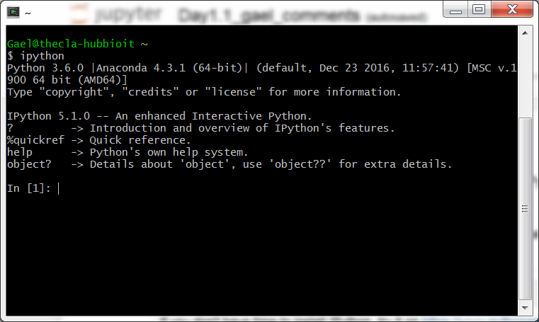{width="51%"}

## Jupyter Notebook

It's another version of IPython (spin off the IPython project) that manages JUlia - PYThon - R.

<https://en.wikipedia.org/wiki/IPython#Project_Jupyter>

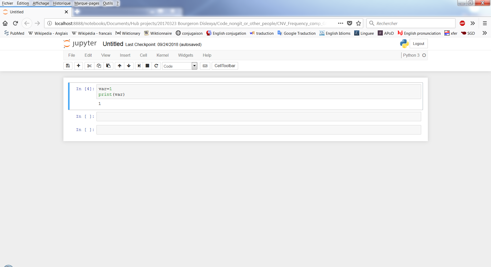{width="71%"}

<https://askubuntu.com/questions/1197891/ubuntu-18-04-open-jupyter-notebook-with-double-click>

## Spyder

Spyder is an open source cross-platform integrated development environment (IDE) for scientific programming in the Python language. Spyder integrates with a number of prominent packages in the scientific Python stack, including NumPy, SciPy, Matplotlib, pandas, IPython, SymPy and Cython, as well as other open source software

Jupyter has not this included by default.

Spyder seems more like RStudio.

<https://en.wikipedia.org/wiki/Spyder_(software)>.

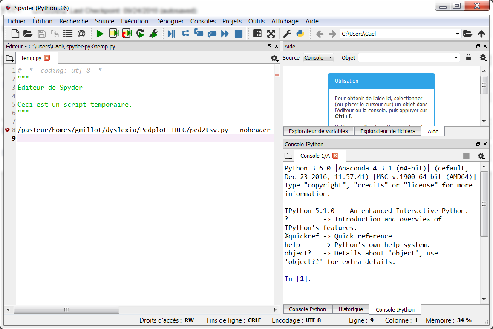{width="74%"}

Packages classically installed via WSL2 are not necessary available in Spider. Trick to install packages available for Spyder:

Open Spider and type in the console:

```
>>> import os
>>> os.system("pip install <PACKAGE_NAME>")
```

## PyCharm

PyCharm is an open source cross-platform integrated development environment (IDE) for scientific programming in the Python language.

<https://www.jetbrains.com/pycharm/>

Color themes:

<http://color-themes.com/?view=index&page=1&order=popular&search=sublime&layout=Generic>

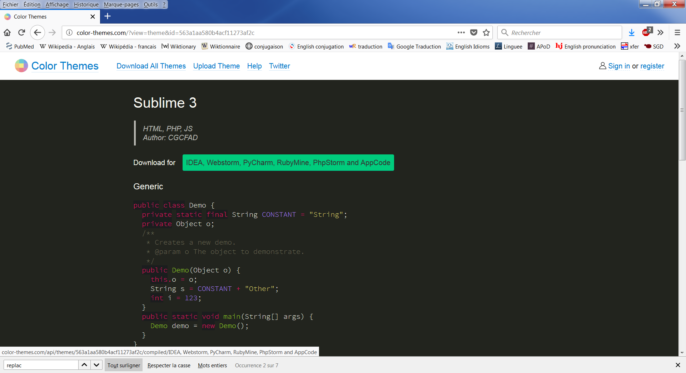

Download the Monokai Sublime Text 3.jar file.

Open PyCharm

Menu File/Import settings and import the .jar file

Then, in menu File/settings, the new color theme is here:

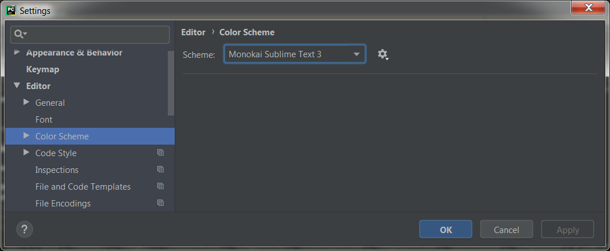{width="70%"}

See also <https://plugins.jetbrains.com/plugin/7275-codeglance> to have a code minimap similar to the one found in Sublime into the editor pane.

# Basic commands in Jupyter

Open Jupyter

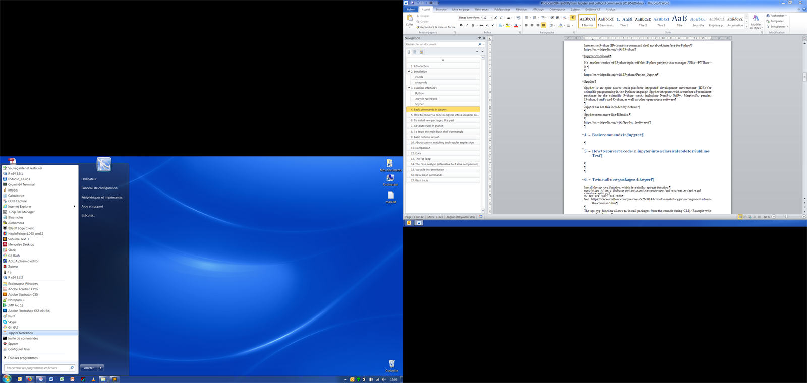{width="48%"}

Two windows opened, a CLI and a web interface.

The CLI is the base of Jupyter. In this interface: `Ctrl+C` quit Jupyter

The web interface is the top lawer of the interface.

The root is:

[REDACTED]

Select a working directory by clicing on the folders

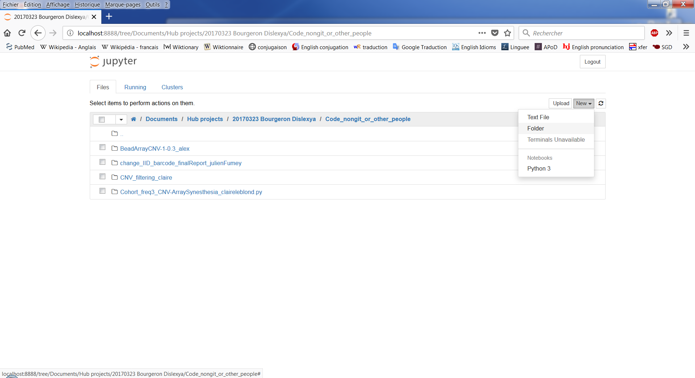

Note the pass in the web address and in the file Tab

Create a new working folder

To rename, select the new folder and clic on the new "Rename" icon

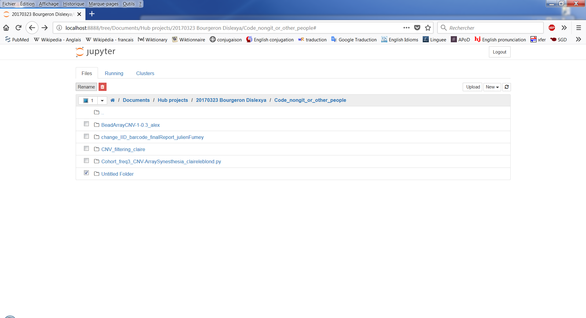

Then create a new Python 3 notebook

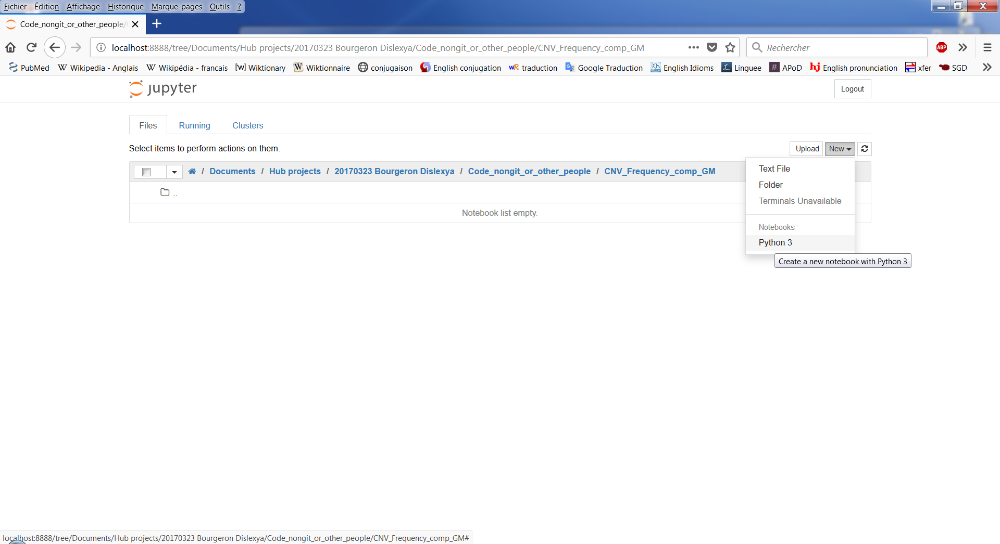

Shortcut commands:

`Shift + Enter` execute a cell

# How to convert a code in Jupyter into a classical code for Sublime Text

Menu Edit/Merge cells

Menu File/Download/.py file

# To know the version of python installed in the shell

Open Cygwin (see protocol 94).

Type:

```
python
```

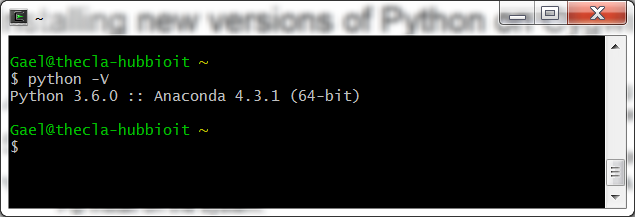{width="81%"}

Beware: in cygwin, python3 command does not exist. The command python used python3.

Idem for pip. See <https://stackoverflow.com/questions/30863501/installing-new-versions-of-python-on-cygwin-does-not-install-pip> to upgrade to pip3

# Import packages

[Run Cygwin as administrator]{.red}

## pip: example on windows with the intervaltree package

Better to use pip than conda.

Differences between pip and conda:

<https://stackoverflow.com/questions/20994716/what-is-the-difference-between-pip-and-conda>

See conda below to have package in several environments

Open Cygwin (see protocol 94).

See the pip3 problem above in cygwin

Type:

```
pip install intervaltree # to install on the computer the intervaltree package # normally pip3 for Python3 and pip for the others, but pip for python3 in cygwin
```

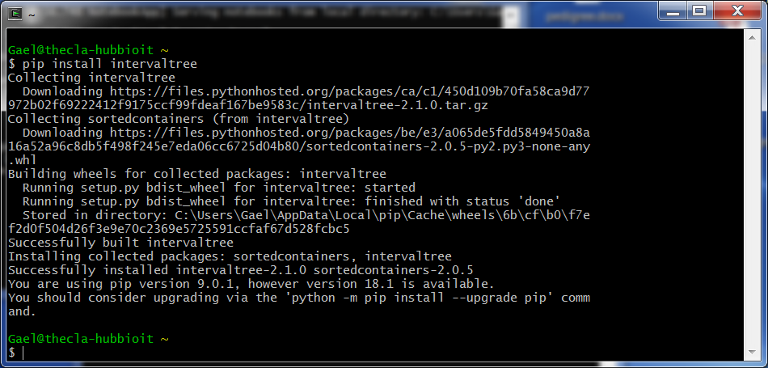

To know where the package is installed:

```
pip show intervaltree # normally pip3 for Python3 and pip for the others, but pip for python3 in cygwin and other windows python interfaces
```

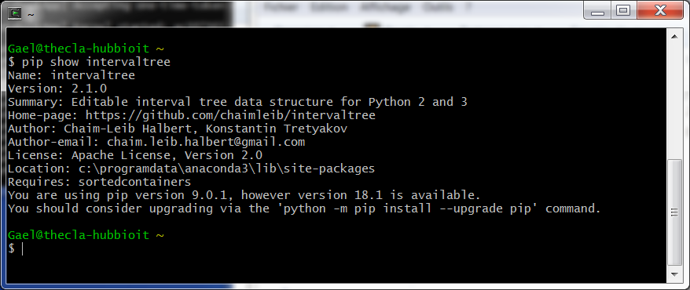{width="69%"}

On windows, the file is installed in:

`C:\programdata\anaconda3\lib\site-packages` (if --user is not used during installation)

`C:\users\gael\appdata\roaming\python\python36\site-packages` (with --user during installation)

On a server, it is installed in Z:\\.local\\lib\\python3.6\\site-packages\\intervaltree

## pip: example on linux with the serpentine package

Better to use pip than conda.

Differences between pip and conda:

<https://stackoverflow.com/questions/20994716/what-is-the-difference-between-pip-and-conda>

But it can be very interesting to use pip from a conda environment (see protocol 107 or see conda below to have package in several environments)

```
pip install serpentine
```

Then test the serpentine installation by typing:

```
serpentine # or  python -m serpentine
```

If does not work, try:

```
pip install --user -e git+https://github.com/koszullab/serpentine.git@master#egg=serpentine
```

But very not efficient, as most of the time, does not install in `/softwares/anaconda3/lib/python3.7/site-packages`

## Conda declaration

See <https://docs.conda.io/projects/conda/en/latest/user-guide/tasks/manage-environments.html> for the tuto

First a problem of declaration has to be solved.

When conda is properly installed, this is added in the .bashrc file:

```
# added by Anaconda3 2018.12 installer
# >>> conda init >>>
# !! Contents within this block are managed by 'conda init' !!
__conda_setup="$(CONDA_REPORT_ERRORS=false '/pasteur/homes/gmillot/softwares/anaconda3/bin/conda' shell.bash hook 2> /dev/null)"
if [ $? -eq 0 ]; then # $? return value of the last executed command, 0 for succes, -eq means equal to
    \eval "$__conda_setup"
else
    if [ -f "/pasteur/homes/gmillot/softwares/anaconda3/etc/profile.d/conda.sh" ]; then
        . "/pasteur/homes/gmillot/softwares/anaconda3/etc/profile.d/conda.sh"
        CONDA_CHANGEPS1=false conda activate base
    else
        \export PATH="/pasteur/homes/gmillot/softwares/anaconda3/bin:$PATH"
    fi
fi
unset __conda_setup
# <<< conda init <<<
```

To test if this works, exit TARS and reopen it. Then:

```
conda activate # activation of the base conda environment
```

If the prompt appears like this, ok:

```
(base) gmillot@tars-submit0:~$
```

Otherwise, copy paste the conda code in the .bashrc and put it in the .profile file.

To test if this works, exit TARS and reopen it. Then:

```
conda activate # activation of the base conda environment
```

The code added by conda means:

```
source ~/softwares/anaconda3/etc/profile.d/conda.sh # or . /pasteur/homes/gmillot/softwares/anaconda3/etc/profile.d/conda.sh # . is like source
```

What can also be done is to leave the code in the .bashrc file and add in the .profile file (see protocole 44):

```
# incorporation of the .bashrc file
if [ -n "$BASH_VERSION" ]; then
    # include .bashrc if it exists
    if [ -f "$HOME/.bashrc" ]; then
        . "$HOME/.bashrc"
    fi
fi
```

To deactivate the environment:

```
conda deactivate # do not precise the name of the environment
```

The prompt appears like this, ok:

```
gmillot@tars-submit0:~$
```

## Conda to install packages

See <https://docs.conda.io/projects/conda/en/latest/user-guide/tasks/manage-environments.html> for the tuto

Beware: sometimes, conda does not like writing like this, mainly using `conda activate`:

```
/pasteur/homes/gmillot/softwares/anaconda3/bin/conda
```

So, better use:

```
conda
```

Beware: always create a specific environment, never use the base one, because if the env is not good, easy to remade. Otherwise, conda must be uninstall and reinstall and all the created env must be redone.

To create an environment named `condaenv_py371`:

```
/pasteur/homes/gmillot/softwares/anaconda3/bin/conda create --name condaenv_py371 # or -n
```

The env is created in:

```
/pasteur/homes/gmillot/softwares/anaconda3/envs/condaenv_py371
```

Then to install packages managed by conda in the env:

```
/pasteur/homes/gmillot/softwares/anaconda3/bin/conda install -n condaenv_py371 -c bioconda minimap2 bowtie2 samtools python=3.7.1 # -c for channel. Conda has several repo (forge bioconda, etc.) and -c force the repo to check first, here bioconda (the second will be the standard one)
```

Conda environment Activation: very important: create a new package path for python, meaning that python can check for dependencies into this activated env. For instance, hicstuff is not in the conda env `condaenv_py371`. But this tool require dependencies that are only in `condaenv_py371`, like samtools. Activating this env allows to use the hicstuff command

```
conda activate condaenv_py371
```

Note: if a conda environment is activated, then using `pip` should install the package in the standard anaconda lib directory but with a link in the conda env activated.

# Import module and own script for execution

## Description

A module is a Python script, a .py file. The list of available modules is here:

<https://docs.python.org/3.7/py-modindex.html>

Python environment do not contain all the module that are available in the basic version. They have to be imported. Some examples:

|  |  |
|----|----|
| `import math` | import all the functions of the math module but remains in the math space. It is not in the local space (working space). Then use `math.pi` to have the pi number (see the dot operator) |
| `import math as m` | alias are possible on the module itself. Then use `m.pi` to have the pi number (see the dot operator) |
| `from math import pi` | import just what we need in the working space, here only pi (more efficient). Then use `pi` to have the pi number |
| `from math import pi as PI` | from the module math, the pi function is imported and is called PI. Then use `PI` to have the pi number |
| `from math import *` | Beware: import everything from the module into the working environment and override existing objects that have the same names |
| `import x` | import the personal x.py script |

## Function that manage modules

|  |  |
|----|----|
| `!ls -a` | unix command that display the imported modules. But do not work everywhere |
| `sys.path` | sys module. Display the differents path in which Python look for modules |
| `sys.path.append("y")` | sys module. add the new path in the path list. y can be `C:\\Users\\Gael\\Desktop` for instance |
| `import x` | import the personal x.py script located in one of the path list. In x.py, the code is `import math ; r = 4 ; phi = math.cos(r)**2 + math.sin(r)**2`. Then use `import x ; x.phi` to display the phi variable |
| `dir(math)` | show the content of the math module |
| `help(math)` | show information on the content of the math module |
| `help(math.pi)` | show information on the type (here float) of the pi variable of math |
| `os.listdir()` | os module. Display the list dir |

## List of useful modules

|          |                            |
|----------|----------------------------|
| `math`   | math functions             |
| `sys`    | basic system functions     |
| `time`   | time access and conversion |
| `pandas` | data frames handling       |

## Get the source code of a function from a module

The `__code__` method, generally present in modules, provide the path where to find the file:

```
>>> import scipy.stats as stats
>>> stats.fisher_exact.__code__
```

# Absolute rules in python & good practices

1\) Python use the space or tabulation indentation to know if inside a loop or conditional instruction, etc.

2\) Never mix tab and space

3\) Use "four spaces" for each indentation: this is the block recognized by Python.

4\) Start any script with a shebang to be sure that the correct running program (and version) is used for this script. In python, the classical one is `#!/usr/bin/env python`

5\) Python distinguish lower and uppercase, like R.

6\) 0 is the first position inside objects

Good practices:

<https://www.python.org/dev/peps/pep-0008/>

# To run a Python script in a shell

<https://docs.python.org/3/using/cmdline.html>

# Basic notions in python

## Cheatsheet

See `C:\Users\Gael\Documents\Manip\Protocoles bioinfo\Supp info\cheatsheet python.pdf`

## Help

Use help().

<https://www.askpython.com/python/built-in-methods/python-help-method>

## The notion of classes and object

Objects are variables (and are also called variables). A class is a template for creating and using objects. A class possesses a constructor (to be able to instantiate), some attributes and some methods. Object belonging to a same class share the same attributes and methods to manipulate them.

Glossary:

|  |  |
|----|----|
| Attributes | variables created inside the class to define it. Example, in the class car, I can create `tire_number = 4`. Then using `print(car.tire_number)`, 4 will be displayed. Therefore, tire_number is an atrribute of car |
| methods | functions created inside the class, that can be used on any object belonging to this class. For instance, `car.door_unlocking` |
| instantiation | assign a class to a variable / object. This is direct: class and values assignation as well as object creation occur at the same time. For instance, `x = 4` (value 4 of class integer assigned to x), `x = float(4)` (value 4 converted to class float and assigned to x) |
| instance | object belonging to a certain class. For example, 4 is an instance of the class integer |
| constructor | part of the class that is able to instantiate |

Useful functions related to classes:

|         |                            |
|---------|----------------------------|
| `class` | create a new kind of class |
| `type`  | display the class object   |

Important to remember that attributes can be displayed, and methods can be used very easily: `car.tire_number` , or `car.door_unlocking`.

In R, those considerations are masked. For instance, it is possible to apply summary() on any kind of classes, matrix, data.frame, etc. But in fact, a summary function has been defined in each class. Writing `a <- matrix(1:5) ; summary(a)` is equivalent to write `a.summary()` (the summary function of the class matrix will be executed because the object a belongs to class matrix).

See the class creation section below.

<https://www.hackerearth.com/fr/practice/python/object-oriented-programming/classes-and-objects-i/tutorial/>

<https://www.w3schools.com/python/python_classes.asp>

## Variable \| object

An object is called a "Variable" or "object reference".

## Assignation in a variable

`=` assignation operator, from right to left. Example: `a = 1`

## Variable name

Same rules as in R:

Variable names are unlimited in length

Variable names start with a letter or underscore \_ followed by letters, numbers or underscores.

Variable names are case-sensitive

Variable names conventionally have lower-case letters, with multiple words separated by underscores.

Variable names cannot be named with special keywords

## Reserved keywords

```
False
```

`None` equivalent of NULL in R

```
True
and
not
or

if
elif
else

for
in
return
while
break
```

|          |                                        |
|----------|----------------------------------------|
| `from`   | import from a package                  |
| `import` | import a fonction into the environment |

```
global
as

assert
class
continue
def
del
except
finally
is
lambda
nonlocal
pass
raise
try
with
yield
```

To get the list of the reserved keywords, called "keywords":

```
import keyword ; print(keyword.kwlist)
```

## Type of objects

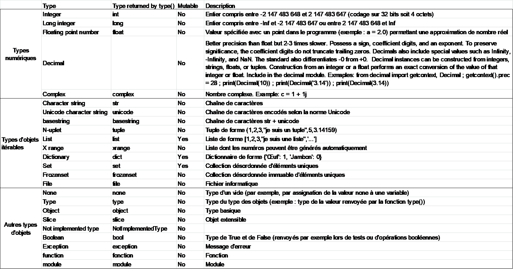

<http://localhost:8888/notebooks/Documents/Python_course/Day1.2_gael_comments.ipynb>

<https://fr.wikiversity.org/wiki/Python/Les_types_de_base>

## Data structure

<http://thomas-cokelaer.info/tutorials/python/data_structures.html>

## Notion of mutable and immutable objects

This notion is linked to the memory location of objects.

Immutable objects are objects for which the memory location is changed if a element is changed in the object. Type of immutable objects: int, float, bool, str, tuple, unicode

Mutable objects are objects for which the memory location is not changed if a element is changed in the object. Type of mutable objects: list, set, dict.

Example of immutable object:

```
i = 1 # type integer
id(i) # id() provide the memory location
# ***704
i += 1 # element of i is changed
i
2
id(i) # memory location is changed
# ***736 (different from ***704)
```

Example of mutable object:

```
x = ['a', 'b', 'c'] # list
x
id(x)
# 68320520
x[1] = 4 # second element of the list is changed
x
id(x) # memory location not changed
# 68320520
```

The strong benefit of mutable objects that modifing a mutable object is faster, notably when objects are big or complex. Indeed, for large and/or complex objects, creating a new copy of the object for every single change can be very costly and/or tedious. And for objects with a distinct identity, changing an existing objects is much more simple and intuitive than creating a new, modified copy of it.

## List object

Creation:

```
>>> l = [1, 2, "a"]
```

Description:

Object with compartments, each compartment is defined by elements (values) inside the compartment. Each value can be anything (another list, tuple, etc.). Could be equivalent to list in R. Compared to dict, no key (names) for the compartments. Example:

```
>>> l = [1, 2, 3]
>>> l[0]
1
```

Features:

order is important. Value locations are based on the order number (called index).

mutable.

<http://thomas-cokelaer.info/tutorials/python/lists.html>

Sometimes better to use numpy.array() more than list() since the former authorizes a single kind of mode.

## Tuple object

Creation:

```
>>> l = (1, 2, 3)
```

Description:

Idem as list but faster to use because immutable.

<http://thomas-cokelaer.info/tutorials/python/tuples.html>

## Dictionnary object

Creation:

```
>>> d = {"a":1, "b":2}
```

Description:

object with compartments, each compartment is defined by a key (name of the compartment) and by elements (values) inside the compartment. Could be equivalent to Data frame in R. . Example:

```
>>> d = {'first':'string value', 'second':[1,2]}
>>> d.keys()
['first', 'second']

>>> d.values()
['string value', [1, 2]]
```

Features:

no duplicated keys possible

no order

mutable

Warning : fast but needs lots of memory if the number of fields becomes high.

<http://thomas-cokelaer.info/tutorials/python/dicts.html>

## Data frame

`pandas.DataFrame` create a data frame. To assemble lists into a data frame for the data argument, use `pandas.DataFrame(data = [[x, y]])`. See <https://pandas.pydata.org/docs/reference/api/pandas.DataFrame.html>

To concatenate two data frames of same number of rows:

```
pandas.concat([df1.reset_index(drop = True), df2], axis = 1)
```

# Variable incrementation

|      |                                          |
|------|------------------------------------------|
| `+=` | variable incrementation by addition      |
| `*=` | variable incrementation by mutiplication |

Example:

```
a = 10
a += 2 # equivalent to a = a + 2
a # gives 12

a = 10
a *= 2 # equivalent to a = a + 2
a # gives 20
```

# Calculator

|      |                                                                  |
|------|------------------------------------------------------------------|
| `=`  | assign into a variable                                           |
| `+`  | sum                                                              |
| `-`  | subtraction                                                      |
| `*`  | multiplication                                                   |
| `/`  | division. Beware: in Python2 truncate and keep the integer part  |
| `//` | division keeping the integer part (dropping the fractional part) |
| `%`  | division providing the remainder. Example: `10 % 3` gives 1      |

# Comparison

|          |                                  |
|----------|----------------------------------|
| `==`     | equal                            |
| `!=`     | different                        |
| `<`      | left strictly lower than right   |
| `>`      | left strictly greater than right |
| `<=`     | left lower or equal than right   |
| `>=`     | left greater or equal than right |
| `is`     | object identity                  |
| `is not` | object difference                |

To compare two objects:

<https://www.kite.com/python/answers/how-to-compare-two-objects-in-python>

# Boolean

|       |          |
|-------|----------|
| `and` | and      |
| `&`   | and      |
| `or`  | or       |
| `not` | negation |

# Strings

# About pattern matching and regular expression (regex)

<https://docs.python.org/3/library/re.html>

See also the nice way of using \\1 to replace surounding strings of something to keep: <https://www.pythontutorial.net/python-regex/python-regex-sub/>

# The for loop

```
for this in [1, 2, 3]:
    print(this)


for i0 in list(range(1, 100)):
    print i0
```

loop to get the content of objects called by a string:

```
a = ['AC', 'QD'] # list of strings
AC = [1, 28, 3] #
QD = ['caca', 'bob'] #
d = {} # empty dictionary
for i0 in a:
    d[i0] = locals()[i0] # implementation of the d dict
d
```

To return a text every n loops:

```
    LOG_EVERY_N = 1000
    count = 0
    report = open(report.log, "a")
    for v in vcf: # parse each line of vcf with the content of region in it
        count = count + 1
        if (count % LOG_EVERY_N) == 0:
            report.write("NUMBER OF VCF LINES SCANNED: " + str(count) + "\n")

    report.close()
```

See globals() and locals() in section [Basic python commands](#basic-python-commands).

# Create a functions

The structure is the following one:

```
def function_name ( arg1, arg2, ...) :
    ......
    # function body. Note the 4 dots indentation that signal the body
    x = arg1 * arg2
    return(x)
```

# Modify a primitive function

Example with the print function:

```
print_file = ""C:/Users/Gael/Documents/test.txt"
if print_file is not None:
    print = functools.partial(print, file=print_file)
```

the print default function is modified such as the print is now in the print_file path

# Create a class

<https://docs.python.org/2/tutorial/classes.html>

# Equivalent of R basic functions in Python pandas

<https://pandas.pydata.org/pandas-docs/stable/getting_started/comparison/comparison_with_r.html>

<https://towardsdatascience.com/cheat-sheet-for-python-dataframe-r-dataframe-syntax-conversions-450f656b44ca>

# Basic python commands

<https://docs.python.org/3/library/index.html>

Builtin functions (valable for all classes):

<https://docs.python.org/3/library/functions.html#open>

|  |  |
|----|----|
| `#` | to comment a scrip |
| `L` | long integer |
| `;` | instruction separator (similar to End of Line) |
| `,` | argument separator inside functions |
| `''` | string delimiter. " ", ''' ''', """ """ put inside ' ' will be considered as string and be printed |
| `""` | string delimiter. ' ', ''' ''', """ """ put inside " " will be considered as string and be printed |
| `''' '''` | string delimiter. " ", ' ' and """ """ put inside ''' ''' will be considered as string and be printed. Carriage return in string are interpreted as \\n |
| `""" """` | string delimiter. " ", ' ' and ''' '''put inside """ """' will be considered as string and be printed. Carriage return in string are interpreted as \\n |
| `.` | apply the function written after the dot to the content of an object written before the dot |
| `True False` | equivalent to 0 and 1 respectively |
| `is_integer()` | is integer? Use `math.pi.is_integer()` or `is_integer(math.pi)` |
| `import` | import function |
| `from x import y,z` | import y and z functions from the package x |
| `sys.arg` | object generated when running a .py script from a shell. `sys.arg[1]` contains the first argument, `sys.arg[2]` the second, etc... |
| `set()` | define an empty variable for which the content will not be ordered and not be duplicated. The display order cannot be garanted |
| `type()` | define the type of the variable. Either integer (int), decimal (float) and string (str) |
| `csv.DictReader()` | import a csv table with header into a dict object |
| `int()` | convert into integer |
| `long()` | convert into long integer |
| `float()` | convert into float |
| `str()` | convert into character sting |
| `repr()` | as `str()` |
| `eval()` | evaluate a character string (or expression?) |
| `unicode()` | convert into unicode character string |
| `id()` | identity of the location of the object in memory |
| `globals()` | display the global variables (as a dict) |
| `globals()[x] = "a"` | if x (or value of x) does not exist, create the x key in the globals() dict and assign "a" in this key. If x already exists, overwrite x |
| `random.choices` | sampling with replacement. See <https://docs.python.org/3/library/random.html> |
| `locals()` | display the local variables (as a dict). Has to be used when inside functions |
| `locals()[x] = "a"` | if x (or value of x) does not exist, create the x key in the local () dict and assign "a" in this key. If x already exists, overwrite x |
| `>` | [greater than (in comparison) or overwrite in a file (if the target file already exists, it is overwritten). Beware: do not write into a variable. When we say "file", it means that a file is created on the computer in the default directory (like the command write() of R). To write in a variable, i.e., to assign, use]{.red} `=`[. Of note]{.red} `> x` [with nothing before create (or overwrite toward) an empty file]{.red} |
| `>>` | [append text in a file (add) and create the file if does not already exist]{.red} |
| `$` | [recover the content of a variable. Is also the way to deal with name and arguments of a shell script. See <http://stackoverflow.com/questions/5163144/what-are-the-special-dollar-sign-shell-variables>]{.red} |

# Python tricks

Convert a tuple into string:

```
fam_header = ("FID", "IID", "Father", "Mother", "Sex", "Pheno") # tuple
var = '\t'.join(fam_header) # \t is the separator
var
```

find duplicates in list:

<https://stackoverflow.com/questions/9835762/how-do-i-find-the-duplicates-in-a-list-and-create-another-list-with-them>

# Use python from R and vice-versa

<https://rstudio-pubs-static.s3.amazonaws.com/397064_bd288708515c4b71a6e78dfe91b8bb99.html>

<https://towardsdatascience.com/from-r-vs-python-to-r-and-python-aa25db33ce17>

<https://cran.r-project.org/web/packages/reticulate/vignettes/calling_python.html>

# function: description section

Beware. Python can parse and integrate some comments, notably describing of script. Example:

```
#!/usr/bin/env python3
# -*- coding: utf-8 -*-

"""Serpentine binning

An implementation of the so-called 'serpentine binning' procedure described
in Baudry et al.

Command line::

    Usage:
        serpentine.py [<matrixA>] [<matrixB>] [--threshold=auto] [--verbose]
                      [--min-threshold=auto] [--trend=high] [--triangular]
                      [--limit=3] [--demo] [--demo-size=500]

    Arguments:
        matrixA                         The first input matrix, in plain text
                                        CSV format. Optional in demo mode.
        matrixB                         The second input matrix, in plain text
                                        CSV format. Optional in demo mode or
                                        single binning mode.

    Options:
        -h, --help                      Display this help message.
        --version                       Display the program's current version.
        -t auto, --threshold auto       Threshold value to trigger binning.
                                        [default: auto]
        -m auto, --min-threshold auto   Minimum value to force trigger binning
                                        in either matrix. [default: auto]
        --trend high                    Trend to subtract to the differential
                                        matrix, possible values are "mean":
                                        equal amount of positive and negative
                                        differences, and "high": normalize
                                        at the regions with higher coverage.
                                        [default: high]
        --triangular                    Treat the matrix as triangular,
                                        useful when plotting matrices adjacent
                                        to the diagonal. [default: False]
        --print-file                    File for stdout redirection. [default: None]
        --limit 3                       Set the z-axis limit on the
                                        plot of the differential matrix.
                                        [default: 3]
        --demo                          Run a demo on randomly generated
                                        matrices. [default: False]
        --demo-size 500                 Size of the test matrix for the demo.
                                        [default: 500]
        -v, --verbose                   Show verbose output. [default: False]
"""
```

Between brackets: elements are evaluated

If an option is generated like this:

```
def _main():

    arguments = _doc.docopt(__doc__, version=__version__)

    inputA = arguments["<matrixA>"]
    inputB = arguments["<matrixB>"]
    threshold = arguments["--threshold"]
    minthreshold = arguments["--min-threshold"]
    size = int(arguments["--demo-size"])
    triangular = arguments["--triangular"]
    limit = int(arguments["--limit"])
    trend = arguments["--trend"]
    is_demo = int(arguments["--demo"])
    verbose = arguments["--verbose"]
    print_file = arguments["--print_file"]
```

If print_file defined here but not in the command line section above, error message.
