# Documentations

`C:\Users\gael\Documents\Formation\20210621 reproductibility`

<https://docs.docker.com/get-started/>

# Video

C:\\Users\\gael\\Documents\\Formation\\20210621 reproductibility\\

Formation Reproductibilité - Docker - Singu - Groupe TP 3.mp4

# Acronyms and definition

|  |  |
|----|----|
| Dockerfile | file of script that will be used to build a docker image |
| Image | Docker images are the basis of containers. An image typically contains a union of layered filesystems stacked on top of each other. An image does not have state and it never changes |
| Container | A container is a runtime instance of a docker image. lt contains: |

> A Docker image
>
> An execution environment
>
> A standard set of instructions
>
> 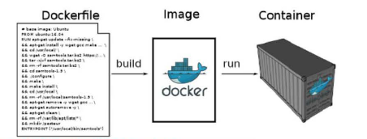{width="55%"}

# Basic description

Written in Go language:

[https://en.wikipedia.org/wiki/Docker\_(software)](https://en.wikipedia.org/wiki/Docker_%28software%29)

[https://en.wikipedia.org/wiki/Go\_(programming_language)](https://en.wikipedia.org/wiki/Go_%28programming_language%29)

# Main commands

<https://docs.docker.com/engine/reference/builder/>

All the commands starts by `docker`.

All commands requires `sudo`.

|  |  |
|----|----|
| `build` | create an image from a dockerfile |
| `pull` | retrieve images from public repositories (such as [DockerHub](https://hub.docker.com/editions/community/docker-ce-desktop-windows/)). Example `sudo docker pull gmillot/bash-extended_v1.0:gitlab_v1.0` |
| `images` | list the images in the folder were the images have been built. They are also listed in the docker desktop here: |

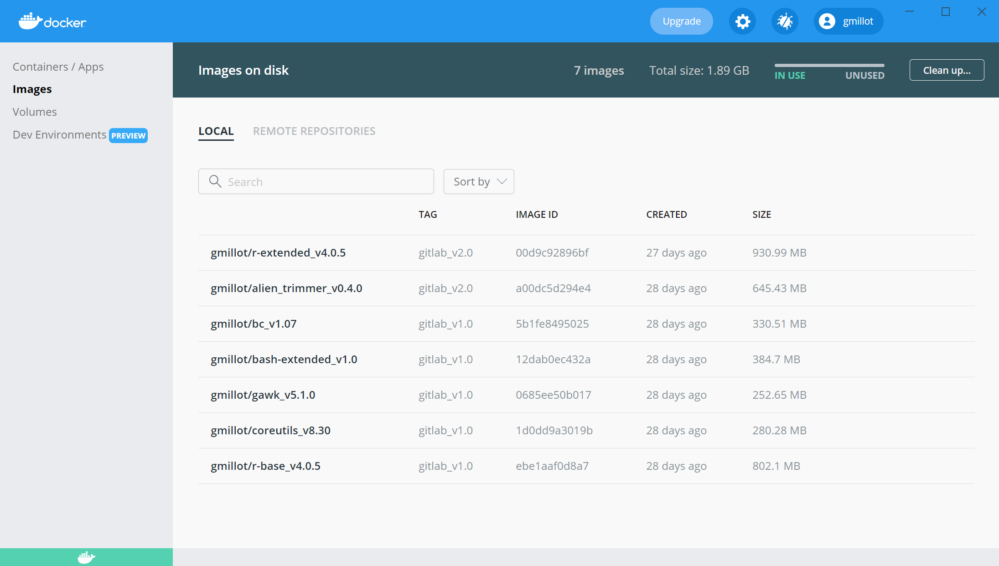{width="65%"}

|  |  |
|----|----|
| `run` | use the specified image to create a container and execute the code in the container. All the path are those of the container |
| `exec` | idem as `run` |
| `login` | login to DockerHub |
| `push` | push the local image into DockerHub. Example `sudo docker push <YOUR_DOCKERHUB_USERNAME>/fastp:0.21.0` |
| `rmi <ID>` | remove image by ID |
| `rmi fastp:0.21.0` | remove image by their name and repository:tag |
| `container ls -a` | list all the containers (not only the ones running) |
| `rm -vf <ID>` | remove a container by ID |
| `run fastp:0.21.0 -v` | check the version |
| `ps -a` | display all the containers, even those finished. usefull to clean a bit because each time the same image is run, a new container is created |

# Installation

## Warning

1.  Docker compromises a lot the security of machines. Indeed:

1\) any execution requires admin rights.

2\) An executed docker image can do anything, and because of the admin rights, lots of damages can happen.

It is thus better to use singularity ([protocol 135](135-apptainer.md)), that doe not have this problem. On the Pasteur cluster, only singularity is available.

<https://docs.docker.com/get-docker/>

## On Linux

No need to do this for WSL2. See installation for windows in section [On windows](#on-windows). This will then work for WSL2.

For Ubuntu:

<https://docs.docker.com/engine/install/ubuntu/>

Uninstall old versions

```
sudo apt-get remove docker docker-engine docker.io containerd runc
```

Update the apt package index and install packages to allow apt to use a repository over HTTPS:

```
sudo apt-get update

# reminder: \ means that the line has a EL but is not finished. WARNING: no space allowed after \
sudo apt-get install \
    apt-transport-https \
    ca-certificates \
    curl \
    gnupg \
    lsb-release
```

Add Docker’s official GPG key:

```
curl -fsSL https://download.docker.com/linux/ubuntu/gpg | sudo gpg --dearmor -o /usr/share/keyrings/docker-archive-keyring.gpg
```

Use the following command to set up the stable repository.

```
echo "deb [arch=amd64 signed-by=/usr/share/keyrings/docker-archive-keyring.gpg] https://download.docker.com/linux/ubuntu $(lsb_release -cs) stable" | sudo tee /etc/apt/sources.list.d/docker.list > /dev/null
```

Do not use Nighty or test repositories.

Install Docker Engine

```
sudo apt install docker.io
```

Check that Docker is correctly intalled

```
docker --version
```

Check that the daemon process is running

```
ps aux | grep docker
sudo service docker status
```

## On windows

General infos regarding install are here:

<https://docs.docker.com/docker-for-windows/wsl/>

Procedure:

Download Docker Desktop Stable 2.3.0.2 or a later release.

<https://hub.docker.com/editions/community/docker-ce-desktop-windows/>

Install the downloaded file.

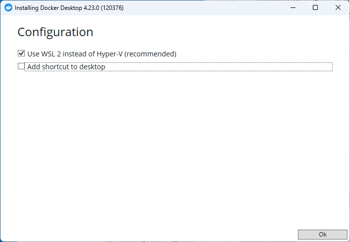{width="70%"}

For information, all the versions of docker for windows:

<https://docs.docker.com/docker-for-windows/release-notes/>

Start Docker Desktop from the Windows Start menu (run as admin)

From the Docker menu, select Settings / General.

Select the Use WSL 2 based engine check box.

Then Open WSL ([protocol 140](140-wsl2-linux-on-windows.md))

Check that the WSL mode is V2:

```
wsl.exe -l -v
```

In case, to set v2 as the default version for future installations, run:

```
wsl.exe --set-default-version 2
```

Then close and reopen Docker Desktop from the Windows Start menu (run as admin).

Then check:

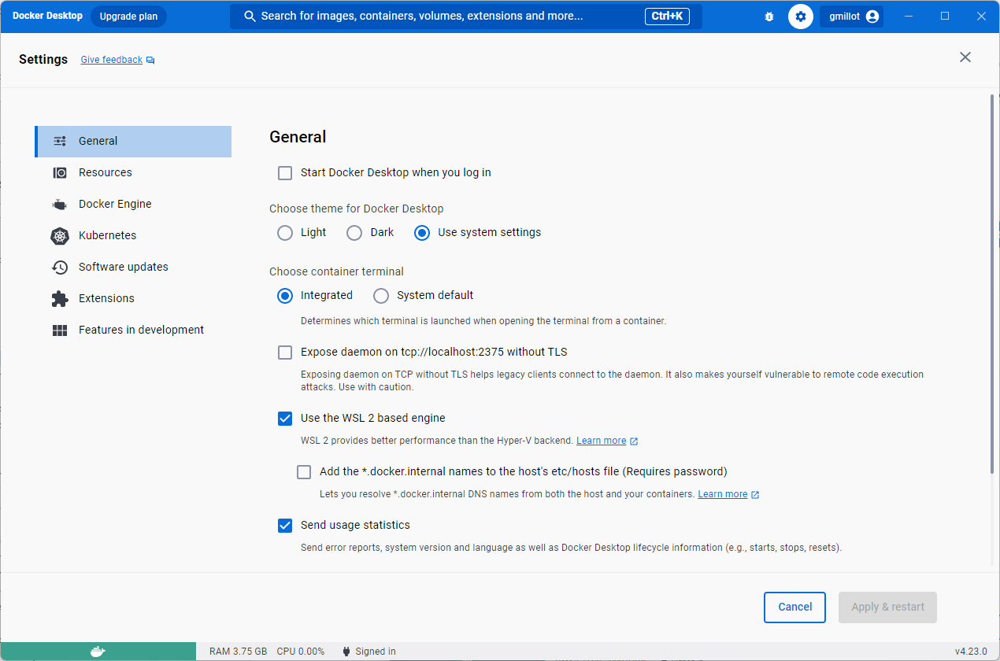

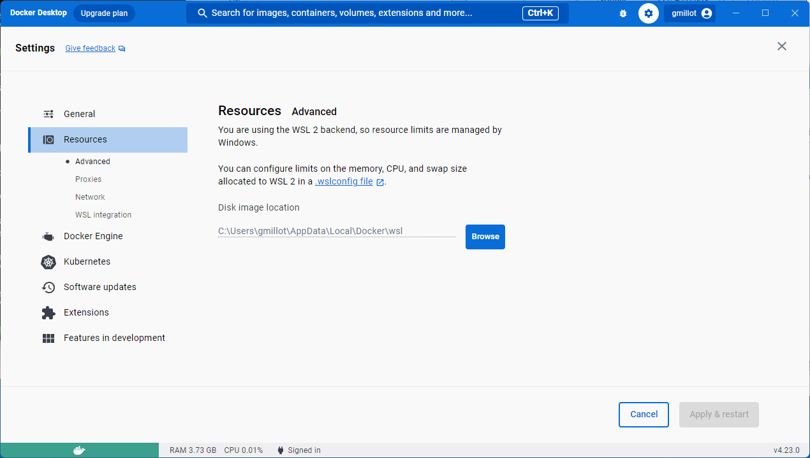

To check that the install was ok, open WSL and:

```
sudo docker run hello-world
```

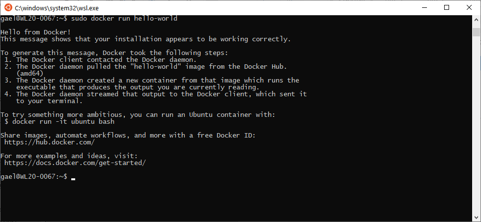

Warning:

WSL ([protocol 140](140-wsl2-linux-on-windows.md)) requires the simultaneous running of Docker Desktop in order to have access to docker commands in WSL. Otherwise this kind of error message appears:

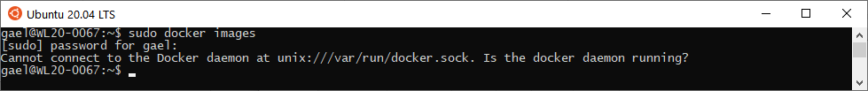

More exactly, when running Docker Desktop in admin mode, different files are running, including this background process (daemon):

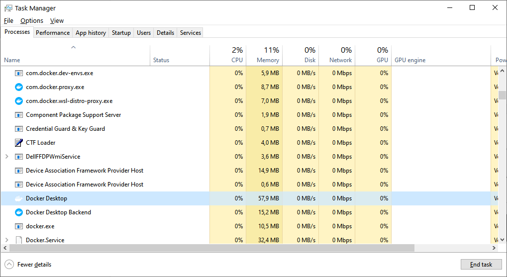

That stays open, even if the Docker Desktop interface app is closed.

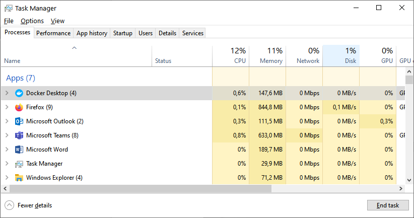{width="65%"}

Of note, when Docker desktop is not started in admin mode, the interface does not open but the background files including the daemon runs.

# Local container handling

## Dockerfile

A Dockerfile is the recipe file for docker.

Must have this format (`FROM`, `RUN`, etc., see section [Main commands](#main-commands)):

```
# base image: Ubuntu
FROM ubuntu:16.04
RUN apt-get update --fix-missing \
# update apt-get
&& apt-get install -y git make g++ zlib1g-dev \
# install the dependencies git make g++ zlib1g-dev
&& cd /usr/local/ \
&& git clone https://github.com/OpenGene/fastp.git \
# clone fastp
&& cd fastp \
&& make \
&& make install \
&& cd /usr/local \
&& rm -rf fastp \
&& apt-get remove -y git make g++ zlib1g-dev \
# important to remove the dependencies after installation to save space in the image that will be built
&& apt-get autoremove -y \
&& apt-get clean \
&& rm -rf /var/lib/apt/lists/*
ENTRYPOINT ["/usr/local/bin/fastp"] # run fastp when this image is run (exec mode writing)
```

To create a dockerfile, goes into:

`C:\Users\gael\Documents\Git_projects\dockerfiles`

And create a new fastp file.

Then copy-paste the code above into that file.

And, from WSL2, copy the file into the linux environment

```
cp /mnt/c/Users/Gael/Documents/Git_projects/dockerfiles/fastp /home/gael/dockerfiles/
```

## Structure of a dockerfile

<https://docs.docker.com/engine/reference/builder/> (use the outine on the right of the page)

|  |  |
|----|----|
| `#` | comment character. Forbidden after \\. See the example section [Dockerfile](#dockerfile) |
| `FROM` | call another image. In general it is an OS. Warning: the name must be exactly what is written in the docker images interface, or `sudo docker image ls`. In addition, not possible to call several images, may be to avoid conflicts |
| `LABEL` | See <https://docs.docker.com/engine/reference/builder/#label>. Very important field as it can be inspected for certain fields using `docker image inspect <myimage>`. Several labels fields can be used. Use "\\" to cut a string by a carriage return. Use quotes for spaces: |

```
LABEL version="1.0"
LABEL image.description="This image \
    is good"
```

> Or in a single field:

```
LABEL version="1.0" \
      image.description="This image \
    is good"
```

|  |  |
|----|----|
| `MAINTAINER` | deprecated. Use `LABEL` |
| `COPY` | adds files from your Docker client’s current directory |
| `RUN` | execute the following POSIX shell commands, i.e., builds your application with `make`. Use `&&` and \\ when using ends of line: \\ to specify that the command is not finished and `&&` to say that is is a continuation of a command. Warning: the language is not bash, it is POSIX shell, that, for instance, 1) does not support array but only single values, 2) does not like but , 3) does not like long string () |
| `CMD` | specifies what command to run within the container |
| `ENTRYPOINT` | before the entrypoint, all the code is only for the image creation. With entrypoint, it is possible to thenafter directly create the container and run some commands inside the container. Two forms: (1) the exec form `ENTRYPOINT ["executable", "param1", "param2"]` and the shell form `ENTRYPOINT command param1 param2`. The exec form is parsed as a JSON array, which means that you must use double-quotes (") around words not single-quotes ('). See <https://docs.docker.com/engine/reference/builder/#entrypoint>. Beware of the difference between the login shell and the classical login, since the login shell sources the files of the init system while the classical shell sources the files of the init user when the container is activated. Examples: `ENTRYPOINT ["/usr/bin/bash" , "-l"]` for the former and `ENTRYPOINT ["/bin/bash"]` for the latter. |

## Dockerfile versioning

Use a git repo to version all Dockerfiles (see protocol 88).

## Image building

Images are built using a recipe called Dockerfile (section [Structure of a dockerfile](#structure-of-a-dockerfile)).

### Classical errors and solutions

1\) Always add the dockerhub account name in the tag (`-t` option of `build`) if the image has to be pushed.

2\) Use `--no-cache` to completely rebuild the image. Otherwise, the cache is used to save time.

3\) The language of the dockerfile is not bash, but POSIX shell, that, for instance, 1) does not support array but only single values, 2) does not like `((COUNT++))` but `COUNT=$((COUNT+1))`, 3) does not like long string (written after `Rscript -e` for instance).

4\) Write all the prints in a log is possible but limited to 1M, triggering the error message:

```
[output clipped, log limit 1MiB reached]
```

To overcome this, use:

```
docker buildx create --use --name larger_log --driver-opt env.BUILDKIT_STEP_LOG_MAX_SIZE=1000000000
docker buildx build <normal build instructions>
```

Even if the message still appears, it should be ok.

Of note, the larger_log file is created here:

\\\\wsl\$\\Ubuntu-20.04\\home\\gael\\.docker\\buildx\\instances

Another way to get a building log is to use:

```
sudo docker build <...> 2>&1 | tee -a building.log
```

### [From a remote repository]{.red}

[From docker]{.underline}

[[https://docs.docker.com/engine/reference/commandline/build/#git-repositories]{.red}](https://docs.docker.com/engine/reference/commandline/build/#git-repositories)

[Git URLs accept context configuration in their fragment section, separated by a colon (:). The first part represents the reference that Git will check out, and can be either a branch, a tag, or a remote reference. The second part represents a subdirectory inside the repository that will be used as a build context. Example:]{.red}

```
sudo docker build https://gitlab.pasteur.fr/gmillot/dockerfiles.git#v5.1.0:ubuntu/v16.04/coreutils/v8.30
```

[From gitlab]{.underline}

<https://docs.gitlab.com/ee/ci/docker/using_docker_build.html>

### Local building

First, clone or pull the remote repository:

Pull:

```
cd /home/gael/dockerfiles
git pull
```

Clone:

```
cd /home/gael/dockerfiles
git clone git@gitlab.pasteur.fr:gmillot/dockerfiles.git /home/gael/dockerfiles/
```

Then, build from the cloned or pulled dockerfile. The usage is:

```
sudo docker build <PATH> --no-cache -f <FILE_NAME> -t <IMAGE_NAME>:<VERSION_NAME>

# --no-cache	completely rebuild the image. Otherwise, the cache is used to save time
# -f, --file	Name of the Dockerfile input (Default is <PATH>/Dockerfile)
# -t	Name and optionally a tag in the 'name:tag' format of the image that will be built. Name is the repo name with at least 2 letters, tag is a tag of the repo (version usually)
```

Example using full writing:

```
sudo docker build /home/gael/dockerfiles/ubuntu/v16.04/bash-extended/v1.0/ --no-cache -f /home/gael/dockerfiles/ubuntu/v16.04/bash-extended/v1.0/Dockerfile -t bash-extended_v1.0:gitlab_v1.0
```

Here the name of the image is "bash-extended_v1.0".

Example with no -f required because the name of the file is "Dockerfile" in \<PATH\>

```
sudo docker build --no-cache -t gmillot/bash-extended_v88.0:gitlab_v1.0 --progress=plain .
```

Here the name of the image is "gmillot/bash-extended_v88.0". This is just to distinguish between my own images and the images pulled from docker hub (other than from my account), which do not have "gmillot/".

The dot at the end can be used when the prompt is where the dockerfile is, for instance:

```
/home/gael/dockerfiles/ubuntu/v16.04/bash-extended/v1.0/
```

Such window indicates that everything was fine:

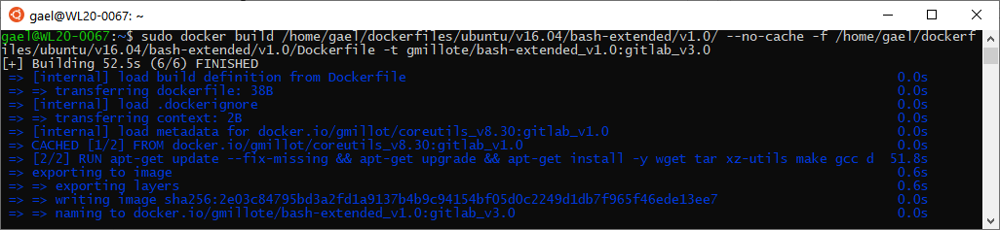

To confirm that the images are well created:

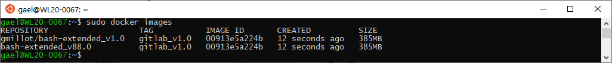

1)  Warning : it seems that it is not possible to get the file of the built image. The reason is that a docker image is not a single file but a combination of layers.

## Image managing

### Overview

First:

`id` display all the groups I am in (from the g field of `chmod`, see [protocol 44](044-bash.md)).

Check that I am in the docker group. Allows to execute docker commands without being root. [Otherwise use usermod to change that?]{.red}

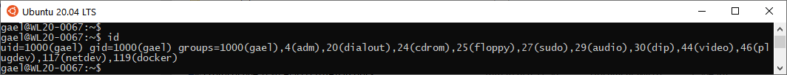

All the commands starts by `docker`.

All the commands requires `sudo` (the first time only the `docker`command is used per session).

|  |  |
|----|----|
| `pull` | retrieve images from public repositories (such as [DockerHub](https://hub.docker.com/editions/community/docker-ce-desktop-windows/)). Example `sudo docker pull gmillot/bash-extended_v1.0:gitlab_v1.0` |
| `images` | list the images in the folder were the images have been built. They are also listed in the docker desktop here: |

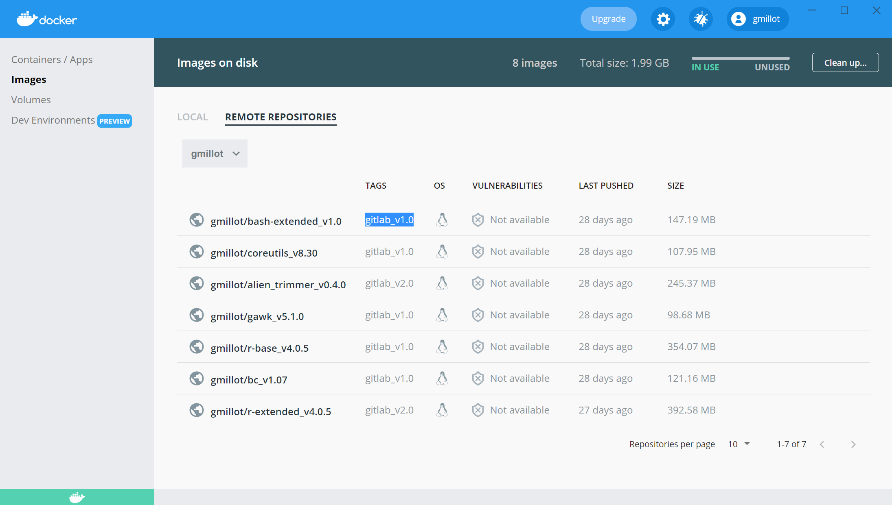{width="70%"}

|  |  |
|----|----|
| `run` | use the specified image to create a container and execute the code in the container. All the path are those of the container |
| `exec` | idem as `run` |
| `push` | push the local image into DockerHub. Example `sudo docker push gmillot/fastp:0.21.0.` Use first `docker login`. An alternative is the docker interface (see section [Image pushing](#image-pushing)) |
| `rmi <ID>` | remove image by ID. Use `-f` to force deletion. Use `sudo docker rmi $(sudo docker image ls -q)` to remove all local images |
| `rmi fastp:0.21.0` | remove image by their repository name:tag, sometimes uses: `rmi gmillot/fastp:0.21.0` |
| `tag OldName:tag NewName:tag` | rename a local image |

### Image pulling

Images are pulled from Dockerhub.

Usage:

```
sudo docker pull <IMAGE_NAME>:<VERSION_NAME>
```

Example:

```
sudo docker pull gmillot/bash-extended_v1.0:gitlab_v1.0
```

### Image pushing

The best is to use command lines.

First, check that you are logged. Then push the image:

```
sudo docker login -u gmillot
sudo docker push gmillot/r_v4.1.2_ig_clustering_v1.2:gitlab_v9.8
```

An alternative is to use the interface:

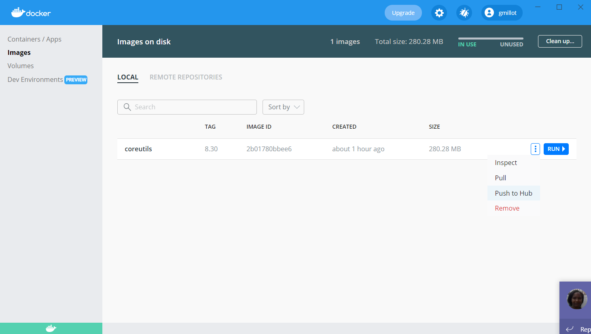{width="61%"}

But sometimes, it awkwardly does not work, with the following message:

denied: requested access to the resource is denied

In that case, use command lines as above.

See then section [Image handling in the remote repository](#image-handling-in-the-remote-repository) to complete information on the distant repo.

### Image running

See section [Image running](#image-running-1).

## container managing

### Commands

All the commands starts by `docker`.

All the commands requires `sudo` (the first time only the `docker`command is used per session).

|  |  |
|----|----|
| `container ls -a` | list all the containers (not only the ones running) |
| `container stop <ID>` | stop a container (image not used anymore) |
| `rm -vf <ID>` | remove a container by ID |
| `run fastp:0.21.0 -v` | check the version |
| `ps -a` | display all the containers, even those finished. usefull to clean a bit because each time an image is run, a new |

Other commands:

<https://docs.docker.com/engine/reference/commandline/container/>

### Erase all containers

function to add in the .bashrc to remove all the containers, even those that have finished to run:

```
function docker_rm_all {
    docker rm $(docker ps --all -q -f status=exited)
}
```

Then

```
sudo docker container ls -a # to see all the containers
docker_rm_all # to remove all of them
```

### Modification in a container, then saved in a new image

Open a container (section [Overview](#overview)) and perform any install.

Then exit the container and:

```
sudo docker container ls -a # to see all the containers
sudo docker commit <CONTAINER_ID> <NEW_IMAGE_NAME>
```

### Go inside a running container

I never had a container with the running status when using `sudo docker ps -a`.

But if it is the case, then:

```
docker start -a -i `docker ps -q -l`

# docker start start a container (requires name or ID)
# -a attach to container
# -i interactive mode
# docker ps List containers
# -q list only container IDs
# -l list only last created container
```

Or see <https://stackoverflow.com/questions/21928691/how-to-continue-a-docker-container-which-has-exited>

### Go inside an exited container

The only way is to commit the exited container into a new image and then run the new image:

```
sudo docker ps -a
sudo docker commit 0dfd54557799 debug/ubuntu
# open a new container from the "broken" image
docker run -it --entrypoint bash debug/ubuntu
```

# Image running

Running an image create a container and potentially run commands inside it. In such case the container remains closed. Depending on the options, it is also possible to open the container and be in the container environment with the system and soft inside of the corresponding image. Once opened, we can work inside it.

Warning: opening an image to use a python session, for instance, can create problems of path, i.e., packages will not be found even if they are in the image because the container look into the locales packages, not into the container. To overcome this, open the image with `--entrypoint bash` and than open a python session.

## Options

|  |  |
|----|----|
| `-v` | Link your current directory to a directory with the same absolute path in the container. First path is from the host (local machine), second is the path inside the docker. If the second one does not exist, it is created directly. Example: -v /mnt/c/Users/:/tmp means that the tree starting at Users in the local system is mounted into /tmp in the container. Then, to call this folder C:\\\\Users\\\\gael\\\\Documents in the container, we have to write /tmp/gael/Documents |
| `--mount` | similar to `-v` ? Example: `--mount "type=bind,src=/mnt/c/Users/Gael/,dst=/caca/"` |
| `--entrypoint` | overwrite the entrypoint inside the image. Useful when the default entrypoint is R but we want to be in the ubuntu environment (hence --entrypoint bash) |
| `-i` | interactif TTY. Means that all the code is executed but after that, we stay in the container environment through a TTY (teletype writter, see <https://stackoverflow.com/questions/43099116/error-the-input-device-is-not-a-tty>) system. Warning we can do nothing without -t |
| `-t` | to have the TTY, i.e., to be able to write inside the container env. Madatory when using -i |
| `-w` | `--workdir`. Equivalent to a cd made once the container is opened. If the path does not exist in the container, it is created |
| `--rm` | close the container after running. Ohterwise, still in use (whatever the use of -ti or not) |

see also <https://pandorafms.com/blog/docker-run/>

## Example

```
docker run -v <PATH>:<PATH> --entrypoint bash -i -t <IMAGE_NAME>:<VERSION_NAME>
```

Here `--entrypoint bash -it` just open the container.

## Example when running a script

No container in use:

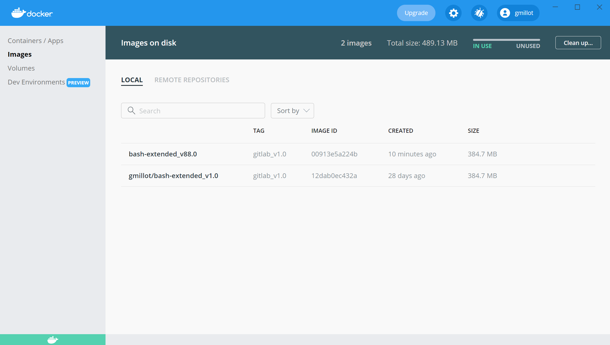{width="63%"}

```
echo 'echo "HELLO"' | sudo docker run -i gmillot/bash-extended_v1.0:gitlab_v1.0
# never forget -i with the pipe
```

Warning: container still in use after that:

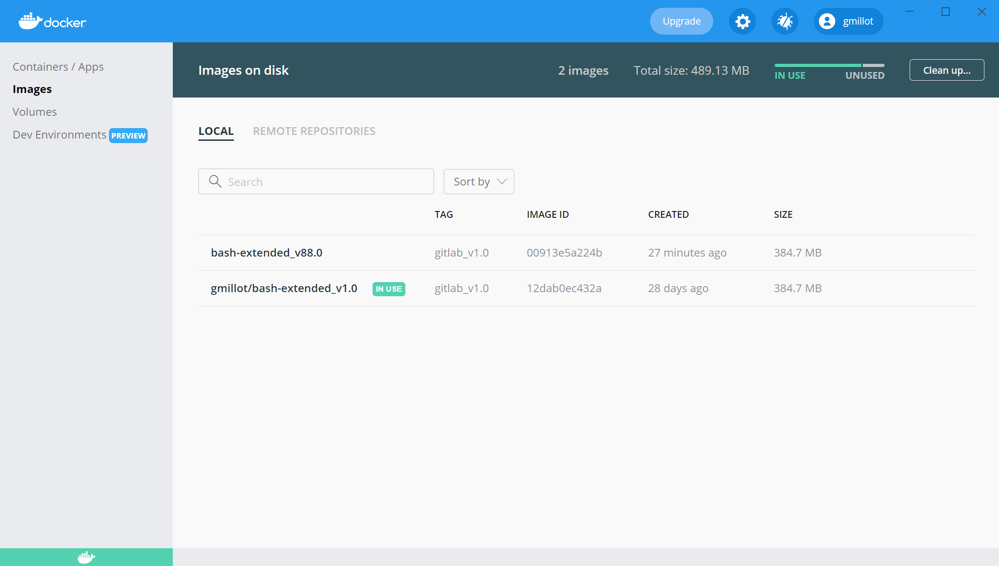{width="61%"}

Use `--rm` to prevent that.

## Example when working interactively inside a container

No container in use:

{width="63%"}

```
sudo docker run -it gmillot/bash-extended_v1.0:gitlab_v1.0
```

Warning: -t is mandatory when using -i, otherwise bug.

The prompt has changed:

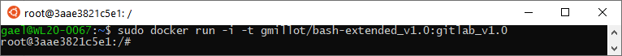{width="81%"}

Use `exit` to quit the container

Warning: container still in use after that:

{width="61%"}

Use `--rm` to prevent that.

## Mounting a drive in a container using -v

Example:

```
sudo docker run -v $PWD:$PWD -ti gmillot/bash-extended_v1.0:gitlab_v1.0
```

\$PWD is the pwd displayed in the console before running the image. Here it means: 1) before the colon, mount that path inside the container and 2) after the colon, create inside the image a path (by creating all the intermediate directories) from the root that is \$PWD. Thus, if PWD = `/mnt/c/Users/Gael/Documents/Git_projects/project_a/`, it means that this path is mounted into the container at this destination inside the container: `/mnt/c/Users/Gael/Documents/Git_projects/project_a`. This facilitate the use of script inside the container because it looks like the local folder

Example:

```
sudo docker run -v /mnt/c/Users/Gael/Documents/Git_projects/project_a/:/caca -ti --entrypoint bash 1e828c256ff0
```

Here `/mnt/c/Users/Gael/Documents/Git_projects/project_a` from the local machine is mounted into the `/caca` path inside the container.

Warning: mounting a drive using -v does not work when this drive is a distant drive using WSL. Example:

```
FOLDER="\\\helix.pasteur.fr\projects\BioIT\gmillot"
sudo mkdir /mnt/share
sudo mount -t drvfs "$FOLDER" /mnt/share
sudo docker run -v /mnt/share/:/caca -ti --entrypoint bash gmillot/r_v4.1.2_extended_v2.1:gitlab_v8.8
```

Nothing is present in /caca.

See <https://github.com/docker/for-win/issues/2151>

## The -w option

Set directly the working directory in the container.

```
sudo docker run -w $caca -ti --entrypoint bash 1e828c256ff0
```

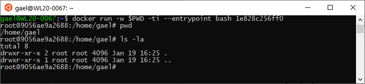

# Docker files repositories

## Trustable repo

<https://github.com/evolbioinfo/dockerfiles>

## Create a repo

This is optional, since the remote repo can be created when pushing from a local repo.

<https://hub.docker.com/repositories>

Click on "create"

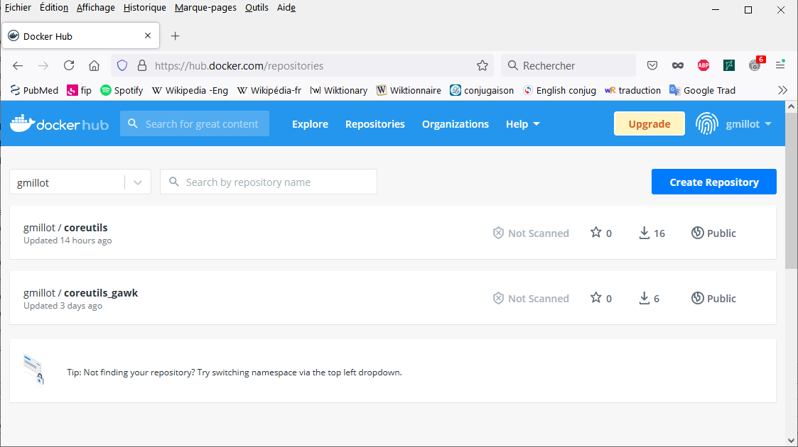{width="87%"}

Then fill the name (warning: at least 2 letters) and click "create"

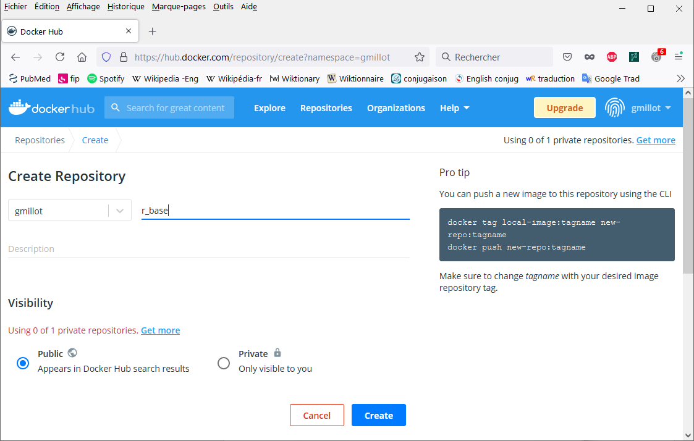{width="79%"}

## Cluster

Not possible to do:

```
sudo docker pull <NAME>
```

On the cluster. Only singularity pull is allowed.

# Docker image repositories

## Docker Hub

<https://hub.docker.com>

Trustable repo:

<https://hub.docker.com/u/genomicpariscentre>

<https://hub.docker.com/u/evolbioinfo>

## Bioconda repo for Python packages

Each Python package in bioconda (see [protocol 136](136-nextflow-dsl1.md)) and managed by the package provider Pypi (<https://pypi.org/>) is automatically associated/embedded to a Python container that contains all the dependencies in order to correctly run this package. Each new upgrade of the package in Pypi is automately upgraded in the container.

The repo of all these automatic container is:

<https://biocontainers.pro>

# Image handling in the remote repository

## Add the gitlab commit

From my dockerhub website

<https://hub.docker.com>

Login (if not automatic)

Click on the repo that need the gitlab connection

Click on "Manage repository"

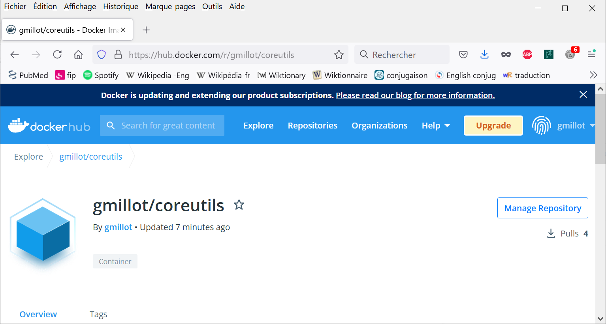

Click on "Description" (100 characters max) and update

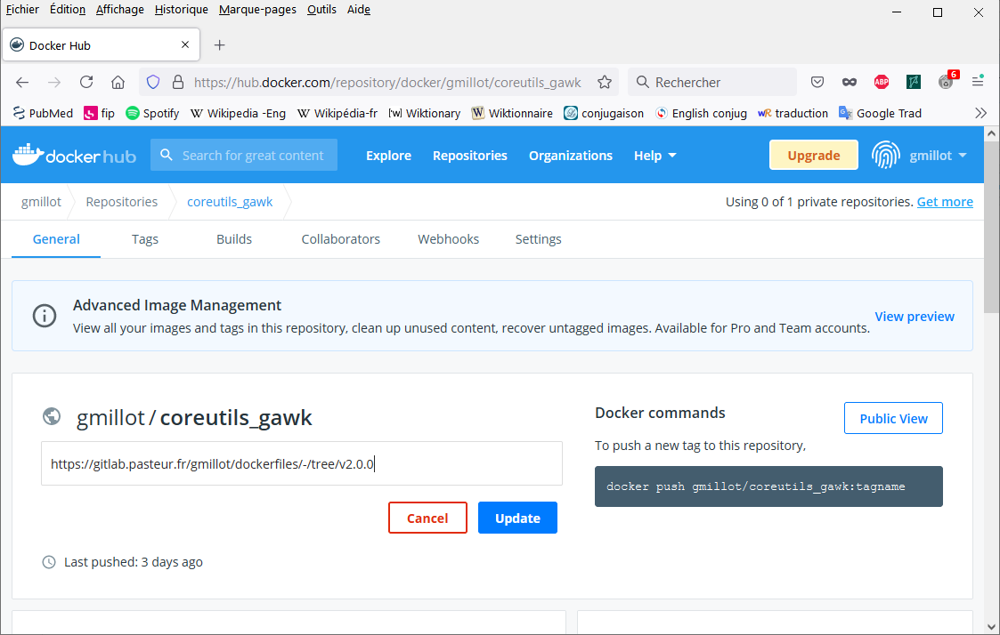{width="77%"}

Or click on "Readme" and update

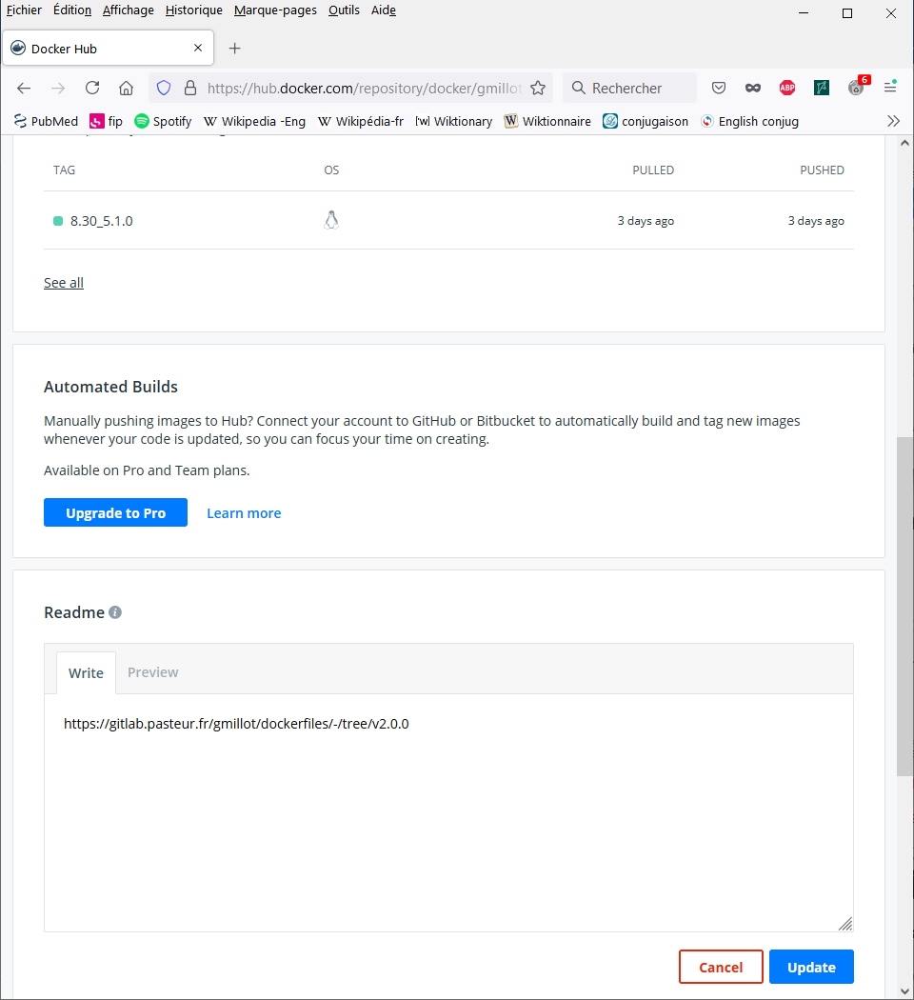{width="58%"}

## Deletion of an image

Using dockerhub website:

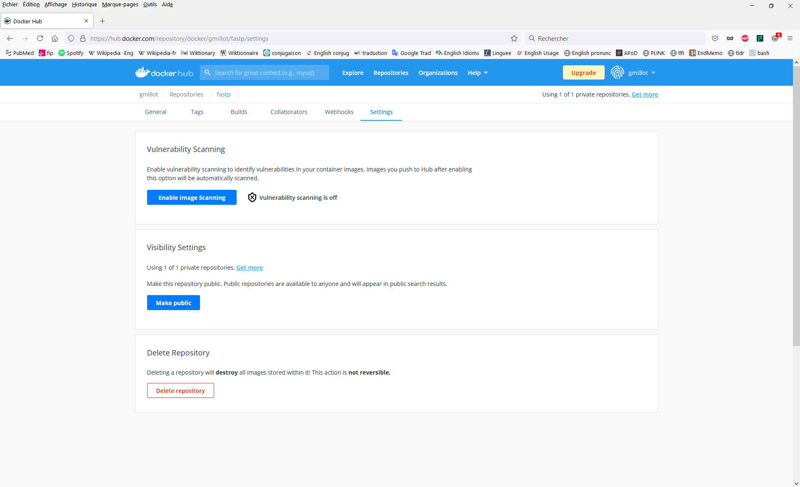{width="81%"}

To obtain the setting tab, click on an image or use this url kind (name/settings):

<https://hub.docker.com/repository/docker/gmillot/r_base/settings>

## Deletion of a tag

Using dockerhub website:

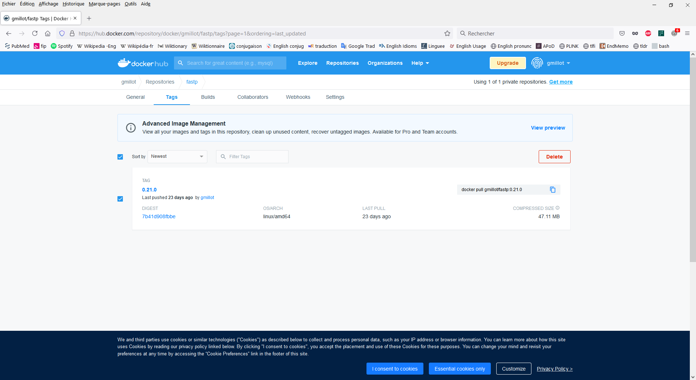{width="76%"}

# Docker on the cluster

Because of what is said in section [Acronyms and definition](#acronyms-and-definition), the easiest is to go through dockerhub.

Push local images on dockerhub

Then pull images from dockerhub when on the cluster, using singularity.

Warning:

1\) sudo docker pull cannot be performed from any location on the cluster (security issue).

2\) singularity pull can only be done from the head of the cluster, not from the nodes. But then, we can use the pulled images on nodes.

# Docker configuration

## Settings

The configuration daemon.json file is here:

`C:\Users\Gael\.docker`

Use these advices to modify the settings:

<https://docs.microsoft.com/en-us/virtualization/windowscontainers/manage-docker/configure-docker-daemon#configure-docker-with-a-configuration-file>

## Image storage

<https://stackoverflow.com/questions/62441307/how-can-i-change-the-location-of-docker-images-when-using-docker-desktop-on-wsl2>

## No more space on disk (huge .docker file)

Open the Docker Desktop client, click the settings icon in the top bar, click Clean/Purge, select all the possibilities (WSL, container, etc.) and purge.

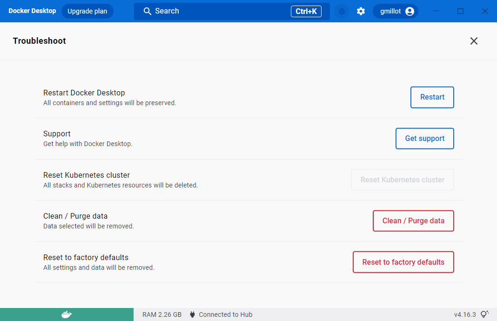{width="84%"}

# Examples

## Coreutils

Dockerfile in

`C:\Users\Gael\Documents\Git_projects\dockerfiles\ubuntu\v16.04\coreutils\v8.30`

```
# coreutils - GNU core utilities
# https://www.gnu.org/software/coreutils/
# v8.30

# base image: ubuntu:16.04
FROM ubuntu:16.04
# Warning: the name must be exactly what is written in the docker images interface, or sudo docker image ls. But here, since the image is not present locally, docker will search it on docker hub. Thus, gmillot/ubuntu:16.04 iw not correct

# File Author / Maintainer
MAINTAINER Gael Millot <gael.millot@pasteur.fr>

RUN apt-get update --fix-missing \
# update apt-get
&& apt-get upgrade \
# end update apt-get
# install the required dependencies
&& apt-get install -y wget tar xz-utils make gcc dpkg libblkid1 libreadline6 \
# end install the required dependencies
# coreutils install
&& cd /usr/local/ \
&& wget http://ftp.gnu.org/gnu/coreutils/coreutils-8.30.tar.xz \
&& tar -xf coreutils-8.30.tar.xz \
&& cd coreutils-8.30 \
&& chmod u=rwx configure \
&& export FORCE_UNSAFE_CONFIGURE=1 \
&& ./configure \
&& make \
&& make install \
&& cd /usr/local/ \
&& rm -rf coreutils-8.30 \
# end coreutils install
# && apt-get remove -y wget tar xz-utils make gcc \ # inactivated because generate errors of pkg dependency
# important to remove the dependencies after installation to save space in the image that will be built
&& apt-get autoremove -y \
&& apt-get clean \
&& rm -rf /var/lib/apt/lists/*

ENTRYPOINT ["/bin/bash"]
```

Git push on the remote gitlab account, with the correct commit text to clearly identify the versions of each Dockerfile

Run the docker daemon

Open WSL2

Clone the gitlab repository (or pull if already cloned):

```
git clone git@gitlab.pasteur.fr:gmillot/dockerfiles.git /home/gael/dockerfiles/
```

Build the image

```
sudo docker build --no-cache /home/gael/dockerfiles/ubuntu/v16.04/coreutils/v8.30 -t gmillot/coreutils:8.30
# -f, --file	Name of the Dockerfile input (Default is 'PATH/Dockerfile'). Do not use -f if only Dockerfile file in the path indicated for sudo docker build, which is the case here
# -t	Name and optionally a tag in the 'name:tag' format of the image that will be built. Name is the repo name with at least 2 letters, tag is a tag of the repo (version usually)
```

Warning: at least 2 letters required for the repo name in -t, i.e., -t gmillot/r:4.0.5 does not work

Verif

```
sudo docker images
```

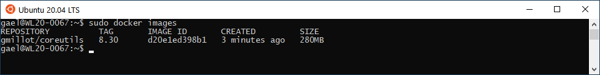

Check that the image is not already present in the dockerhub repo:

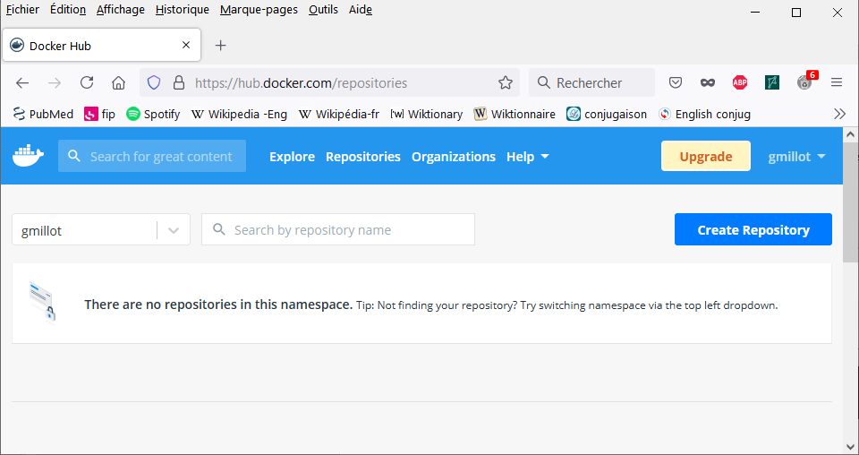{width="88%"}

Push on dockerhub

```
sudo docker login
sudo docker push gmillot/coreutils:8.30
```

Check that the image is now present in the distant dockerhub repo:

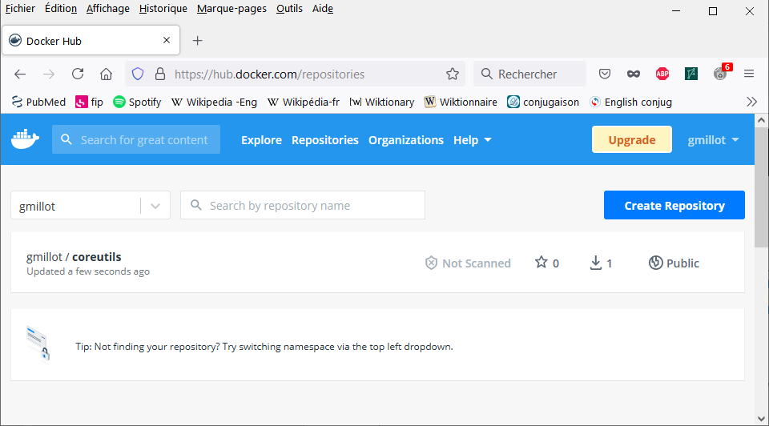{width="85%"}

Then see section [Add the gitlab commit](#add-the-gitlab-commit) to add the gitlab commit in the description or the readme window.

To use the remote image:

```
echo "echo 'Hello world'" | sudo docker run -i gmillot/coreutils:8.30
# never forget -i with the pipe
```

Warning: do not use -t when piping into docker run.

To work inside the remote image env:

```
sudo docker run --entrypoint bash -i -t gmillot/coreutils:8.30
# Here -t must be used to have the TTY, i.e., to be able to write inside the container env

echo 'Hello world'
exit
```

To remove the containers

```
docker_rm_all
```

## R

Dockerfile in

`C:\Users\Gael\Documents\Git_projects\dockerfiles\R\v4.0.5\base`

```
# R
# https://cran.r-project.org/
# v4.0.5

# base image: r-base:4.0.5, see https://hub.docker.com/_/r-base for details
FROM r-base:4.0.5 # Warning: the name must be exactly what is written in the docker images interface, or sudo docker image ls. But here, since the image is not present locally, docker will search it on docker hub. Thus, gmillot/r-base:4.0.5 iw not correct

# File Author / Maintainer
LABEL maintainer=gael.millot@pasteur.fr

RUN apt-get update \
&& apt-get install -y procps
# nextflow needs procps for usage stats, cpu and process memory. Normally, this package is present by default in ubuntu. But in the R base image, it seems that there is a problem

ENTRYPOINT ["/usr/bin/R"]
```

Then as in section [Coreutils](#coreutils) but using:

Clone the dockerfile:

```
git clone git@gitlab.pasteur.fr:gmillot/dockerfiles.git /home/gael/dockerfiles/
```

Build the image

```
sudo docker build --no-cache /home/gael/dockerfiles/R/v4.0.5/base/ -f /home/gael/dockerfiles/R/v4.0.5/base/Dockerfile -t gmillot/r_base:4.0.5
```

Warning: at least 2 letters required for the repo name in -t, i.e., -t gmillot/r:4.0.5 does not work

By default, R and Rscript executions files are in:

```
/usr/bin/
```

## R extended

Dockerfile in

`C:\Users\gael\Documents\Git_projects\dockerfiles\R\v4.0.5\extended`

```
# to get all the packages:
## open a R session
## use
# ip = as.data.frame(installed.packages()[,c(1,3:4)])
# ip = ip[is.na(ip$Priority),1:2,drop=FALSE]
# ip


# R v4.0.5 with packages:
#   Package Version
#   SARTools    1.7.3
...
#   zlibbioc    1.36.0


# base image: r-base:4.0.5
FROM gmillot/r-base:4.0.5 # Warning: the name must be exactly what is written in the docker images interface, or sudo docker image ls. Here, the image is present locally, or distantly on the gmillot repo. Thus, gmillot/r-base:4.0.5 is correct

# File Author / Maintainer
LABEL maintainer=gael.millot@pasteur.fr

ENV CRANREPO="'https://cran.irsn.fr/'"
# use the code above to get the list of the installed packages
ENV RLIB="'SARTools' 'abind' 'annotate' 'AnnotationDbi' 'askpass' 'assertthat' 'backports' 'base64enc' 'BH' 'Biobase' 'BiocGenerics' 'BiocManager' 'BiocParallel' 'BiocVersion' 'Biostrings' 'bit' 'bit64' 'bitops' 'blob' 'brew' 'brio' 'broom' 'cachem' 'Cairo' 'callr' 'car' 'carData' 'caTools' 'cellranger' 'CGHbase' 'CGHcall' 'cli' 'clipr' 'colorspace' 'commonmark' 'conquer' 'corrplot' 'covr' 'cpp11' 'crayon' 'credentials' 'crosstalk' 'curl' 'data.table' 'DBI' 'dbplyr' 'DelayedArray' 'desc' 'DESeq2' 'devtools' 'diffobj' 'digest' 'DNAcopy' 'dplyr' 'DT' 'dtplyr' 'edgeR' 'ellipsis' 'emmeans' 'estimability' 'evaluate' 'ExPosition' 'fansi' 'farver' 'fastmap' 'forcats' 'formatR' 'fs' 'futile.logger' 'futile.options' 'future' 'future.apply' 'gargle' 'genefilter' 'geneplotter' 'generics' 'GenomeInfoDb' 'GenomeInfoDbData' 'GenomicRanges' 'gert' 'GGally' 'ggdendro' 'ggplot2' 'ggrepel' 'gh' 'gitcreds' 'githubinstall' 'globals' 'glue' 'googledrive' 'googlesheets4' 'gplots' 'gridExtra' 'gtable' 'gtools' 'haven' 'HiCcompare' 'highr' 'hms' 'htmltools' 'htmlwidgets' 'httr' 'ids' 'impute' 'ini' 'InteractionSet' 'IRanges' 'isoband' 'jpeg' 'jsonlite' 'kableExtra' 'knitr' 'labeling' 'lambda.r' 'later' 'lazyeval' 'lemon' 'lifecycle' 'limma' 'listenv' 'lme4' 'lmerTest' 'locfit' 'lubridate' 'magrittr' 'maptools' 'markdown' 'marray' 'MatrixGenerics' 'MatrixModels' 'matrixStats' 'memoise' 'mime' 'minqa' 'mockery' 'modelr' 'munsell' 'mvtnorm' 'nloptr' 'numDeriv' 'openssl' 'openxlsx' 'parallelly' 'pbkrtest' 'pheatmap' 'pillar' 'pkgbuild' 'pkgconfig' 'pkgload' 'plogr' 'plyr' 'png' 'praise' 'prettyGraphs' 'prettyunits' 'processx' 'progress' 'promises' 'ps' 'pspearman' 'purrr' 'QDNAseq' 'quantreg' 'R.methodsS3' 'R.oo' 'R.utils' 'R6' 'rappdirs' 'rcmdcheck' 'RColorBrewer' 'Rcpp' 'RcppArmadillo' 'RcppEigen' 'RCurl' 'readr' 'readxl' 'rematch' 'rematch2' 'remotes' 'reprex' 'reshape' 'reshape2' 'reticulate' 'rex' 'rhdf5' 'rhdf5filters' 'Rhdf5lib' 'Rhtslib' 'rio' 'rlang' 'rmarkdown' 'roxygen2' 'rprojroot' 'Rsamtools' 'RSQLite' 'rstudioapi' 'rversions' 'rvest' 'S4Vectors' 'SARTools' 'scales' 'selectr' 'sessioninfo' 'snow' 'snowfall' 'sp' 'SparseM' 'statmod' 'stringi' 'stringr' 'SummarizedExperiment' 'SuppDists' 'svglite' 'sys' 'systemfonts' 'testthat' 'tibble' 'tidyr' 'tidyselect' 'tidyverse' 'tinytex' 'translations' 'usethis' 'utf8' 'uuid' 'vctrs' 'viridisLite' 'waldo' 'webshot' 'whisker' 'withr' 'xfun' 'XML' 'xml2' 'xopen' 'xtable' 'XVector' 'yaml' 'zip' 'zlibbioc'"

# nextflow needs procps for usage stats, cpu and process memory. Normally, this package is present by default in ubuntu. But in the R base image, it seems that there is a problem
RUN apt-get update && apt-get install -y procps                       \
  && for i in $RLIB ; do R -e "install.packages(pkgs = $i, lib = '/usr/local/lib/R/site-library', dependencies=TRUE, repo=$CRANREPO)" ; done \
  && apt-get autoremove -y                                            \
  && apt-get clean                                                    \
  && rm -rf /var/lib/apt/lists/*


ENTRYPOINT ["/usr/bin/R"]
```

Then as in section [Coreutils](#coreutils) but using:

Clone the dockerfile:

```
git clone git@gitlab.pasteur.fr:gmillot/dockerfiles.git /home/gael/dockerfiles/
```

Build the image

```
sudo docker build --no-cache /home/gael/dockerfiles/R/v4.0.5/extended/ -f /home/gael/dockerfiles/R/v4.0.5/extended/Dockerfile -t gmillot/r_extended:4.0.5
```

Warning: at least 2 letters required for the repo name in -t, i.e., -t gmillot/r:4.0.5 does not work

By default, R and Rscript executions files are in:

```
/usr/bin/
```

# Migrate your existing images away from docker hub

The crane tool by Google's open source office is able to mirror images in a much more efficient way than running docker pull, tag and push. The pull, tag and push approach also doesn't work with multi-arch images.

Here's an example command to list tags for an image:

```
crane ls ghcr.io/openfaas/gateway | tail -n 5
```

The crane cp command doesn't require a local docker daemon and copies directly from one registry to another:

```
crane cp docker.io/openfaas/gateway:0.26.3 ghcr.io/openfaas/gateway:0.26.3
```

On Twitter, a full-time employee on the CNCF's Harbor project also explained that it has a "mirroring" capability.
