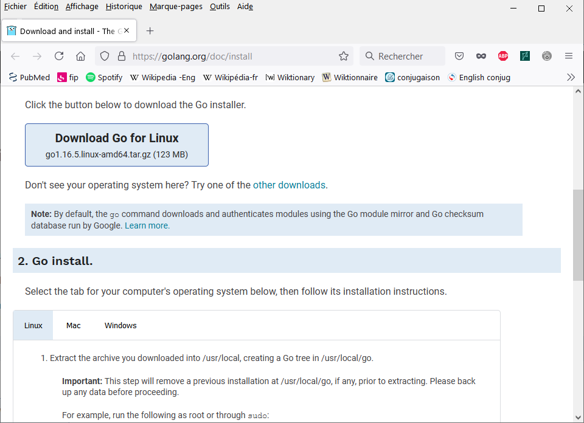
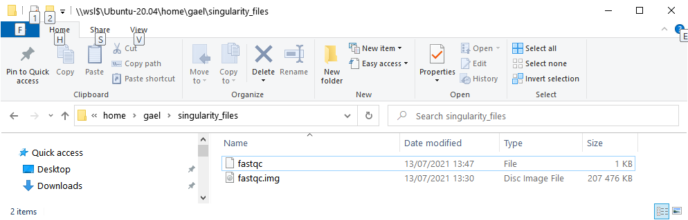

# Apptainer vs Singularity

Apptainer <https://apptainer.org/> is the new name of singularity, since its inclusion in the Linux Foundation.

see <https://apptainer.org/news/community-announcement-20211130/>

Apptainer provides singularity as a command line link and maintains as much of the CLI and environment functionality as possible. From the user's perspective, very little, if anything, changes.

You should switch your command lines eg: `singularity build|run|exec ...` to `apptainer build|run|exec ...`

NB all `SINGULARITY_` prefix environement  variables are now translated to `APPTAINER_` prefix ones.  `SINGULARITY_` prefix variables are still recognized but will generate a warning.

See apptainer-1.0.0 changelog for more information:

<https://github.com/apptainer/apptainer/releases/tag/v1.0.0>

We encourage you to use `apptainer` module instead of the `singularity` ones as soon as possible. We welcome any feedback. Please note that in the near future we plan to remove all `singularity` modules and keep only `apptainer` ones.

# Documentation

<https://apptainer.org/docs/user/main/>

The different versions: <https://apptainer.org/documentation/>

# Acronyms and definitions

|               |                                   |
|---------------|-----------------------------------|
| DAG           | Directed Acyclic Graph            |
| SIF           | Singularity Image Format          |
| SingularityCE | Community Edition of Singularity. |

# Main commands

See <https://apptainer.org/docs/user/main/cli.html>

All the commands start by `apptainer`.

Some commands require `sudo`.

|  |  |
|----|----|
| `build` | build a container |
| `inspect` | inspect a container |
| `pull` | download a container from existing url |
| `exec` | execute an executable inside the container (Ctrl+C to exit). Require a script to execute defined after the image. Example: `apptainer exec [exec options...] <container> <command>`. See the difference with `run` in section [Image running](#image-running) |
| `run` | launch an Apptainer container and execute a runscript if one is defined for that container. The runscript is a metadata file within the container that contains shell commands. If the file is present (and executable) then this command will execute that file within the container automatically. All arguments following the container name will be passed directly to the runscript). Example: `apptainer exec [exec options...] <container>`. See the difference with `exec` in section [Image running](#image-running) |
| `shell -- writable` | enter into the image environment. The prompt becomes `Apptainer>`. exit to leave |

# Installation

<https://github.com/apptainer/apptainer/blob/main/INSTALL.md>

## On linux

### Ubuntu 26.04 (apt)

Tested on Ubuntu 26.04 (WSL2) on 2026-11-21: apptainer 1.4.5, squashfuse 0.5.2 and fuse2fs 1.47.2.

Apptainer is in the universe repository of Ubuntu 26.04:

```
sudo apt update
sudo apt install apptainer squashfuse fuse2fs
apptainer --version # apptainer version 1.4.5
```

The singularity command is also installed (it runs apptainer).

squashfuse and fuse2fs are not installed with the apptainer package, but they are required to run the images (.sif files) without extracting them. Without them, apptainer displays `INFO: squashfuse not found, will not be able to mount SIF or other squashfs files` and extracts each image into a temporary folder of /tmp (several GB per image), which can end with `no space left on device` (on Ubuntu 26.04 in WSL2, /tmp is in RAM). The temporary folder of apptainer can also be moved to the disk:

```
mkdir -p ~/apptainer_tmp
export APPTAINER_TMPDIR=~/apptainer_tmp # add this line at the end of the ~/.bashrc file to keep it
```

Optional: `sudo apt install gocryptfs` (2.6.1 tested), to avoid the recurrent apptainer message about it.

On older Ubuntu versions, if `apt-cache policy apptainer` shows no candidate, use the PPA of the apptainer team (see <https://apptainer.org/docs/admin/main/installation.html>):

```
sudo apt install -y software-properties-common
sudo add-apt-repository -y ppa:apptainer/ppa
sudo apt update
sudo apt install -y apptainer squashfuse fuse2fs
```

### Any linux (from source)

Uninstall singularity

```
sudo apt-get remove singularity # or sudo apt-get purge --auto-remove singularity
```

Installation of dependencies:

```
sudo apt-get update

# reminder: \ means that the line has a EL but is not finished. WARNING: no space allowed after \
sudo apt-get install -y \
    build-essential \
    libseccomp-dev \
    pkg-config \
    uidmap \
    squashfs-tools \
    squashfuse \
    fuse2fs \
    fuse-overlayfs \
    fakeroot \
    cryptsetup \
    curl wget git
```

Installation of GO:

Retrieve the Linux version of GO <https://golang.org/doc/install>, by selection the **Linux** tab below "Go install":



The Download button switches to the Linux version.

Click on download (1.27.4)

A new <https://go.dev/dl/> page opens.

Download the file:

go1.27.4.linux-amd64.tar.gz

For older version, use

<https://golang.org/dl/>

And take the go1.27.4.linux-amd64.tar.gz version.

Then:

```
sudo rm -rf /usr/local/go # remove the precedent version of go
sudo cp /mnt/c/Users/gmillot/Desktop/go1.27.4.linux-amd64.tar.gz /usr/local/
sudo tar -C /usr/local -xzf /usr/local/go1.27.4.linux-amd64.tar.gz
```

Then update the .profile file with :

```
export PATH="/usr/local/go/bin:$PATH" # for apptainer
```

See [protocol 140](140-wsl2-linux-on-windows.md) for details about .profile update.

Reopen the terminal and check that GO is correctly installed:

```
go version
```

Apptainer install:

```
cd # because it seems that singu can only be installed from the $HOME, where the go folder is present, after install of go in the /usr/local/ directory
git clone https://github.com/apptainer/apptainer.git
cd apptainer
./mconfig
cd ./builddir
make
sudo make install

apptainer --version
```

If gocryptfs is required, see :

<https://github.com/rfjakob/gocryptfs?tab=readme-ov-file#installation>

Go is already installed, so skip the first step.

## On windows

It is not possible to install it on Windows directly, only via WLS2.

<https://apptainer.org/docs/admin/main/installation.html#installation-on-windows-or-mac>

## OnMac

It is not possible to install it on Mac. The only way is to use a Linux virtual Machine.

<https://apptainer.org/docs/admin/main/installation.html#installation-on-windows-or-mac>

# Container handling

## Definition file (eq of dockerfile)

Also called recipy.

Must have this format:

```
Bootstrap: docker
From: ubuntu:20.04

%post
apt-get install openjdk-8-jre-headless
apt-get install wget unzip perl
wget https://www.bioinformatics.babraham.ac.uk/projects/fastqc/fastqc_v0.11.9.zip
unzip fastqc_v0.11.9.zip
chmod 755 /FastQC/fastqc

%environment
export PATH=/FastQC:$PATH

%runscript
exec fastqc "$@"
```

To create a recipy, goes into:

`C:\Users\gmillot\Documents\Git_projects\apptainer_files`

And create a new fastqc file.

Then copy-paste the code above into that file.

And, from WSL2, copy the file into the linux environment.

```
cp /mnt/c/Users/gmillot/Documents/Git_projects/apptainer_files/fastqc /home/gael/apptainer_files/
```

## Options of the definition file

### Overview

<https://apptainer.org/docs/user/main/definition_files.html#definition-files>

A definition file has a header and a body.

The header determines the base container to begin with.

The body is further divided into sections that perform things like software installation, environment setup, and copying files into the container from host system, etc.

Example:

```
Bootstrap: library
From: ubuntu:18.04
Stage: gael_build


%setup
    touch /file1
    touch ${APPTAINER_ROOTFS}/file2

%files
    /file1
    /file1 /opt

%environment
    export LISTEN_PORT=12345
    export LC_ALL=C

%post
    apt-get update && apt-get install -y netcat
    NOW=`date`
    echo "export NOW=\"${NOW}\"" >> $APPTAINER_ENVIRONMENT

%runscript
    echo "Container was created $NOW"
    echo "Arguments received: $*"
    exec echo "$@"

%startscript
    nc -lp $LISTEN_PORT

%test
    grep -q NAME=\"Ubuntu\" /etc/os-release
    if [ $? -eq 0 ]; then
        echo "Container base is Ubuntu as expected."
    else
        echo "Container base is not Ubuntu."
        exit 1
    fi

%labels
    Author d@sylabs.io
    Version v0.0.1

%help
    This is a demo container used to illustrate a def file that uses all
    supported sections.
```

In this example, the header, made of `Bootstrap`, `From` and `Stage`, tells Apptainer to use a base Ubuntu 16.04 image from the Container Library.

The stage section just names the section initiated by the header, since several headers (stages) can be in a single definition file. See <https://apptainer.org/docs/user/main/definition_files.html#multi-stage-builds>

### Header

The only keyword that is required for every type of build is Bootstrap. It determines the bootstrap agent that will be used to create the base operating system you want to use. For example, the library bootstrap agent will pull a container from the Container Library as a base. Similarly, the docker bootstrap agent will pull docker layers from Docker Hub as a base OS to start your image.

Starting with Singularity 3.2, the Bootstrap keyword needs to be the first entry in the header section. This breaks compatibility with older versions that allow the parameters of the header to appear in any order.

Preferred bootstrap agents:

|           |                                                         |
|-----------|---------------------------------------------------------|
| `library` | images hosted on the Container Library                  |
| `docker`  | images hosted on Docker Hub                             |
| `shub`    | deprecated                                              |
| `scratch` | a flexible option for building a container from scratch |

See <https://apptainer.org/docs/user/main/definition_files.html#preferred-bootstrap-agents>

### Body

|  |  |
|----|----|
| `%setup` | commands in this section are first executed on the host system outside of the container after the base OS has been installed. Warning: executed outside of the container on the host system itself, and is executed with elevated privileges. Can alter and potentially damage the host |
| `%file` | copy files into the container (greater safety than using the `%setup` section) |
| `%post` | execute within the container at build time after the base OS has been installed. The `%post` section is therefore the place to perform installations of new applications |
| `%environment` | defines some environment variables that will be available to the container at runtime |
| `%runscript` | this content is written to a file within the container that is executed when the container image is run (either via the singularity run command or by executing the container directly as a command) |
| `%test` | this section is run at the very end of the build process to validate the container |
| `%labels` | used to add metadata to the file /.singularity.d/labels.json within your container |
| `%help` | this section is transcribed into a metadata file in the container during the build. This text can then be displayed using the run-help command. |

See <https://apptainer.org/docs/user/main/definition_files.html#sections>

### Best practices

<https://apptainer.org/docs/user/main/definition_files.html#best-practices-for-writing-definition-files>

## Image building

```
cd /home/gael/apptainer_files/
sudo apptainer build fastqc.img fastqc
```

Contrary to Docker ([protocol 134](134-docker.md)), the image location is easy to know, as it is specified:



<https://apptainer.org/docs/user/main/build_a_container.html>

## Image building from a docker image

```
apptainer build --sandbox my_container.img docker://ubuntu:latest
```

## Image managing

All the commands start with `apptainer`.

Some commands require `sudo`.

|  |  |
|----|----|
| `build` | build an image |
| `delete` | delete an image from the specified library |
| `inspect` | inspect an image (display the associated metadata) |
| `pull` | download an image from existing url |
| `exec` | execute an executable or a command inside the container (Ctrl+C to exit) |
| `run` | launch a Apptainer container from the indicated image and execute a runscript if one is defined for that container. The runscript is a metadata file within the container that contains shell commands. If the file is present (and executable) then this command will execute that file within the container automatically. All arguments following the container name will be passed directly to the runscript. Use exit to quit the container env |
| `shell -- writable` | enter into the image environment. The prompt becomes `Apptainer>`. exit to leave |

## Image running

Running an image creates a container and potentially run commands inside it. In such cases the container remains closed. Depending on the options, it is also possible to open the container and be in the container environment with the system and soft inside of the corresponding image. Once opened, we can work inside it. Example:

```
apptainer run fastqc.img
```

To mount a folder, the syntax is the same as for docker:

```
apptainer run -B $PWD:$PWD fastqc.img
```

With -B /src, it directly creates the /src path in the container.

\$PWD is the pwd displayed in the console before running the image. Here it means: 1) before the colon, mount that path inside the container and 2) after the colon, create inside the image a path (by creating all the intermediate directories) from the root that is \$PWD. Thus, if PWD = `/mnt/c/Users/gmillot/Documents/Git_projects/project_a`, it means that this path is mounted into the container at this destination inside the container: `/mnt/c/Users/gmillot/Documents/Git_projects/project_a`. This facilitates the use of script inside the container because it looks like the local folder.

To work in a container with bash:

```
apptainer shell fastqc.img
```

Difference between apptainer run and apptainer exec:

|  |  |
|----|----|
| apptainer run | run the default command set for containers based on the specified image. This default command is set within the image metadata when the image is built. You do not specify a command to run when using apptainer run, you simply specify the image file name. As we saw earlier, you can use the apptainer inspect command to see what command is run by default when starting a new container based on an image. |
| apptainer exec | start a container based on the specified image and run the command provided on the command line following apptainer exec \<image file name\>. This will override any default command specified within the image metadata that would otherwise be run if you used apptainer run. |

## container managing

[No container to manage ?]{.red}

# Apptainer repositories

<https://singularityhub.github.io/> seems deprecated.

# Apptainer files repositories

Does not exist.

# Apptainer on the cluster

<https://confluence.pasteur.fr/display/FAQA/Singularity@Pasteur>

# Examples

## Coreutils

### Definition file from dockerhub

See [protocol 134](134-docker.md)

```
Bootstrap: docker
From: gmillot/coreutils:8.30


%labels
    Author Gael Millot
    Version v0.0.1
```

### Definition file from scratch

`C:\Users\gmillot\Documents\Git_projects\apptainer_files`

```
# Coreutils - GNU core utilities
# https://www.gnu.org/software/coreutils/
# v8.30

# base image: ubuntu:16.04 from docker
Bootstrap: docker
From: ubuntu:16.04

%post
    apt-get update --fix-missing
    # update apt-get
    apt-get upgrade
    apt-get install -y wget tar xz-utils make gcc dpkg libblkid1 libreadline6
    # install the required dependencies
    cd /usr/local/
    wget http://ftp.gnu.org/gnu/coreutils/coreutils-8.30.tar.xz
    tar -xf coreutils-8.30.tar.xz
    cd coreutils-8.30
    chmod u=rwx configure
    export FORCE_UNSAFE_CONFIGURE=1
    ./configure
    make
    make install
    cd /usr/local/
    rm -rf coreutils-8.30
    # && apt-get remove -y wget tar xz-utils make gcc # inactivated because generate errors of pkg dependency
    # important to remove the dependencies after installation to save space in the image that will be built
    apt-get autoremove -y
    apt-get clean
    rm -rf /var/lib/apt/lists/*

%labels
    Author Gael Millot
    Version v0.0.1
```

### Next

Git push on the remote gitlab account, with the correct commit text to clearly identify the versions of each file.

Copy the file:

```
cp /mnt/c/Users/gmillot/Documents/Git_projects/apptainer_files/apptainer.coreutils.v8.30 /home/gael/apptainer_files/
```

Build the image:

```
sudo apptainer build /home/gael/apptainer_files/apptainer.coreutils.v8.30.img /home/gael/apptainer_files/apptainer.coreutils.v8.30
```

Contrary to docker, the image is easy to find.

Verify:

```
ls -la
```

Use:

```
echo "echo 'Hello world'" | apptainer run apptainer.coreutils.v8.30.img
```

Use inside the image env:

```
apptainer run apptainer.coreutils.v8.30.img # or apptainer shell apptainer.coreutils.v8.30.img
echo 'Hello world'
exit
```

## R

See section [Coreutils](#coreutils).

By default, R and Rscript executions files are in:

```
/usr/bin/
```
