# Documentations

<https://www.nextflow.io/docs/latest/index.html>

<https://nextflow-io.github.io/nf-hack18/training.html>

<https://nextflow-io.github.io/patterns/index.html#_basic_patterns>

# Acronyms

|      |                                                                                        |
|------|----------------------------------------------------------------------------------------|
| DAG  | Directed Acyclic Graph                                                                 |
| DSL  | Domain Specific Language. See <https://en.wikipedia.org/wiki/Domain-specific_language> |
| DSL2 | Version 2 of Nextflow. See <https://www.nextflow.io/blog/2020/dsl2-is-here.html>       |
| nf   | nextflow                                                                               |

# Very important to understand how nextflow works

## Names of the files

The nextflow pipeline file are named by default main.nf.

The nextflow config file must are named by default nextflow.config.

It is possible to modify these two names. But it will not work if the idea is to work from a distant repository (see section [Precision when running a distant nextflow file](#precision-when-running-a-distant-nextflow-file)).

## work folders

Nextflow create a folder for each process of the .nf file (or each parallelization of each process) in the work directory. For instance *00/5bf63033e13094f180fe69c583ce3c*. Then, everything of the process is perform in this folder, which becomes the working environment (a kind of home). If INPUT is present, then files or values are imported. For the files, a [symbolic link]{.underline} is created pointing to the initial file (in another folder of the work directory, or in a dataset folder). All the new files are created here. If publishDir is used, then the files referenced in OUTPUT are [copy/paste]{.underline} into the designed publishDir folder.

Execution files are also hosted here. Example in the work folder work/1c/8b95199cc174e6590288faf07f3658:

.command.err : Content of STDERR

.command.log : Log File (STDOUT+STDERR)

.command.out : Content of STDOUT

.command.run : Nextflow generated commands to run the script (cloud, etc.)

.command.sh : Script of the task (“script:“ in process definition)

.command.trace : Memory/CPU/Disk footprint of the task

.exitcode : Exit status of the task

## symbolic links

Warning, because of the symbolic links, every imported file that is modified by the process is not only modified in the work folder but also were the link point, meaning that initial input data can be modifed !

To prevent that :

1\) always use input files that are "write" protected (read and execute only).

2\) Copy the input file in the process before working:

```
input:
file fs

script:
"""
cp ${fs} tempo.txt
chmod 777 tempo.txt
...
```

See also section [Very important to understand](#very-important-to-understand) for a better example of copy.

## The resume option

A strong advantage of nextflow is to rerun the pipeline using the `-resume` option of the `run` command. In such case, all the processes that are `cache 'true'` are not run but linked to the previous same process execution, which save lots of time !

However, all the variables of the .config used in the process must be declared in the input section of the process. Otherwise, nextflow will not rerun a `cache 'true'` process using a variable modified in the .config file.

## Variable declaration in processes

The scope of a process is such that if a variable is not in the input section, it looks for variables in the working environment of nextflow, which has notably sourced the `env{}` environment of the config file. Thus, it is not mandatory to use the input section to declare variables. [However]{.underline}, in that case, nextflow will not rerun a `cache 'true'` process using a variable modified in the .config file.

# nexflow usage

## DSL1 and DSL2

Always start a .nf script by:

```
nextflow.enable.dsl=2
```

With value 1 or 2 depending on the desired DSL.

## Commands

|             |                                                           |
|-------------|-----------------------------------------------------------|
| clean       | Clean up project cache and work directories               |
| clone       | Clone a project into a folder                             |
| config      | Print a project configuration                             |
| console     | Launch Nextflow interactive console                       |
| drop        | Delete the local copy of a project                        |
| help        | Print the usage help for a command                        |
| info        | Print project and system runtime information              |
| kuberun     | Execute a workflow in a Kubernetes cluster (experimental) |
| list        | List all downloaded projects                              |
| log         | Print executions log and runtime info                     |
| pull        | Download or update a project                              |
| run         | Execute a pipeline project                                |
| self-update | Update nextflow runtime to the latest available version   |
| view        | View project script file(s)                               |

Example:

```
nextflow run main.nf
```

## Main options

|                |                                                                 |
|----------------|-----------------------------------------------------------------|
| -C             | Use the specified configuration file(s) overriding any defaults |
| -D             | Set JVM properties                                              |
| -bg            | Execute nextflow in background                                  |
| -c, -config    | Add the specified file to configuration set                     |
| -d, -dockerize | Launch nextflow via Docker (experimental)                       |
| -h             | Print this help                                                 |
| -log           | Set nextflow log file path                                      |
| -q, -quiet     | Do not print information messages                               |
| -syslog        | Send logs to syslog server (eg. localhost:514)                  |
| -v, -version   | Print the program version                                       |

Example:

```
nextflow -v
```

## Main run options

|  |  |  |
|----|----|----|
| -cache | Enable/disable processes caching |  |
| -h, -help | Print the command usage | Default: false |
| -main-script | The script file to be executed when launching a project directory or repository |  |
| -name | Assign a mnemonic name to the a pipeline run |  |
| -resume | Execute the script using the cached results, useful to continue executions that was stopped by an error. Warning: s soon as a cache = false in a process, all the process that uses a channel from this process will be re-executed. Thus, if the first process is cache = false and that it channels toward the second process, then every process would be re-executed |  |
| -r, -revision | Revision of the project to run (either a git branch, tag or commit SHA | number) |
| -test | Test a script function with the name specified |  |
| -N, -with-notification | Send a notification email on workflow completion to the specified | recipients |
| -with-weblog | Send workflow status messages via HTTP to target URL |  |
| -w, -work-dir | Directory where intermediate result files are stored |  |

Example:

```
nextflow run main.nf -resume
```

# Installation

<https://www.nextflow.io/docs/latest/getstarted.html#requirements>

The best is to install in our home/bin/ the nextflow software and dependencies (java and singularity).

## Local Linux kernel

### Linux and WSL2

Java install: see [protocol 165](165-java.md).

Nextflow install:

```
sudo chmod 777 /usr/local/bin
cd /usr/local/bin
sudo curl -s https://get.nextflow.io | bash
```

Of note, this is specified but Fred Lemoine confirmed that does not work:

```
wget -qO- https://github.com/nextflow-io/nextflow/releases/download/v21.04.1/nextflow-21.04.1-all
```

However, this works:

```
wget -qO nextflow https://github.com/nextflow-io/nextflow/releases/download/v21.04.1/nextflow
```

Or:

```
curl -s https://get.nextflow.io | bash -s -- -v 20.10.0 # replace 20.10.0 by the desired version
```

Then, update the .bashrc if this path is not already present

```
export PATH="/usr/local/bin:$PATH" # for nextflow
```

### MacOS

Java install: see [protocol 165](165-java.md).

Then check if wget is present, otherwise:

```
sudo port install wget
```

Then:

```
wget -qO- https://get.nextflow.io | bash
# Weirdly, nextflow command is installed in the Users directory. Thus, check that install is correct:
cd /Users/username/
nextflow # should display options. If not:
echo $PATH
export PATH="/Users/username:$PATH"
echo $PATH
nextflow # should display options
```

If it does not work, notably because of Java, then test:

```
brew install nextflow
```

Apptainer has to be installed. See [protocol 135](135-apptainer.md).

## Cluster

Connect to sonic.

Then

```
cd $ZEUSHOME
cd bin
module load java
curl -s https://get.nextflow.io | bash
```

Of note, this is specified but Fred Lemoine confirmed that does not work:

```
wget -qO- https://github.com/nextflow-io/nextflow/releases/download/v21.04.1/nextflow-21.04.1-all
```

Then, update the for_sonic.profile and for_sonic.bashrc

```
export PATH="/pasteur/zeus/projets/p01/BioIT/gmillot/bin:$PATH" # for nextflow

alias nextflow="module load java/13.0.2 ; nextflow"
```

## Old version / previous release

### classic way

Java install: see [protocol 165](165-java.md).

Then:

```
wget -qO nextflow https://github.com/nextflow-io/nextflow/releases/download/v20.10.0/nextflow
sudo mv nextflow /usr/local/bin/nextflow
```

### sdk management

Java install: see [protocol 165](165-java.md).

Install SDKMAN if you haven't installed it yet.

```
curl -s "https://get.sdkman.io" | bash
source "$HOME/.sdkman/bin/sdkman-init.sh"
```

Install the versions of Nextflow you want. For instance, if you want to install Nextflow 20.10.0 and 21.04.0, you would run the following commands:

```
sdk install nextflow 20.10.0
```

# update

```
nextflow -self-update
```

Update the version where it is already installed

# Basic description

See <https://www.nextflow.io/docs/latest/process.html?highlight=tuple>

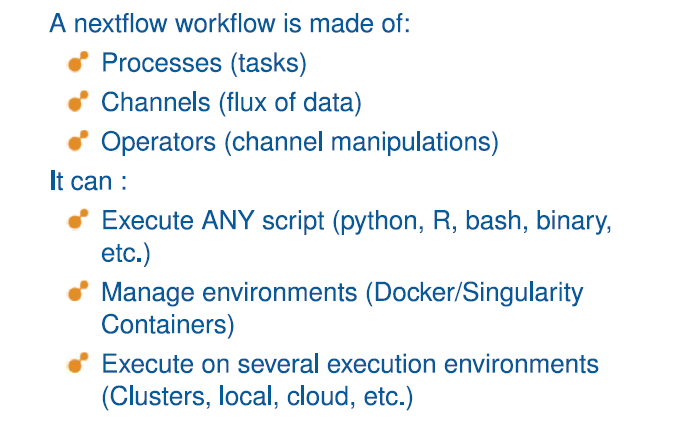{width="61%"}

Nextflow is a DSL (see section [Acronyms](#acronyms)).

Comarison with other workflow managers:

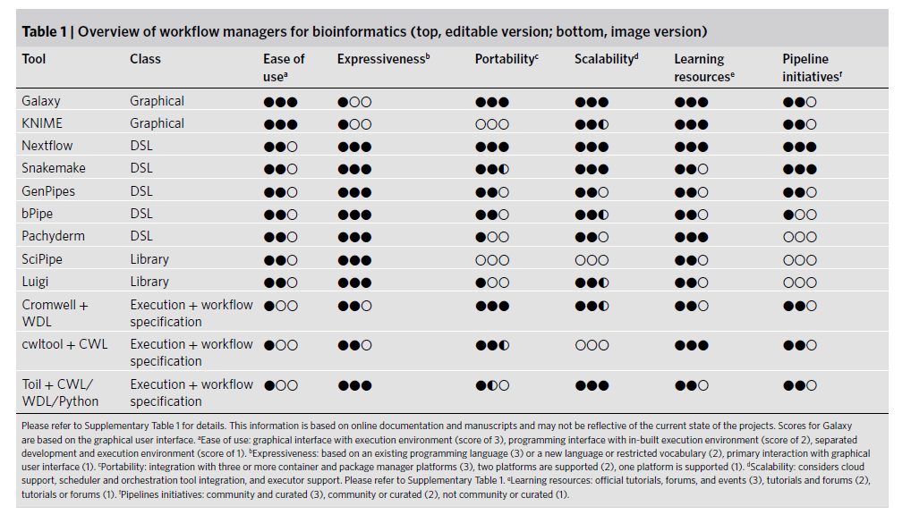

<https://www.nature.com/articles/s41592-021-01254-9>

Nextflow uses the Groovy language

<https://www.nextflow.io/docs/latest/script.html#language-basics>

<https://groovy-lang.org/>

<https://groovy-lang.org/syntax.html>

<https://www.tutorialspoint.com/groovy/index.htm>

Regex:

<https://www.nextflow.io/docs/latest/script.html#regular-expressions>

<https://web.archive.org/web/20170621185113/http://naleid.com/blog/2008/05/19/dont-fear-the-regexp/>

<https://docs.oracle.com/javase/tutorial/essential/io/fileOps.html#glob>

<https://docs.oracle.com/javase/7/docs/api/java/util/regex/Pattern.html>

# Console

Very useful to test groovy code.

On the cluster:

```
module load java
nextflow console
```

Web console:

<http://groovyconsole.appspot.com/edit/34004>

# Main groovy commands

|  |  |
|----|----|
| `x.first()` | If parallelization due to another channel in the same input section, specify that the x channel has to be used each time |
| `x.name` | take the name of the variable x. To assign the name, use `val(x.name) into y` |
| `${x}` | value of the variable x, defined at the beginning of the file |
| `//` | comment |
| `channel.` | function that defines a channel. Must be followed by another function (see below) |
| `channel.from(1,2)` | channel for the value 1 and 2 |
| `Channel.fromPath("x")` | define a channel from the path x. Warning: a channel can be called only once, contrary to variables |
| `Channel.fromFilePairs("x")` | take as argument a pathway of two files. If several couples of files, regular expressions are used. The result is a tuple |
| `file()` | define a path variable. For instance `file("x")` defines the path x as a variable, that can be used several times in a nextflow script if defined at the beginning of a nf script |
| `x.first()` | take the first element of channel x |
| `x.collectFile()` | collect all the files of channel x, means that it waits for the end of the parallelization of the process using the output channel x. Warning: see section [weird behavior of collectFile()](#weird-behavior-of-collectfile). Optional: `x.collectFile(name:"all_consensus.fasta", skip: 1, keepHeader: true)` |

```
x.collect()
x.mix(y, z)
```

|  |  |
|----|----|
| `x.flatten()` | split a list of file inside a single channel x into several channels with one file per channel |
| `publishDir "x/", mode: 'copy'` | copy the output files defined in the output section into the x folder. The `, mode: 'copy'` precises that we do not want a symbolic file into the x folder pointing to the work folder (default) but that we want a real copy. This avoid to break symbolic links if the wok folder is removed for instance |
| `tuple` | create a channel containing several info (like a list). Example: `tuple val(name), file(f1), file(f2) from data` |
| `val(y) from x` | recover a value from x and assign to y. Can be an integer, character, etc. |
| `file(y) from x` | recover a file from x and assign to y. In `input:` section |

# Script start

Every nexflow script start by at least one channel or one variable that must be defined.

## Channel

Channels are not mandatory. The advantage to use a channel is 1) to have several files in it and 2) to perform parallelization.

### Basic

Example:

```
num = Channel.from( 1, 2, 3 )
```

num takes the values 1, 2, 3.

Example:

```
file1 = Channel.fromPath("fasta/nCov_ampliseq_up.fasta")
```

Here file1 is a channel variable. It can be used only in a single process

Example:

```
data = Channel.fromFilePairs('fastq_files/*_{1,2}.fq.gz', flat:true)
```

Take all the files corresponding to `*`, then take 1 and 2 to form a couple of files. Thus if `*` corresponds to 8 names, 8 couples are formed. The `data` channel is an object a bit like a list, made of 8 compartments, one for each file name, each compartment having 3 values: a name (corresponding to `*`), and two file names (corresponding to `*_1.fq.gz` and `*_2.fq.gz`). The calling of this channel in a process could be something like:

```
input:
tuple val(x), file(x1), file(x2) from data
```

To create several initial channel from the same parameter:

```
Channel.fromPath("fasta/nCov_ampliseq_up.fasta", checkIfExists: false).into{fs_ch1; fs_ch2}
```

Warning: the `into` operator should be used to connect two or more target channels and checkIfExists is to check if the file exists (option not valid for value for instance).

To print the content of a channel:

```
tempo_ch.view { "tempo_ch: $it" } // tempo_ch is the name of the channel. The implicit variable "it" means iteration as it takes all the values from 1 to ... it will successively take the values 1, 2, and 3 as iterations go. To complete the answer a bit: any closure {} has the the implicit variable "it". {x->} has no implicit "it" variable, but an explicit "x". {->} has not implicit "it" variable and no explicit variable
```

### Queue and value channels

See <https://www.nextflow.io/docs/latest/channel.html#channel-types>

[Queue channel : single use]{.underline}

A queue channel is a non-blocking unidirectional FIFO queue which connects two processes or operators.

A queue channel is usually created using a factory method such as a from, fromPath, etc. or chaining it with a channel operator such as map, flatMap, etc.

Queue channels are also created by process output declarations using the into clause.

The definition implies that the same queue channel cannot be used more than one time as process output and more than one time as process input.

If you need to connect a process output channel to more than one process or operator use the into operator to create two (or more) copies of the same channel and use each of them to connect a separate process.

[Value channel : multiple use]{.underline}

A value channel a.k.a. singleton channel by definition is bound to a single value and it can be read unlimited times without consuming its content.

For this reason a value channel can be used as input by more than one process.

A value channel is created [using the value factory]{.underline} method or by operators returning a single value, such as first, last, collect, count, min, max, reduce, sum. Thus, a channel recovering a value via stdout will not be considered as value channel.

A value channel is implicitly created by a process when an input specifies a simple value in the from clause. Moreover, a value channel is also implicitly created as output for a process whose inputs are only value channels.

## Data objects

See <http://groovy-lang.org/groovy-dev-kit.html#_data_and_objects>

See section [Variable scope](#variable-scope) for the scope of the variables in nextflow.

### Vectors (Variable)

Variables are mostly vectors of one element. Example:

```
x = 1
println x

x = new java.util.Date()
println x

x = -3.1499392
println x

x = false
println x

x = "Hi"
println x
```

Variable can also be defined in processes or in the nextflow script:

```
y = 2

process foo {

  script:
  x = 1
  """
  echo $x $y
  """
}
```

See section [Variable scope](#variable-scope) for the scope of the variables.

### Range

See <http://groovy-lang.org/groovy-dev-kit.html#Collections-Ranges>

A range is like a Python xrange type, i.e., a range of integers. See <https://fr.wikiversity.org/wiki/Python/Les_types_de_base>

Example:

```
def range = 5..8 // range is a name not a function. Def is not mandatory
assert range.size() == 4
assert range.get(2) == 7
assert range[2] == 7
```

### List

See <http://groovy-lang.org/groovy-dev-kit.html#Collections-Lists>

A list is like a Python list type, i.e., an ordered collection of elements, but it seems that in groovy, they are of same mode. See <https://fr.wikiversity.org/wiki/Python/Les_types_de_base>

Example:

```
def list = [5, 6, 7, 8] // list is a name not a function. Def is not mandatory
assert list.get(2) == 7
assert list[2] == 7
assert list instanceof java.util.List

def emptyList = []
assert emptyList.size() == 0
emptyList.add(5)
assert emptyList.size() == 1
```

### Map

See <http://groovy-lang.org/groovy-dev-kit.html#Collections-Maps>

A map is like Python dictionnary type, i.e., an unordered collection of objects. See <https://fr.wikiversity.org/wiki/Python/Les_types_de_base>

Example:

```
def map = [name: 'Gromit', likes: 'cheese', id: 1234]
assert map.get('name') == 'Gromit'
assert map.get('id') == 1234
assert map['name'] == 'Gromit'
assert map['id'] == 1234
assert map instanceof java.util.Map

def emptyMap = [:]
assert emptyMap.size() == 0
emptyMap.put("foo", 5)
assert emptyMap.size() == 1
assert emptyMap.get("foo") == 5
```

### Tuple

See <https://www.nextflow.io/docs/latest/process.html#output-tuple-of-values>

A tuple is like Python tuple type, i.e., an unordered collection of objects. See <https://fr.wikiversity.org/wiki/Python/Les_types_de_base>

The tuple qualifier allows you to send multiple values into a single channel. This feature is useful when you need to group together the results of multiple executions of the same process, as shown in the following example:

```
query_ch = Channel.fromPath '*.fa'
species_ch = Channel.from 'human', 'cow', 'horse'

process blast {

input:
  val query from query_ch
  file species  from species_ch

output:
  tuple val(species), file('result') into blastOuts

script:
  """
  blast -db nr -query $query > result
  """
}
```

In the above example a BLAST task is executed for each pair of species and query that are received. When the task completes a new tuple containing the value for species and the file result is sent to the blastOuts channel.

### File reading

See <http://groovy-lang.org/groovy-dev-kit.html#_reading_files>

<https://www.nextflow.io/docs/latest/script.html#basic-read-write>

<https://www.nextflow.io/docs/latest/script.html#read-a-file-line-by-line>

Warning:

```
file1 = file("fasta/nCov_ampliseq_up.fasta")
```

[]{#_Ref88241790}Does not create a file if does not exists, nor read a file, file() create a path object than can then be used to manipulate the path.

## Implicit (reserved) variables

<https://www.nextflow.io/docs/latest/script.html#implicit-variables>

Very important variables:

|  |  |
|----|----|
| `launchDir` | The directory where the workflow is run (requires version 20.04.0 or later). |
| `projectDir` | The directory where the main .nf script is located (requires version 20.04.0 or later). Warning: `baseDir` is deprecated |
| `workDir` | The directory where tasks temporary files are created. See |

Dictionary like implicit variables (cannot be easily printed):

|  |  |
|----|----|
| `params` | Dictionary like object holding workflow parameters specifing in the config file or as command line options. |
| `workflow` | Dictionary like object representing workflow information (see See also <https://www.nextflow.io/docs/latest/metadata.html#workflow-introspection>). |
| `nextflow` | Dictionary like object representing nextflow runtime information (see Nextflow metadata). |

Other variables:

`moduleDir` The directory where a module script is located for DSL2 modules or the same as projectDir for a non-module script (requires version 20.04.0 or later).

To use one of this variable:

```
config_file = workflow.configFiles[0] // to get the config file (as a file, not a path string)

out_path_ini = "$baseDir/results"
```

To print one of this variable:

```
print("\n\nINITIATION TIME: ${workflow.start}")
```

See also section [Run metadata](#run-metadata).

## Options of nextflow run (params)

Pipeline parameters are simply declared by prepending to a variable name the prefix params, separated by dot character. Their value can be specified on the command line by prefixing the parameter name with a double dash character, i.e. --paramName. As an example, here is what should be written in the main.nf file:

```
params.str = 'Hello world!'
```

Which is used like this:

```
nextflow run tutorial.nf --str 'Bonjour le monde'
```

The string specified on the command line will override the default value of the parameter.

As of version 20.11.0-edge any . (dot) character in a parameter name is interpreted as the delimiter or nested scope e.g. --foo.bar Hello will be accessible from the script as params.foo.bar. If you want to have a parameter name including a . (dot) character escape it using the back-slash character e.g. --foo\\.bar Hello

the variable can be used as it is in the nextflow script:

```
${params.str}
```

Or reassigned in a more easy readable variable:

```
str=params.str
```

# Process

## Description

A process is a section of a nf script that processes channels or variables. The definition is:

```
process <name> {
}
```

Between the brackets is what is called the body of the process.

The minimal structure is:

```
process <NAME> {
    <user script of the required task>
}
```

But it is better to name the execution block using *script*, *shell* or *exec*:

```
process <NAME> {
[script | shell | exec]:
    <user script of the required task>
}
```

Can start with directives as `publishDir.`

And then is made of blocks, like:

|                          |                       |
|--------------------------|-----------------------|
| `input:`                 | input                 |
| `output:`                | output                |
| `when:`                  | when execute the task |
| `script | shell | exec:` | task to execute       |

If the channel has several values, the process is parallelized.

Full structure :

process \< name \> { \[ directives \]

input:

\< process inputs \>

output:

\< process outputs \>

when :

\< condition \>

\[ script\| shell\| exec \]:

\< user script to be executed \>

}

## Variable scope

Nextflow first check if the variable is present 1) in the script of the execution block of a process, 2) in the execution block of a process, but before the script, 3) in the channel, then in the nextflow script, and then in the system (\$PATH for instance).

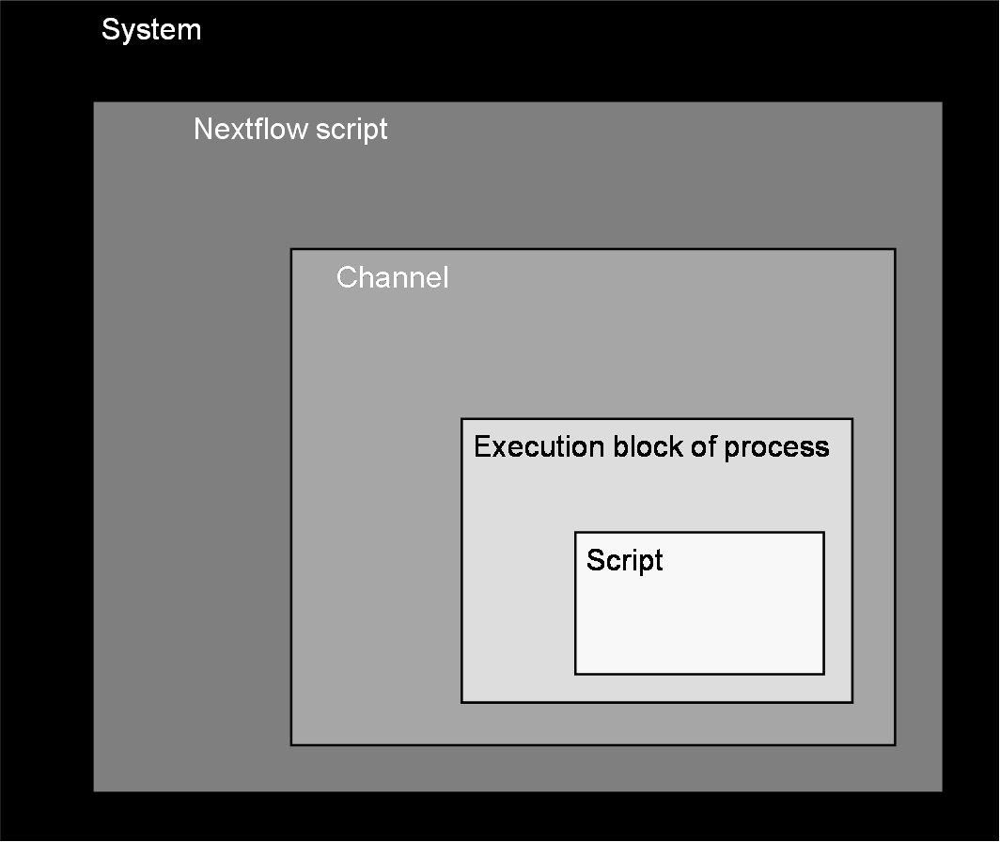{width="40%"}

Single quotes in the execution block scoops the scope and goes directly into the system environment if the variable is not defined between the quotes. See <https://www.nextflow.io/docs/latest/process.html#script>.

Example: copy-paste the following code into the file /mnt/c/Users/Gael/Desktop/caca.nf

```
x=4

process A {
x=3 # variable cannot be defined inside process but outside of the execution block

output:
"res.txt"

script:
x=2
"""
x=1
echo "Result is:" \$x > res.txt # if $x is used, it is replaced during the writting into the work/.../.command.sh file before execution of this file
"""
}
```

And execute:

```
nextflow run caca.nf
```

Check the result in work/.../res.txt

Then, play with inactivation and \\\$x to see the scope:

```
# x=1
echo "Result is:" \$x > res.txt
```

-\> Error: because the `.command.sh` has no variable x defined.

```
echo "Result is:" $x > res.txt
```

With no inactivation, the replacement of \$x is performed before the writing of `.command.sh`, and the result is 2.

```
//x=2
echo "Result is:" $x > res.txt
```

With `//x=2`, the replacement of \$x is performed before the writing of `.command.sh`, and the result is 4, because a ariable cannot be defined inside process but outside of the execution block.

```
//x=4
//x=2
echo "Result is:" $x > res.txt
```

-\> Error: because during the `.command.sh` writing, no variable x is defined, and the fact to use:

```
x=5
nextflow run caca.nf
```

Does not work either.

Now using single quotes:

```
'''
x=1
echo "Result is:" $x > res.txt
'''
```

The result is 1.

```
'''
# x=1
echo "Result is:" $x > res.txt
'''
```

-\> Error: because during the `.command.sh` writing, the scope is impaired by the single quotes.

```
'''
# x=1
echo "Result is:" $PATH > res.txt
'''
```

The \$PATH system variable is returned.

## Very important to understand

When a process is run, a working directory is created (inside the general working directory known thanks to the `workDir` implicit variable) and all the files declared in the `input` block are added into this directory thanks to symbolic links. For instance, when the process configBackup in `C:\Users\gael\Documents\Git_projects\project_a\main.nf` is run (see section [Backup the nextflow.config file into the result folder](#backup-the-nextflow.config-file-into-the-result-folder)):

```
config_file = workflow.configFiles[0] // better to use this than config_file = file("${projectDir}/ig_clustering.config") because the latter is not good if -c option of nextflow run is used
result_folder_name="20210903_res_project_a"
out_path="/mnt/c/Users/Gael/Desktop"
out_path="${out_path}/${result_folder_name}"

process configBackup {
    publishDir "${out_path}", mode: 'copy', overwrite: false

    input:
    file config_file

    output:
    file "${config_file}" // warning message if we use file config_file

    script: // mandatory block
    """
    """
}
```

The directory work\\b0\\2f59852ea304ebe335edfdf3fd9d68 is created and the file config_file (which is by default `"${projectDir}/nextflow.config"` except if -c option of nextflow run is used) is, added, using a symbolic link (warning: not seen through Windows OS windows):

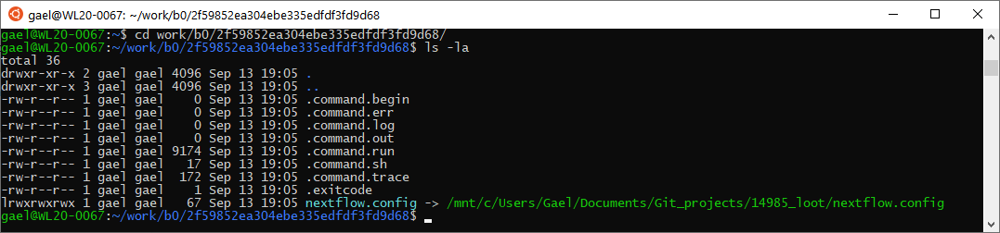

Now if:

1\) `publishDir "${out_path}"` is used at the beginning of the process

2\) a file is present in the input block

3\) and also present in the output block

Then, the file is copied into the `publishDir` folder using a symbolic link (warning: not seen through Windows OS windows):

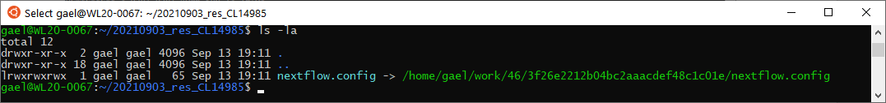

Now if in (1) `publishDir "${out_path}", mode: 'copy`' is used at the beginning of the process, then the file is copied hard into the `publishDir` folder:

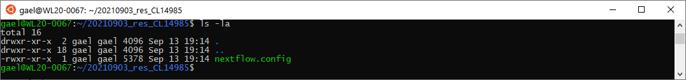

Now if in (1) `publishDir "${out_path}", mode: 'copy' overwrite: false` is used at the beginning of the process, then the file is copied into the `publishDir` folder according to the mode, but only if the file is not already in the `publishDir` folder, whatever the form.

If an input file is modified in a process, we could imagine than only the file present in the work directory is modified. But due to the symbolic link, the initial file will be also modified. To prevent this:

\- NEVER modify a file using the same name. always change the mane of the modified file.

\- ALWAYS copy these files in the process that modifies the file, not in another process (to optimize the -resume option of nextflow run).

## Directives

<https://www.nextflow.io/docs/latest/process.html#directives>

|  |  |
|----|----|
| `publishDir` | where to publish the output files. Example: `publishDir "${results}/", mode: 'copy'` |
| `cache` | store the process results to a local cache. When the cache is enabled and the pipeline is launched with the -resume option, any following attempt to execute the process, along with the same inputs, will cause the process execution to be skipped, producing the stored data as the actual results. Example: `cache 'false'`. The `'deep'` or `'lenient'` value can be used instead of `'true'` or `'false'`. See <https://www.nextflow.io/docs/latest/process.html?highlight=deep#cache> |
| `executor` | where processes are executed. By default a process uses the executor defined globally in the nextflow.config file. Example: `executor 'local'` |
| `tag` | associate each process execution with a custom label, so that it will be easier to identify them in the log file or in the trace execution report. Example: `tag "${name}"` |
| `label` | connect the current process with the withLabel: . Example: `label 'bwa'` |

### publishDir

See <https://www.nextflow.io/docs/latest/process.html#publishdir>.

The `publishDir` directive copies output files of the output block into a folder. Example:

```
    publishDir path: "/mnt/c/Users/Gael/Desktop/", mode: 'copy', overwrite: false

    output:
    file "aligned.gz" into tempo_ch
```

The aligned.gz file is sent into the tempo_ch channel but is also copied into the `/mnt/c/Users/Gael/Desktop/` folder thanks to the `publishDir` directive.

To get several output in folders (not into channels), use publishDir:

```
    publishDir path: "${results}/08_POS_QC", mode: 'link', pattern: 'out_*/*' // for the output result of pos_qc into 08_POS_QC
    publishDir path: "${results}/", mode: 'link', pattern: 'Full_Results.tsv' // for the copy of Full_Results.tsv from 08_POS_QC into ${results}/

    output:
    file "out_${vocqcfilename}*/*"// for the output result of voc_qc into 08_POS_QC
    file "Full_Results.tsv" // for the copy of Full_Results.tsv from 08_POS_QC into ${results}/
```

[Parameters]{.underline}

|  |  |
|----|----|
| `mode` | The file publishing method. See the following table for possible values. |
| `overwrite` | When true any existing file in the specified folder will be overridden (default: true during normal pipeline execution and false when pipeline execution is resumed). |
| `pattern` | Specifies a glob file pattern that selects which files to publish from the overall set of output files. See <https://docs.oracle.com/javase/tutorial/essential/io/fileOps.html#glob> |
| `path` | Specifies the directory where files need to be published. Note: the syntax publishDir '/some/dir' is a shortcut for publishDir path: '/some/dir'. |
| `saveAs` | A closure which, given the name of the file being published, returns the actual file name or a full path where the file is required to be stored. This can be used to rename or change the destination directory of the published files dynamically by using a custom strategy. Return the value null from the closure to not publish a file. This is useful when the process has multiple output files, but you want to publish only some of them. |
| `enabled` | Enable or disable the publish rule depending on the boolean value specified (default: true). |

## Input

<https://www.nextflow.io/docs/latest/process.html#inputs>

Warning: only channels can be specified in this block, even is it is not specified by "from" (which means in that case that the input name is the same as the channel name).

Warning: it is possible to use variables in the script block that does not come from a channel (see section [Variable scope](#variable-scope)). But not recommanded, notably to benefit from the -resume option if cache 'true'. Indeed, if a variable is modified, the -resume option + cache 'true' will not detect it and will rerun the process.

Warning: a list in the input block, example

```
methods = ['prot','dna', 'rna', 23, y]
process foo {
  input:
  val x from methods
```

results in a script run for each element of the list, independently. The parallelized processes are isolated from the others.

Warning: a list of files in the input block for which we would except a parallelization, is not parallelized if another input has a unique file: only one of the files is processed.

```
input:
    val file_name // a single variable
    file bam from dup_ch.mix(bowtie2_ch, q20_ch) // mix of three channels, i.e., three files in that case
    file "report.rmd" from log_ch14.first() // a single file in log_ch14
```

In this example, the three channels `dup_ch`, `bowtie2_ch` and `q20_ch` are assembled into a single one. The file_name variable is single but has no influence on the parallized process. However, `report.rmd` is a single file. If written as `file "report.rmd" from log_ch14`, the process takes only one of the three files from `dup_ch.mix(bowtie2_ch, q20_ch)` for the process. The `first()` operator is a trick to let nextflow believe that there are three files in `log_ch14`, which allow the parallelization. Warning, at that stage, the single `report.rmd` file are in three channels. In addition, the printing of the process shows that only one process is performed, while in fact 3. (See the .nextflow.log for the path of the three parallelized process). Thus, the `first()` strategy is not recommanded. It is better to have a correct definition of the parallelization.

Nextflow processes are isolated from each other but can communicate between themselves sending values through channels. The input block defines from which channels the process expects to receive data. You can only define one input block at a time and it must contain one or more input declarations. The input block follows the syntax shown below:

```
input:
  <input qualifier> <input name> from <source channel> [attributes]
```

Example:

```
    Input:
    file tempo1 from file1
```

[Input qualifier]{.underline}

Declares the type of data to be received

|         |                                                                                   |
|---------|-----------------------------------------------------------------------------------|
| `val`   | take the channel as values                                                        |
| `env`   | take the channel to set an environment variable named as the specified input name |
| `file`  | take the channel as a file, staging it properly in the execution context          |
| `path`  | take the channel as a path, staging the file properly in the execution context    |
| `stdin` | forward the channel to the process stdin special file                             |
| `tuple` | take the channel as a group of input values having one of the above qualifiers    |
| `each`  | lets you execute the process for each entry in the input collection               |

[Input name]{.underline}

variable that will contain the data from the channel

[source channel]{.underline}

Name of the channel to use. Must be preceeded by the keyword "from".

[[attribute]{.underline}]{.red}

[input optional attributes. Example ?]{.red}

[Example]{.underline}

```
num = Channel.from(1, 2, 3)
process basicExample {
  input:
  val x from num
  script:
  "echo process job $x"
}
```

The val function takes each value of the num channel and put it into the x variable.

Note that the results are in the .command.out of different folders, because the process is parallelized:

`\\wsl$\Ubuntu-20.04\home\gael\work\cf\8b0dc7603a6b28d7cd4da6e07befb9`

When the input name is the same as the channel name, the from part of the declaration can be omitted:

```
num = Channel.from(1, 2, 3)
process basicExample {
  input:
  val num
  script:
  "echo process job $num"
}
```

Of note, possible to use several channels as input:

```
num = Channel.from(1, 2, 3)
time = Channel.from(5)
process basicExample {
  input:
  val num
  val tempo from time.first()
 shell:
  """
  echo '$num * $tempo'
  """
```

Warning: if num is made of several values, while ref is made of only one, but that both have to be used in the process, `.first()` has to be used.

Warning with the scope of nextflow (see section [Variable scope](#variable-scope)). Examples:

```
num=Channel.from(5)
x=4

process A {
input:
val x from num
output:
"res.txt"
script:
x=2
"""
x=1
echo "Result is:" $x > res.txt # if $x is used, it is replaced during the writting into the work/.../.command.sh file before execution of this file
"""
}
num=Channel.from(5)
x=4

process A {
input:
val x from num
output:
"res.txt"
script:
//x=2
"""
x=1
echo "Result is:" $x > res.txt # if $x is used, it is replaced during the writting into the work/.../.command.sh file before execution of this file
"""
}
```

The result is 5, because the channel comes before the x=4 in the scope.

With tuples:

```
dsrc=Channel.fromFilePairs(params.fastq+'/*_R{1,2}.fastq.dsrc', flat: true)
process dsrc2gz {
	label 'dsrc'

	input:
	tuple val(name), file(r1), file(r2) from dsrc
```

The dsrc channel is an object a bit like a list, made of 8 compartments, one for each file name, each compartment having 3 values: a name (corresponding to \*), and two file names (corresponding to \*\_1.fq.gz and \*\_2.fq.gz)

With repeated inputs:

<https://www.nextflow.io/docs/latest/process.html#input-repeaters>

With fasta files:

```
    input:
    set  id, seqString from fasta_ch.splitFasta(record:[header: true, seqString: true]) // warning: several data -> parall expected
```

splitFasta(record:\[header: true, seqString: true\]) split a fasta files in records (one per sequence), each record with two items: the first is the header and the second the seq string. See <https://www.nextflow.io/docs/latest/operator.html#splitfasta>

set takes the first and second items of the record

## Output

<https://www.nextflow.io/docs/latest/process.html#outputs>

Warning: it is not possible to send a variable, a value, string, etc., from a complex script into channels. Only files works. The only way to get a variable is if the script return a single thing, which can be capted by the stdout qualifier.

Warning: to get an output file of a script into a result directory, we must 1) declare the output file into the output block (whatever sent into a channel or not), and 2) use the publishDir directive (see section [Directives](#directives)).

Warning: if an an output file of a script is not declared in the output block, it will never be present in the result directory. If it is present in the output block, it will depend of what is written in the publishDir directive.

The output declaration block allows you to define the channels used by the process to send out the results produced. You can only define one output block at a time and it must contain one or more output declarations.

The output block follows the syntax shown below:

```
output:
  <output qualifier> <output name> into <target channel>[,channel,..] [attribute [,..]]
```

If not `into` used, a channel with the same name is created (as for the input block) and is useable.

Example:

```
    Output:
    file "example1.txt" into tempo2,tempo3
```

Several channels can be created here

Global pattern can be used to specify several file names (see [protocol 44](044-bash.md)):

```
    Output:
    file "{head,table}*.txt" into tempo2
```

[Output qualifier]{.underline}

Declares the type of data to be received

|  |  |
|----|----|
| `val` | send variables with the name specified over the output channel |
| `env` | send a file defined in the process environment with the name specified over the output channel |
| `file` | send a file produced by the process with the name specified over the output channel |
| `path` | [idem]{.red} `file` |
| `stdout` | send the executed process `stdout` over the output channel |
| `tuple` | send multiple values over the same output channel |

[Output name]{.underline}

variable that will be sent into the channel

[target channel]{.underline}

Name of the channel to use. Must be preceeded by the keyword "into".

[[attribute]{.underline}]{.red}

[output optional attributes. Example ?]{.red}

[Example]{.underline}

```
num = Channel.from(1, 2, 3)
process basicExample {
  input:
  val x from num
  output:
  val x into tempo
  script:
  """
  echo $x > file
  """
}
```

See section [Input](#input).

Of note, when the output name is the same as the channel name, the into part of the declaration can be omitted.

Several channels can be defined:

```
output:
  val x into var_channel
  val 'BB11' into str_channel
  val "${fasta.baseName}.out" into exp_channel
```

Another way to declare several outputs:

```
    output:
    file "${fq.baseName}_fastqc.*" // fq.baseName means the base name of the input file named fq // .* means that all the fastqc.* files will be printed if publishDir is declared
```

Example with tuple:

```
file1 = Channel.fromPath("covid.fa")
process indexRef {
    input:
    file x from file1
    output:
    tuple val(x.Name), file("${x.baseName}.*") into tempo2
    script:
    """
    bwa index ${x}
    """
}
```

`val(x.Name)` take the name of the variable x that is a file, and take it as character using val()

See also <https://www.nextflow.io/docs/latest/script.html#check-file-attributes> where:

|  |  |
|----|----|
| `x.getName() or x.Name` | Gets the file name e.g. /some/path/file.txt -\> file.txt |
| `x.getBaseName() or x.BaseName` | Gets the file name without its extension e.g. /some/path/file.tar.gz -\> file.tar |
| `x.getSimpleName() or x.SimpleName` | Gets the file name without any extension e.g. /some/path/file.tar.gz -\> file |

To get several output in folders (not into channels), use publishDir:

```
    publishDir "${results}/08_POS_QC", mode: 'link', pattern: 'out_*/*' // for the output result of pos_qc into 08_POS_QC
    publishDir "${results}/", mode: 'link', pattern: 'Full_Results.tsv' // for the copy of Full_Results.tsv from 08_POS_QC into ${results}/
    output:
    file "out_${vocqcfilename}*/*"// for the output result of voc_qc into 08_POS_QC
    file "Full_Results.tsv" // for the copy of Full_Results.tsv from 08_POS_QC into ${results}/
```

## When

<https://www.nextflow.io/docs/latest/process.html#when>

## Execution block

<https://www.nextflow.io/docs/latest/process.html>

A process contains one and only one script or shell or exec block, and it must be the last statement when the process contains input and output declarations. The entered string is executed as a Bash script in the host system. It can be any command, script or combination of them, that you would normally use in terminal shell or in a common Bash script.

### Warnings

1\) If a script file is used in this block, it must be inside the ./bin/ folder if main.nf is in ./

2\) Whatever the entrypoint declared in a docker or singularity image used in a process, the code written in the `script` section is considered by default as bash. Thus, always specify the shebang at the beginning of the process. Example:

```
    script:
    """
    #!/bin/bash -ue
    echo "Hello"
    """
```

3\) When using files to run in the `script` section, located in the ./bin folder, always precise the executing file to use with the shebang. Example with a .R file. The `script` section is:

```
    script:
    """
    #!/bin/bash -ue
    tree_vizu.R \
"${tree_kind}" \
"tree_vizu.log"
    """
```

and the beginning of the `tree_vizu.R` file is:

```
#!/usr/bin/Rscript
```

We can also use the absolute path of the executing file:

```
    script:
    """
    #!/bin/bash -ue
    /usr/bin/Rscript -e '
        cat("Hello")
    '
    """
```

4\) When using `Rscript` in the `script` section, do not forget to use `-e`:

```
    script:
    """
    #!/bin/bash -ue
    /usr/bin/Rscript -e '
        cat("Hello")
    '
    """
```

5\) It is possible to use variables that are not declared in the input block. But not recommanded, notably to help the -resume option if cache 'true' [(it might be possible that the -resume option check the modifications of variables in channel but not other variables ?)]{.red}.

6\) The number of character must not be too long in that section. Otherwise, weird messages can appear (see section [Weird message (with process run but no output)](#weird-message-with-process-run-but-no-output)).

7\) Every messages and warnings coming from this section are not displayed in the executing window. Only error are returned by nextflow. The other messages are in the .command.log and .command.out files, in the work folder of the process:

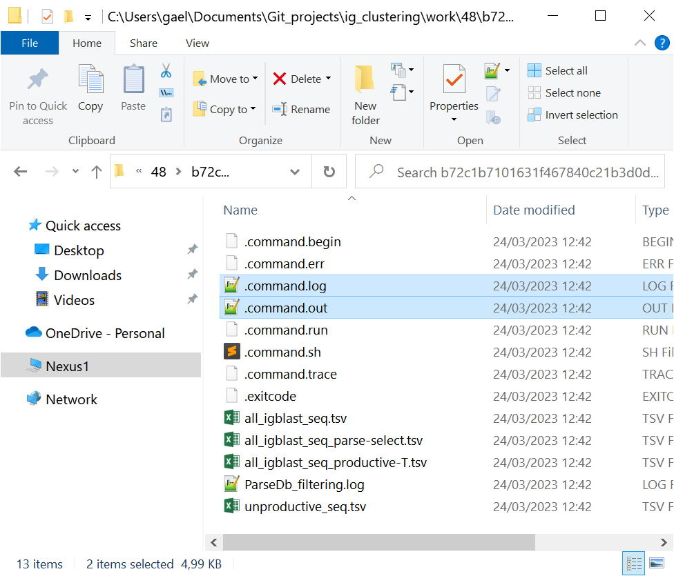{width="48%"}

If messages are required, either assign to a log folder and use publishDir (section [publishDir](#publishdir)) or use instruction in groovy inside workflow{}:

```
parseDb_filtering.out.unproductive_ch.count().subscribe{
    n -> if ( n == 0 ){
        print "\n\nWARNING: EMPTY unproductive_seq.tsv FILE RETURNED FOLLOWING THE parseDb_filtering PROCESS\n\n"
    }else{
        it -> it.copyTo("${out_path}/unproductive_seq.tsv")
    }
}
```

8\) The use of `|& tee -a file.log` prevents the arrest of the nextflow execution and error message display. Example :

```
    script:
    """
    if [[ "${meta_file}" != "NULL" && "${meta_legend}" != "NULL" ]] ; then
        Rscript -e '
            df <- read.table("${file_assembly_ch}", header = TRUE, sep = "\\t")
            meta <- read.table("${meta_file}", header = TRUE, sep = "\\t")
            if(names(meta)[1] != "Label"){
                stop(paste0("\\n\\n============\\n\\nERROR IN THE metadata_check PROCESS OF NEXTFLOW\\nIF THE meta_path PARAMETER IS NOT \\"NULL\\", THEN THE FIRST COLUMN OF THE METADATA FILE MUST BE NAMED \\"Label\\" AND BE MADE OF THE NAMES OF THE FASTA SEQUENCES\\n\\n============\\n\\n"), call. = FALSE)
            }
        ' |& tee -a file_assembly.log
    fi
    """
```

With such script section, the error message is printed into the file_assembly.log file, but not in the console. And the process is not interrupted.

Removing `|& tee -a file_assembly.log` solves the problem.

### Script

[Kind of language]{.underline}

Bash by default. Example of language modification

```
num = Channel.from(1, 2, 3)
time = Channel.from(5)
process basicExample {
  input:
  val num
  val tempo from time.first()
  script:
  """
  #!/usr/bin/python3
  print(\"the result is \" + str($num + $tempo))
  """
}
```

[Variable evaluation]{.underline}

No nextflow variable evaluation and single line -\> single quote or triple single quote. Example:

```
'echo The path is: $PATH'
  '''
  echo The path is: $PATH
  '''
```

In this example PATH is not subtituted before sending the script to bash (default).

No nextflow variable evaluation and multiple lines -\> triple single quote. Example:

```
  '''
  echo The path is: $PATH
  echo "Hello world"
  '''
```

Nextflow variable evaluation and single line -\> double quote or triple double quote. Example:

```
"echo The path is: $PATH"
  """
  echo The path is: $PATH
  """
```

In this example, if PATH is a nextflow variable (defined in the input section of the process, or before the process) it is substituted before sending the script to bash (default).

Nextflow variable evaluation and multiple lines -\> triple double quote. Example:

```
  """
  echo The path is: $PATH
  echo \"Hello world\"
  """
```

Here, the quotes inside the script are inactivated using `\.`

Another example

```
  """
  echo -e The path is:\\n$PATH
  """
```

Here, the \\n inside the script is inactivated using `\.`

Full example

```
num = Channel.from(1, 2, 3)
process basicExample {
  input:
  val num
  script:
  """
  #!/usr/bin/bash
  echo \"The result is \$(( $num * 5 ))\"
  """
}
```

The shebang is used to force the execution using bash (another language can be used like this).

The `$` of `num` is not inactivated because we need the variable substitution before sending the code to bash. However, the `$((` has to be inactivated using `\`, because it has to be interpreted only during bash execution.

Warning, some implicit variables of nextflow, like (see section [0](#_Ref88241790)) cannot be printed easily since it contains \$ that should be inactivated.

### Shell

Uses the exclamation mark ! character as the variable placeholder for Nextflow variables in place of the usual dollar character. Example:

```
process myTask {
    input:
    val str from 'Hello', 'Hola', 'Bonjour'
    shell:
    '''
    echo User $USER says !{str}
    '''
}
```

`!{str}` replaced during evaluation, then sent to bash, then `$USER` replaced.

Example:

```
process myTask {
    input:
    val str from 'Hello', 'Hola', 'Bonjour'
    shell:
    '''
    echo User $tempo says !{str}
    '''
}
```

Bash error message because no tempo variable in the env.

Using double quotes:

```
process myTask {
    input:
    val str from 'Hello', 'Hola', 'Bonjour'
    shell:
    """
    echo User $tempo says !{str}
    """
}
```

Nextflow error message because no tempo variable in nextflow.

### Exec

To execute native codes.

See

<https://www.nextflow.io/docs/latest/process.html#native-execution>

<https://www.nextflow.io/docs/latest/script.html#language-basics>

# Operators

## Nextflow

<https://www.nextflow.io/docs/latest/operator.html>

## Groovy

<https://groovy-lang.org/operators.html>

# Closure functions

See <https://www.nextflow.io/docs/latest/script.html#closures>

```
executor {
    name = 'slurm'
    queueSize = 2000
}
```

# running

## Defaults names

Nextflow recognize main.nf and nextflow.config as the two nf and config files by default.

When using `nextflow run`, this means that:

1\) it is not mandatory to specify the config file name if it is in the same path as the main.nf file and if it is named nextflow.config. Example:

```
nextflow run /home/gael/tmp/main.nf
```

2\) Running from a distant repository, the two files are recognized

```
nextflow run https://gitlab.pasteur.fr/gmillot/project_a -r master
```

## Basic instruction for execution

### Local running

Where the instruction is executed is important. Indeed, several files and folders are created at this place: result, work, .nexflow, etc. Once the location chosen using cd, do:

```
nextflow run /home/gael/tmp/main.nf
```

The main.nf file is executed. Parameters are in the nextflow.config file in the same folder as main.nf.

To specifiy the file name and path of the config file:

```
nextflow run /home/gael/tmp/main.nf -c /home/gael/tmp/nextflow.config
```

See section [Check that a distant server is mounted](#check-that-a-distant-server-is-mounted) if nothing happens, like:

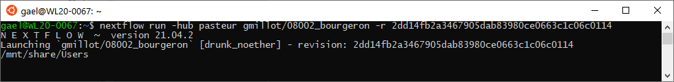

### Using a distant repository

See section [Precision when running a distant nextflow file](#precision-when-running-a-distant-nextflow-file).

[If the linkage.nf file in a public gitlab repository]{.underline}

Run the following command from where you want the results:

```
nextflow run -hub pasteur gmillot/genetic_linkage -r v1.0.0
```

-r for the tagged version of the file.

Warning : the .config file used by default is the one present in the distant repository. The config file can be on the local computer but -c option has to be used.

[If the linkage.nf file in a private gitlab repository]{.underline}

Create the scm file:

```
providers {
    pasteur {
        server = 'https://gitlab.pasteur.fr'
        platform = 'gitlab'
    }
}
```

And save it as 'scm' in the .nextflow folder. For instance in:

\\\\wsl\$\\Ubuntu-20.04\\home\\gael\\.nextflow

Warning: ssh key must be set for gitlab, to be able to use this procedure.

Then run the following command (example: from here \\\\wsl\$\\Ubuntu-20.04\\home\\gael):

```
nextflow run -hub pasteur gmillot/genetic_linkage -r v1.0.0
```

### On clusters

Warning: whatever the location where the run is executed, the \$HOME (`/pasteur/sonic/homes/gmillot`) is the reference for nextflow when running a file from a distant repo. This means that:

1\) The scm file must be in

```
$HOME/.nextflow
```

2\) The .ssh key for the connection to the pasteur gitlab repo must be in

```
$HOME/.ssh
```

3\) When pulling the distant repo, nextflow stores it in

```
$HOME/.nextflow/assets
```

However, as for local running, the rest is located where the run command is executed:

> 1\) .nextflow.log file
>
> 2\) work folder
>
> 3\) .nextflow folder, containing the cache folder and the history
>
> 4\) singularity folder

The `.nextflow/assets` folder is not used.

Start with:

````
```{bash, eval = FALSE}
EXEC_PATH="/pasteur/zeus/projets/p01/BioIT/gmillot/project_a" # where the bin folder of the main.nf script is located
export CONF_BEFORE=/opt/gensoft/exe # on maestro
export JAVA_CONF=java/13.0.2
export JAVA_CONF_AFTER=bin/java # on maestro
export SINGU_CONF=apptainer/1.1.5
export SINGU_CONF_AFTER=bin/singularity # on maestro
export GIT_CONF=git/2.39.1
export GIT_CONF_AFTER=bin/git # on maestro
export GRAPHVIZ_CONF=graphviz/2.42.3
export GRAPHVIZ_CONF_AFTER=bin/graphviz # on maestro

MODULES="${CONF_BEFORE}/${JAVA_CONF}/${JAVA_CONF_AFTER},${CONF_BEFORE}/${SINGU_CONF}/${SINGU_CONF_AFTER},${CONF_BEFORE}/${GIT_CONF}/${GIT_CONF_AFTER},${CONF_BEFORE}/${GRAPHVIZ_CONF}/${GRAPHVIZ_CONF_AFTER}"
# cd ${EXEC_PATH} # not required when using the gitlab repo to run the script
# chmod 755 ${EXEC_PATH}/bin/*.* # not required when using the gitlab repo to run the script. Neither required if no bin folder
module load ${JAVA_CONF} ${SINGU_CONF} ${GIT_CONF} ${GRAPHVIZ_CONF}
```
````

Then run like this:

```
nextflow run ${EXEC_PATH}/main.nf --modules ${MODULES}
```

Or using a distant repo (section [Precision when running a distant nextflow file](#precision-when-running-a-distant-nextflow-file)):

```
nextflow run -hub pasteur gmillot/project_a --modules ${MODULES}
```

Adapted code:

```
HOME_INI=$HOME
HOME="${ZEUSHOME}/genetic_linkage/" # $HOME changed to allow the creation of .nextflow into /$ZEUSHOME/genetic_linkage/, for instance. See NFX_HOME in the nextflow software script
trap '' SIGINT
nextflow run --modules ${MODULES} linkage.nf -c linkage.config
HOME=$HOME_INI
trap SIGINT
```

If an error message appears, like:

```
Unknown error accessing project `gmillot/project_a` -- Repository may be corrupted: /pasteur/sonic/homes/gmillot/.nextflow/assets/gmillot/project_a
```

Use to purge the

```
rm -rf /pasteur/sonic/homes/gmillot/.nextflow/assets/gmillot*
```

### Check that a distant server is mounted

See [protocol 140](140-wsl2-linux-on-windows.md).

Example:

```
DRIVE="C"
sudo mkdir /mnt/share
sudo mount -t drvfs $DRIVE: /mnt/share
```

Warning: if no mounting, it is possible that nextflow does nothing, or displays a message like:

```
Launching `linkage.nf` [loving_morse] - revision: d5aabe528b
/mnt/share/Users
```

### Error messages and solutions

1\)

```
Unknown error accessing project `gmillot/genetic_linkage` -- Repository may be corrupted: /pasteur/sonic/homes/gmillot/.nextflow/assets/gmillot/genetic_linkage
```

Purge using:

```
rm -rf /pasteur/sonic/homes/gmillot/.nextflow/assets/gmillot*
```

2\)

```
WARN: Cannot read project manifest -- Cause: Remote resource not found: https://gitlab.pasteur.fr/api/v4/projects/gmillot%2Flinkage
```

Make the distant repo public.

In settings/General/Visibility, project features, permissions, check that every item is "on" with "Everyone With Access" and then save the changes.

3\)

```
permission denied
```

Use chmod to change the user rights.

4\)

Warning: if no mounting, it is possible that nextflow does nothing, or displays a message like:

```
Launching `linkage.nf` [loving_morse] - revision: d5aabe528b
/mnt/share/Users
```

## Resume a run

First, get the name of the run that we want to resume, either by opening the history file in the .nextflow folder. Example: `\\wsl$\Ubuntu-20.04\home\gael\.nextflow`

Or by using the following command:

```
nextflow log
```

Note: it only works when executed where a .nextflow folder is present.

Then, use the -resume option and potentially the name of the run that we want to resume. Not adding name means the last one:

```
nextflow run /home/gael/tmp/main.nf -resume elegant_williams
nextflow run /home/gael/tmp/main.nf -resume # the last one
```

## Precision when running a distant nextflow file

See <https://www.nextflow.io/docs/latest/sharing.html#running-a-pipeline>

Warning:

1\) Does not work if main.nf and nextflow.config are not named like this.

2\) It seems that the -r option (section [The -r option](#the--r-option)) does not work if no main.nf and nextflow.config are present in the master branch. See <https://github.com/nextflow-io/nextflow/issues/1591>

3\) When executing a distant .nf file, nextflow first pulls the repo to the .nextflow\\assets\\ folder, where the nextflow run command is executed. If the folder already exists, nextflow does not compare the distant repo with the local pulled one. It goes directly to the local one. Thus, if the folder is corrupted or empty, an error message will appear, even if the distant repo is ok.

See section [Check that a distant server is mounted](#check-that-a-distant-server-is-mounted) if nothing happens, like:


### Preregistered repository

Warning: see section [Precision when running a distant nextflow file](#precision-when-running-a-distant-nextflow-file).

[Default command]{.underline}

This means that the distant repo is a public project on github/gitlab, etc., and that the two files are named main.nf and nextflow.config and are both in the pointed repo:

```
nextflow run gael-millot/project_a
```

Note that `gael-millot/project_a` is called the "qualified name". The qualified name is formed by two parts: the owner name and the repository name separated by a / character

[Pre-registered repo]{.underline}

First, precise the repo thanks to the -hub option, then the user account thanks to the -user option, then the name of the project:

```
nextflow run -hub github -user gael-millot project_a
```

Note: does not work for pasteur.gitlab, as it is not referenced in nextflow. See section [Private repository: example with pasteur gitlab](#private-repository-example-with-pasteur-gitlab).

Note that what is run here is the project name `project_a`.

[Url]{.underline}

Using the master branch of the public project repo:

```
nextflow run https://github.com/gael-millot/project_a
```

Using another branch/tag/commit of the project repo:

```
nextflow run https://github.com/gael-millot/project_a -r v1.0.0
```

Option -r signals either a git branch, tag or commit SHA number.

### Private repository: example with pasteur gitlab

Warning: see section [Precision when running a distant nextflow file](#precision-when-running-a-distant-nextflow-file).

About the SCM file:

<https://www.nextflow.io/docs/latest/sharing.html#scm-configuration-file>

See the site of Remi Planel:

<https://gitlab.pasteur.fr/genolist/legiolist-pre-processing/-/tree/master>

Create the scm file:

```
providers {
    pasteur {
        server = 'https://gitlab.pasteur.fr'
        platform = 'gitlab'
    }
}
```

And save it as 'scm' in the .nextflow folder. For instance in:

`\\wsl$\Ubuntu-20.04\home\gael\.nextflow`

Warning: ssh key must be set for gitlab, to be able to use this procedure (see [protocol 44](044-bash.md)).

Then run the following command from here `\\wsl$\Ubuntu-20.04\home\gael`:

```
nextflow run -hub pasteur gmillot/project_a -r v1.0.0
```

Warning: does not work:

```
nextflow run -hub pasteur -user gmillot project_a
```

See also:

<https://www.nextflow.io/blog/2021/configure-git-repositories-with-nextflow.html>

### The -r option

[Branch]{.underline}

```
nextflow run -hub pasteur gmillot/project_a -r master
```

[Tag]{.underline}

```
nextflow run -hub pasteur gmillot/project_a -r v1.0.0
```

[Commit number (found in the url address bar of the commit page)]{.underline}

```
nextflow run -hub pasteur gmillot/project_a -r 1b05c85463558e8911a5ac0c2ee730b2133588c4
```

Warning: does not work using the short ID number.

### The -c option

It is very important to use absolute path with the -c option, since by default, nextflow uses as the starting point where the script is run. For instance, with:

```
nextflow run -hub pasteur gmillot/project_a -r v1.0.0 -c dev/test.config
```

Nextflow does not look starting from where main.nf is (/pasteur/appa/homes/gmillot/.nextflow/assets/gmillot/project_a/) but where the script is run (/pasteur/zeus/projets/p01/BioIT/gmillot/project_a/). Thus the best is to write:

```
nextflow run -hub pasteur gmillot/project_a -r v1.0.0 -c /pasteur/appa/homes/gmillot/.nextflow/assets/gmillot/project_a/dev/test.config
```

### Several nextflow execution

[Does not work]{.red}

The determinant factor is the .nextflow file: only one can be used per ongoing run. The idea is thus to create a new .nextflow folder in different tmp folders:

```
mkdir $ZEUSHOME/project_a/temp1
HOME="$ZEUSHOME/project_a/temp1" ;
mkdir $HOME/.nextflow ;
cp /pasteur/zeus/projets/p01/BioIT/gmillot/project_a/.nextflow/scm $HOME/.nextflow/ ;
nextflow run --modules ${MODULES} -hub pasteur gmillot/project_a -r v7.1.0 -c $HOME/.nextflow/assets/gmillot/project_a/nextflow.config ;
HOME="/pasteur/appa/homes/gmillot/"
```

Another important thing is to execute the command where the singularity folder is present to prevent pulling docker images each time. Example of procedure for slurm:

```
cd $ZEUSHOME/project_a
tmux
```

```
mkdir $ZEUSHOME/project_a/temp2
HOME="$ZEUSHOME/project_a/temp2" ;
mkdir $HOME/.nextflow ;
cp /pasteur/zeus/projets/p01/BioIT/gmillot/project_a/.nextflow/scm $HOME/.nextflow/ ;
# cd $HOME/

EXEC_PATH=$HOME # where the bin folder of the main.nf script is located
export CONF_BEFORE=/opt/gensoft/exe # on maestro
export JAVA_CONF=java/13.0.2
export JAVA_CONF_AFTER=bin/java # on maestro
export SINGU_CONF=singularity/3.8.3
export SINGU_CONF_AFTER=bin/singularity # on maestro
export GIT_CONF=git/2.25.0
export GIT_CONF_AFTER=bin/git # on maestro
export GRAPHVIZ_CONF=graphviz/2.42.3
export GRAPHVIZ_CONF_AFTER=bin/graphviz # on maestro

MODULES="${CONF_BEFORE}/${JAVA_CONF}/${JAVA_CONF_AFTER},${CONF_BEFORE}/${SINGU_CONF}/${SINGU_CONF_AFTER},${CONF_BEFORE}/${GIT_CONF}/${GIT_CONF_AFTER},${CONF_BEFORE}/${GRAPHVIZ_CONF}/${GRAPHVIZ_CONF_AFTER}"
# cd ${EXEC_PATH} # not required when using the gitlab repo to run the script
# chmod 755 ${EXEC_PATH}/bin/*.* # not required when using the gitlab repo to run the script
module load ${JAVA_CONF} ${SINGU_CONF} ${GIT_CONF} ${GRAPHVIZ_CONF}

nextflow run --modules ${MODULES} -hub pasteur gmillot/project_a -r eefe412af536d368e1e6960a7acce376d769011f -c $HOME/.nextflow/assets/gmillot/project_a/nextflow.config ;

HOME="/pasteur/appa/homes/gmillot/"
```

## Example of scripts and running commands

### Example 1

File prep:

```
cd
mkdir tmp
echo -e "Hello world\nI love you all" > ./tmp/ex1.txt
```

Nextflow script:

```
file1 = Channel.fromPath("/home/gael/tmp/ex1.txt")
process exercice1 {
    input:
    file tempo1 from file1
    script:
    """
    sed 's/ /./g' ${tempo1} > tempo2 # replace spaces by dots
    """
    }
```

Note that no need of output section

Copy paste this script into:

`\\wsl$\Ubuntu-20.04\home\gael\tmp\main.nf`

Execution:

```
nextflow run /home/gael/tmp/main.nf
```

Everything is fine:

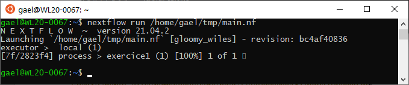{width="83%"}

The result is in 7f as indicated in the message:

`\\wsl$\Ubuntu-20.04\home\gael\work\7f\2823f4940b5ad82cd87ec4302240ea`

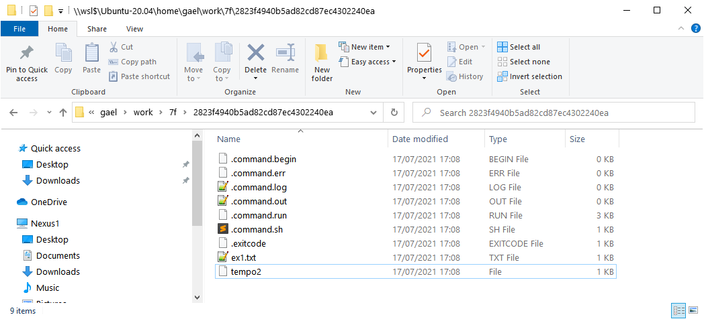{width="75%"}

See section [The work directory](#the-work-directory) for the details of these files.

### Example 2

File prep:

```
cd
mkdir tmp
echo -e "Hello world\nI love you all" > ./tmp/ex1.txt
```

Nextflow script:

```
file1 = Channel.fromPath("/home/gael/tmp/ex1.txt")
process exercice1 {
    input:
    file tempo1 from file1
    output:

    script:
    """
    sed 's/ /./g' ${tempo1} > tempo2 # replace spaces by dots
    """
    }
```

Copy paste this script into:

\\\\wsl\$\\Ubuntu-20.04\\home\\gael\\tmp\\main2.nf

Execution:

```
nextflow run /home/gael/tmp/main.nf
```

### Example 3

See

`C:\Users\gael\Documents\Git_projects\project_a`

```
nextflow run -resume -hub pasteur gmillot/project_a -r v1.0.0
```

### Example 4

See

`C:\Users\gael\Documents\Git_projects\project_a`

```
nextflow run https://gitlab.pasteur.fr/gmillot/project_a/-/blob/v1.0.0/main.nf -resume
```

# Execution printing

## Display

```
N E X T F L O W  ~  version 19.04.0
executor >  local (3)
```

`[69/c8ea4a] process > splitLetters   [100%] 1 of 1` ✔

`[84/c8b7f1] process > convertToUpper [100%] 2 of 2` ✔

You can see that the first process is executed once, and the second twice. Finally the result string is printed.

The hexadecimal numbers, like 22/7548fa, identify the unique process execution. These numbers are also the prefix of the directories where each process is executed. You can inspect the files produced by them changing to the directory \$PWD/work and using these numbers to find the process-specific execution path.

## Recovering these infos

See trace in section [Parameter and execution report](#parameter-and-execution-report) and section [The work directory](#the-work-directory).

# Config file

<https://www.nextflow.io/docs/latest/config.html#configuration-file>

<https://carpentries-incubator.github.io/workflows-nextflow/08-configuration/index.html>

## Name and location of the config file

By default:

nextflow.config

in the same folder as the main.nf file.

## Priorities of variables

<https://www.nextflow.io/docs/latest/config.html?highlight=params#configuration-file>

When a pipeline script is launched, Nextflow looks for configuration files in multiple locations. Since each configuration file can contain conflicting settings, the sources are ranked to decide which settings to are applied. All possible configuration sources are reported below, listed in order of priority:

Parameters specified on the command line (--something value)

Parameters provided using the -params-file option

Config file specified using the -C my_config option

The config file named nextflow.config in the current directory

The config file named nextflow.config in the workflow project directory

The config file \$HOME/.nextflow/config

Values defined within the pipeline script itself (e.g. main.nf)

When more than one of these ways of specifying configurations are used, they are merged, so that the settings in the first override the same ones that may appear in the second one, and so on.

If you want to ignore any default configuration files and use only the custom one use the command line option -C \<config file\>.

Three main sections inside a config file: variables, scopes and directives

## Variables

Variables can be defined at the begining of the config file

1\) variables that will be used in the main.nf file.

2\) variables that will be used only in the config file.

## Scopes

The following sections cannot be used in nextflow scripts, only in config files.

### env

This scope allows to declare variables that will be used in the main executed nf file.

See an example of how to write variables in env:

<https://gitlab.pasteur.fr/gmillot/project_a/-/tree/v1.0.0>

### executor

<https://www.nextflow.io/docs/latest/config.html#scope-executor>

### singularity

<https://www.nextflow.io/docs/latest/config.html#scope-singularity>

To understand how singularity is used by nextflow instead of docker :

<https://www.nextflow.io/docs/latest/singularity.html#singularity-page>

See notably <https://www.nextflow.io/docs/latest/singularity.html#singularity-docker-hub>

Warning: python can have problems with singularity. The error message is:

FileNotFoundError: \[Errno 2\] No such file or directory: '/dev/shm'

In that case, use:

```
singularity {
    runOptions = '-B /run/shm:/run/shm'
}
```

Example:

```
singularity {
    enabled = true
    autoMounts = true // automatically mounts host paths in the executed container
    runOptions = '--no-home --bind /pasteur -B /run/shm:/run/shm'
    cacheDir = '/pasteur/zeus/projets/p01/BioIT/gmillot/project_a/singularity'
}
```

Single or double quotes depending on whether we need variable interpretation or not.

Warning: with apptainer, this trick does not work.

Options of singularity:

|  |  |
|----|----|
| enabled | Turn this flag to true to enable Singularity execution (default: false). |
| autoMounts | When true Nextflow automatically mounts host paths in the executed container. It requires the user bind control feature enabled in your Singularity installation (default: false). |
| runOptions | This attribute can be used to provide any extra command line options supported by the singularity exec. |

> |  |  |
> |----|----|
> | --bind | mount a folder point into the container. Mandatory such that singularity is able to understand the tree of the machine used. Example: --bind /pasteur, in order for singularity to access to /pasteur/usr/local for instance. By default, singularity uses --bind \$HOME |
> | --no-home | does not use \$HOME (which is what is used by default). Probably create a tmp folder or an empty \$HOME. This prevent singularity to use \$HOME to look for applications and forces it to use only what is inside the container |
> | --home \$HOME:/home/\$USER | to change the \$HOME for singularity |

cacheDir The directory where remote Singularity images are stored. When using a computing cluster it must be a shared folder accessible to all computing nodes.

In singularity, there is no entrypoint to manage.

Remember that Nextflow use singularity exec and not singularity run (see protocol ).

### Docker

If singularity/apptainer is not available locally (on MacOS for instance), use:

```
docker{
    enabled = true
    runOptions = "--entrypoint ''"
}
```

runOptions This attribute can be used to provide any extra command line options supported by the docker exec.

> --entrypoint "" Overwrite the default entrypoint set by the image of the container, so that it uses the system (bash for instance).

<https://www.nextflow.io/docs/latest/config.html#scope-docker>

### process

<https://www.nextflow.io/docs/latest/config.html#scope-process>

# Info about the run

## Run metadata

<https://www.nextflow.io/docs/latest/metadata.html#workflow-introspection>

The `workflow` object contains many info about the run that are listed in the link above. To get them, use for instance:

```
println "Project : $workflow.projectDir"
println "Git info: $workflow.repository - $workflow.revision [$workflow.commitId]"
println "Cmd line: $workflow.commandLine"
println "configFiles: $workflow.configFiles"
println "configFiles: $workflow.configFiles[0]"

config_file = workflow.configFiles[0] // to get the config file (as a file, not a path string)
```

## Parameter and execution report

<https://www.nextflow.io/docs/latest/config.html#config-scopes>

Several scopes are interesting:

|  |  |
|----|----|
| report | <https://www.nextflow.io/docs/latest/config.html#scope-report> |
| trace | provide information about each process execution, including the path in the work directory where to find all the execution report files. Somehow, similar to the printing during nextflow execution. See section [The work directory](#the-work-directory). |
| timeline | time line of each process |

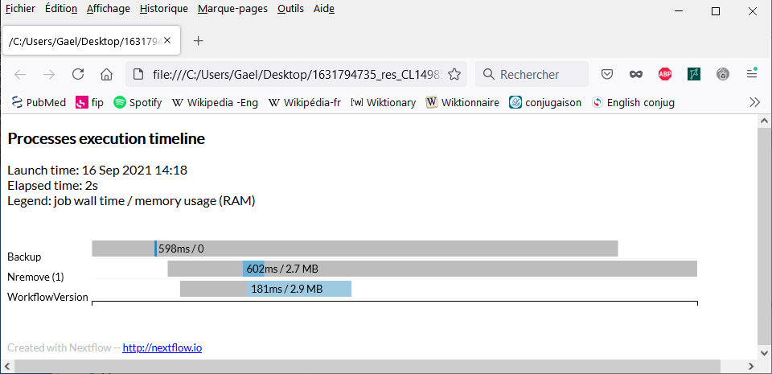{width="75%"}

dag graph in the dot format of the workflow. Graphviz software (<https://graphviz.org/download/>) is required to see the graph. For formats other than dot, see <https://www.nextflow.io/docs/latest/tracing.html#dag-visualisation>. To install graphviz: <http://www.graphviz.org/download/>

```
sudo apt install graphviz
```

Parameters of the report scope:

<https://www.nextflow.io/docs/latest/config.html#config-report>

## The work directory

During each worflow execution, a working directory is created in the work directory for each process. The full path is indicated in the trace file (section [Parameter and execution report](#parameter-and-execution-report)). Example of trace content:

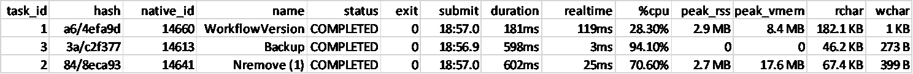

Example of the content of the corresponding task 2:

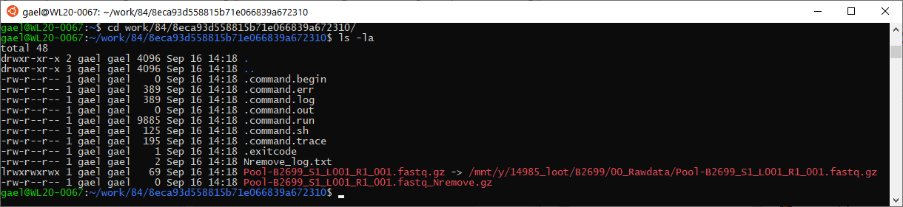

The tmp file contains all the files indicated in the input and output blocks of the process (see that the Pool-B2699_S1_L001_R1_001.fastq.gz file is a symbolic link), and also the following files:

[.command.begin]{.red}

|  |  |
|----|----|
| .command.err | content of STDERR |
| .command.log | STDOUT + STDERR |
| .command.out | content of STDOUT |
| .command.run | Nextflow generated commands torun the script (cloud, etc.) |
| .command.sh | Script of the task ("script:" in process definition). Warning : the files indicated are not with absolute path because it is the file from the work tmp directory that is called (see section [The work directory](#the-work-directory)) |
| .command.trace | Memory/CPU/Disk footprint of the task |
| .exitcode | Exit status of the task (0, ok; other, error) |

## Manifest

<https://www.nextflow.io/docs/latest/metadata.html?highlight=workflow%20manifest%20version>

# Problem of path

It is difficult to work with absolute paths with nextflow, because the idea of nextflow is precisely to do not depend on that (see section [Very important to understand](#very-important-to-understand)) by creating the work tmp directory (see section [The work directory](#the-work-directory)).

Example of how path can be used :

```
process check {
    label 'bash' // see the withLabel: bash in the nextflow config file
    publishDir "${out_path}", mode: 'copy', overwrite: false
    cache 'false'
    input:
    val projectDir
    val out_path
    output:
    file "check_log.txt"
    script:
    """
    check.sh "check_log.txt" ${projectDir} ${out_path}
    """
}
```

With the following check.sh script file

```
output_file=$1
in_path="$2"
out_path="$3"
echo -e "\nRESULT DIRECTORY CREATED:\n${out_path}\n" > ${output_file}
echo -e "\nnextflow.config FILE USED FOR THIS RUN IS IN:\n${in_path}\nAND IS SAVED IN:\n${out_path}\n" >> ${output_file}
```

Here we can see that the text is printed in the `${output_file}`, which corresponds to `"check_log.txt"` , that is created in the tmp work directory when the process is executed. With `publishDir "${out_path}", mode: 'copy'`, the `"check_log.txt"` file is also copied in the result folder. The other arguments are just indicative. They are not used as path.

# Example of variable assessment

## Warning with "!"

This works:

```
nb = "a"
if(nb != "a"){
    error "\nERROR\n"
}
```

This assessment of nb being a character string made of digits does not work properly :

```
nb = "a"
if( ! nb =~ /^\d+$/){
    error "\nERROR\n"
}
```

Neither this:

```
nb = "a"
if(nb !=~ /^\d+$/){
    error "\nERROR\n"
}
```

But this yes:

```
nb = "a"
if( ! (nb =~ /^\d+$/) ){
    error "\nERROR\n"
}
```

Idem with expression like this one that does not work properly:

```
nb = 1
if( ! nb in String){
    error "\nERROR\n"
}
```

But this yes:

```
nb = 1
if( ! (nb in String) ){
    error "\nERROR\n"
}
```

Thus, always use brackets with "!"

## Warning with "\|"

This assessment of nb being a proportion character string (0 or 1 or 0.*\<digits\>*) does not work properly :

```
nb = "1.1"
if(nb =~ /^(1)|(0)|(0\.[0-9]*)$/){
    println("\nOK\n")
}else{
    error "\nERROR\n"
}
```

But this works:

```
nb = "1.1"
if(nb =~ /^((1)|(0)|(0\.[0-9]*))$/){
    println("\nOK\n")
}else{
    error "\nERROR\n"
}
```

Thus, always use brackets with "\|"

## String made of integer over 2

```
nb="1"
try {
    if(nb.toInteger()<3){
        throw new Exception("Integer not >=3")
    }else{
        println("Entier > 3")
    }
} catch(Exception e) {
    println "Problem with nb parameter: "+e.message
}
```

or

```
nb="1"
if(( ! (nb =~ /^\d+$/)) || nb.toInteger() < 3){
    error "\n\n========\n\nERROR IN NEXTFLOW EXECUTION\n\nINVALID nb PARAMETER IN ig_clustering.config FILE:\n${nb}\nMUST BE A POSITIVE INTEGER VALUE EQUAL OR GREATER TO 3\n\n========\n\n"
}
```

# Example of processes

## Versions & used variables

```
git_path="https://gitlab.pasteur.fr/gmillot/project_a/-/raw/master"
in_path="/mnt/y/project_a/B2699/00_Rawdata"
config_file = workflow.configFiles[0] // better to use this than config_file = file("${projectDir}/ig_clustering.config") because the latter is not good if -c option of nextflow run is used
result_folder_name="20210903_res_project_a"
out_path="/mnt/c/Users/Gael/Desktop"
out_path="${out_path}/${result_folder_name}"

process WorkflowVersion {
    publishDir "${out_path}", mode: 'copy'
    cache 'false'
    executor 'local' // this is the default config

    output:
    file "Run_info.txt"

    script:
    """
echo "Project: " \$(git -C ${projectDir} remote -v | head -n 1) > Run_info.txt # works only if the main script run is located in a directory that has a .git folder, i.e., that is connected to a distant repo
echo "Git info: " \$(git -C ${projectDir} describe --abbrev=10 --dirty --always --tags) >> Run_info.txt # idem. Provide the small commit number of the script and nextflow.config used in the execution
echo "Cmd line: ${workflow.commandLine}" >> Run_info.txt // provide the command line used
echo "Manifest's pipeline version: ${workflow.manifest.version}" >> Run_info.txt
echo "result path: ${out_path}" >> Run_info.txt
echo "nextflow version: ${nextflow.version}" >> Run_info.txt
echo -e "\\n\\nIMPLICIT VARIABLES:\\n\\nlaunchDir (directory where the workflow is run): ${launchDir}\\nprojectDir (directory where the main script is located): ${projectDir}\\nworkDir (directory where tasks temporary files are created): ${workDir}" >> Run_info.txt
echo -e "\\n\\nSCRIPT VARIABLES:\\n\\ngit_path: ${git_path}\\nin_path: ${in_path}\\nout_path: ${out_path}" >> Run_info.txt
    """
}
```

The two first lines are very important in reproductibility, as they connect the executed script with the commited version to a distant repo. But it works only if the the main script run is located in a directory that has a .git folder, i.e., that is connected to a distant repo.

To recover the url of the commit number indicated in "Git info:"

```
git
```

## Backup the nextflow.config file into the result folder

A nextflow.config file must exist where the main.nf file is executed.

```
config_file = workflow.configFiles[0] // better to use this than config_file = file("${projectDir}/ig_clustering.config") because the latter is not good if -c option of nextflow run is used
result_folder_name="20210903_res_project_a"
out_path="/mnt/c/Users/Gael/Desktop"
out_path="${out_path}/${result_folder_name}"

process configBackup {
    label 'bash' // see the withLabel: bash in the nextflow config file
    publishDir "${out_path}", mode: 'copy', overwrite: false // since I am in mode copy, all the output files will be copied into the publishDir. See \\wsl$\Ubuntu-20.04\home\gael\work\aa\a0e9a739acae026fb205bc3fc21f9b
    cache 'false'

    input:
    file config_file

    output:
    file "${config_file}" // warning message if we use file config_file

    script:
    """
    """
}
```

## Library of processes

<https://github.com/nextflow-io/patterns/>

# Nextflow nf-core

Community effort to collect a curated set of analysis pipelines built using Nextflow. It is like to make packages for nextflow in order to avoid to each one to develop the same stuff (like bowtie alignment). The problem is that the code beomes very hard to understand because many sub files, etc. Fred Lemoine does not use it.

<https://github.com/nf-core/configs>

<https://github.com/nf-core/hic>

<https://github.com/nf-core/sarek>

Command:

```
singularity pull --docker-login docker://nfcore/hic
nextflow run nf-core/hic -r 1.2.2 -profile singularity --input 'SRR11893084_{1,2}.fastq' --fasta ../fa/scer_288_2mu.fa --bwt2_idx ../fa/scer_288_2mu --dnase --bin-size '
200,1000' -c ~/pasteur.config -with-singularity ../hic_latest.sif
```

# Errors handling

For the list of error exit status, sse the corresponding environnement (slurm for instance).

# Troubleshootings

1\) How to run nextflow on maestro and be able to quit the session without killing the process ?

Use Tmux (see protocol )

2\) How to run the same nextflow on two independent sessions. It seems that there is a problem inside the .nexflow folder.

scope singularity avec cachedir ou NXF_SINGULARITY_CACHEDIR defined in the .profile

This force with an absolute path where nextflow has to seek for singularity images. scope singularity with cachedir overrides the NXF_SINGULARITY_CACHEDIR variable

3\) The variable problem that I still have to deal with Fred in nf_column_reorder

4\) The problem with subscribe that I still have to deal with Fred in nf_column_reorder

5\) Dockerfile : I suceeded to recover the log of the building process (see r extended dockerfile v1.0). But how to recover all the prints? Some are missing, notably during compilation of R packages

6\) In docker, is it important to force the versions to install, in order to have a better chance to recreate the same image from the dockerfile, if ever the image is lost ?

7\) How to use docker instead of singularity

J'ai un truc bizarre. Quand je remplace mon engin singularity:

singularity {

enabled = true

autoMounts = true

cacheDir = 'singularity'

}

par

docker {

enabled = true

}

J'ai le message d'erreur suivant:

Cannot enable more than one container engine -- Choose either one of: docker, singularity

Alors que je n'ai aboslument plus de mot 'singularity' dans le config ou le main file.

Salut Gael, peut être sur la ligne de commande?

8\) Why cache = TRUE is sometimes not respected? Why -resume is not respected ?

<https://github.com/nextflow-io/nextflow/issues/1629>

As soon as a cache = false in a process, all the process that uses a channel from this process will be re-executed. This is the case for

Warning: Rscript \$workflow.projectDir/bin/plot_fivep_filtering_stat.R is the only way to have the execution rights of a .R file in the bin directory when the gitlab repo is pulled into /pasteur/sonic/homes/gmillot/.nextflow/assets/. See <https://github.com/nextflow-io/nextflow/issues/698>. Otherwise, the following message can appear: Fatal error: cannot open file '/pasteur/sonic/homes/gmillot/.nextflow/assets/gmillot/project_a/bin/plot_fivep_filtering.R': No such file or directory

But we have added a Rscript shebang at the beginning of each .R file. This could overcome the problem.

9\) I would like the dag file in png and html at the same time.

No idea.

10\) How to increment a channel name. Example: log_ch{NB+1}

Nope. No way

11\) How to have two channels made of several files in the same order. Example. I want to be sure that these two series are associated in the same order:

```
  file bam from bowtie2_ch2.concat(q20_ch3, dup_ch1) // warning: several files
  file read_nb from bow_read_nb_ch.concat(q20_read_nb_ch, dup_read_nb_ch)

tuple file(bam), file(readnb) from bowtie2_ch2.combine(bow_read.nb_ch).concat(q20-ch3.combine(q20_read_nb_ch)).concat(dup_ch1.combine(dup_read_nb_ch))
```

combine() creates a list and concat() creates a channel

12\) A way to parallelize alientrimmer ?

trimgalore

13\) Quand je définie ces deux listes:

categ = \["leading0", "leading16", "lagging0", "lagging16"\]

grep_pattern = \["LEADING_0", "LEADING_16", "LAGGING_0", "LAGGING_16"\]

Comment assembler les éléments deux à deux dans l'input de sorte que 4 parallélization du process ?

tuple val("categ"), val("grep_pattern") from categ.phase(grep_pattern) ne fonctionne pas par exemple.

tuple val(grep_pattern), val(cat) from grep_pattern.merge(categ)

Ou

categ = Channel.from(\["leading0", "LEADING_0"\], \["leading16", "LEADING_16"\], …)

Et tu l’utilises directement:

Input:

tuple val(categ), val(grep) from categ

14\) Warning: everything written outside of processes and that is not channel, will not be detected if modified when -resume is used. Thus, it is very dangerous to use such way of writting in nextflow scripts. In other words, only variable that will never change can be written outside of channels. Example of mistake with the incrementation of figure numbers:

```
figure_count = 0 # new variable defined at the beginning of a script

process plot_fivep_filtering_stat {
    label 'r_ext' // see the withLabel: bash in the nextflow config file

    input:
    val cute_path

    output:

    script:
    """
    echo -e "
{width=600}
\\n\\n</center>\\n\\n
    " > report.rmd
    plot_fivep_filtering_stat.R "${stat}" "${attc_seq}" "${cute_path}" "plot_fivep_filtering_stat_report.txt"
    """
}
figure_count = figure_count + 1
```

This works as long as -resume is not used. Otherwise, if this process is not used, the incrementation below the process is executed but the variable is not detected as modified by the processes downstream, even is "val figure_count" is added in the input block of downstream processes.

15\) Can I hard delete a file that went into a channel once I do not need it anymore to save space in the work dir (to avoid crash due to lack of space) ?

Not yet possible, and hard to implement due to the structure of nextflow. Can be done with snakemake.

<https://github.com/nextflow-io/nextflow/issues/452>

16\) If a cache does not work as expected when using the -resume option of nextflow run

In the process that is not using the cache, check if an output file name has the same name than an input file name. If yes, that will explain the problem.

17\) Warning this the file names

In each process, never use an output file name identical to an input file name. Otherwise :

1- see above the problem of cache

2- an input fiel can be directly sent into a output channel. Example:

input:

file pos from orient_ch1 // with the name test.pos

output:

file "\${pos.baseName}\_.pos" into pos_ch1 // the test.pos is sent into the pos_ch1 channel

This example is not a good practice because it either mean that an input file has been modified in a process without name change or because a file has been directly sent into a channel without processing (it is better to stay in a channel in taht case)

## Slow parallelization in WSL2

See [protocol 140](140-wsl2-linux-on-windows.md) to set the .wslconfig file.

## How to deal with replacement in awk

In the line highlighted in yellow is an example of how to replace square brackets or single quote, written in a process.

```
    script:
    """
    #!/bin/bash -ue
    PREHEADER='##fileformat=VCFv4.1;build by fisher_for_vcf.nf'
    HEADER='#CHROM\\tPOS\\tID\\tREF\\tALT\\tQUAL\\tFILTER\\tINFO'
    echo -e \$PREHEADER > res.vcf
    awk -v var1=\$HEADER 'BEGIN{FS="\\t" ; OFS="" ; ORS=""}
        NR==1{
            print "##WARNING: 4 first names of the header of the initial file:"\$1" "\$2" "\$3" "\$4"\\n" ;
            print "##WARNING: if the four first columns of the .tsv file are not CHROM POS REF ALT, then the .vcf file produced by this process is not good\\n" ;
            print "##FORMAT=<FISHER=" ;
            for(i=5;i<=NF;i++){print \$i ; if(i < NF){print "|"}} ;
            print ">\\n" ;
            print var1"\\n"
        }
        NR > 1{
            gsub("[\\\\[\\\\]\\'"'"']", "", \$4)
            print \$1"\\t"\$2"\\t.\\t"\$3"\\t"\$4"\\t.\\t.\\tFISHER=" ;
            for(i=5;i<=NF;i++){print \$i ; if(i < NF){print "|"}} ;
            print "\\n"
        }
    ' ${fisher} >> res.vcf
    """
```

## Weird message (with process run but no output)

Example:

```
WARNING: '-e ~n~~+~~+~~+~~+~tempo.list~+~<-~+~list.files(path~+~=~+~".",~+~pattern~+~
```

Solution:

The script section is too long. Use a separate script file in the bin directory and call this file from the script section.

## '\\r': command not found

Example:

```
Command error:
  /mnt/c/Users/Gael/Documents/Git_projects/ig_clustering/bin/tree_vizu.R: line 1: $'\r': command not found
```

Solution:

Open the script file using notepad+ and remove all the CR (\\r).

## weird behavior of collectFile()

The case happens when using an output channel of a process that gathers several files without parallelization. In such situation, the channel is a list. Example with ig_clustering in <https://gitlab.pasteur.fr/gmillot/ig_clustering>:

```
tree_vizu.out.tree_seq_not_displayed_ch.view()
[/pasteur/zeus/projets/p01/BioIT/gmillot/Alice/sort1_VH/ig_clustering-v6.11/work/d5/d2f7b2ed8656ca0f671685bbd44079/16_tree_seq_not_displayed.tsv, /pasteur/zeus/projets/p01/BioIT/gmillot/Alice/sort1_VH/ig_clustering-v6.11/work/d5/d2f7b2ed8656ca0f671685bbd44079/17_tree_seq_not_displayed.tsv, /pasteur/zeus/projets/p01/BioIT/gmillot/Alice/sort1_VH/ig_clustering-v6.11/work/d5/d2f7b2ed8656ca0f671685bbd44079/18_tree_seq_not_displayed.tsv]
```

If `collectFile()` is used that way:

```
tree_seq_not_displayed_ch2 = tree_vizu.out.tree_seq_not_displayed_ch.collectFile(name: "tree_seq_not_displayed.tsv", skip: 1, keepHeader: true)
    tree_seq_not_displayed_ch2.subscribe{it -> it.copyTo("${out_path}")}
```

Then, it seems that nextflow takes the first file of the list, `16_tree_seq_not_displayed.tsv`, in the work directory of the tree_vizu process and combine the 2 other `17_tree_seq_not_displayed.tsv` and `18_tree_seq_not_displayed.tsv` files into that file, but with missing the content of `16_tree_seq_not_displayed.tsv`. And even if the name of the output file `collectFile(name: "tree_seq_not_displayed.tsv")` is imposed, it is `16_tree_seq_not_displayed.tsv` that is returned by `tree_seq_not_displayed_ch2.subscribe{it -> it.copyTo("${out_path}")}`.

The flatten command, by splitting the list into several objects:

```
tree_vizu.out.tree_seq_not_displayed_ch.flatten().view()
/pasteur/zeus/projets/p01/BioIT/gmillot/Alice/sort1_VH/ig_clustering-v6.11/work/8c/f4c93891cd4729cd8a85bf09351512/16_tree_seq_not_displayed.tsv
/pasteur/zeus/projets/p01/BioIT/gmillot/Alice/sort1_VH/ig_clustering-v6.11/work/8c/f4c93891cd4729cd8a85bf09351512/17_tree_seq_not_displayed.tsv
/pasteur/zeus/projets/p01/BioIT/gmillot/Alice/sort1_VH/ig_clustering-v6.11/work/8c/f4c93891cd4729cd8a85bf09351512/18_tree_seq_not_displayed.tsv
/pasteur/zeus/projets/p01/BioIT/gmillot/Alice/sort1_VH/ig_clustering-v6.11/work/tmp/67/3102181f3bb7419150a18c379fc3e9/tree_seq_not_displayed.tsv
```

Solve this:

```
tree_seq_not_displayed_ch2 = tree_vizu.out.tree_seq_not_displayed_ch.flatten().collectFile(name: "tree_seq_not_displayed.tsv", skip: 1, keepHeader: true)
    tree_seq_not_displayed_ch2.subscribe{it -> it.copyTo("${out_path}")}
```
