# Documentations

# Description

It is different from PowerShell which is the successor of CMD:

<https://en.wikipedia.org/wiki/PowerShell>

<https://www.nextinpact.com/article/30305/107973-windows-10-mai-2020-nouveau-sous-systeme-linux-wsl-2-est-la-comment-installer-et-utiliser>

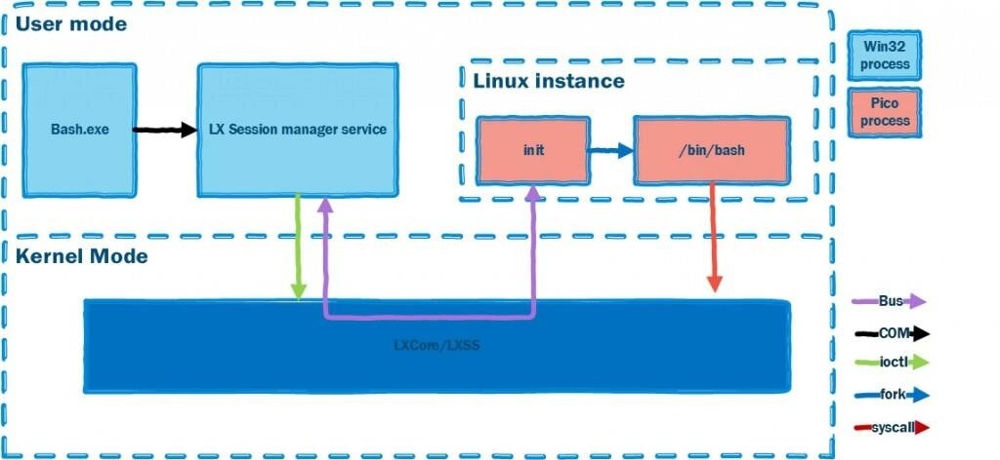{width="73%"}

# Installation of WSL2

## New way (windows 11)

Open the terminal as administrator.

To get the version of the powershell, write and press enter:

```
$PSVersionTable
```

Optional:

If the version is 5, then install version 7:

<https://learn.microsoft.com/en-us/powershell/scripting/whats-new/migrating-from-windows-powershell-51-to-powershell-7?view=powershell-7.3>

In windows 11, WSL2 is pre-installed as it is in the terminal.

Open the terminal as administrator and see the main commands of WSL:

<https://learn.microsoft.com/fr-fr/windows/wsl/basic-commands>

See also :<https://learn.microsoft.com/fr-fr/windows/wsl/install>

Open the terminal as administrator.

Then write :

```
wsl --list --online
```

This display the different distribution of linux that can be installed. Any other command of WSL at that time returns the help of wsl, because no distribution of linux is installed.

Install wsl functions without linux distributions:

```
wsl --install --no-distribution
```

Then, check the version:

```
wsl --status
wsl --version # sometimes does not work
```

The second one does not correspond to the version 1 or 2 of wsl

Check also the distribution already installed with which version of wsl:

```
wsl -l -v
```

At that time:

```
wsl ~
```

`d`oes not work, because no distribution of linux is installed

Restart the computer.

Check that windows subsystem for linux is activated:

Menu start/settings/System/optional features/More windows features:

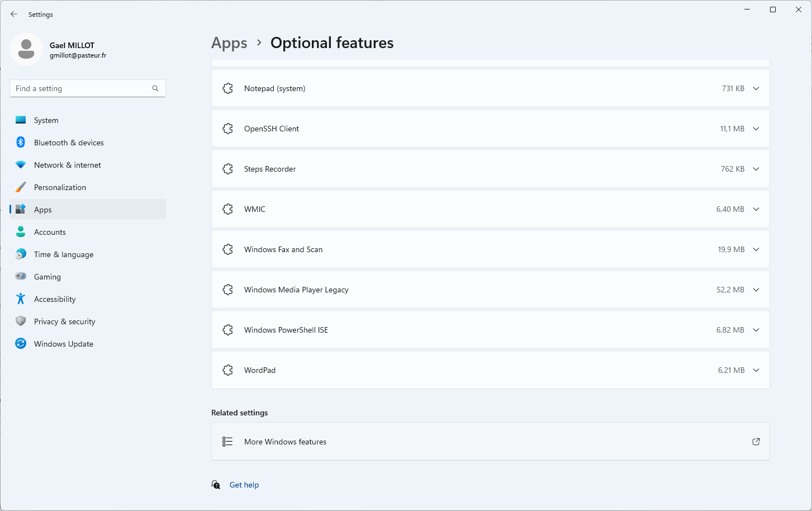{width="86%"}

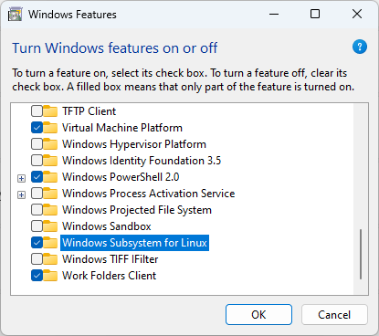{width="47%"}

Restart the PC.

Install:

```
wsl --install --distribution Ubuntu-20.04
```

If the linux session open, write :

```
exit
```

To go back to the powershell.

Check the version of linux installed:

```
wsl --list --verbose
```

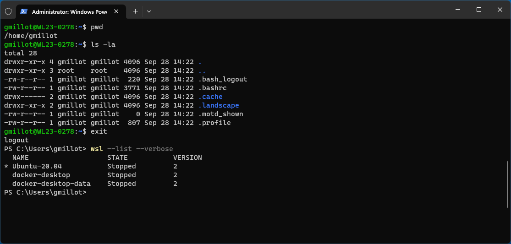

If not the case, set the default distrib to open using the terminal:

```
wsl --set-version Ubuntu-20.04 2
```

Normally, the ubuntu distrib does not appear on the terminal distrib :

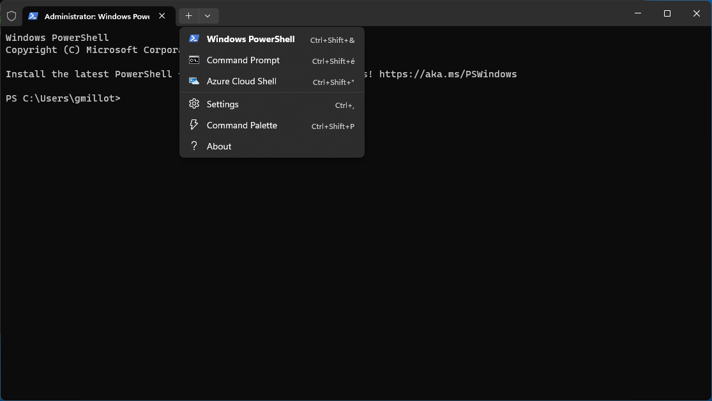{width="93%"}

However, opening ubuntu put, as the corresponding opened window, a terminal icon in the taskbar.

Do not use this process for the moment :

> In firefox, go to the microsoft store webpage:
>
> <https://apps.microsoft.com/store>
>
> Choose ubuntu 20.04 LST
>
> <https://apps.microsoft.com/store/detail/ubuntu-20046-lts/9MTTCL66CPXJ>
>
> Click on "obtain"
>
> Normally, installation of WSL2 is done.
>
> Give login name and password, otherwise, the home will not be in `\\wsl$\Ubuntu-20.04\home\gmillot` (see section [Home of WSL](#home-of-wsl)):
>
> <https://learn.microsoft.com/en-us/windows/wsl/setup/environment#set-up-your-linux-username-and-password>

## old way (windows 10)

Use the manual installation described in <https://docs.microsoft.com/en-us/windows/wsl/install-win10>

Check the version of windows 10 (see protocol 117). For For x64 systems, it must be Version 1903 or higher, with Build 18362 or higher.

Open PowerShell as Administrator and run:

```
dism.exe /online /enable-feature /featurename:Microsoft-Windows-Subsystem-Linux /all /norestart

dism.exe /online /enable-feature /featurename:VirtualMachinePlatform /all /norestart
```

Download the latest package of WSL2 Linux kernel update package for x64 machines

<https://wslstorestorage.blob.core.windows.net/wslblob/wsl_update_x64.msi>

Click on the file to install it.

Open the terminal as administrator.

Then write :

```
wsl --list --online
```

This display the different distribution of linux that can be installed. Any other command of WSL at that time returns the help of wsl, because no distribution of linux is installed.

Install wsl functions without linux distributions:

```
wsl --install --no-distribution
```

Then, check the version:

```
wsl --status
wsl --version # sometimes does not work
```

The second one does not correspond to the version 1 or 2 of wsl

Check also the distribution already installed with which version of wsl:

```
wsl -l -v
```

At that time:

```
wsl ~
```

`d`oes not work, because no distribution of linux is installed

Check that windows subsystem for linux is activated:

Go in menu System/Fonctionalités facultatives, click on the top rigth "Plus de fonctionalités windows".

check this for WSL:

{width="47%"}

Restart the PC.

Open the terminal as administrator.

Then write :

```
wsl --install --distribution Ubuntu-20.04
```

If the linux session open, write :

```
exit
```

To go back to the powershell.

Check the version of linux installed:

```
wsl --list --verbose
```

Old way :

In the terminal:

```
wsl --set-default-version 2
```

Open the [Microsoft Store](https://aka.ms/wslstore) and select your favorite Linux distribution.

Take Ubuntu 20.04 LTS

<https://apps.microsoft.com/store/detail/ubuntu-20046-lts/9MTTCL66CPXJ>

Click on "obtain"

Give login name and password, otherwise, the home will not be in `\\wsl$\Ubuntu-20.04\home\gmillot` (see section [Home of WSL](#home-of-wsl)):

<https://learn.microsoft.com/en-us/windows/wsl/setup/environment#set-up-your-linux-username-and-password>

Such install does not work from Pasteur.

It is now installed:

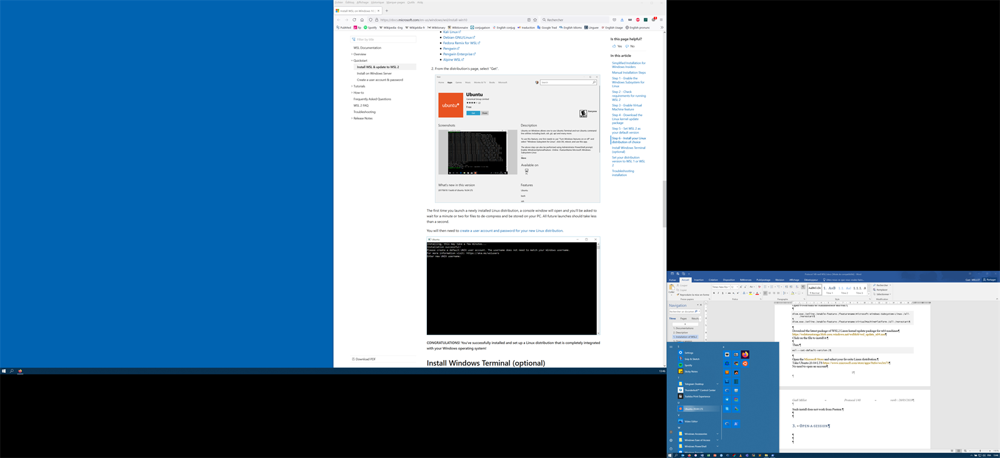{width="44%"}

## install several ubuntu versions

See <https://ubuntu.com/tutorials/install-ubuntu-on-wsl2-on-windows-11-with-gui-support#3-download-ubuntu> for more description about how to 1) deal with the different version of ubuntu installed, 2) install several versions, etc.

# uninstall WSL

<https://www.groovypost.com/howto/uninstall-linux-from-windows-11/>

# .wslconfig

This file is optional. It sets some settings for WSL.

It must be present in the Windows home:

C:\\Users\\gmillot

Settings can be memory, CPU, etc.

To test the memory allocated to WSL, open WSL and:

```
top
```

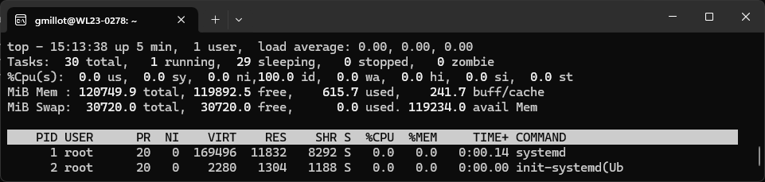

Or:

```
free -h
```

To have the CPU allocated:

```
nproc
```

To change and set other values, write in .wslconfig:

```
[wsl2]
memory=110GB   # How much memory to assign to WSL2 (e.g., 4GB, 8GB)
processors=31 # How many processors to assign to WSL2
swap=30GB     # How much swap space to use (e.g., 8GB)
localhostForwarding=true # Enable or disable localhost forwarding
```

Of note:

localhostForwarding:

by default, WSL2 uses a virtual network adapter to provide network connectivity, which means that services running inside WSL2 are usually accessed via a separate IP address from the Windows host. However, with localhostForwarding set to true, WSL2 will forward network requests from localhost on the Windows host to the WSL2 environment, allowing you to use localhost to access services running inside WSL2 as if they were running directly on Windows.

swape:

swap space that WSL2 is allowed to use. Swap space is a form of virtual memory that allows the operating system to use hard disk space to store data that does not fit into physical RAM. If the system runs out of physical memory, less frequently used data can be moved to the swap space to free up RAM for more immediate tasks.

Then save and close this file.

Open a windows powershell windows in admin mode.

Type:

```
wsl --shutdown
```

Just closing all the WSL windows does not seem sufficient.

# Home of WSL

<https://superuser.com/questions/1185033/what-is-the-home-directory-on-windows-subsystem-for-linux>

The home absolute path is (windows):

`\\wsl$\Ubuntu-20.04\home\gmillot`

And Linux (WSL2):

/home/gmillot/

This is where .profile and .bashrc must be present.

In fact, the environment is considered as a network:

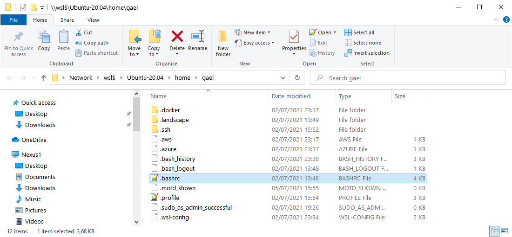{width="82%"}

Such windows can be opened typing in the linux console:

```
explorer.exe .
```

To navigate into the windows folders, start from /mnt/. Example:

```
cd /mnt/c/Users/gmillot/
```

Warning:

```
/mnt/wsl
```

is a dead end (empty file).

# .bashrc and .profile

This is an example of what can be written in the two .bashrc and .profile files, that must be present in the wsl home user (i.e., `\\wsl$\Ubuntu-20.04\home\gmillot`):

## .bashrc

```
# ~/.bashrc: executed by bash(1) for non-login shells.
# see /usr/share/doc/bash/examples/startup-files (in the package bash-doc)
# for examples

# If not running interactively, don't do anything
case $- in
    *i*) ;;
      *) return;;
esac

# don't put duplicate lines or lines starting with space in the history.
# See bash(1) for more options
HISTCONTROL=ignoreboth

# append to the history file, don't overwrite it
shopt -s histappend

# for setting history length see HISTSIZE and HISTFILESIZE in bash(1)
HISTSIZE=1000
HISTFILESIZE=2000

# check the window size after each command and, if necessary,
# update the values of LINES and COLUMNS.
shopt -s checkwinsize

# If set, the pattern "**" used in a pathname expansion context will
# match all files and zero or more directories and subdirectories.
#shopt -s globstar

# make less more friendly for non-text input files, see lesspipe(1)
[ -x /usr/bin/lesspipe ] && eval "$(SHELL=/bin/sh lesspipe)"


# Alias definitions.
# You may want to put all your additions into a separate file like
# ~/.bash_aliases, instead of adding them here directly.
# See /usr/share/doc/bash-doc/examples in the bash-doc package.

if [ -f ~/.bash_aliases ]; then
    . ~/.bash_aliases
fi

# enable programmable completion features (you don't need to enable
# this, if it's already enabled in /etc/bash.bashrc and /etc/profile
# sources /etc/bash.bashrc).
if ! shopt -oq posix; then
  if [ -f /usr/share/bash-completion/bash_completion ]; then
    . /usr/share/bash-completion/bash_completion
  elif [ -f /etc/bash_completion ]; then
    . /etc/bash_completion
  fi
fi
```

## .profile

```
# ~/.profile: executed by the command interpreter for login shells.
# This file is not read by bash(1), if ~/.bash_profile or ~/.bash_login
# exists.
# see /usr/share/doc/bash/examples/startup-files for examples.
# the files are located in the bash-doc package.

# the default umask is set in /etc/profile; for setting the umask
# for ssh logins, install and configure the libpam-umask package.
#umask 022


######################
# PATH               #
######################


# set PATH so it includes user's private bin if it exists
if [ -d "$HOME/bin" ] ; then
    PATH="$HOME/bin:$PATH"
fi

# set PATH so it includes user's private bin if it exists
if [ -d "$HOME/.local/bin" ] ; then
    PATH="$HOME/.local/bin:$PATH"
fi


export PATH="/usr/local/go/bin:${PATH}:${GOPATH}/bin" # for singularity
export PATH="/usr/local/bin:$PATH" # for nextflow
export PATH="/home/gmillot/bin/scripts:$PATH" # for IMGT tools
export PATH="/home/gmillot/bin/igphyml/src:$PATH" # for igphyml tools
# export PATH="/home/gmillot/share/igblast/fasta:$PATH" # for IMGT tool databases
# export PATH="/home/gmillot/share/igblast:$PATH" # for IMGT tool databases
# export PATH="/home/gmillot/share/germlines/imgt:$PATH" # for IMGT tool databases
# export PATH="/home/gmillot/share/germlines/imgt/human/vdj:$PATH" # for IMGT tool databases


######################
# END PATH           #
######################


######################
# VARIABLES          #
######################


export CHOME="/mnt/c/Users/gmillot/Documents/"
export PROJECT="/mnt/c/Users/gmillot/Documents/Git_projects/project_a/"
export GIT="/mnt/c/Users/gmillot/Documents/Git_projects/"
export GOPATH=${HOME}/go # for singularity
export DISPLAY=$(ip route list default | awk '{print $3}'):0 # for X11 via vcxsrv
export LIBGL_ALWAYS_INDIRECT=1 # for X11 via vcxsrv


######################
# END VARIABLES      #
######################


######################
# BASHRC             #
######################

# incorporation of the .bashrc file
# if running bash
if [ -n "$BASH_VERSION" ]; then
    # include .bashrc if it exists
    if [ -f "$HOME/.bashrc" ]; then
	. "$HOME/.bashrc"
    fi
fi


######################
# END BASHRC         #
######################


######################
# STANDARDS COMMANDS #
######################

alias tree="find . -print | sed -e 's;[^/]*/;|--;g;s;____|; |;g'"

##########################
# END STANDARDS COMMANDS #
##########################


######################
# DOCKER COMMANDS    #
######################

function docker_rm_all {
    docker rm $(docker ps --all -q -f status=exited)
}

##########################
# END DOCKER COMMANDS    #
##########################


#############################
# SHORT CUT INACTIVATION    #
#############################

trap '' SIGINT # https://stackoverflow.com/questions/37148672/how-to-prevent-a-user-from-using-ctrl-c-to-stop-a-script

#################################
# END SHORT CUT INACTIVATION    #
#################################


#######################
# PROMPT REDEFINITION #
#######################


# set variable identifying the chroot you work in (used in the prompt below)
if [ -z "${debian_chroot:-}" ] && [ -r /etc/debian_chroot ]; then
    debian_chroot=$(cat /etc/debian_chroot)
fi

# set a fancy prompt (non-color, unless we know we "want" color)
case "$TERM" in
    xterm-color|*-256color) color_prompt=yes;;
esac

# uncomment for a colored prompt, if the terminal has the capability; turned
# off by default to not distract the user: the focus in a terminal window
# should be on the output of commands, not on the prompt
#force_color_prompt=yes

if [ -n "$force_color_prompt" ]; then
    if [ -x /usr/bin/tput ] && tput setaf 1 >&/dev/null; then
	# We have color support; assume it's compliant with Ecma-48
	# (ISO/IEC-6429). (Lack of such support is extremely rare, and such
	# a case would tend to support setf rather than setaf.)
	color_prompt=yes
    else
	color_prompt=
    fi
fi

if [ "$color_prompt" = yes ]; then
    PS1='${debian_chroot:+($debian_chroot)}\[\033[01;32m\]\u@\h\[\033[00m\]:\[\033[01;34m\]\w\[\033[00m\]\$ '
else
    PS1='${debian_chroot:+($debian_chroot)}\u@\h:\w\$ '
fi
unset color_prompt force_color_prompt

# If this is an xterm set the title to user@host:dir
case "$TERM" in
xterm*|rxvt*)
    PS1="\[\e]0;${debian_chroot:+($debian_chroot)}\u@\h: \w\a\]$PS1"
    ;;
*)
    ;;
esac

# enable color support of ls and also add handy aliases
if [ -x /usr/bin/dircolors ]; then
    test -r ~/.dircolors && eval "$(dircolors -b ~/.dircolors)" || eval "$(dircolors -b)"
    alias ls='ls --color=auto'
    #alias dir='dir --color=auto'
    #alias vdir='vdir --color=auto'

    alias grep='grep --color=auto'
    alias fgrep='fgrep --color=auto'
    alias egrep='egrep --color=auto'
fi

# colored GCC warnings and errors
#export GCC_COLORS='error=01;31:warning=01;35:note=01;36:caret=01;32:locus=01:quote=01'

# some more ls aliases
alias ll='ls -alF'
alias la='ls -A'
alias l='ls -CF'

# Add an "alert" alias for long running commands.  Use like so:
#   sleep 10; alert
alias alert='notify-send --urgency=low -i "$([ $? = 0 ] && echo terminal || echo error)" "$(history|tail -n1|sed -e '\''s/^\s*[0-9]\+\s*//;s/[;&|]\s*alert$//'\'')"'


###########################
# END PROMPT REDEFINITION #
###########################


###############################
# GIT PROMPT REDEFINITION     #
###############################

# install first git clone https://github.com/magicmonty/bash-git-prompt.git ~/.bash-git-prompt --depth=1

if [ -f "$HOME/.bash-git-prompt/gitprompt.sh" ]; then
    GIT_PROMPT_ONLY_IN_REPO=1

    # GIT_PROMPT_FETCH_REMOTE_STATUS=0   # uncomment to avoid fetching remote status
    # GIT_PROMPT_IGNORE_SUBMODULES=1 # uncomment to avoid searching for changed files in submodules
    # GIT_PROMPT_WITH_VIRTUAL_ENV=0 # uncomment to avoid setting virtual environment infos for node/python/conda environments
    # GIT_PROMPT_VIRTUAL_ENV_AFTER_PROMPT=1 # uncomment to place virtual environment infos between prompt and git status (instead of left to the prompt)

    # GIT_PROMPT_SHOW_UPSTREAM=1 # uncomment to show upstream tracking branch
    # GIT_PROMPT_SHOW_UNTRACKED_FILES=normal # can be no, normal or all; determines counting of untracked files

    # GIT_PROMPT_SHOW_CHANGED_FILES_COUNT=0 # uncomment to avoid printing the number of changed files

    # GIT_PROMPT_STATUS_COMMAND=gitstatus_pre-1.7.10.sh # uncomment to support Git older than 1.7.10

    # GIT_PROMPT_START=...    # uncomment for custom prompt start sequence
    # GIT_PROMPT_END=...      # uncomment for custom prompt end sequence

    # as last entry source the gitprompt script
    # GIT_PROMPT_THEME=Custom # use custom theme specified in file GIT_PROMPT_THEME_FILE (default ~/.git-prompt-colors.sh)
    # GIT_PROMPT_THEME_FILE=~/.git-prompt-colors.sh
    # GIT_PROMPT_THEME=Solarized # use theme optimized for solarized color scheme
    source "$HOME/.bash-git-prompt/gitprompt.sh"
fi

###############################
# END GIT PROMPT REDEFINITION #
###############################
```

## Inactivate ctrl+C

<https://stackoverflow.com/questions/37148672/how-to-prevent-a-user-from-using-ctrl-c-to-stop-a-script>

Write :

```
trap '' SIGINT # or trap '' 2
```

To see the list of the kill numbers and detect the number of SIGINT

```
kill -l
```

# Open a session

Clic on the icon in the start menu

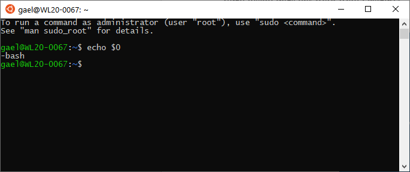

# DrvFs

DrvFs is a filesystem plugin to WSL that was designed to support interop between WSL and the Windows filesystem. DrvFs enables WSL to mount drives with supported file systems under /mnt, such as /mnt/c, /mnt/d, etc.

You can learn more about DrvFs and the WSL filesystem in a previous blog post from June 2016, [WSL File System Support](https://blogs.msdn.microsoft.com/wsl/2016/06/15/wsl-file-system-support/), which covers the Linux filesystem as it pertains to WSL and compares it to the Windows filesystem.

# Go into mounted volums

## Mounting local drives

In order to mount a Windows drive using DrvFs, you can use the regular Linux mount command. For example, to mount a removable drive D: as /mnt/d directory, run the following commands:

```
volum="d"
# Warning: never use rm -r
sudo mkdir /mnt/$volum
sudo mount -r -t drvfs ${volum^^}: /mnt/$volum
# -o ro: read only mode
# -r: read only mode
chmod u=rx,g=rx,o=rx /mnt/$volum #provide an error message that says that the folder is Read-only file system
```

Warning: if D: does not exist in windows, it will return an error (we can only mount what exists).

Now, you will be able to access the files of your D: drive under /mnt/d. When you wish to unmount the drive, for example so you can safely remove it, run the following command:

```
sudo umount /mnt/$volum
# Warning: never use rm -r
# if "target is busy" message, get out of /mnt/$volum (go back to home for instance)
```

[[Warning: never use rm -r after]{.mark}]{.mark} `mkdir /mnt/$volum`, because it remove all the distant files !

With:

```
sudo mount -r
```

It is not possible to remove files.

## Mounting network locations

When you wish to mount a network location, you can of course create a mapped network drive in Windows and mount that as indicated above. However, it's also possible to mount them directly using a UNC path:

```
# Warning: never use rm -r
sudo mkdir /mnt/share
sudo mount -t drvfs '\\zeus.pasteur.fr\BioIT\gmillot' /mnt/share
```

This mount `\\zeus.pasteur.fr\BioIT\gmillot` into `/mnt/share`

With a variable, use this:

```
FOLDER="\\\zeus.pasteur.fr\BioIT\gmillot"
sudo mount -t drvfs "$FOLDER" /mnt/share
```

# Preferences

[Right-click an empty part of the title bar and select "Properties"]{.red}

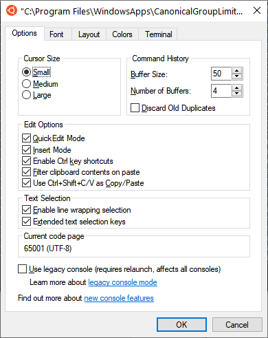{width="45%"}

# Version of ubuntu

Check for the version of Ubuntu

```
echo $(lsb_release -cs)
```

focal means "Ubuntu 20.04.6 LTS"

jammy means "Ubuntu 22.04.6 LTS"

# Where to install applications

<https://unix.stackexchange.com/questions/11544/what-is-the-difference-between-opt-and-usr-local/11552#11552>

```
/usr/local
```

# Management of packages

## In summary

### Primary Operating System installation

1\) OS Ubuntu Installation

2\) List of the packages in the [distant repository]{.underline} of the OS:

`dpkg` (Debian package) low level tool managing the packages for Debian. Do not manage dependencies, contrary to apt. <https://doc.ubuntu-fr.org/dpkg>

```
dpkg -l # --list
```

```
Desired=Unknown/Install/Remove/Purge/Hold
| Status=Not/Inst/Conf-files/Unpacked/halF-conf/Half-inst/trig-aWait/Trig-pend
|/ Err?=(none)/Reinst-required (Status,Err: uppercase=bad)
||/ Name                           Version                            Architecture Description
+++-==============================-==================================-============-===================
ii  accountsservice                0.6.55-0ubuntu12~20.04.4           amd64        query and manipulate user account information
ii  adduser                        3.118ubuntu2                       all          add and remove users and groups
ii  adwaita-icon-theme             3.36.1-2ubuntu0.20.04.2            all          default icon theme of GNOME (small subset)
```

But another solution is to use the apt library (see section [APT](#apt)):

```
apt list
```

This one says if the package is already installed or not.

3\) Update the OS for main packages:

It is better to use the apt library since the install deals with dependencies:

```
sudo apt-get update --fix-missing
sudo apt-get upgrade
```

Warning: this does not update the already installed packages. For that, use :

```
sudo apt-get install gawk
```

### Installation of all the available packages not already installed

```
sudo apt-get update --fix-missing
sudo apt-get upgrade
```

### Installation of a specific package

```
sudo apt-get install gawk
```

With a specific version, use :

```
dpkg -l gawk # --list
```

To get the list. Then:

```
sudo apt-get install gawk=1:5.0.1+dfsg-1
```

### Installation of a metapackage

build-essential is a metapackage taht install lots of essential packages. See <https://packages.debian.org/fr/sid/build-essential>

## APT

Advanced Package Tool (APT), is a free-software user interface that works with core libraries to handle the installation and removal of software on Debian-based Linux Distributions.

[https://en.wikipedia.org/wiki/APT\_(software)](https://en.wikipedia.org/wiki/APT_%28software%29).

This library of package is managed by the `apt` and `apt-get` commands.

## apt command

<https://manpages.debian.org/stretch/apt/apt.8.en.html>

|                |                                                                                     |
|----------------|-------------------------------------------------------------------------------------|
| `list`         | list packages based on package names. `-a` for all. Example: `sudo apt list -a git` |
| `search`       | search in package descriptions                                                      |
| `show`         | show package details                                                                |
| `install`      | install packages                                                                    |
| `reinstall`    | reinstall packages                                                                  |
| `remove`       | remove packages                                                                     |
| `autoremove`   | Remove automatically all unused packages                                            |
| `update`       | update list of available packages                                                   |
| `upgrade`      | upgrade the system by installing/upgrading packages                                 |
| `full-upgrade` | upgrade the system by removing/installing/upgrading packages                        |
| `edit-sources` | edit the source information file                                                    |
| `satisfy`      | satisfy dependency strings                                                          |

## apt-get command

See <https://linux.die.net/man/8/apt-get>

|  |  |
|----|----|
| `apt-get update` | downloads the package lists from the repositories and "updates" them to get information on the newest versions of packages and their dependencies. It will do this for all repositories and PPAs. In other words, used to re-synchronize the package index files from their sources. The indexes of available packages are fetched from the location(s) specified in /etc/apt/sources.list(5). An update should always be performed before an upgrade. `--fix-missing` Ignore missing packages. If packages cannot be retrieved or fail the integrity check after retrieval (corrupted package files), hold back those packages and handle the result |
| `apt-get upgrade` | Used to install the newest versions of all packages currently installed on the system from the sources enumerated in /etc/apt/sources.list(5). Packages currently installed with new versions available are retrieved and upgraded; under no circumstances are currently installed packages removed, nor are packages that are not already installed retrieved and installed. New versions of currently installed packages that cannot be upgraded without changing the install status of another package will be left at their current version. An update must be performed first so that apt-get knows that new versions of packages are available |
| `apt-get install` | install packages. `-y` to say yes each time. Example: `apt-get install -y coreutils`. With version: `apt-get install -y coreutils=-3ubuntu2` |
| `apt-get autoremove` | remove those dependencies that were installed with applications and are no longer used by anything else on the system. `-y` to say yes each time |
| `apt-get clean` | clears out the local repository of retrieved package files.It removes everything but the lock file from /var/cache/apt/archives/ and /var/cache/apt/archives/partial/ |

## Installation of packages

To get the correct version of the packages, depending on the OS, use docker:

```
sudo docker run -ti --entrypoint bash ubuntu:16.04
dpkg -l core* # to get the kind of version to ask for coreutils
```

Classical installation:

```
# update apt-get
sudo apt-get update --fix-missing
sudo apt-get upgrade

# install the packages
sudo apt-get install -y coreutils=8.30-3ubuntu2 gawk=1:5.0.1+dfsg-1ubuntu0.1 bc=1.07.1-2build1 git=1:2.25.1-1ubuntu3.11 zip
```

# Permissions

## sudo

### sudo ask for password but password does not work

Open cmd.exe

Type wsl -u root

Type passwd username and change the password

Type exit

Type wsl

Type sudo echo hi to confirm the new password works.

## Program files

No possibility to modify the program files folder directly.

This neither works:

```
sudo chmod u=rwx /mnt/c/Program\ Files/tor
```

For each program folder, tor for instance:

Right clic on the folder

Select the Security tab and click on Advanced settings.

Then edit this:

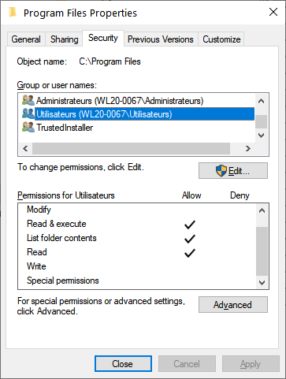{width="41%"}

And select "Full control"

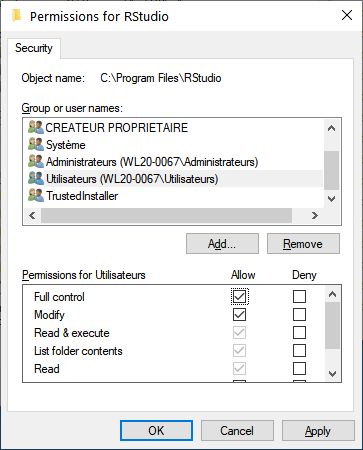{width="44%"}

Click twice on Ok.

If the access to "Full control" is not allowed, try this procedure:

Right-click your D: drive and click Properties.

Go to the Security tab and click \[Advanced\].

At the top, next to Owner, click Change.

Type your Windows username and click \[OK\].

Tick Replace owner on sub-containers and objects.

In the list of permission entries below, remove all the entries using the \[Remove\] button.

Click \[Add\] and click Select a principal.

Type Everyone and click \[OK\].

Tick Full Control and click \[OK\]. You should now see one permission entry granting Full Control to Everyone in the list of permissions.

Tick Replace all child object permission entries with inheritable permission entries from this object and click \[OK\]. This will propagate the new permissions to all the files and folders on your D: drive, which should take a couple seconds. Any inaccessible files should be accessible when it is done.

In WSL, we can then see the change of authorisation.

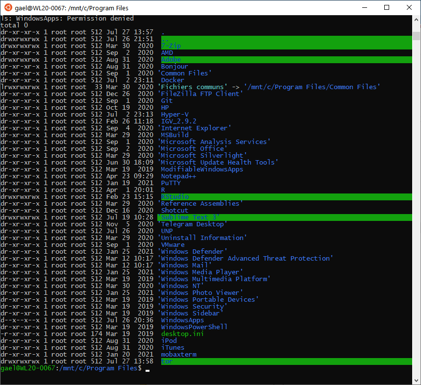

# SSH key

See [protocol 44](044-bash.md) or 88 for gitlab.

# Prevent the sudo password prompt

## First method

Start a new WSL session as you usually would.

Type

```
sudo EDITOR=nano visudo
```

Use your arrow keys to scroll to the end of the file

Append the following:

```
<username> ALL=(ALL) NOPASSWD:ALL
```

to the end of the file. Of course, replacing “username” with your user name (gmillot).

Hit CTRL + X and if asked to save, hit Y to confirm. When asked for the file name, leave the default and just hit enter.

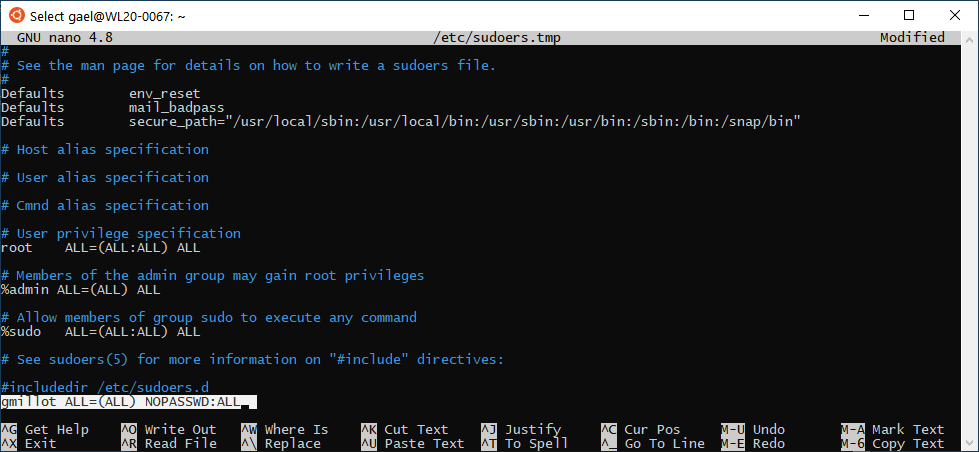

## Second method

In wsl add your username to a sudo config file.

Replace MY_USERNAME below to your username name.

sudo nano /etc/sudoers.d/MY_USERNAME

add the following line:

MY_USERNAME ALL=(ALL) NOPASSWD:ALL

If you don't replace MY_USERNAME with the target username you will receive an error no valid sudoers sources found.

# C drive not available (question marks in ls -la)

Close the WSL2 sessions

Open the windows command prompt (search tool and "command")

Execute: `wsl --shutdown`

This should solve the problem when opening a new WSL2 session.

# Access to Linux files from Windows

## Via the windows explorer

In the adress bar of a window, type:

`\\wsl$\Ubuntu-20.04\home\gmillot`

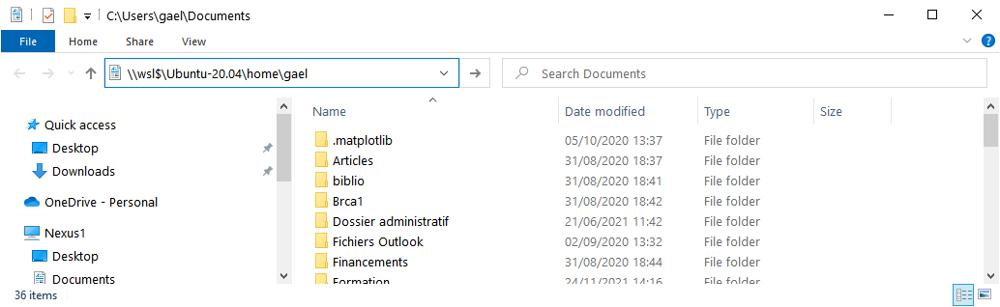

## Via Map a network drive

Only this command is possible:

\\\\wsl\$\\Ubuntu-20.04

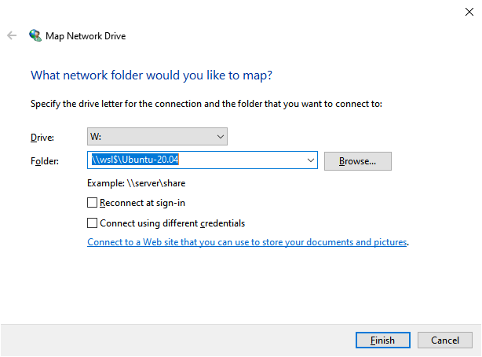{width="55%"}

## Via command lines (Powershell)

```
pushd \\wsl$\\Ubuntu-20.04\\home\\gmillot
# popd to exit
```

```
cd \\wsl$\\Ubuntu-20.04\\home\\gmillot
# popd to exit
```

## Via R

```
read.table("\\\\wsl$\\Ubuntu-20.04\\home\\gmillot\\20211126_project_e\\dataset\\20210628_sample1_plate3_IgH_sanger_seq\\merge_parse-select_clone-pass_germ-pass.tsv", sep = "\t", header = TRUE)
```

# X11

Install mobaXterm (see protocol 124).

Install xterm (not sure that it is mandatory when we already have mobaXterm):

```
sudo apt install xterm
```

Optional but important (If a x11 window pops up, authorize):

```
pip install cairosvg # to convert .svg based icons
sudo apt install imagemagick # to have an additional opportunity to convert appropriate icon files if other methods fail
```

Then add the following code in the .profile or .bashrc file:

```
export DISPLAY=$(ip route list default | awk '{print $3}'):0
export LIBGL_ALWAYS_INDIRECT=1
```

When running a x11-dependent application, it seems that it goes via mobaXterm. Meaning that to disable authorization messages, open mobaXterm and menu Settings/configuration and select "full" for x11 remote access:

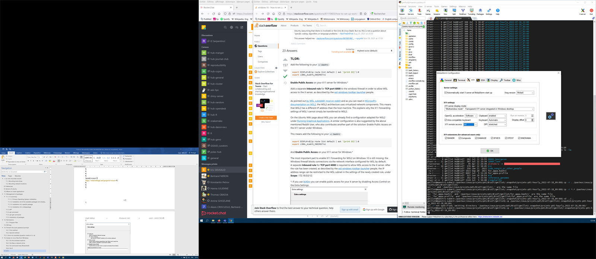{width="67%"}

If problems, try this:

<https://stackoverflow.com/questions/61110603/how-to-set-up-working-x11-forwarding-on-wsl2>

# Llama files

See <https://github.com/Mozilla-Ocho/llamafile>.

Import any llama file from the page:

<https://github.com/Mozilla-Ocho/llamafile#other-example-llamafiles>

Then execute simply like this:

```
 ./llava-v1.5-7b-q4.llamafile
```

A web browser page open in which we can make requests:

For some llama files (not llava), this must be executed (<https://github.com/Mozilla-Ocho/llamafile#gotchas>):

```
sudo wget -O /usr/bin/ape https://cosmo.zip/pub/cosmos/bin/ape-$(uname -m).elf
sudo chmod +x /usr/bin/ape
sudo sh -c "echo ':APE:M::MZqFpD::/usr/bin/ape:' >/proc/sys/fs/binfmt_misc/register"
sudo sh -c "echo ':APE-jart:M::jartsr::/usr/bin/ape:' >/proc/sys/fs/binfmt_misc/register"
sudo sh -c "echo -1 > /proc/sys/fs/binfmt_misc/WSLInterop"
```

Otherwise, error messages like "invalid argument" are returned.

[Still a problem to activate GPU.]{.red}

# Troubleshooting

## Network lost

Example of message :

Error: ipv4: FIB tables does not exist

Or ping does not work:

ping www.google.com

[Solution]{.underline}

Open powershell.

type:

wsl --shutdown

Reopen ubuntu

## the \> prompt

When this prompt appears :"\>", it means that that we are inside a command prompt or shell, and the system is waiting for us to enter a command.

[Solution]{.underline}

If Ctrl-C does not work, Ctrl-D should (it depends on the shell and settings used).
