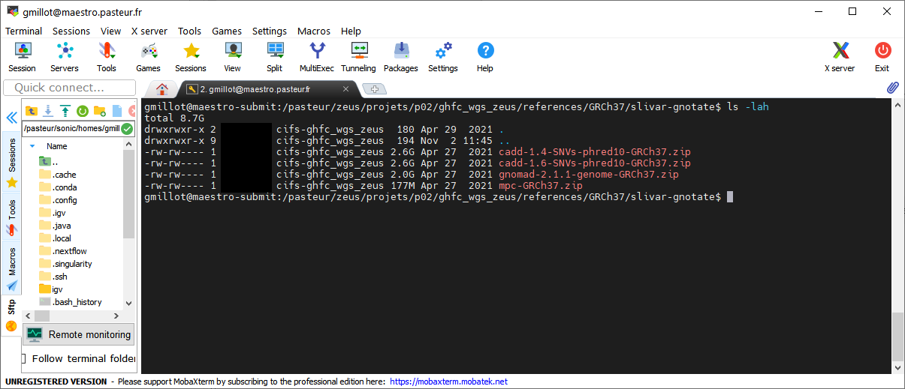

# Documentations

<https://github.com/brentp/slivar>

# Description

Slivar is a set of command-line tools that enables rapid querying and filtering of VCF files. It facilitates operations on trios and groups and allows arbitrary expressions using simple javascript.

Annotation can also be performed without filtering (see section [Annotation file input](#annotation-file-input)).

# Installation

## Local or cluster

Use the link

<https://github.com/brentp/slivar/releases/tag/v0.2.7>

Select "slivar" and download the file.

Move the file into

`\\wsl$\Ubuntu-20.04\home\gael\bin`

Or into

/pasteur/zeus/projets/p01/BioIT/gmillot/bin

## Docker image

<https://hub.docker.com/r/gmillot/slivar_v1.0/>

See [protocol 134](134-docker.md)

```
sudo docker pull gmillot/slivar_v1.0:gitlab_v8.11
```

# Commands

<https://github.com/brentp/slivar#attributes>

Warning: any expression can be interpreted in bash before execution. To avoid this, use single quotes instead of double quotes.

# slivar-functions.js file

This file gather all the functions that can be used for the slivar executions. In the following link are basic functions :

<https://github.com/brentp/slivar/blob/master/js/slivar-functions.js>

But we can download and add additional homemade functions.

Example:

C:\\Users\\gael\\Documents\\Git_projects\\project_c\\bin\\slivar-functions.js

```
var config = {min_GQ: 20, min_AB: 0.20, min_DP: 6}
// hi quality variants
function hq1(sample) {
  if (sample.unknown || (sample.GQ < config.min_GQ)) { return false; }
  if ((sample.AD[0] + sample.AD[1]) < config.min_DP) { return false; }
  if (sample.hom_ref){
      return sample.AB < 0.02
  }
  if(sample.het) {
      return sample.AB >= config.min_AB && sample.AB <= (1 - config.min_AB)
  }
  return sample.AB > 0.98
}

// functions to be use with --family-expr

function find_het_aff_hom_ref_unaff(indiv) {
  if(!hq1(indiv)){ return false; } // test first if quality is ok. It is faster since return false and go the the next line directly
  return indiv.het == indiv.affected && indiv.hom_ref == !indiv.affected
  // indiv.het: take the GT field of FORMAT of indiv that is 0/1
  // indiv.affected: take indiv that is 2 in the ped file
  // indiv.hom_ref: the GT field of FORMAT of indiv that is 0/0
  // !indiv.affected: take indiv that is 1 in the ped file
}
```

# Annotation file input

Use the ones from a colleague:

> Connect to maestro
>
> then

```
cd /pasteur/zeus/projets/p02/ghfc_wgs_zeus/references/GRCh37/slivar-gnotate
```

> 

|  |  |
|----|----|
| cadd-1.6-SNVs-phred10-GRCh37.zip | phred10 because annotation only for variant with phred \>= 10 (warning: not the phred of the base calling). Otherwise, too many variants (9 Billions). See <https://cadd.gs.washington.edu/info> for phred. Phred10 means that 90% of the variants are removed from the initial file. |
| gnomad-2.1.1-genome-GRCh37.zip | with a caution: contains only worldwide and non-finnish-european info to lighten the file. |

For annotation only, without filtering, see <https://github.com/brentp/slivar/wiki/gnotate>

# Description of outputs

The first fields, down to CSQ, come from gatk calling.

|  |  |
|----|----|
| chr:pos:ref:alt | as indicated |
| genotype(sample,dad,mom) | 0 = homozygote REF, 1 = heterozygote, 2 = homozygote ALT |
| AC | Allele count among the individuals of the pedigree |
| AF | AC / AN, i.e., allele frequency [in the pedigree]{.underline} |
| AN | Allele number among the individuals of the pedigree (22 means 11 individuals) |

BaseQRankSum

DB

DP depth of coverage

ExcessHet

FS

InbreedingCoeff

MLEAC

MLEAF

MQ Mapping quality (max 60).

MQRankSum

QD

ReadPosRankSum

SOR

[VQSLOD]{.red}

[culprit]{.red}

VEP annotation:

|  |  |
|----|----|
| CSQ | VEP annotation |
| cadd_phred | cadd and phred score from cadd-1.6-SNVs-phred10-GRCh37.zip. -1means 1) no data, i.e., variant never seen before or 2) filtered out in the cadd annotation file used (phred10 cutoff for instance) or 3) indel. In the latter case, go the cadd website for the cadd of this specific indel <https://cadd.gs.washington.edu/info> |

Gnomad annotation:

|  |  |
|----|----|
| gno_non_neuro_af_all | allele frequency of non neuro worldwide (all ancestries) cohorte in gnomade file gnomad-2.1.1-genome-GRCh37.zip |
| gno_non_neuro_af_nfe | idem but non-finnish europeans |
| gno_non_neuro_nhomalt_all | number of ALT homozygotes (it is to see the recessivity) |

gno_non_neuro_nhomalt_nfe

[Slivar annotation:]{.red}

|  |  |
|----|----|
| highest_impact_order | See <https://github.com/brentp/slivar/blob/master/src/slivarpkg/default-order.txt> (from most impacting to less impacting). The order is defined by par Ensembl (<http://www.ensembl.org/info/genome/variation/prediction/predicted_data.html>) and as they say, this order can be subjective |
| aff_only | example added by slivar, names of the affected indiv |
| depths(sample,dad,mom) | example added by slivar, depth of coverage |
| allele_balance(sample,dad,mom) | example added by slivar, proportion of reads carrying the ALT variant |

# Expr command

<https://github.com/brentp/slivar#expr>

Label (and optionnally filter lines) a VCF according to trios or groups or family infos.

The output VCF is never modified, except the labelling added in the INFO field for some of the variants that fit the filtering.

Lines of the VCF can be selected for the filter labeling using the --pass-only option.

Options:

|  |  |
|----|----|
| -v, --vcf=VCF | path to VCF/BCF |
| --region=REGION | optional region to limit evaluation. e.g. chr1 or 1:222-333 (or a BED file of regions) |
| -x, --exclude=EXCLUDE | BED file of exclude regions (will never output excluded variants regardless of pass-only flag) |
| -j, --js=JS | path to javascript functions to expose to user |
| -p, --ped=PED | pedigree file with family relations, sex, and affected status |
| -a, --alias=ALIAS | path to file of group aliases |
| -o, --out-vcf=OUT_VCF | path to output VCF/BCF (default: /dev/stdout) |
| --pass-only | if not used, slivar expr only add filtering info in the INFO field of the VCF. If used, only output lines of the VCF (i.e., variants) that pass at least one of the 4 expression filters below |
| --skip-non-variable | don't evaluate expression unless at least 1 sample is variable at the variant this can improve speed |

*The 4 following ones add a label in the INFO field of the VCF*

|  |  |
|----|----|
| --trio=TRIO | expression(s) applied to each trio where 'mom', 'dad', 'kid' labels are available; trios inferred from ped file. |
| --family-expr=FAMILY_EXPR | expression(s) applied to each family where 'fam' is available with a list of samples in each family from ped file. |
| --group-expr=GROUP_EXPR | expression(s) applied to the groups defined in the alias option \[see: <https://github.com/brentp/slivar/wiki/groups-in-slivar>\]. |
| --sample-expr=SAMPLE_EXPR | expression(s) applied to each sample in the VCF. |
| --info=INFO | expression using only attributes from the INFO field or variant. If this does not pass trio/group/sample expressions are not applied. |
| -g, --gnotate=GNOTATE | path(s) to compressed gnotate file(s) for "Genome anNOTATion" |
| -h, --help | Show this help |

Example:

```
salloc -p common

sample_path="/pasteur/zeus/projets/p02/ghfc_wgs_zeus/WGS/Dyslexia/vcf/Dyslexia.gatk-vqsr.splitted.norm.vep.merged.vcf.gz"
fun_path="/pasteur/zeus/projets/p01/BioIT/gmillot/project_c/bin/slivar-functions.js"
ped_path="/pasteur/zeus/projets/p01/BioIT/gmillot/project_c/dataset/Dyslexia.pedigree.txt"
annot1_path="/pasteur/zeus/projets/p02/ghfc_wgs_zeus/references/GRCh37/slivar-gnotate/cadd-1.6-SNVs-phred10-GRCh37.zip"
annot2_path="/pasteur/zeus/projets/p02/ghfc_wgs_zeus/references/GRCh37/slivar-gnotate/gnomad-2.1.1-genome-GRCh37.zip"

${ZEUSHOME}bin/slivar expr --js $fun_path -g $annot1_path -g $annot2_path --vcf $sample_path --ped $ped_path --pass-only -o "res.vcf" --family-expr "aff_only:fam.every(find_het_aff_hom_ref_unaff)"
```

# Tsv command

<https://github.com/brentp/slivar#tsv>

<https://github.com/brentp/slivar/wiki/tsv:-creating-a-spreadsheet-from-a-filtered-VCF>

Convert a filtered and annotated VCF to a TSV.

One line per variant and per individual. Using "affected only", only the affected patients will be present in the tsv file.

Options:

|  |  |
|----|----|
| -p, --ped=PED | required ped file describing the trios in the VCF |
| -c, --csq-field=CSQ_FIELD | INFO field containing the gene name and impact. Usually CSQ or BCSQ |
| --csq-column=CSQ_COLUMN | CSQ sub-field(s) to extract (in addition to gene, impact, transcript). may be specified multiple times. |

-s, --sample-field=SAMPLE_FIELD

INFO field(s) that contains the sample names (indiv) that have passed previous filters. Can be specified multiple times.

-g, --gene-description=GENE_DESCRIPTION

tab-separated lookup of gene (column 1) to description (column 2) to add to output. the gene is case-sensitive. can be specified multiple times.

--impact-order=IMPACT_ORDER

ordering of impacts to override the default (<https://raw.githubusercontent.com/brentp/slivar/master/src/slivarpkg/default-order.txt>)

-i, --info-field=INFO_FIELD

INFO field(s) that should be added to output (e.g. gnomad_popmax_af) can also use 'ID' or 'QUAL' to report those variant fields.

|               |                                                          |
|---------------|----------------------------------------------------------|
| -o, --out=OUT | path to output tab-separated file (default: /dev/stdout) |
| -h, --help    | Show this help                                           |

Example:

```
salloc -p common

sample_path="/pasteur/zeus/projets/p01/BioIT/gmillot/project_c/results/family1_WGS_20211207"
ped_path="/pasteur/zeus/projets/p01/BioIT/gmillot/project_c/dataset/Dyslexia.pedigree.txt"

cd $sample_path
${ZEUSHOME}bin/slivar tsv --ped $ped_path -s aff_only -i AC -i AF -i AN -i BaseQRankSum -i DB -i DP -i ExcessHet -i FS -i InbreedingCoeff -i MLEAC -i MLEAF -i MQ -i MQRankSum -i QD -i ReadPosRankSum -i SOR -i VQSLOD -i culprit -i CSQ -i cadd_phred -i gno_non_neuro_af_all -i gno_non_neuro_af_nfe -i gno_non_neuro_nhomalt_all -i gno_non_neuro_nhomalt_nfe -i highest_impact_order -i aff_only -c Allele $sample_path/res.vcf > $sample_path/res.tsv

# -p --ped	pedigree file
# -s --sample-field	field of --family-expr of slivar exp instruction, before the colon. Above it is aff_only
# -c --csq-field	field of VEP info in the INFO column of the vcf file, identified by CSQ. Create a new column ""gene_impact_transcript" in the tsv file. Possible to select only part of the info by using something like -c CSQ=. See the .vcf comments to have the field names of the CSQ field. Use -i CSQ to get the whole CSQ column
#-i 	field the INFO column in the vcf file
```
