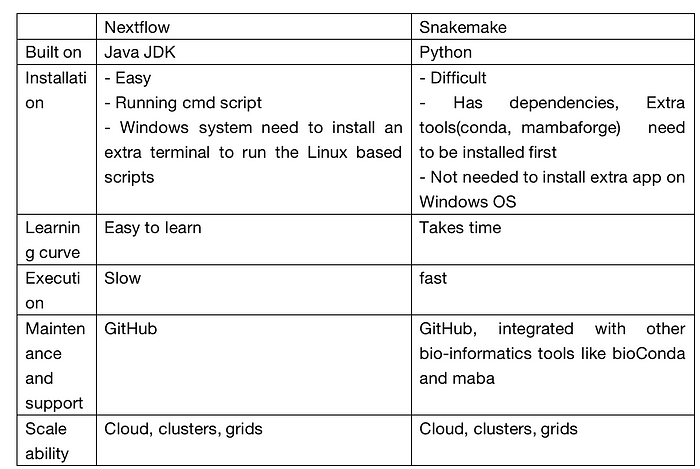
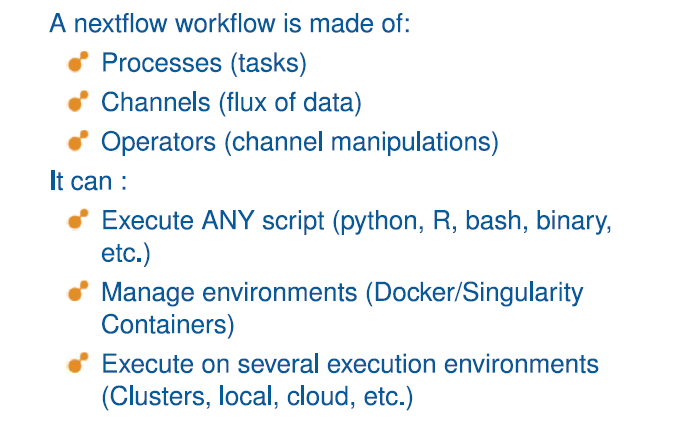
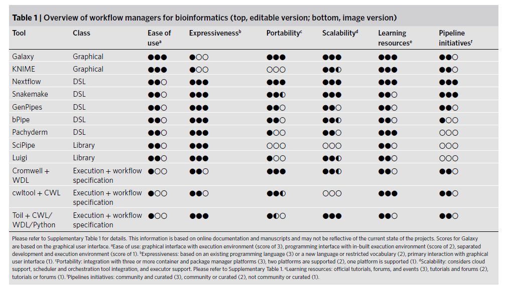
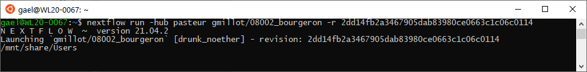

# Documentations

<https://www.nextflow.io/docs/latest/dsl2.html>

<https://carpentries-incubator.github.io/workflows-nextflow/>

<http://www.ens-lyon.fr/LBMC/intranet/services-communs/pole-bioinformatique/bioinfoclub_list/nextflow-dsl2-laurent-modolo>

Pro and con of Nextflow, comparison with snakemake:

<https://flowdeploy.com/blog>

<https://medium.com/@MarinaBioinfoStarter/bioinformatics-tools-nextflow-snakemake-how-they-are-integrated-with-ci-cd-pipeline-c9f02781ccf7>

{width="91%"}

# Acronyms

|      |                                                                                        |
|------|----------------------------------------------------------------------------------------|
| DAG  | Directed Acyclic Graph                                                                 |
| DSL  | Domain Specific Language. See <https://en.wikipedia.org/wiki/Domain-specific_language> |
| DSL2 | Version 2 of Nextflow. See <https://www.nextflow.io/blog/2020/dsl2-is-here.html>       |
| nf   | nextflow                                                                               |

# Very important to understand how nextflow works

## Names of the files

The nextflow pipeline file is named by default main.nf.

The nextflow config file must are named by default nextflow.config.

It is possible to modify these two names. But it will not work if the idea is to work from a distant repository (see section [[**Error! Reference source not found.**]{.red}](#_Ref83385591)).

## work folders

Nextflow create a folder for each process of the .nf file (or each parallelization of each process) in the work directory. For instance, *00/5bf63033e13094f180fe69c583ce3c*. Then, everything of the process is performed in this folder, which becomes the working environment (a kind of home). If INPUT is present, then files or values are imported. For the files, a [symbolic link]{.underline} is created pointing to the initial file (in another folder of the work directory, or in a dataset folder). All the new files are created here. If publishDir is used, then the files referenced in OUTPUT are [copy/paste]{.underline} into the designed publishDir folder.

## symbolic links

Warning, because of the symbolic links, every imported file that is modified by the process is not only modified in the work folder but also were the link point, meaning that initial input data can be modifed !

To prevent that:

1\) always use input files that are "write" protected (read and execute only).

2\) Copy the input file in the process before working:

```
input:
file fs

script:
"""
cp ${fs} tempo.txt
chmod 777 tempo.txt
...
```

See also section [[**Error! Reference source not found.**]{.red}](#_Ref82445048) for a better example of copy.

## The resume option

A strong advantage of nextflow is to rerun the pipeline using the `-resume` option of the `run` command. In such case, all the processes that are `cache 'true'` are not run but linked to the previous same process execution, which save lots of time!

However, all the variables of the .config used in the process must be declared in the input section of the process. Otherwise, nextflow will not rerun a `cache 'true'` process using a variable modified in the .config file.

## Variable declaration in processes

The scope of a process is such that if a variable is not in the input section, it looks for variables in the working environment of nextflow, which has notably sourced the `env{}` environment of the config file. Thus, it is not mandatory to use the input section to declare variables. [However]{.underline}, in that case, nextflow will not rerun a `cache 'true'` process using a variable modified in the .config file.

# Installation

[update using DSL1]{.red}

<https://www.nextflow.io/>

The best is to install in our home/bin/ the nextflow software and dependencies (java and singularity).

## Local Linux kernel

### Linux and WSL2

Tested on Ubuntu 26.04 (WSL2) on 2026-11-21: nextflow 24.10.4 with Java 21.0.13, apptainer 1.4.5 and graphviz 14.1.2.

Java install: see [protocol 165](165-java.md). Each nextflow version only accepts a range of Java versions:

| Nextflow | Java |
| --- | --- |
| 24.10.x | 11 to 23 |
| 26.10.x | 17 to 26 |

If the default java is out of the range (for instance Java 25 with nextflow 24.10.4, refused with the message `ERROR: Cannot find Java or it's a wrong version`), install a compatible java next to it (see [protocol 165](165-java.md#linux-and-wsl2)) and give it to nextflow only, with the NXF_JAVA_HOME variable, before installing and running nextflow:

```
export NXF_JAVA_HOME="$HOME/.sdkman/candidates/java/21.0.13.0+9-tem" # java used by nextflow only, the default java is unchanged
```

Add this line at the end of the ~/.bashrc file to set it in every new terminal (see [protocol 140](140-wsl2-linux-on-windows.md#bashrc) for the .bashrc file).

Specific version of Nextflow install (here 24.10.4):

```
wget -qO- https://github.com/nextflow-io/nextflow/releases/download/v24.10.4/nextflow | bash # creates the nextflow file of this version in the current folder and downloads its jar file (needs a compatible java, see above)
chmod +x nextflow
sudo mv nextflow /usr/local/bin/
nextflow -version # must display version 24.10.4
```

To keep the version already installed, rename it before the `sudo mv` above. Example:

```
nextflow -version # version of the installed nextflow, for instance 26.10.6
sudo mv /usr/local/bin/nextflow /usr/local/bin/nextflow-26.10.6 # this version is then run with the nextflow-26.10.6 command
```

[Warning]{.red}: nextflow 26.04 and later use the strict syntax by default, which refuses the code of many pipelines written before (for instance repertoire_profiler). For these pipelines, use nextflow 24.10.4, or run the recent version with the former syntax:

```
export NXF_SYNTAX_PARSER=v1 # v2 (strict syntax) by default
```

Last version of Nextflow install:

```
sudo chmod 777 /usr/local
sudo chmod 777 /usr/local/bin
cd /usr/local/bin
sudo curl -s https://get.nextflow.io | bash
chmod 777 nextflow
```

PATH checking:

```
echo $PATH # to check that the string "/usr/local/bin" is included between colons in this variable
```

PATH update (if required)

```
export PATH="/usr/local/bin:$PATH" # add the nextflow path into this variable
```

Apptainer has to be installed. See [protocol 135](135-apptainer.md).

### MacOS

Check Java version:

```
java -version # Check that java 11 to 18 is installed
```

Java install:

<https://download.oracle.com/java/17/latest/jdk-17_macos-x64_bin.tar.gz>

Then open the terminal and check the Java version again.

If several versions are installed, it is possible to select the appropriate version like this:

```
VERSION=17 # version to use
/usr/libexec/java_home -V
echo $JAVA_HOME
export JAVA_HOME=$(/usr/libexec/java_home -v $VERSION)
java -version
```

Then check if wget is present, otherwise:

```
sudo port install wget
```

Then:

```
wget -qO- https://get.nextflow.io | bash
# Weirdly, nextflow command is installed in the Users directory. Thus, check that install is correct:
cd /Users/username/
nextflow # should display options. If not:
echo $PATH
export PATH="/Users/username:$PATH"
echo $PATH
nextflow # should display options
```

If it does not work, notably because of Java, then test:

```
brew install nextflow
```

Apptainer has to be installed. See [protocol 135](135-apptainer.md).

## Cluster

Connect to sonic.

Then

```
cd $ZEUSHOME
cd bin
module load java
curl -s https://get.nextflow.io | bash
```

Of note, this is specified but Fred Lemoine confirmed that does not work:

```
wget -qO- https://github.com/nextflow-io/nextflow/releases/download/v21.04.1/nextflow-21.04.1-all
```

Then, update the for_sonic.profile and for_sonic.bashrc

```
export PATH="/pasteur/zeus/projets/p01/BioIT/gmillot/bin:$PATH" # for nextflow

alias nextflow="module load java/13.0.2 ; nextflow"
```

## Old version / previous release

See also [Linux and WSL2](#linux-and-wsl2) above for the compatible java (NXF_JAVA_HOME) and to keep the version already installed.

```
wget -qO- https://github.com/nextflow-io/nextflow/releases/download/v24.10.4/nextflow | bash
chmod +x nextflow
sudo mv nextflow /usr/local/bin/
```

## Installation of DSL1 together with DSL2 already installed

Of note, java 11 works for both DSL1 and DSL2, but when using DSL2, is is better to use the last compatible java version for security reasons.

### classic way

When nextflow (DSL2 only is already installed):

```
wget -qO nextflow https://github.com/nextflow-io/nextflow/releases/download/v20.10.0/nextflow # replace 20.10.0 by the desired version
sudo mv nextflow /usr/local/bin/nextflow-dsl1
nextflow-dsl1 -v
```

Then to use the old version of nextflow (DSL1):

```
sdk default java 11.0.22-amzn #see protocol 165 for java
nextflow-dsl1 run main.nf
```

To use the nex DSL2 version of nextflow:

```
sdk default java 11.0.22-amzn #see protocol 165 for java
nextflow-dsl1 run main.nf
```

### sdk management

Install SDKMAN if you haven't installed it yet.

```
curl -s "https://get.sdkman.io" | bash
source "$HOME/.sdkman/bin/sdkman-init.sh"
```

Install the versions of Nextflow you want. For instance, if you want to install Nextflow 20.10.0 and 21.04.0, you would run the following commands:

```
sdk install nextflow 20.10.0
sdk install nextflow 23.04.4.5881
```

Set the desired Nextflow version as the default. For instance, to set 20.10.0 as the default, you would run:

```
sdk default java 11.0.22-amzn #see protocol 165 for java
sdk default nextflow 20.10.0 # or sdk use nextflow 20.10.0
```

```
sdk default java 11.0.22-amzn #see protocol 165 for java
sdk default nextflow 20.10.0 # or sdk use nextflow 20.10.0
```

# Upgrade

```
nextflow -self-update
```

Update the version where it is already installed.

[Warning]{.red}: `-self-update` always installs the last version, even when the installed nextflow is a specific version (for instance 24.10.4, installed as above for a pipeline that requires it). To change for another specific version, install it as explained in [Linux and WSL2](#linux-and-wsl2).

# Switch between different versions of nextflow

## Using path

```
/path/to/nextflow-<version>/nextflow run your_workflow.nf
```

Replace /path/to/nextflow-\<version\>/ with the path where the specific version of Nextflow is installed, and your_workflow.nf with the actual filename of your Nextflow workflow.

## Using Environment Variables

You can also use the NXF_VER environment variable to set the Nextflow version for a particular session. For example:

```
export NXF_VER=20.10.0
nextflow run your_workflow.nf
```

This will set the Nextflow version to 20.10.0 for the current terminal session.

# Warning: efficiency of DSL2

Make sure your Nextflow project and input/output data are located in the Linux file system under /home or another native WSL2 directory. If files are stored in the Windows file system (e.g., /mnt/c/... in WSL), I/O performance frequently degrades and can greatly increase overhead for each job.

# DSL1 or DSL2 by default

As of version 22.03.0-edge Nextflow defaults to DSL 2 if no version is specified explicitly. You can restore the previous behavior setting in into your environment the following variable:

```
export NXF_DEFAULT_DSL=1
```

See section [DSL1 and DSL2](#dsl1-and-dsl2).

# nexflow usage

## DSL1 and DSL2

Always start a .nf script by:

```
nextflow.enable.dsl=2
```

With value 1 or 2 depending on the desired DSL.

## Commands

|             |                                                           |
|-------------|-----------------------------------------------------------|
| clean       | Clean up project cache and work directories               |
| clone       | Clone a project into a folder                             |
| config      | Print a project configuration                             |
| console     | Launch Nextflow interactive console                       |
| drop        | Delete the local copy of a project                        |
| help        | Print the usage help for a command                        |
| info        | Print project and system runtime information              |
| kuberun     | Execute a workflow in a Kubernetes cluster (experimental) |
| list        | List all downloaded projects                              |
| log         | Print executions log and runtime info                     |
| pull        | Download or update a project                              |
| run         | Execute a pipeline project                                |
| self-update | Update nextflow runtime to the latest available version   |
| view        | View project script file(s)                               |

Example:

```
nextflow run main.nf
```

## Main options

|                |                                                                 |
|----------------|-----------------------------------------------------------------|
| -C             | Use the specified configuration file(s) overriding any defaults |
| -D             | Set JVM properties                                              |
| -bg            | Execute nextflow in background                                  |
| -c, -config    | Add the specified file to configuration set                     |
| -d, -dockerize | Launch nextflow via Docker (experimental)                       |
| -h             | Print this help                                                 |
| -log           | Set nextflow log file path                                      |
| -q, -quiet     | Do not print information messages                               |
| -syslog        | Send logs to syslog server (eg. localhost:514)                  |
| -v, -version   | Print the program version                                       |

Example:

```
nextflow -v
```

## Main run options

|  |  |  |
|----|----|----|
| -cache | Enable/disable processes caching |  |
| -h, -help | Print the command usage | Default: false |
| -main-script | The script file to be executed when launching a project directory or repository |  |
| -name | Assign a mnemonic name to the run pipeline |  |
| -resume | Execute the script using the cached results, useful to continue executions that were stopped by an error. Warning: as soon as a cache = false in a process, all the process that uses a channel from this process will be re-executed. Thus, if the first process is cache = false and that it channels toward the second process, then every process would be re-executed |  |
| -r, -revision | Revision of the project to run (either a git branch, tag or commit SHA | number) |
| -test | Test a script function with the name specified |  |
| -N, -with-notification | Send a notification email on workflow completion to the specified | recipients |
| -with-weblog | Send workflow status messages via HTTP to target URL |  |
| -w, -work-dir | Directory where intermediate result files are stored |  |

Example:

```
nextflow run main.nf -resume
```

# Basic description

See <https://www.nextflow.io/docs/latest/process.html?highlight=tuple>

{width="61%"}

Nextflow is a DSL (see section [Acronyms](#acronyms)).

Comparison with other workflow managers:



<https://www.nature.com/articles/s41592-021-01254-9>

Nextflow uses the Groovy language.

<https://www.nextflow.io/docs/latest/script.html#language-basics>

<https://groovy-lang.org/>

<https://groovy-lang.org/syntax.html>

<https://www.tutorialspoint.com/groovy/index.htm>

Regex:

<https://www.nextflow.io/docs/latest/script.html#regular-expressions>

[https://web.archive.org/web/20170621185113/http://naleid.com/blog/2008/05/19/dont-fear-the-regexp/](https://web.archive.org/web/20170621185113/http:/naleid.com/blog/2008/05/19/dont-fear-the-regexp/)

<https://docs.oracle.com/javase/tutorial/essential/io/fileOps.html#glob>

<https://docs.oracle.com/javase/7/docs/api/java/util/regex/Pattern.html>

# Variables

## Empty file

This can be convenient when a file is missing:

```
tbi_file = file("NULL")
```

# Console

Very useful to test groovy code.

On the cluster:

```
module load java
nextflow console
```

Nice Web console:

<https://groovyide.com/playground>

<http://groovyconsole.appspot.com/edit/34004>

# Main groovy commands

## basic

|  |  |
|----|----|
| `x.first()` | If parallelization due to another channel in the same input section, specify that the x channel has to be used each time |
| `x.name` | take the name of the variable x. To assign the name, use `val(x.name) into y` |
| `${x}` | value of the variable x, defined at the beginning of the file |
| `//` | comment |
| `channel.` | function that defines a channel. Must be followed by another function (see below) |
| `channel.from(1,2)` | channel for the value 1 and 2 |
| `Channel.fromPath("x")` | define a channel from the path x. Warning: a channel can be called only once, contrary to variables |
| `Channel.fromFilePairs("x")` | take as argument a pathway of two files. If several couples of files, regular expressions are used. The result is a tuple |
| `file()` | define a path variable. For instance `file("x")` defines the path x as a variable, that can be used several times in a nextflow script if defined at the beginning of a nf script |
| `x.first()` | take the first element of channel x |
| `x.collectFile()` | collect all the files of channel x, means that it waits for the end of the parallelization of the process using the output channel x. Warning: see section [**Error! Reference source not found.**](#_Ref135663204). Optional: `x.collectFile(name:"all_consensus.fasta", skip: 1, keepHeader: true)` |

```
x.collect()
x.mix(y, z)
```

|  |  |
|----|----|
| `x.flatten()` | split a list of file inside a single channel x into several channels with one file per channel |
| `publishDir "x/", mode: 'copy'` | copy the output files defined in the output section into the x folder. The `mode: 'copy'` precises that we do not want a symbolic file into the x folder pointing to the work folder (default) but that we want a real copy. This avoid breaking symbolic links if the wok folder is removed for instance |
| `tuple` | create a channel containing several info (like a list). Example: `tuple val(name), file(f1), file(f2) from data` |
| `val(y) from x` | recover a value from x and assign to y. Can be an integer, character, etc. |
| `file(y) from x` | recover a file from x and assign to y. In `input:` section |

## condition

|                           |           |
|---------------------------|-----------|
| `||`                      | ou        |
| `&&`                      | and       |
| `!=`                      | different |
| `==`                      | equal     |
| `if(){}else if(){}else{}` | if        |

# Condition with if()\{\}

In the `workflow{}` section, it is possible to check variables and so on:

```
workflow {
    if( ! (sample_path in String) ){
        error "\n\n========\n\nERROR IN NEXTFLOW EXECUTION\n\nINVALID sample_path PARAMETER IN repertoire_profiler.config FILE:\n${sample_path}\nMUST BE A SINGLE CHARACTER STRING\n\n========\n\n"
    }else if( ! (file(sample_path).exists()) ){
        error "\n\n========\n\nERROR IN NEXTFLOW EXECUTION\n\nINVALID sample_path PARAMETER IN repertoire_profiler.config FILE (DOES NOT EXIST): ${sample_path}\nIF POINTING TO A DISTANT SERVER, CHECK THAT IT IS MOUNTED\n\n========\n\n"
    }
}
```

Warning: in the `workflow{}` section, `if(){}` are checked immediately, wherever the code is written. This means that end of processes are not waited. For instance:

```
process igblast{
    input:
    path f

    output:
    path "*.out"

    script:
    """
    $f > ${f.baseName}.out
    """
}

igblast.out.collectFile().view()
workflow{
    fs_ch = Channel.fromPath("/Users/Gael/f*.test", checkIfExists: false) // two files made of different nb of lines
    igblast(fs_ch)
    if( igblast.out.collectFile().countLines() != fs_ch.collectFile().countLines() ){
        error "\n\n========\n\nERROR IN NEXTFLOW EXECUTION\n\nTHE NUMBER OF LINES IN THE OUTPUT OF IGBLAST IS NOT EQUAL TO THE NUMBER OF LINES IN THE SUBMITTED FILES\n========\n\n"
    }
}
```

The error message will come even before the `igblast.out.collectFile().view()`.

The only way to have the condition testing waiting for the end of a process is to use `subscribe()`. Example:

```
process igblast{
    input:
    path f

    output:
    path "*.out"

    script:
    """
    $f > ${f.baseName}.out
    """
}

igblast.out.collectFile().view()
workflow{
    fs_ch = Channel.fromPath("/Users/Gael/f*.test", checkIfExists: false) // two files made of different nb of lines
    igblast(fs_ch)
    nblines1 = igblast.out.collectFile().countLines()
    nblines2 = fs_ch.collectFile().countLines()
    nblines1.combine(nblines2).subscribe{n1,n2 -> if(n1!=n2){
        error "\n\n========\n\nERROR IN NEXTFLOW EXECUTION\n\nTHE NUMBER OF LINES IN THE OUTPUT OF IGBLAST IS NOT EQUAL TO THE NUMBER OF LINES IN THE SUBMITTED FILES\n========\n\n"
    }
}
```

# Main differences with Nextflow DSL1

See [protocol 136](136-nextflow-dsl1.md) for nextflow DSL1.

1\) Now custom functions can be designed in the .nf script. See <https://www.nextflow.io/docs/latest/dsl2.html#function>

2\) Process section identical except that the `from` and `into` channel declarations have to be omitted.

3\) Output section. See section [output](#output).

4\) Processes are executed using a new section `workflow{}`. See <https://www.nextflow.io/docs/latest/dsl2.html#workflow>

> 3.1) Workflow inputs are always channels by definition. If a basic data type is provided instead, such as a number, string, list, etc, it is implicitly converted to a value channel.
>
> 3.2) A workflow definition which does not declare any name (also known as implicit workflow) is the entry point of execution for the workflow application.
>
> 3.3) Several workflow sections can be defined and then used inside another workflow section.
>
> 3.4) Channels can be used several times (no need to define same channels with different names).

5\) Modules. See <https://www.nextflow.io/docs/latest/dsl2.html#modules>

6\) Other things. See <https://www.nextflow.io/docs/latest/dsl2.html#dsl2-migration-notes>

7\) Deprecation:

> 1\) `from` or `file()` use `path` or `path()` instead (notably in input and output processes).

8\) Values or path specified in the env{} section of the .config file do not have to be declared as input in processes, and as arguments of processes in the workflow{} section. Example in the .config file (on value and one path parameter):

```
env {
    REPLACE_SPACE_CONF="_._"
    BASH_FUNCTIONS_CONF="/mnt/c/Users/Gael/Documents/Git_projects/little_bash_functions/little_bash_functions.sh"
}
```

And in the .nf file (no input declared):

```
process lodscore {
    label 'bash'

    script:
    """
    eval lodscore.sh
    """
}

workflow {
    lodscore(
    )
}
```

However, is something is declared in the input section of a process, it must also be declared as argument in the core of the process in the workflow{} section:

```
process lodscore {
    label 'bash'

    input:
    path BASH_FUNCTIONS_CONF

    script:
    """
    eval lodscore.sh
    """
}

workflow {
    lodscore(
        BASH_FUNCTIONS_CONF
    )
}
```

9\) for parallelization of a process for each file in a folder, one way is to write this:

```
process lodscore {
    label 'bash'

    input:
    path DIR_ch

    script:
    """
    #!/bin/bash -ue
    eval lodscore.sh
    """
}


workflow {
    if( ! file(DIR).exists()){
        error "\n\n========\n\nERROR IN NEXTFLOW EXECUTION\n\nINVALID DIR PARAMETER IN linkage.config FILE (DOES NOT EXIST): ${DIR}\nIF POINTING TO A DISTANT SERVER, CHECK THAT IT IS MOUNTED\n\n========\n\n"
    }else{
        DIR_ch = Channel.fromPath("${DIR}/*.*", checkIfExists: false)
    }

    lodscore(
        DIR_ch
    )
}
```

[10)]{.red}

[Gael MILLOT la prochaine version de nextflow intégrera une commande apptainer à utiliser à la place de singularity. Par contre, elle ne gèrera plus DSL1.]{.red}

[Si tu veux déjà tester, tu peux faire:]{.red}

```
export NXF_EDGE=1
nextflow self-update
```

# Functions and operators

Functions are objects that can modify, read, etc. an object. Example of function usage using the x object:

```
x = "Hello"
print(x)
```

Most functions are from the groovy language.

Custom (home made) functions:

<https://www.nextflow.io/docs/latest/dsl2.html#function>

Operators allow to manipulate channels (see <https://www.nextflow.io/docs/latest/operator.html>). Example of operator usage using the x channel:

```
x = Channel.fromPath("./file.txt")
x.view()
```

Thus, operators are used with a dot, but not groovy or home made functions.

# docker images

Nextflow uses containers to run processes. Example on how a docker image is set in the nextflow.config file:

```
process {
    withLabel: bash {
        container='gmillot/alohomora_merlin_v2.1:gitlab_v9.5'
        cpus=1
        memory='6G'
    }
}
```

1\) Nextflow can automately convert docker images to singularity, using this in the nextflow.config file

```
singularity {
    enabled = true
    autoMounts = true // automatically mounts host paths in the executed container
    if(system_exec == 'slurm' || system_exec == 'slurm_local'){
        runOptions = '--no-home --bind /pasteur -B /run/shm:/run/shm'
    }else{
        runOptions = '--no-home -B /run/shm:/run/shm' // --no-home prevent singularity to mount the $HOME path and thus forces singularity to work with only what is inside the container
    }
    //runOptions = '--home $HOME:/home/$USER --bind /pasteur' // provide any extra command line options supported by the singularity exec. Here, fait un bind de tout /pasteur dans /pasteur du container. Sinon pas d accès
    if(system_exec == 'slurm'){
        cacheDir = '/pasteur/zeus/projets/p01/BioIT/gmillot/singularity' // name of the directory where remote Singularity images are stored. When rerun, the exec directly uses these without redownloading them. When using a computing cluster it must be a shared folder accessible to all computing nodes
    }else if(system_exec == 'slurm_local'){
        cacheDir = 'singularity' // "$baseDir/singularity" can be used but do not forget double quotes.
    }else{
        cacheDir = '/mnt/c/Users/gmillot/singularity' // "$baseDir/singularity" can be used but do not forget double quotes.
    }
}
```

2\) Warning: nextflow does not use the entrypoint of the images. It systematically uses --entrypoint bash, i.e., open the container in the system environment.

# Process

## executor

Different way to execute:

Local (default), SGE, slurm, PBS, Kubernetes, AWS Batch, Google, etc.

```
process igblast {
    executor ="local"
```

## container

Warning: by default, execute on the local environment (no container). For instance, using `executor ="slurm"`, the process is run on the head of the cluster. If modules are imported in my session before using `nextflow run`, they are found. But this is not a proper way to work.

```
process igblast {
    container = "evolbioinfo / goalign : v0 .3.2"
```

## errorStrategy and maxRetries

```
process igblast {
    maxRetries=3
    errorStrategy = {task.exitStatus in 137..143 ? 'retry' : 'terminate' }
```

Here is to indicate that if the exit status is between 137 and 143, then retry the number of times indicated by maxRetries. Otherwise terminate.

See protocol 74 SLURM.

# input

## Example

Warning: inputs defined in a process inside `workflow{}` must be in the same order as in the input section of the process before `workflow{}`. Example:

```
process igblast {
    ...

    input:
    val("CHROMO_NB"), path("DIR") // from channel x1_ch
    val x2
    ...
}

workflow {
    igblast(
        x1_ch,
        x2
    )
}
```

Here, the channel x1_ch is a tuple that is split in the input section of the igblast process.

## Tuple

```
process fisher {

    input:
    tuple val(region2), path(vcf) // parallelization expected for each value of region_ch


workflow {
    vcf_ch = Channel.fromPath(sample_path) # sample_path from the nextflow.config file
    if(region == 'none'){ # region from the nextflow.config file
        region_ch = Channel.from("chr1", "chr2", "chr3", "chr4", "chr5", "chr6", "chr7", "chr8", "chr9", "chr10", "chr11", "chr12", "chr13", "chr14", "chr15", "chr16", "chr17", "chr18", "chr19", "chr20", "chr21", "chr22", "chr23", "chr24", "chr25", "chrY", "chrX", "chrM")
    }else{
        if(region =~ /,/){
            tempo = region.replaceAll(':.+,', ',')
        }else{
            tempo = region
        }
        tempo2 = tempo.replaceAll(':.+$', '')
        tempo3 = tempo2.replaceAll(' ', '')
        tempo4 = tempo3.split(",") // .split(",") split according to comma and create an array https://www.tutorialspoint.com/groovy/groovy_split.htm
        region_ch = Channel.from(tempo4)
    }

    fisher(
        region_ch.combine(vcf_ch2) // combine the vcf file and each value of region_ch
    )
}
```

# output

## Quotes and no quotes

Warning: in the output section, variable with no quotes means that the variable is a nextflow variable. Quotes mean that the output is a string and that glob (wildcard) can be used. Strings work for path outputs. However, it is not possible to add a variable created in the script section as val output. Only stdout can do it but forward all the stdout of the script section.

Example:

```
process igblast {
    ...
    output:
    val TEMPO
    path "*.log"

    script:
    TEMPO=4
```

TEMPO without quotes produces an error because TEMPO is not defined as a nextflow variable, and TEMPO with quotes send "TEMPO".

See <https://www.nextflow.io/docs/latest/process.html?highlight=tuple#output-type-tuple>

See section [Stdout in output](#stdout-in-output) to solve this.

## Stdout in output

The only way to have a value in output, potentially sent into a channel is to use the stdout of the script section. Example:

```
process standardout_test {
    label 'bash' // see the withLabel: bash in the nextflow config file    cache 'true'

    input:
    path vcf_header // no parall

    output:
    stdout

    script:
    """
    #!/bin/bash -ue
    cat ${vcf_header} | wc -l
    """
}


workflow{
    standardout_test(
        header.out.vcf_header_ch
    )

    standardout_test.out[0].view()
}
```

The number of lines of the vcf header is the stdout and is emitted in `vcf_header_line_nb`

Warning: \\n (end of lines) can impair the correct use of the variable. See trim in groovy or printf in bash to solve that.

## Emit in channel

If output are not named (emitted), then:

```
process igblast {
    ...
    output:
    path "*.tsv"
    path "*.log"
```

Then, outputs of the igblast process can be used like this:

```
igblast.out[0].view() // for the first output of igblast
igblast.out[1].view() // for the second output of igblast
```

If output are named, then:

```
process igblast {
    ...
    output:
    path "*.tsv", emit: tsv_ch1
    path "*.log", emit: log_ch
```

Then, outputs of the igblast process can be used like this:

```
igblast.out.tsv_ch1.view()
igblast.out.log_ch.view()
```

Thus, channels in outputs are not necessarily named and `emit` only facilitate the use of a channel several times.

## Optional

```
process igblast {
    ...
    output:
    path "*.tsv", emit: tsv_ch1, optional: true
```

With or without `emit`.

## two different file names

Use this writting if the output file is either file.tsv or NULL:

```
path '{file.tsv,NULL}', includeInputs: true, emit: meta_file_ch
```

includeInputs: true means that any files with the glob of `{file.tsv,NULL}` will be added into the channel.

# Workflow writing

2 options:

```
process writeFiles {
    input :
        val odd
    output :
        file "*. txt "
    script :
"""
echo " Value = ${ odd }" > file_$ { odd }. txt
"""
}
workflow {
ch = Channel .of( 1, 3, 5, 7 )
oddfiles = writeFiles(ch) // equivalent to
}
```

```
workflow {
    ch = Channel .of( 1, 3, 5, 7 )
    writeFiles(ch)
    oddfiles = writeFiles.out[0]
}
```

oddfiles gather all the outputs, which can be called using \[0\], \[1\], etc.

oddfiles is a channel.

Warning: emit is optional. It is just to give a name to the channel.

```
process writeFiles {
input :
val odd
output :
file "*. txt ", emit: out_ch
script :
"""
echo " Value = ${ odd }" > file_$ { odd }. txt
"""
}
workflow {
    ch = Channel .of( 1, 3, 5, 7 )
    writeFiles(ch)
    oddfiles = writeFiles.out.out_ch
}
```

# running

## Defaults names

Nextflow recognizes main.nf and nextflow.config as the two nf and config files by default.

When using `nextflow run`, this means that:

1\) it is not mandatory to specify the config file name if it is in the same path as the main.nf file and if it is named nextflow.config. Example:

```
nextflow run /home/gmillot/tmp/main.nf
```

2\) Running from a distant repository, the two files are recognized

```
nextflow run https://gitlab.pasteur.fr/gmillot/project_a -r master
```

## Basic instruction for execution

### Local running

Where the instruction is executed is important. Indeed, several files and folders are created at this place: result, work, .nexflow, etc. Once the location chosen using cd, do:

```
nextflow run /home/gmillot/tmp/main.nf
```

The main.nf file is executed. Parameters are in the nextflow.config file in the same folder as main.nf.

To specifiy the file name and path of the config file:

```
nextflow run /home/gmillot/tmp/main.nf -c /home/gmillot/tmp/nextflow.config
```

See section [Check that a distant server is mounted](#check-that-a-distant-server-is-mounted) if nothing happens, like:



### Using a distant repository

[If the linkage.nf file in a public gitlab repository]{.underline}

Run the following command from where you want the results:

```
nextflow run -hub pasteur gmillot/genetic_linkage -r v1.0.0
```

-r for the tagged version of the file.

Warning: the .config file used by default is the one present in the distant repository. The config file can be on the local computer but -c option has to be used.

[If the linkage.nf file in a private gitlab repository]{.underline}

Create the scm file:

```
providers {
    pasteur {
        server = 'https://gitlab.pasteur.fr'
        platform = 'gitlab'
    }
}
```

And save it as 'scm' in the .nextflow folder. For instance in:

\\\\wsl\$\\Ubuntu-20.04\\home\\gmillot\\.nextflow

Warning: ssh key must be set for gitlab, to be able to use this procedure.

Then run the following command (example: from here \\\\wsl\$\\Ubuntu-20.04\\home\\gmillot):

```
nextflow run -hub pasteur gmillot/genetic_linkage -r v1.0.0
```

### On clusters

Warning: the workflow{} section is made of processes that are executed in nodes but the inter process code is executed on the node where the `nexflow run` command is executed. This means that the head od the cluster can be saturated if used for `nexflow run`.

### Check that a distant server is mounted

See [protocol 140](140-wsl2-linux-on-windows.md).

Example:

```
DRIVE="C"
sudo mkdir /mnt/share
sudo mount -t drvfs $DRIVE: /mnt/share
```

Warning: if no mounting, it is possible that nextflow does nothing, or displays a message like:

```
Launching `linkage.nf` [loving_morse] - revision: d5aabe528b
/mnt/share/Users
```

### Error messages and solutions

1\)

```
Unknown error accessing project `gmillot/genetic_linkage` -- Repository may be corrupted: /pasteur/sonic/homes/gmillot/.nextflow/assets/gmillot/genetic_linkage
```

Purge using:

```
rm -rf /pasteur/sonic/homes/gmillot/.nextflow/assets/gmillot*
```

2\)

```
WARN: Cannot read project manifest -- Cause: Remote resource not found: https://gitlab.pasteur.fr/api/v4/projects/gmillot%2Flinkage
```

Make the distant repo public.

In settings/General/Visibility, project features, permissions, check that every item is "on" with "Everyone With Access" and then save the changes.

3\)

```
permission denied
```

Use chmod to change the user rights.

4\)

Warning: if no mounting, it is possible that nextflow does nothing, or displays a message like:

```
Launching `linkage.nf` [loving_morse] - revision: d5aabe528b
/mnt/share/Users
```

# -resume option

## general

The `-resume` option of nextflow has a considerable benefit, as it prevent the running of long processes. For instance, when changing a parameter in the .config file, nextflow will rerun only the processes that is impacted by the change and all the subsequent ones.

However, this benefit comes with tricky behaviors that must be anticipated:

1\) modification inside a file (see section [Protection of the initial files if modified in processes](#protection-of-the-initial-files-if-modified-in-processes)).

2\) if the code inside the script section of a process A is unchanged and the input are the same, nextflow uses the last work folder created during the last time that the process A has been run. And Nextflow indicates that process A is "cached". This is the expected behavior. However, if modifications of the script section of a process A, goes back to a previous one (word to word), it seems that Nextflow uses the last work folder created using this previous script. It should be logical. But because of 1), this can generate behaviors difficult to understand.

Of note, both the work and .nextflow folders are used by the `-resume` option. Erasing the work folder is sometimes not sufficient to prevent this option to run. Only the .nextflow deletion will trigger the message:

WARN: It appears you have never run this project before -- Option `-resume` is ignored

## resume from the last run

```
nextflow run main.nf -resume
```

## resume from an old run

Display fisrt the nextflow log:

```
nextflow log
```

```
TIMESTAMP               DURATION        RUN NAME                STATUS  REVISION ID     SESSION ID                              COMMAND
2024-11-26 16:57:48     -               confident_bardeen       -       75061c2cbc      8706e4a5-f463-4d2e-8a18-8db7b3a04aa4    nextflow main.nf
2024-11-26 16:59:05     -               reverent_goldwasser     -       75061c2cbc      d27e1dfb-581e-414f-8b0d-5f8fb3a6cf22    nextflow main.nf
2024-11-26 17:00:29     -               boring_lamarck          -       75061c2cbc      87ab72d8-0170-40b9-a532-2fce350ab825    nextflow main.nf
2024-11-26 17:01:34     -               confident_wegener       -       75061c2cbc      58ee84a8-58fd-43dc-b71f-0f048c1c7938    nextflow main.nf
2024-11-26 17:05:49     6.9s            drunk_bhabha            ERR     62866b504a      8fd3ee8c-cdb3-4671-ac8f-277831c3dcbd    nextflow main.nf
2024-11-27 14:13:30     -               adoring_shockley        -       62866b504a      951ca0b2-6b23-4f15-bcb6-5c15f4c1fcd0    nextflow main.nf
2024-11-27 14:13:55     -               nasty_sax               -       62866b504a      8e36b1a8-9289-4d18-bda6-9ffa1756c99f    nextflow main.nf
2024-11-27 14:14:26     6.9s            elegant_banach          ERR     62866b504a      5aa0f39b-ddd7-499b-b5bd-b69a08dfcf31    nextflow main.nf
2024-11-27 14:31:27     7.3s            insane_montalcini       ERR     62866b504a      757205fe-72ca-4c78-af2b-a7865ed90e60    nextflow main.nf
2024-11-27 14:51:11     7.2s            mad_pare                ERR     62866b504a      f52b68f4-7c88-44d5-b4f1-2023885ee04f    nextflow main.nf
2024-11-27 14:58:25     5.9s            adoring_mahavira        ERR     62866b504a      69057232-bdf5-4710-95a0-5cc63eb774d1    nextflow main.nf
2024-11-27 15:00:02     9.2s            grave_ride              ERR     62866b504a      693aef98-d81c-4a14-b5b7-12b2d36fe5ae    nextflow main.nf -c nextflow.config
nextflow.config -resume drunk_kalman
```

Select the SESSION ID of the job to rerun and do

```
nextflow run main.nf -resume <SESSION ID>
```

# Protection of the initial files if modified in processes

If an input file is modified in a process, we could imagine that only the file present in the work directory is modified. But due to the symbolic link, the initial file will be also modified. To prevent this:

\- NEVER modify a file using the same name. always change the mane of the modified file.

\- ALWAYS copy these files in the process that modifies the file, not in another process (to optimize the -resume option of nextflow run).

# Manipulation of channels

## Parallelization

The output channel of a parallelized process A, containing a single value or path, will induce parallelization of the next process B if the channel is not assembled between the A and B process in the `workflow{}`.

## Concatenation post parallelized process

```
process igblast {
    ...

    output:
    path "*.tsv", emit: tsv_ch1, optional: true

    ...
}

workflow {
    igblast()
    igblast.out.tsv_ch1.collectFile()
}
```

## several directories into a channel

See the linkage.nf script.

```
process splitting{
    ...

    output:
    path "Group*", emit: group_dir_ch

    ...
}

workflow {
    alohomora(
        splitting.out.group_dir_ch.flatten()
}
```

The `flatten()` operator splits the list into several objects.

## Get the name of a file or folder together with a path

See the linkage.nf script.

### Simplest instruction

If the input is several path, generated by the previous process like this:

```
    output:
    path "Group*", emit: group_dir_ch
```

Then the name can be recover just by using the file method `baseName`: in the output and in the script section:

```
process alohomora {
    ...

    input:
    path group_dir_ch

    output:
    tuple val(group_dir_ch.baseName), path("Group*/merlin/c*"), emit: chr_dir_ch // Warning: a tuple with a single group_name associated with 23 path

    script:
    """
    #!/bin/bash -ue
    GROUP_NAME=${group_dir_ch.baseName}
}

workflow {
    alohomora(
        splitting.out.group_dir_ch.flatten()
    )
}
```

### Pity but map{} does not work

From <https://www.nextflow.io/docs/latest/faq.html?highlight=map#how-do-i-get-a-unique-id-based-on-the-file-name>

```
process splitting{
    ...

    output:
    path "Group*", emit: group_dir_ch

    ...
}

process alohomora{
    ...

    input:
    tuple val(group_name), path(group_dir_ch)

    ...
}


workflow {
    alohomora(
        splitting.out.group_dir_ch.flatten().map{it -> [it.baseName(), it]}
}
```

The `map{}` operator convert the path into a tuple according to what is written between brackets.

```
process alohomora {
    ...

    input:
    tuple val(group_name), path(group_dir_ch)

    output:
    tuple val(group_dir_ch.baseName), path("Group*/merlin/c*"), emit: chr_dir_ch
```

The output tuple can also be:

```
    tuple val(group_name), path("Group*/merlin/c*"), emit: chr_dir_ch
```

Here the channel is complicate because it is intricated lists, like:

```
Channel.of(
    ['a', ['p', 'q'], ['u','v']],
    ['b', ['s', 't'], ['x','y']]
    )
```

To correctly split the channel during the next step, the operator to use is `transpose()`:

```
[a, p, u]
[a, q, v]
[b, s, x]
[b, t, y]
```

So the instruction in the `workflow{}` would be:

```
    alohomora.out.chr_dir_ch.transpose()
```

No need to flatten if we use a tuple as input.

# Simple writting

# config file

Can be called by nextflow when in the same repertoire as main.nf or if the full path is specified with the -c option:

```
nextflow run -c /mnt/c/Users/Gael/Documents/Git_projects/repertoire_profiler/nextflow.config main.nf
```

Example of nextflow.config file:

```
/*
#########################################################################
##                                                                     ##
##     repertoire_profiler.config                                      ##
##                                                                     ##
##     Gael A. Millot                                                  ##
##     Bioinformatics and Biostatistics Hub                            ##
##     Computational Biology Department                                ##
##     Institut Pasteur Paris                                          ##
##                                                                     ##
#########################################################################
*/

/*
#########################################################################
##                                                                     ##
##     Parameters that must be set by the user                         ##
##                                                                     ##
#########################################################################
*/

/*
##########################
##                      ##
##     Ig Clustering    ##
##                      ##
##########################
*/

env {
    sample_path = "/mnt/c/Users/Gael/Documents/Git_projects/repertoire_profiler/dataset/ig_clustering_test_1/VH" // single character string of the path of the fasta files directory. The last / can be added or not, as it is removed by nextflow file(). Warning: the fasta names must not start by a digit, before alakazam::readChangeoDb() function is fixed by the maintainer. Example : sample_path="/mnt/c/Users/Gael/Documents/Git_projects/repertoire_profiler/dataset/A1_IgG_H_fw.fasta" or sample_path="/pasteur/appa/homes/gmillot/dataset/20210707_sample1_plate3_IgK_sanger_seq". Example with spaces in the path: sample_path="/mnt/x/ROCURONIUM PROJECT/01 Primary data/04.Repertoire analysis/SORT1/SORT1 Seq-original/xlsx_to_fasta_1669018924/All/VL"
    igblast_database_path = "germlines/imgt/mouse/vdj" // single character string of the path of the database provided by igblast indicating a folder of fasta files, WITHOUT the last /. See \\wsl$\Ubuntu-20.04\home\gael\share for the different possibilities of paths. Example: igblast_database_path="germlines/imgt/human/vdj". Warning: change this code in the .nf file " MakeDb.py igblast -i \${FILE}_igblast.fmt7 -s ${fs} -r \${REPO_PATH}/imgt_human_IGHV.fasta \${REPO_PATH}/imgt_human_IGHD.fasta \${REPO_PATH}/imgt_human_IGHJ.fasta --extended" if the present path is modified
    igblast_organism = "mouse" // single character string of the value of the --organism option of AssignGenes.py igblast. Example: igblast_organism="human". Example: igblast_organism="mouse"
    igblast_loci = "ig" // single character string of the value of the --loci option of AssignGenes.py igblast. Example: igblast_loci="ig"
    igblast_aa = "false" // single character string either of the igblast protein (true) or nucleic (false) aligmnent. Either "true" or "false" in lower capitals. Warning: "true" means that the fasta sequences in sample_path must be aa sequences. Example: igblast_aa = "false". igblast_aa = "true" does not work for the moment because no j data in the imgt database (compare AssignGenes.py igblast --help and AssignGenes.py igblast-aa --help). In addition, no junction data are returned by igblast-aa, which block the clone_assignment process
    igblast_files = "imgt_mouse_IGHV.fasta imgt_mouse_IGHD.fasta imgt_mouse_IGHJ.fasta" // single character string of the files of igblast_database_path parameter to use (-r option of MakeDb.py igblast). Each file msut be separated by a single space. Example for human IGH: igblast_files="imgt_human_IGHV.fasta imgt_human_IGHD.fasta imgt_human_IGHJ.fasta". Example for human IGK: igblast_files="imgt_human_IGKV.fasta imgt_human_IGKJ.fasta". Example for mouse IGK: igblast_files="imgt_mouse_IGKV.fasta imgt_mouse_IGKJ.fasta". Example for human IGK + IGL: igblast_files = "imgt_human_IGLV.fasta imgt_human_IGLJ.fasta imgt_human_IGKV.fasta imgt_human_IGKJ.fasta"
    clone_nb_seq = "3" // single character string of a positive integer value greater or equal to 3. Minimun number of non-identical sequences per clonal group for tree plotting. Example: clone_nb_seq = "5". Cannot be below 3 as dowser::getTrees(clones, build="igphyml") needs at least three different sequences
    clone_model = "ham" // single character string of the model used to compute the distance between sequences, before clutering them to clonal groups. Either "ham", "aa", "hh_s1f", "hh_s5f", "mk_rs1nf", "mk_rs5nf", "m1n_compat", "hs1f_compat". Warning. Must be "aa" if aa are used. See https://shazam.readthedocs.io/en/stable/topics/distToNearest/ and https://shazam.readthedocs.io/en/stable/vignettes/DistToNearest-Vignette/
    clone_normalize = "len" // single character string of the normalization used to compute the distance between sequences, before clutering them to clonal groups. Either "len" or "none". See the links in clone_model
    clone_distance = "0.15" // single character string of a positive proportion value, setting the distance threhold that defines the appartenance of 2 sequences to a same clonal group or not. See https://shazam.readthedocs.io/en/stable/vignettes/DistToNearest-Vignette/. Example: clone_distance = "0.15"
}

/*
########################
##                    ##
##     Graphics       ##
##                    ##
########################
*/

env {
    meta_path = "/mnt/c/Users/Gael/Documents/Git_projects/repertoire_profiler/dataset/ig_clustering_test_1/metadata.tsv" // single character string of a valid path of a metadata file for adding additional info to the trees. Write "NULL" if no metadata to add. WARNING: the metadata .tsv table must include a first column named "Label" containing sequence names, i.e., the header of some of the fasta files from sample_path, without the ">" of the header. Additionnal columns (quanti or quali) can then be added after the fisrt column to modify the leafs of the tree. For instance: "KD", or Antibody name. Example: tree_meta_path = "/mnt/c/Users/Gael/Documents/Git_projects/repertoire_profiler/dataset/metadata.tsv". Example: tree_meta_path = "NULL"
    meta_name_replacement = "Name" // single character string of the name of the columns of the table indicated in the tree_meta_path parameter. This column will be used to replace the sequence names (header of the fasta files) by more appropriate names. Write "NULL" if not required and if tree_meta_path is not "NULL". Ignored if tree_meta_path = "NULL". Ignored if tree_meta_path = "NULL". Example: tree_meta_name_replacement = "KD". Of note, tree_leaf_size parameter is ignored if tree_meta_name_replacement is a numeric column ,and tree_leaf_shape is ignored if the column is another mode
    meta_legend = "KD" // single character string of the name of the columns of the table indicated in the tree_meta_path parameter. This column will be used to add a legend in trees, in order to visualize an additionnal parameter like KD, names, etc. Ignored if tree_meta_path = "NULL". Example: tree_meta_legend = "KD". Of note, tree_leaf_size parameter is ignored if tree_meta_legend is a numeric column ,and tree_leaf_shape is ignored if the column is another mode
    tree_kind = "rectangular" // single character string of the kind of tree. Can be "rectangular", "roundrect", "slanted", "ellipse", "circular", "fan", "equal_angle", "daylight". See https://yulab-smu.top/treedata-book/chapter4.html#tree-layouts
    tree_duplicate_seq = "FALSE" // single character string indicating if identical sequences (with difference cell or sequence names) must be removed from trees or not. Either "TRUE" for keeping or "FALSE" for removing
    tree_leaf_color = "NULL" // single character string of the color of leaf tip. Ignored if tree_meta_legend parameter is a name of a non numeric column of the tree_meta_path parameter
    tree_leaf_shape = "23" // single character string of the shape of leaf tip. See http://127.0.0.1:25059/library/graphics/html/points.html
    tree_leaf_size = "3" // single character string of the size of leafs (positive numeric value in mm, the size of the plot being 120 x 120 mm). Ignored if tree_meta_legend parameter is a name of a numeric column of the tree_meta_path parameter
    tree_label_size = "2" // single character string of the size of leaf labeling (positive numeric value in mm, the size of the plot being 120 x 120 mm)
    tree_label_hjust = "-0.5" // single character string of the adjustment of leaf labeling (numeric value)
    tree_label_rigth = "FALSE" // single character string of the position of the labeling. Either "TRUE" or "FALSE". Only works for tree_kind = "rectangular" and users need to use theme() to adjust tip labels in this case
    tree_label_outside = "TRUE" // single character string of the display of the labeling outside of the plot region (if labels are truncated). Either "TRUE" or "FALSE"
    tree_right_margin = "1.5" // single character string of the positive numeric value for the right margin in inches, considering 5 inches the width of the graphic device
    tree_legend = "TRUE" // single character string of the display of the legend. Either "TRUE" or "FALSE"
    donut_palette = "NULL" // single character string of the color palette of the donut. Write "NULL" for default. Example: donut_palette = "Accent". See https://ggplot2.tidyverse.org/reference/scale_brewer.html#palettes
    donut_hole_size = "0.5" // single character string of the positive proportion of donut central hole, 0 meaning no hole (pie chart) and 1 no plot (donut with a null thickness)
    donut_hole_text = "TRUE" // single character string of the display of the sum of frequencies. Either "TRUE" or "FALSE"
    donut_hole_text_size = "14" // single character string of the positive numeric value of the title font size in mm. Ignored if hole.text is FALSE
    donut_border_color = "gray50" // single character string of the color of the donut borders. Either "black" or "white". Example: donut_border_colors = "black"
    donut_border_size = "0.2" // single character string of the size of the donut borders (positive numeric value in mm, the size of the plot being 120 x 120 mm)
    donut_annotation_distance = "0.8" // single character string of the distance from the center of the slice. 0 means center of the slice, 0.5 means at the edge (positive numeric value ). Above 0.5, the donut will be reduced to make place for the annotation. Ignored if tree_meta_path is NULL
    donut_annotation_size = "4" // single character string of the annotation font size in mm (numeric value). Ignored if tree_meta_path is NULL
    donut_annotation_force = "100" // single character string of the force of repulsion between overlapping text labels (numeric value). See ?ggrepel::geom_text_repel() in R. Ignored if tree_meta_path is NULL
    donut_annotation_force_pull = "1" // single character string of the force of attraction between a text label and its corresponding data point (numeric value). See ?ggrepel::geom_text_repel() in R. Ignored if tree_meta_path is NULL
    donut_legend_width = "0.5" // single character string indicating the relative width of the legend sector (on the right of the plot) relative to the width of the plot (single proportion between 0 and 1). Value 1 means that the window device width is split in 2, half for the plot and half for the legend. Value 0 means no room for the legend, which will overlay the plot region. Write NULL to inactivate the legend sector. In such case, ggplot2 will manage the room required for the legend display, meaning that the width of the plotting region can vary between graphs, depending on the text in the legend
    donut_legend_text_size = "7" // single character string of the font size in mm of the legend labels (numeric value)
    donut_legend_box_size = "3" // single character string of the size of the legend squares in mm (numeric value)
    donut_legend_box_space = "2" // single character string of the space between the legend boxes in mm (numeric value)
    donut_legend_limit = "0.05" // single character string of the classes displayed in the legend for which the corresponding proportion is over the mentionned proportion threshold (positive proportion). Example: donut_legend_limit = 0.4 means that only the sectors over 40% of the donut will be in the legend. Write "NULL" for all the sectors in the legend (no limit required).
}

/*
############################
##                        ##
##     Local / Cluster    ##
##                        ##
############################
*/

// see https://confluence.pasteur.fr/pages/viewpage.action?pageId=69304504
system_exec = 'local' // single character string of the system that runs the workflow. Either 'local' to run on our own computer or 'slurm' to run on the pasteur cluster. Example: system_exec = 'local'
queue = 'common,dedicated' // single character string of the -p option of slurm. Example: queue = 'common,dedicated'. Example: queue = 'hubbioit'
qos = '--qos=ultrafast' // single character string of the --qos option of slurm. Example: qos= '--qos=fast'. Example: qos = '--qos=ultrafast'. Example: qos = '--qos=hubbioit'
add_options = ' ' // single character string of the additional option of slurm. Example: add_options = '--exclude=maestro-1101,maestro-1034' or add_options = ' ', add_options = '--time=70:00:00' (acceptable time formats include "minutes", "minutes:seconds", "hours:minutes:seconds", "days-hours", "days-hours:minutes" and "days-hours:minutes:seconds"). See https://slurm.schedmd.com/sbatch.html#OPT_time for other options

/*
#############################
##                         ##
##     Other (optional)    ##
##                         ##
#############################
*/

env{
    cute_path = "https://gitlab.pasteur.fr/gmillot/cute_little_R_functions/-/raw/v12.4.0/cute_little_R_functions.R" // single character string indicating the file (and absolute pathway) of the required cute_little_R_functions toolbox. With ethernet connection available, this can also be used: "https://gitlab.pasteur.fr/gmillot/cute_little_R_functions/raw/v5.1.0/cute_little_R_functions.R" or local "C:\\Users\\Gael\\Documents\\Git_projects\\cute_little_R_functions\\cute_little_R_functions.R"
    igphylm_exe_path = "/usr/local/share/igphyml/src/igphyml" // single character string indicating the path of the igphyml exec file. Not it to change that path when using the containers defined below. Example: igphylm_exe_path = "/usr/local/share/igphyml/src/igphyml". Example: igphylm_exe_path = "\\\\wsl$\\Ubuntu-20.04\\home\\gael\\bin\\igphyml\\src\\igphyml"
}

singularity_path = "NULL" // single character string of the path of the singularity folder (where all the singularity images are are pulled and stored for proper nextflow execution). Write "NULL" for default path (but will not work in most cases). Example: singularity_path='/pasteur/zeus/projets/p01/BioIT/gmillot/singularity'. Example: singularity_path='/mnt/c/Users/gmillot/singularity'. Example: singularity_path="$baseDir/singularity" # do not forget double quotes
out_path_ini = "$baseDir/results" // single character string of where the output files will be saved. Example out_path_ini = '.' for where the main.nf run is executed or out_path_ini = "$baseDir/results" to put the results in a result folder (created if required), $baseDir indicating where the main.nf run is executed. Example: out_path_ini = '/mnt/c/Users/Gael/Desktop'. Example : out_path_ini="/pasteur/zeus/projets/p01/BioIT/gmillot/project_c/results". Warning: this does not work: out_path_ini = "/mnt/share/Users/gael/Desktop"
result_folder_name="repertoire_profiler" // single character string.of the name of the folder where the results files are dorpped


/*
#########################################################################
##                                                                     ##
##     End Parameters that must be set by the user                     ##
##                                                                     ##
#########################################################################
*/


//////// Pre processing

int secs = (new Date().getTime())/1000
out_path="${out_path_ini}/${result_folder_name}_${secs}"

//////// end Pre processing


//////// variables used here and also in the main.nf file

env {
    system_exec = "${system_exec}"
    out_path_ini = "${out_path_ini}"
    out_path = "${out_path}"
    queue = "${queue}"
    qos = "${qos}"
    add_options = "${add_options}"
}

//////// variables used here and also in the main.nf file


//////// Scopes

// kind of execution. Either 'local' or 'slurm'
// those are closures. See https://www.nextflow.io/docs/latest/script.html#closures
executor {
    name = "${system_exec}"
    queueSize = 2000
}

// create a report folder and print a html report file . If no absolute path, will be where the run is executed
// see https://www.nextflow.io/docs/latest/config.html#config-report
report {
       enabled = true
       file = "${out_path}/reports/report.html" // warning: here double quotes to get the nextflow variable interpretation
}

// txt file with all the processes and info
trace {
    enabled = true
    file = "${out_path}/reports/trace.txt"
}

// html file with all the processes
timeline {
    enabled = true
    file = "${out_path}/reports/timeline.html"
}

// .dot picture of the workflow
dag {
    enabled = true
    file = "${out_path}/reports/nf_dag.png"
}


// define singularity parameters
singularity {
    enabled = true
    autoMounts = true // automatically mounts host paths in the executed container
    if(system_exec == 'slurm' || system_exec == 'slurm_local'){
        runOptions = '--no-home --bind /pasteur' //-B /run/shm:/run/shm has been removed because block the pipeline. Warning: clone_assignment process use python. Thus, -B /run/shm:/run/shm should be required normally
    }else{
        runOptions = '--no-home -B /run/shm:/run/shm' // --no-home prevent singularity to mount the $HOME path and thus forces singularity to work with only what is inside the container
    }
    //runOptions = '--home $HOME:/home/$USER --bind /pasteur' // provide any extra command line options supported by the singularity exec. Here, fait un bind de tout /pasteur dans /pasteur du container. Sinon pas d accès
    if(singularity_path == "NULL"){
        if(system_exec == 'slurm'){
            cacheDir = '/pasteur/zeus/projets/p01/BioIT/gmillot/singularity' // name of the directory where remote Singularity images are stored. When rerun, the exec directly uses these without redownloading them. When using a computing cluster it must be a shared folder accessible to all computing nodes
        }else if(system_exec == 'slurm_local'){
            cacheDir = 'singularity' // "$baseDir/singularity" can be used but do not forget double quotes.
        }else{
            cacheDir = '/mnt/c/Users/gmillot/singularity' // "$baseDir/singularity" can be used but do not forget double quotes.
        }
    }else{
        cacheDir = "${singularity_path}"
    }
}

//////// end Scopes


//////// directives

// provide the default directives for all the processes in the main.nf pipeline calling this config file
process {
// directives for all the processes
    // executor='local' // no need because already defined above in the executor scope
    if(system_exec == 'slurm'){
        queue = "$queue"
        clusterOptions = "$qos $add_options"
        scratch=false
        maxRetries=3
        errorStrategy{ task.exitStatus in 137..143 ? 'retry' : 'terminate' }
    }else{
        maxRetries=0
        errorStrategy='terminate'
    }

    withLabel: bash {
        container = 'gmillot/bash-extended_v4.0:gitlab_v8.0'
        cpus = 1
        memory = '500M'
    }

    withLabel: immcantation {
        container = 'gmillot/immcantation_v1.2:gitlab_v10.1'
        cpus = 1
        memory = '3G'
    }

    withLabel: immcantation_10cpu {
        container = 'gmillot/immcantation_v1.2:gitlab_v10.1'
        cpus = 10
        memory = '30G'
    }

    withLabel: r_ext {
        container='gmillot/r_v4.1.2_ig_clustering_v1.3:gitlab_v9.9'
        cpus=1 // only used when name = "local" in the executor part above
        memory='3G' // only used when name = "local" in the executor part above
    }

    withLabel: seqkit {
        container='pegi3s/seqkit:2.3.0'
        cpus=1 // only used when name = "local" in the executor part above
        memory='3G' // only used when name = "local" in the executor part above
    }

}

//////// end directives
```

A way to control number of attempts when failing process, depending on the kind of submission:

```
process {
        queue = {task.attempt>1 ? "$normalqueue" : "$fastqueue" }
        clusterOptions = {task.attempt > 1  ? "$normalqos" : "$fastqos" }
        time = {task.attempt>1 ? '10h' : '10m' }

        memory={50.GB * task.attempt}
}
```

|           |                                                        |
|-----------|--------------------------------------------------------|
| withLabel | take the name of the label defined with the label tag. |
| withName  | take the name of the process (only)                    |
