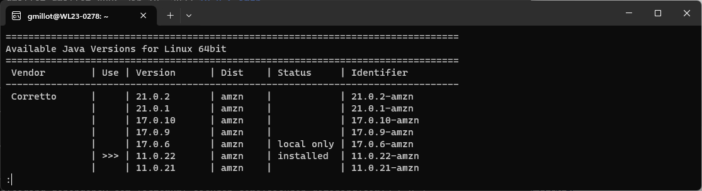

# Java Development Kit (JDK) Distributions

Amazon Corretto.

Azul Platform Core (Zulu)

Oracle Java Downloads.

Microsoft Build of OpenJDK.

SAPMachine.

Azul Platform Prime (Zing)

Oracle uses sdk management.

# Installation

## Linux and WSL2

Tested on Ubuntu 26.04 (WSL2) on 2026-11-21: SDKMAN 5.24.0, Temurin 25.0.5.1 (default java) and Temurin 21.0.13 (used by nextflow 24.10.4).

Java checking:

```
java -version # check that the version is in the range required by the tool (for instance Java 11 to 23 for nextflow 24.10.x, see protocol 152)
sudo update-alternatives --config java # if several versions of java are installed with apt-get, select the right one
```

Java install (sdk management):

```
sudo apt install unzip zip
curl -s "https://get.sdkman.io" | bash # install sdk and the last version of java
# source "$HOME/.sdkman/bin/sdkman-init.sh" # optional
```

Close the Linux session and open a new one.

```
sdk install java # default version (25.0.5.1+2-tem, i.e., Temurin 25, in November 2026)
```

Install another version next to the default one (example: Java 21 for nextflow 24.10.4, see [protocol 152](152-dsl2.md#linux-and-wsl2)):

```
sdk list java # available versions: identifier in the last column, installed ones marked by *, the default one by >
sdk install java 21.0.13.0+9-tem # answer n to "Do you want java 21.0.13.0+9-tem to be set as default? (Y/n)"
ls -la ~/.sdkman/candidates/java # installed versions (current is the default one)
```

Then, either use it in the current terminal only:

```
sdk use java 21.0.13.0+9-tem
```

or give its folder to the tool that needs it, for instance to nextflow (the default java is unchanged for the rest):

```
export NXF_JAVA_HOME="$HOME/.sdkman/candidates/java/21.0.13.0+9-tem" # add this line at the end of the ~/.bashrc file to keep it
```

Java install (classic management):

```
sudo apt-get install openjdk-<version>-jdk
```

## MacOS

Check Java version:

```
java -version # Check that java 8 to 18 is installed
```

Java install:

<https://download.oracle.com/java/17/latest/jdk-17_macos-x64_bin.tar.gz>

Then open the terminal and check the Java version again.

If several versions are installed, it is possible to select the appropriate version like this:

```
VERSION=17 # version to use
/usr/libexec/java_home -V
echo $JAVA_HOME
export JAVA_HOME=$(/usr/libexec/java_home -v $VERSION)
java -version
```

# Java install of an old version

## apt-get

1\) Select the Java Version installed:

```
sudo update-alternatives --config java # if several versions of java are installed, select v17 # display only le active java version all java version are installed with sdk
```

2\) Check Available Versions to install

```
apt list -a "openjdk*"
```

3\) Once you identify the version you want, you can install it using the apt-get command. Replace \<version\> with the desired version number.

```
sudo apt-get install openjdk-<version>-jdk
```

For example, if you want to install Java 8: sudo apt-get install openjdk-8-jdk

4\) Select the Java Version:

```
sudo update-alternatives --config java # if several versions of java are installed, select v17 # display only le active java version all java versions are installed with sdk
```

## sdk

If you haven't installed SDKMAN yet, you can install it using the following command:

```
curl -s "https://get.sdkman.io" | bash
source "$HOME/.sdkman/bin/sdkman-init.sh"
```

Once SDKMAN is installed, you can list available Java versions, and those installed:

```
sdk list java
```



The use column indicates the default version.

The status column indicates the installed (local only + installed) versions.

Install OpenJDK 11:

```
sdk install java 11.0.22-amzn
```

Replace 11.0.12-amzn with the specific version you want to install.

List the path and the version of java installed, and the default one:

```
ls -la /home/gmillot/.sdkman/candidates/java
```

Set OpenJDK 11 as the default version:

```
sdk default java 11.0.22-amzn
```

Verify the Java version:

```
java -version
```

This will install OpenJDK 11 using SDKMAN. The version number may vary depending on the specific version available at the time of installation. Ensure you replace the version numbers in the commands with the desired version you want to install.

## SDK versus apt-get management

This explains why

```
sudo update-alternatives --config java
```

does not return all the installed versions of java, but only those using apt-get and the active java version, even installed by sdk.

If sudo update-alternatives --config java is showing only Java 11 and not Java 17, it means that the Java 17 installation may not have been registered with the alternatives system. To resolve this, you can manually add the Java 17 installation to the alternatives. Assuming OpenJDK 17 is installed in the /usr/lib/jvm/openjdk-17 directory, you can follow these steps:

To handle OpenJDK 17 installed with SDKMAN, you can use the sdk command to set the default Java version. List all available versions managed by SDKMAN:

```
sdk list java
```

Set OpenJDK 17 as the default version:

```
sdk default java 17.0.6-amzn
```
